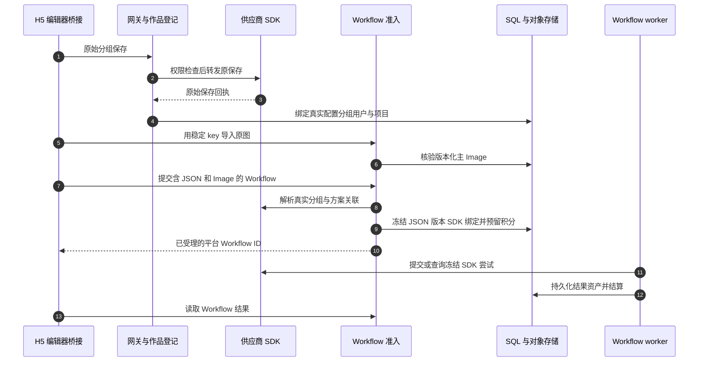

# 户型与共享三维家 SDK

用一个例子贯穿阅读：成员保存供应商作品，提交图片渲染，再从“我的方案”打开结果。这里有三个边界：**打开编辑器免费**，**供应商保存后登记本地归属**，**付费渲染属于平台 Workflow**。[前端入口](/zh/frontend/floor-plans)讲解原生接力，[逐接口指南](/zh/reference/flows/floor-plan-flow)追踪各个 API。

## 发布版也是集成契约

活动 `ThreeVjiaSDKConfiguration` 选择 `ThreeVjiaRelease` 和精确契约摘要。`current_editor_model` 只有在恰好一个配置、发布版为 `AVAILABLE`、摘要一致时才报告可用。`prepare_editor_entry` 验证必需操作，在数据库事务之外探测供应商登录，然后加锁重读配置、Feature 和用户／项目权限。指纹变化就拒绝 URL，避免混用不同发布版。

`account_identity` 选择可续期的账号凭据服务；现有加密 API key 配置仍有受支持分支。供应商凭据保留在平台边界内。短期编辑器别名／cookie 使用含用户、配置、凭据代次的 Redis scope，和接力给 H5 的独立平台 auth pair 是两回事。SDK 配置不再是通用 Provider 目录中的一个模型。历史冻结执行保留其精确发布版，不会悄悄选择最新版。

源码：[current_editor_model](https://github.com/Orientation-CD/YuanZhu-AI/blob/749e82df3a51c441335ba6a4db607a98bacbcf97/app/floor_plans/editor_entry.py#L37) · [prepare_editor_entry](https://github.com/Orientation-CD/YuanZhu-AI/blob/749e82df3a51c441335ba6a4db607a98bacbcf97/app/floor_plans/editor_entry.py#L182) · [AccountCredentials](https://github.com/Orientation-CD/YuanZhu-AI/blob/749e82df3a51c441335ba6a4db607a98bacbcf97/app/three_vjia/account_credentials.py#L95) · [sdk_render_execution](https://github.com/Orientation-CD/YuanZhu-AI/blob/749e82df3a51c441335ba6a4db607a98bacbcf97/app/workflows/workflow_sdk_execution.py#L60)。

## SQL 保存什么，什么仍在远端

| 对象 | 持久证据 |
| --- | --- |
| `FloorPlanWork` | 配置／分组身份、原始用户、空间、项目、管理写入与删除栅栏 |
| 供应商作品 | 实时名称、封面和户型 ID；正常列表读取元数据，不维护本地镜像 |
| `DesignJob`／Workflow run | 用户、当前项目、作品关联、冻结输入／配置、积分预留和执行状态 |
| 输入 `Document` + 主 `Image` | 版本化私有 JSON 请求和核验后的原图，固定到本次执行 |
| 输出 `Image` 资产 | 持久结果身份和元数据，用于普通历史／下载／查看链路 |

不存在需要创建或续期的持久编辑器 Session 资源。`bootstrap_auth` 可创建普通平台认证会话，那是 access／refresh 会话，不是编辑器作品。`group_id` 是与 SDK 配置 ID 配对的不透明文本，不能和 Workflow UUID 互换。

源码：[FloorPlanWork](https://github.com/Orientation-CD/YuanZhu-AI/blob/749e82df3a51c441335ba6a4db607a98bacbcf97/app/persistence/db_models.py#L2223) · [WorkIdentity](https://github.com/Orientation-CD/YuanZhu-AI/blob/749e82df3a51c441335ba6a4db607a98bacbcf97/app/floor_plans/ownership.py#L15) · [finish_group_save](https://github.com/Orientation-CD/YuanZhu-AI/blob/749e82df3a51c441335ba6a4db607a98bacbcf97/app/floor_plans/registration.py#L78)。

## 分开追踪保存与付费渲染

| 步骤 | 源码符号 | 检查点及目的 |
| --- | --- | --- |
| 1–4 | [relay](https://github.com/Orientation-CD/YuanZhu-AI/blob/749e82df3a51c441335ba6a4db607a98bacbcf97/app/floor_plans/gateway.py#L263) · [prepare_group_save](https://github.com/Orientation-CD/YuanZhu-AI/blob/749e82df3a51c441335ba6a4db607a98bacbcf97/app/floor_plans/registration.py#L50) · [finish_group_save](https://github.com/Orientation-CD/YuanZhu-AI/blob/749e82df3a51c441335ba6a4db607a98bacbcf97/app/floor_plans/registration.py#L78) | 观察一次供应商原保存，用确证回执绑定归属。`x-floor-plan-work-registration: unavailable` 表示本地登记失败，不能重放供应商保存 |
| 5–6 | [import_before_asset](https://github.com/Orientation-CD/YuanZhu-AI/blob/749e82df3a51c441335ba6a4db607a98bacbcf97/app/floor_plans/before_assets.py#L88) | 下载前已有清理归属；图片字节和版本经过普通 Asset 完成核验 |
| 7–10 | [admit_workflow_job](https://github.com/Orientation-CD/YuanZhu-AI/blob/749e82df3a51c441335ba6a4db607a98bacbcf97/app/workflows/workflow_admission.py#L3291) · [stage_render_document](https://github.com/Orientation-CD/YuanZhu-AI/blob/749e82df3a51c441335ba6a4db607a98bacbcf97/app/floor_plans/rendering.py#L142) | 版本和作品权限一致；受理 ID 不代表供应商执行成功 |
| 11–12 | [sdk_render_execution](https://github.com/Orientation-CD/YuanZhu-AI/blob/749e82df3a51c441335ba6a4db607a98bacbcf97/app/workflows/workflow_sdk_execution.py#L60) · [ThreeVjiaRenderExecution](https://github.com/Orientation-CD/YuanZhu-AI/blob/749e82df3a51c441335ba6a4db607a98bacbcf97/app/workflows/operations/image/three_vjia_execution.py#L148) | worker 消费冻结的发布版／输入身份，复用现有尝试、产物和结算机制 |
| 13 | [work_workflows](https://github.com/Orientation-CD/YuanZhu-AI/blob/749e82df3a51c441335ba6a4db607a98bacbcf97/app/floor_plans/group_works.py#L634) · [panorama_viewer_url](https://github.com/Orientation-CD/YuanZhu-AI/blob/749e82df3a51c441335ba6a4db607a98bacbcf97/app/floor_plans/panorama.py#L38) | 授权读者取得标准 Workflow 结果或新的只读全景能力 |

## 输入与准入边界

`FloorPlanWorkflowCreate` 包含 `type`、空间、可选项目、名称、`render_mode`，一个 `kind:json, role:render_request` 输入和一个 `kind:asset, role:primary, port:images` 输入。`floor_plan_render` 对应 image，`floor_plan_panorama` 对应 panorama，模式不一致会拒绝。供应商请求 JSON 对通用工作流是不透明内容，但仍检查发布版和关联。旧单 JSON body 只为恢复匹配的既有回执而解析，不能创建新任务。

H5 桥接先导入原图，再用 `Idempotency-Key` 和 `X-Editor-Version` 提交精确冻结 body。准入检查发布版和执行指纹，解析真实供应商分组、检查已登记作品范围，保存私有版本化请求 Document。最后短事务重查项目／作品权限、预留积分并写入作品关联；最终数据库锁不会跨越供应商 HTTP。未被使用的暂存 Document 仍受普通临时清理机制管理。

源码：[FloorPlanWorkflowCreate](https://github.com/Orientation-CD/YuanZhu-AI/blob/749e82df3a51c441335ba6a4db607a98bacbcf97/app/core/models.py#L711) · [dispatchStored](https://github.com/Orientation-CD/YuanZhu-AI/blob/749e82df3a51c441335ba6a4db607a98bacbcf97/app/static/3vjia/h5/bridge.js#L437) · [resolve_render_scheme](https://github.com/Orientation-CD/YuanZhu-AI/blob/749e82df3a51c441335ba6a4db607a98bacbcf97/app/floor_plans/rendering.py#L96)。

## 网关传输不是第二套渲染引擎

网关选择精确发布版／服务来源，保留普通供应商 path／query 字节。所选服务内未知的普通路径仍可转发。它拦截已知付费 render／history 签名，用平台 Feature 元数据生成询价响应，并为分组保存、更新、删除加栅栏。声明的九种 HTTP 方法都进入同一边界；声明存在不代表所有供应商操作都有效。

包围 `ThreeVjiaSDK.forward` 的网关去除或替换敏感头，读取受限回执，不跟随重定向。网关认证缓存缺失是可恢复的认证失败，不能证明此前远程写入失败。已经确认的原保存或删除，不能因本地响应处理失败而重复发送。

源码：[relay](https://github.com/Orientation-CD/YuanZhu-AI/blob/749e82df3a51c441335ba6a4db607a98bacbcf97/app/floor_plans/gateway.py#L263) · [forward](https://github.com/Orientation-CD/YuanZhu-AI/blob/749e82df3a51c441335ba6a4db607a98bacbcf97/app/three_vjia/sdk.py#L276) · [selected_contract](https://github.com/Orientation-CD/YuanZhu-AI/blob/749e82df3a51c441335ba6a4db607a98bacbcf97/app/floor_plans/sdk_binding.py#L24)。

## 移动、删除和全景具有不同语义

移动是一个平台事务：`move_group` 核对预期来源、取得准入锁、验证全部关联执行和两个项目，然后一起移动作品及关联任务。它不向供应商发出移动请求。

删除先持久化声明并等待进行中的管理写入。恢复器对每个持久声明最多派发一次供应商删除，再以元数据读取确认，并委托普通任务／资产清理。120 秒后，已派发但不确定的声明进入 `supplier_unconfirmed`；手动确认只对原声明执行一次读取。确认供应商不存在且关联任务清理完成后，本地归属才变成不含身份的 tombstone。Redis 唤醒失败不会丢失持久声明。

全景查看检查 Workflow 可读范围和 panorama 模式，加载当前精确发布版的完整查看器文件，再次核对读权限后才提交可选 bootstrap auth。查看权限与作者专属编辑权限分离，也不会提交新的渲染。

源码：[move_group](https://github.com/Orientation-CD/YuanZhu-AI/blob/749e82df3a51c441335ba6a4db607a98bacbcf97/app/floor_plans/group_move.py#L73) · [resume_group_deletion](https://github.com/Orientation-CD/YuanZhu-AI/blob/749e82df3a51c441335ba6a4db607a98bacbcf97/app/floor_plans/group_recovery.py#L172) · [finalize_group](https://github.com/Orientation-CD/YuanZhu-AI/blob/749e82df3a51c441335ba6a4db607a98bacbcf97/app/floor_plans/group_recovery.py#L51) · [panorama_viewer_url](https://github.com/Orientation-CD/YuanZhu-AI/blob/749e82df3a51c441335ba6a4db607a98bacbcf97/app/floor_plans/panorama.py#L38)。
