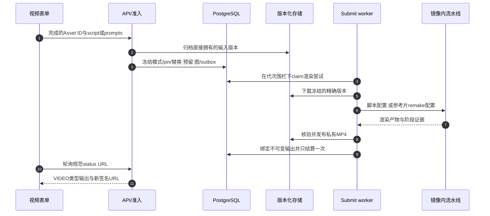

# 视频：脚本生成与同款重制

`video_generation`是同一个Feature，使用本地`render_video` Operation。镜像内的私有jinqiu流水线执行耗时媒体/模型编排，本地执行器不走普通provider-model路由。两种视频模式都复用Job/Workflow、输入归档、钱包和结果发布机制。

## 三种请求路径，一个Operation

| 路径 | 请求主体 | 故事来源 | 附加约束 |
| --- | --- | --- | --- |
| 脚本 | `script`，无`prompts` | 冻结脚本 | 人物合成图恰好1，场景图0..12，录音0..1 |
| 系统同款 | 一个具名`prompts`选择，无`script` | 模板参考视频 | 活跃`purpose=same_style_video`，字段恰好`称呼`，场景图0..1，必选MP3录音>5秒 |
| 自定义同款 | `prompts`名称`__user_reference__`，上传`reference_video`，无`script` | 用户精确版本视频 | 相同字段/录音/场景限制；不查找/渲染模板，不创建script pin |

所有路径都要求恰好一张`character_image`/`primary` Image。上传参考片是已完成的Video Asset，最大100 MiB、120秒，port/role都为`reference_video`，不能重复Asset ID。结构模型最多14项输入，可能先于模式校验拒绝超大清单。UI要求可以比公共schema更窄，详见[联调状态](/zh/reference/integration-status)。

脚本最大20,000字符。当前txt方言使用独立`【场景N】`标题和结构化标签；仍支持的历史markdown方言集中在[兼容边界](/zh/reference/compatibility)。同时传script+prompts或script+reference clip是`VIDEO_SCRIPT_CONFLICT`，两种主体都不传是`VIDEO_SCRIPT_REQUIRED`。

## 模板选择与可选台词替换

小程序选择器读取`GET /v1/prompt-templates?purpose=same_style_video`；省略purpose只列通用模板。同款元数据包含展示名及短期参考片/封面URL，不暴露私有模板正文。播放能力过期应重新获取列表，预览不会创建Job或预留积分。

系统模板恰好定义`称呼`字段，无system/negative prompt，渲染脚本最多15,000字符，每场`【人物】`与称呼一致。称呼不能含空白或`、`、`,`、`，`。渲染文本经过校验并冻结，但重制流水线由参考片驱动，worker不传入另一份竞争脚本。自定义模式校验相同字段，但不写script输入。

可选顶层`replacements:[{"from":"旧台词","to":"新台词"}]`两端去空格后必须非空。`replace_scope`为`all`（默认）或`dialogue`，必须至少有一组替换。后端冻结并透传给镜头规划，不自己替换文本。默认all保持默认规范指纹，dialogue改变语义身份，不能修改替换内容后复用已接受动作key。

## 从接受Job到MP4

先读[`_build_render_request`](https://github.com/Orientation-CD/YuanZhu-AI/blob/e59716c83e087deda8477da5ea7b327a40cf65c5/app/workflows/submissions/workflow_local_video_submission.py#L552)，再读[`build_config`](https://github.com/Orientation-CD/YuanZhu-AI/blob/e59716c83e087deda8477da5ea7b327a40cf65c5/app/conversion/video_jinqiu_adapter.py#L224)。存在参考视频时进入`_remake_config`，script_path保持空；否则`_script_config`读取暂存脚本和映射。输出是核验后的`video/mp4` Asset，不是任意供应商URL。

## 模型、恢复与证据边界

`VIDEO_MODEL_SELECTION_ENABLED`控制是否提供/透传模型选择，关闭时默认`Doubao-Seedance-2.0-mini`。应发现支持模型和价格，不能硬编码供应商积分表。平台Token与真实供应商消费是两回事。

渲染有有界租约、总时长/阶段预算、spool及上传限制，可以运行数小时。API健康不证明供应商容量。失败本地视频渲染为终态，不自动重新生成；人工付费重跑由支持流程决定，过时代次不能覆盖新代次。发布证据记录镜像内私有供应商版本，并区分模拟测试与仍待真实供应商/长时运行验证的边界。[产品全链路](/zh/reference/flows/workflow-products-flow#video-branch)提供错误码和代码导航。

---

源码依据 · backend `e59716c8`: [app/core/models.py](https://github.com/Orientation-CD/YuanZhu-AI/blob/e59716c83e087deda8477da5ea7b327a40cf65c5/app/core/models.py) · [app/workflows/video_template_rules.py](https://github.com/Orientation-CD/YuanZhu-AI/blob/e59716c83e087deda8477da5ea7b327a40cf65c5/app/workflows/video_template_rules.py) · [app/workflows/workflow_admission.py](https://github.com/Orientation-CD/YuanZhu-AI/blob/e59716c83e087deda8477da5ea7b327a40cf65c5/app/workflows/workflow_admission.py) · [app/workflows/submissions/workflow_local_video_submission.py](https://github.com/Orientation-CD/YuanZhu-AI/blob/e59716c83e087deda8477da5ea7b327a40cf65c5/app/workflows/submissions/workflow_local_video_submission.py) · [app/conversion/video_jinqiu_adapter.py](https://github.com/Orientation-CD/YuanZhu-AI/blob/e59716c83e087deda8477da5ea7b327a40cf65c5/app/conversion/video_jinqiu_adapter.py).
