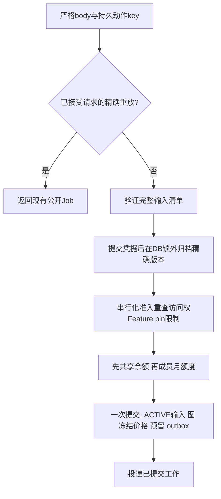

# 统一Workflow与持久化执行

Feature是对外商业能力，映射到可执行Workflow定义。Job是公开任务聚合，WorkflowRun是一份持久化图执行，OperationRun是图节点，Submission是一次具体执行尝试。公开Workflow ID仍是Job ID，不是内部WorkflowRun UUID。

## 公共契约与实际调用者

新集成使用`POST /v1/workflows`、`GET /v1/workflows/{id}`及Workflow历史/动作路由。现有UI wrapper仍会选择部分已实现的兼容适配器，把按钮对应到URL前先看[联调状态](/zh/reference/integration-status)。适配器共用持久化运行时，不是第二套引擎。剩余服务端别名与退休请求集中在[兼容参考](/zh/reference/compatibility)。

先发现活跃Feature价格、结果类型、输入角色和允许模型。个人提交要求当前套餐授予Feature；企业使用独立访问权和共享池规则。个人空grant列表拒绝新工作，已接受Job及精确重放保留原证据。

## 准入不只是入队

READY表示上传并核验；archive COMPLETED表示准备好持久位置；只有最终准入才将自有输入设为无过期ACTIVE并独占绑定Job。后续拒绝可以留下有效的准备输入，不能留下已接受工作或新扣费。[准入深入讲解](/zh/reference/flows/design-job-lifecycle)把各阶段对应到函数与记录。

## 幂等、重试与收费

创建请求同key、同body精确重放返回已接受任务，也适用于响应丢失。语义指纹改变则是`IDEMPOTENCY_KEY_REUSED`，不能悄悄换新key。公开状态为pending→running→completed/failed；内部图/尝试状态携带恢复细节。进度只是估计，不是结算证据。

失败任务重试是`/v1/workflows/{id}/retry`的独立动作，使用自己的持久key并受服务端资格控制。它保留同一Job，推进retry generation，使用冻结价格并重新检查余额/成员容量，不是重新组装创建请求。付费供应商接受状态不明时不能重复调用；由`retry_block_code`及持久化disposition控制恢复。视频超时不意味着可以自动重新付费渲染。

## 读取、移动与删除

`GET /v1/workflows`是创建者历史，`/v1/workspace/workflows`是owner投影。当前企业owner可读他人可见详情，返回`inputs:[]`和实际`submitted_by`，但不授予写权限。每次读取重新检查访问权并签发新结果能力URL。

移动检查预期源Project、同工作区、终态和创建者归属。删除记录持久化清理意图，只在允许时删除精确保留版本。清理故障可留下已接受的删除claim；应按约定重试/协调，不能直接删SQL。详见[历史动作](/zh/reference/flows/workflow-history-flow)。

---

源码依据 · backend `e59716c8`: [app/workflows/api.py](https://github.com/Orientation-CD/YuanZhu-AI/blob/e59716c83e087deda8477da5ea7b327a40cf65c5/app/workflows/api.py) · [app/workflows/workflow_admission.py](https://github.com/Orientation-CD/YuanZhu-AI/blob/e59716c83e087deda8477da5ea7b327a40cf65c5/app/workflows/workflow_admission.py) · [app/workflows/submissions/workflow_submission_retry.py](https://github.com/Orientation-CD/YuanZhu-AI/blob/e59716c83e087deda8477da5ea7b327a40cf65c5/app/workflows/submissions/workflow_submission_retry.py) · [app/billing/member_token_quotas.py](https://github.com/Orientation-CD/YuanZhu-AI/blob/e59716c83e087deda8477da5ea7b327a40cf65c5/app/billing/member_token_quotas.py).
