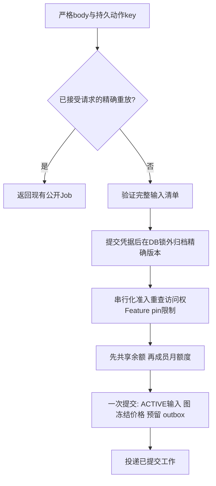
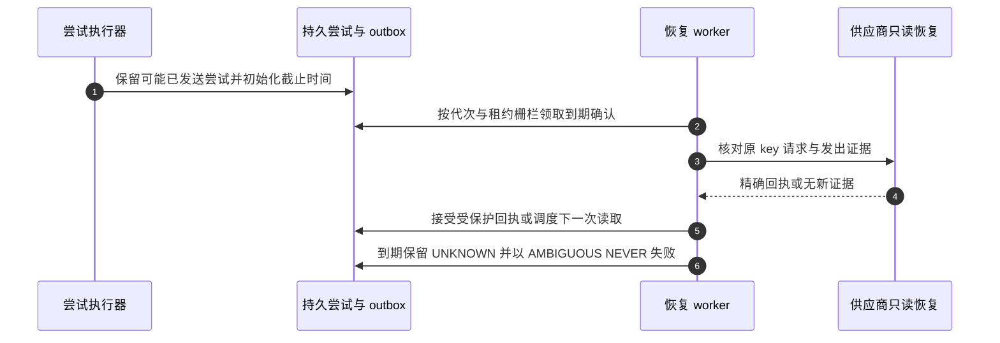

# 统一工作流与持久化执行

Feature是对外商业能力，映射到可执行Workflow定义。Job是公开任务聚合，WorkflowRun是一份持久化图执行，OperationRun是图节点，Submission是一次具体执行尝试。公开Workflow ID仍是Job ID，不是内部WorkflowRun UUID。

## 公共契约与实际调用者

新集成使用`POST /v1/workflows`、`GET /v1/workflows/{id}`及Workflow历史/动作路由。现有UI wrapper仍会选择部分已实现的兼容适配器，把按钮对应到URL前先看[联调状态](/zh/reference/integration-status)。适配器共用持久化运行时，不是第二套引擎。剩余服务端别名与退休请求集中在[兼容参考](/zh/reference/compatibility)。

先发现活跃Feature价格、结果类型、输入角色和允许模型。个人提交要求当前套餐授予Feature；企业使用独立访问权和共享池规则。个人空grant列表拒绝新工作，已接受Job及精确重放保留原证据。

## 准入不只是入队

READY表示上传并核验；archive COMPLETED表示准备好持久位置；只有最终准入才将自有输入设为无过期ACTIVE并独占绑定Job。后续拒绝可以留下有效的准备输入，不能留下已接受工作或新扣费。[准入深入讲解](/zh/reference/flows/design-job-lifecycle)把各阶段对应到函数与记录。

## 幂等、重试与收费

创建请求同key、同body精确重放返回已接受任务，也适用于响应丢失。语义指纹改变则是`IDEMPOTENCY_KEY_REUSED`，不能悄悄换新key。公开状态为pending→running→completed/failed；内部图/尝试状态携带恢复细节。进度只是估计，不是结算证据。

失败任务重试是`/v1/workflows/{id}/retry`的独立动作，使用自己的持久key并受服务端资格控制。它保留同一Job，推进retry generation，使用冻结价格并重新检查余额/成员容量，不是重新组装创建请求。付费供应商接受状态不明时不能重复调用；由`retry_block_code`及持久化disposition控制恢复。视频超时不意味着可以自动重新付费渲染。

## 读取、移动与删除

未传项目的 `GET /v1/workflows` 是原作者历史，带可读项目筛选时可返回该项目中前任作者的任务；`/v1/workspace/workflows` 仍是显式选定空间的 owner 投影。列表隐藏他人输入，获授权按 ID 详情则明确向作者、当前项目负责人或企业 owner 暴露输入 Asset。`submitted_by` 保留原作者，`project_assignee` 与 `permissions` 描述当前责任。能力签名后用新 SQL 再次检查权限。以上读取路径都不授予修改其他作者任务或复用其输入的权限。

新移动／重试／继续编辑要求原始作者与当前负责人身份，并分别检查当前范围／生命周期。移动核对预期来源和终态，关联户型执行会委托整组移动。新删除 claim 要求原作者／当前负责人，已持久化清理继续执行，后续改派不构成取消。保留历史的作者删除不必取得新的成员关系，但前端写前检查可更严格。清理故障保留 `deletion_pending`、空媒体投影和可重试的可见占位，见[历史动作](/zh/reference/flows/workflow-history-flow)。

源码：[readable_design_job](https://github.com/Orientation-CD/YuanZhu-AI/blob/749e82df3a51c441335ba6a4db607a98bacbcf97/app/workflows/read_access.py#L79) · [finalize_workflow_reads](https://github.com/Orientation-CD/YuanZhu-AI/blob/749e82df3a51c441335ba6a4db607a98bacbcf97/app/workflows/read_access.py#L117) · [move_design_job](https://github.com/Orientation-CD/YuanZhu-AI/blob/749e82df3a51c441335ba6a4db607a98bacbcf97/app/workspaces/project_jobs.py#L185) · [delete_terminal_design_job](https://github.com/Orientation-CD/YuanZhu-AI/blob/749e82df3a51c441335ba6a4db607a98bacbcf97/app/workflows/design_job.py#L487)。

## 不重新发付费 POST 的 UNKNOWN 恢复 {#unknown-recovery}

派发后超时不能证明供应商拒绝任务。原尝试保留不变的加密请求信封、供应商尝试 key、代次和受理不确定性。`ensure_unknown_deadline` 只初始化一次持久 `provider_unknown_started_at`／`provider_unknown_deadline_at`：窗口为120秒，重新入队／进程重启不会重置。明确记为 UNKNOWN 时从记录不确定性的时刻起算，失联租约恢复时可从原始发出证据推导时钟。这与已知受理任务的普通结果轮询不同。

| 步骤 | 源码 | 证据与边界 |
| --- | --- | --- |
| 1 | [finish_provider_attempt](https://github.com/Orientation-CD/YuanZhu-AI/blob/749e82df3a51c441335ba6a4db607a98bacbcf97/app/providers/provider_attempt.py#L586) · [ensure_unknown_deadline](https://github.com/Orientation-CD/YuanZhu-AI/blob/749e82df3a51c441335ba6a4db607a98bacbcf97/app/workflows/provider_unknown.py#L11) | UNKNOWN 保留原请求证据，不能通过再领取预留打开新的付费派发 |
| 2 | [reconcile_unknown_provider_handoffs](https://github.com/Orientation-CD/YuanZhu-AI/blob/749e82df3a51c441335ba6a4db607a98bacbcf97/app/workflows/submissions/workflow_submission_dispatch.py#L525) | outbox 使用 recovery_only、协议／代次和恢复 epoch 去重，Redis 唤醒不是新供应商尝试 |
| 3–5 | [recover_unknown_provider_attempt](https://github.com/Orientation-CD/YuanZhu-AI/blob/749e82df3a51c441335ba6a4db607a98bacbcf97/app/providers/provider_attempt.py#L773) · [unknown_query_due](https://github.com/Orientation-CD/YuanZhu-AI/blob/749e82df3a51c441335ba6a4db607a98bacbcf97/app/workflows/provider_unknown.py#L40) | 最多8次确认，每次最多3秒且受剩余时间限制，网络耗时不延长截止时间 |
| 6 | [preserve_unknown_failure](https://github.com/Orientation-CD/YuanZhu-AI/blob/749e82df3a51c441335ba6a4db607a98bacbcf97/app/providers/provider_attempt.py#L324) | 终态失败保留受理 UNKNOWN、failure_class AMBIGUOUS、重试处置 NEVER，不宣称供应商什么都没做 |

只有实现 `AmbiguityRecoverableProvider` 的供应商支持这些确认。恢复解码精确信封，调用 `recover_unknown`，绝不调用 `submit`；证据缺失／无效或供应商不支持时等待到期。后续间隔依次为1、2、4、8、16、30、30秒，裁剪到原截止时间；达到8次后不再发第9次。回执改变状态前再次核对租约、查询次数、信封、请求次数和代次。迟到或旧响应不能恢复已过期／新代次执行，读取错误也不能证明受理或拒绝。

若到期前恢复出可信原回执，既有 finish／收尾逻辑继续同一尝试及其正常结果链路；否则图进入原有不确定终态失败，保留的不确定性继续阻止同 ID 显式重试。运维调查沿同一 Job／submission／attempt 证据进行，更换 URL、key、代次或手工重放供应商 POST 都不是恢复操作。[运行时追踪](/zh/reference/flows/runtime-debugging)说明如何定位这些证据。

---

源码依据 · backend `749e82df`: [app/workflows/api.py](https://github.com/Orientation-CD/YuanZhu-AI/blob/749e82df3a51c441335ba6a4db607a98bacbcf97/app/workflows/api.py) · [app/workflows/workflow_admission.py](https://github.com/Orientation-CD/YuanZhu-AI/blob/749e82df3a51c441335ba6a4db607a98bacbcf97/app/workflows/workflow_admission.py) · [app/workflows/submissions/workflow_submission_retry.py](https://github.com/Orientation-CD/YuanZhu-AI/blob/749e82df3a51c441335ba6a4db607a98bacbcf97/app/workflows/submissions/workflow_submission_retry.py) · [app/billing/member_token_quotas.py](https://github.com/Orientation-CD/YuanZhu-AI/blob/749e82df3a51c441335ba6a4db607a98bacbcf97/app/billing/member_token_quotas.py).
