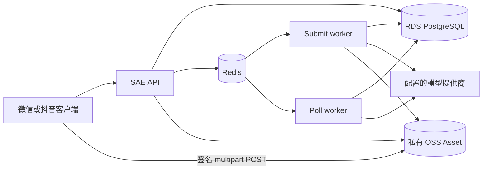

# 云端架构

API、submit worker、poll worker 是三个 SAE 应用，使用同一后端版本和不可变镜像 digest。PostgreSQL 保存权威业务状态；Redis 提供队列、限流、会话与运行协调；OSS 保存绑定对象版本的 Asset 和发布产物。

## 环境边界与工作负载

| 边界/角色 | 用途 |
| --- | --- |
| `yuanzhu-test` | 云测/联调；测试前仍需确认当前模型和支付模式 |
| `yuanzhu-prod` | 生产；变更需要受保护发布证据 |
| `--stage=test` / `--stage=production` | 独立于 namespace 名称的风险分类，不改写 `ENVIRONMENT` |
| `yuanzhu-ai-api` | HTTP API 与 Admin |
| `yuanzhu-ai-submit-worker` | Workflow/Operation 调度、provider 派发、本地转换 |
| `yuanzhu-ai-poll-worker` | provider 轮询、对账、过期和周期任务 |

脚本在目标 namespace 内解析应用 ID。mock provider 是本地测试服务，不是生产发布目标。三个角色的 provider/支付/加密配置与特性启用状态必须一致。

## 镜像身份与拉取通道

从完整已提交 SHA 构建 `linux/amd64` 的 `runtime` 镜像，发布完整 SHA tag，并冻结不可变 digest。构建还会解析私有 `jinqiuai` 提交，需一并记录。

构建、推送、digest 校验使用配置的 Personal ACR 公网 host；SAE 通过同实例、同地域、严格匹配的 VPC host 拉取同仓库/digest。只能使用这对验证过的 host，不能任意替换 registry。已有拉取 Secret 的选择是只读前提，部署不会暗中修复 Secret。ECI 缓存只用于加速。

## 数据库与存储权限

运行凭据只授予应用权限。namespace 的 `yuanzhu-migration-secrets` 仅保存临时迁移 runner 使用的 `MIGRATION_DATABASE_URL`。`configure-migration-db.sh` 通过独立审阅的 apply 流程协调 owner/授权；常规发布只使用已验证契约。

正常 owner 为 `yuanzhu_app`，API/worker 使用分离的运行账户。不要把迁移凭据挂进长期服务，也不要用运行账户临时拼 DDL。

私有下载使用新签发的 OSS URL。直传使用公网 OSS S3 endpoint 和全部 POST 字段；公共分发仅限批准的 public 前缀。CDN 域名不能替代 `S3_PRESIGN_ENDPOINT`，签名绑定请求 host。旧文档把私有 CDN 当作普遍已启用功能；应以目标 namespace 的实际配置为准。

## 配置与兼容边界

云端 Envs、Secret/ConfigMap 引用和运行设置决定部署行为；开发者 `.env` 只是本地工具输入。环境变更使用完整数组读取、合并、漂移校验流程，保留无关配置。

迁移、API、worker 形成同一个兼容边界。当前 schema 包含 Workflow/Operation、类型化 Asset、私有 Project、项目成败与可信活动状态。回滚应用代码不会恢复已删除的旧 provider/output 表。选择回滚镜像前阅读[生产恢复](/zh/deploy/production)。

## 源码依据

已按[本文档记录的源码版本](/zh/reference/source-revisions)核对；实际运行配置与云端启用状态需要单独确认。

- [SAE 架构契约](https://github.com/Orientation-CD/YuanZhu-AI/blob/b13cc5668920620a274cb91a3393ed9fadac72ae/deploy/sae/SAE_DEPLOYMENT_ARCHITECTURE.md)
- [环境与发布手册](https://github.com/Orientation-CD/YuanZhu-AI/blob/b13cc5668920620a274cb91a3393ed9fadac72ae/deploy/sae/SAE_DEPLOYMENT_RUNBOOK.md)
- [不可变镜像部署](https://github.com/Orientation-CD/YuanZhu-AI/blob/b13cc5668920620a274cb91a3393ed9fadac72ae/deploy/sae/deploy-image.sh)
