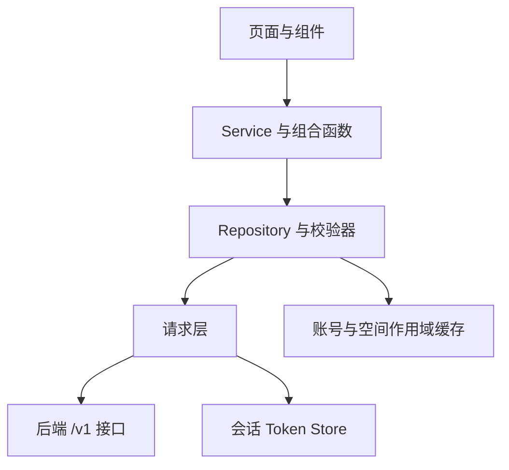

# 前端架构

页面管理呈现和生命周期，Service 编排用户动作，Repository 校验响应并管理作用域缓存，请求层负责传输和刷新会话。生产与测试使用别名选择部分实现，因此 Mock 测试通过不能单独证明 API 产物正确。

## 编译期边界

`vite.config.ts` 选择 `AccountRepositoryRuntime`、`TaskRepositoryRuntime`、平台登录辅助、开发连接提示和订阅场景。`VITE_ENABLE_PRIVATE_PROJECTS` 同时设置 `pages.json` 的 `PRIVATE_PROJECTS` 预处理条件，并选择启用/禁用项目实现。要求发布包剔除能力时，不能仅隐藏按钮。

旧的宽泛账号仓储在 API 模式明确不可用。正式功能使用会话、资料、空间、项目、任务、Workflow、计费和组织等较小仓储。部分仓储在内部判断模式，不能假定每个仓储都有一对独立 Mock/API 文件。

`src/pages.json` 定义页面与分包。主包代码须尊重分包边界；模块放置、启动绑定等问题通过编译产物检查补足源码测试。

## 会话与请求

`src/stores/session.ts` 以 `yuanzhu.session.tokens.v1` 保存凭据。会话 generation 在账号切换时使旧读取与作用域界面失效，不依赖 Pinia。

`src/services/request.ts` 将路径拼接到 `VITE_API_BASE_URL`，添加 `X-Request-ID`，按需附加 Bearer，并将错误统一为 `ApiRequestError`。并发过期请求共享一次刷新，使用轮换凭据重放；其它认证失败按约定清理会话。

基础地址须用 HTTPS，开发时允许回环 HTTP 或明确启用的私有局域网 HTTP。这与平台合法域名校验是不同规则。结果文件和报告还有精确 Origin/有效期检查；API 地址合法不等于任意媒体 URL 都可信。

## 发现与响应校验

`designCatalog.ts` 请求公共 `/v1/billing/features`，发送 `If-None-Match`，缓存 ETag 支持的 `200/304` 响应，并区分标准任务、报告 Workflow 和文案产品。模板元数据需要认证，前端表单控件仍须匹配声明字段。

DTO 描述期望 JSON，仓储 normalizer 在运行时执行验证。列表/详情统一校验输入输出类别、ID、媒体元信息。`*_RESPONSE_INVALID` 等错误阻止畸形响应变成看似有效的 UI 状态。

会话读取缓存合并请求并过期清理。项目选择、方案计数、筛选和成员读取还跟踪账号、空间、项目、会话；切换或失权后，迟到响应不得写入新上下文。

## 提交、恢复与结果

准备阶段校验本地字段、服务端目录、套餐、余额、项目绑定和已上传 Asset。受理结果不确定时，同一逻辑动作保留原 body/key；修改内容则形成新动作。`202` 后任务仍待处理或运行中，本地超时不能证明后端失败。

轮询尊重 `poll_after_seconds`、`Retry-After`，页面隐藏时暂停、退出时释放。结果页再次校验访问权，报告/文件地址过期后重新取得能力。重试使用服务端授权的现有任务；删除、移动、企业只读读取各有写权限门禁。

启动时恢复凭据并安装应用更新提示。新版本准备好后在前台提示，只有明确确认才重启；取消可继续当前版本。

请求族见[工作流](/zh/frontend/workflows)，作用域行为见[项目](/zh/frontend/projects)，契约/产物验证见[测试](/zh/frontend/testing)。

## 源码依据

前端 `eca0a5f`（2026-10-20）：[构建别名](https://github.com/Orientation-CD/wechat_mini_program/blob/eca0a5f9e0a2aa1cb3fd4f9714114bb3db7fae5f/vite.config.ts) · [请求层](https://github.com/Orientation-CD/wechat_mini_program/blob/eca0a5f9e0a2aa1cb3fd4f9714114bb3db7fae5f/src/services/request.ts) · [会话 Store](https://github.com/Orientation-CD/wechat_mini_program/blob/eca0a5f9e0a2aa1cb3fd4f9714114bb3db7fae5f/src/stores/session.ts) · [应用更新](https://github.com/Orientation-CD/wechat_mini_program/blob/eca0a5f9e0a2aa1cb3fd4f9714114bb3db7fae5f/src/services/appUpdate.ts)。
