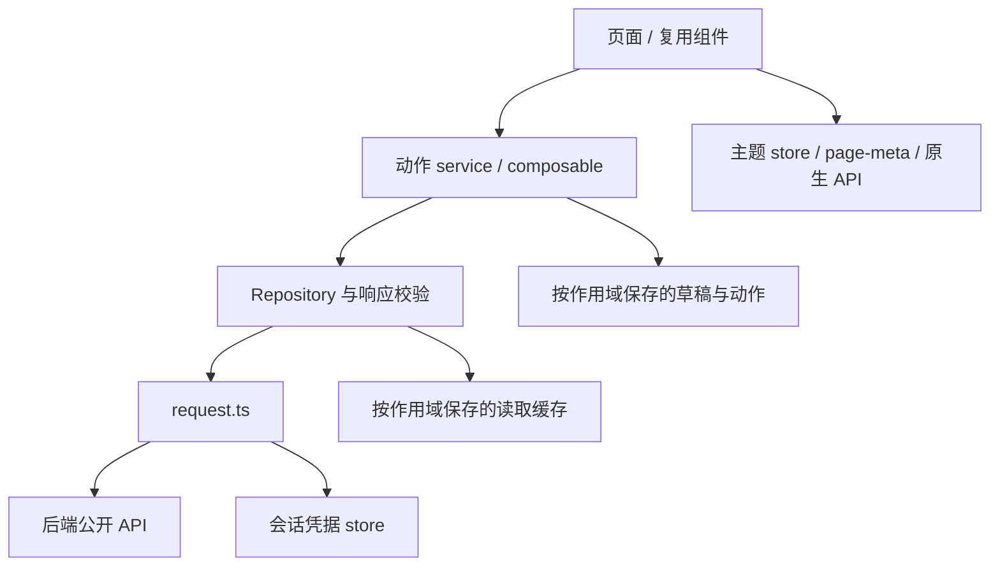
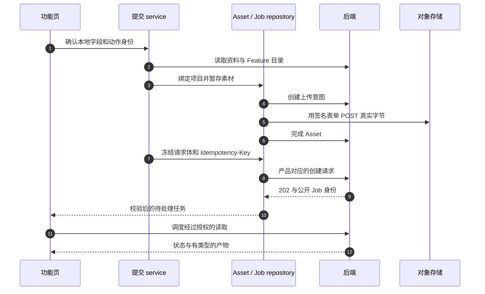

# 前端架构

页面负责可见生命周期，service 编排一次动作，repository 校验服务端契约，请求客户端负责传输。阅读时要把这些层连起来：只有 TypeScript DTO 不能验证远端 JSON，隐藏按钮也不能实施服务端授权。

## 找到构建实际选中的实现

`src/pages.json` 注册主包和分包，`vite.config.ts` 在打包前选择 runtime alias。遇到以 `Runtime` 结尾的 import，应先查 alias，不能默认它就是旁边的 API 文件。

| 边界 | 代表性 runtime alias | 影响 |
| --- | --- | --- |
| 账户/任务数据 | `AccountRepositoryRuntime`、`TaskRepositoryRuntime` | 前端 Mock 与 API 包包含不同实现 |
| 项目绑定 | `DesignProjectBindingServiceRuntime` | 无项目构建排除绑定行为 |
| 首页当前作用域 | `HomeScopeSwitchRuntime` | 关闭项目的产物不带项目 UI |
| 成员结果读取 | `MemberProjectReadRuntime` | 项目启用时才编入成员只读视图 |
| 户型作品移动 | `FloorPlanMoveRuntime` | 关闭项目的构建不能获得项目移动行为 |

`PRIVATE_PROJECTS` 预处理还会改变页面注册和 Tab。[包体门禁](/zh/frontend/testing)检查真实 JS、JSON、模板和样式依赖：主包不能引用功能分包，兄弟分包不能直接互引。为维持此边界而保留一份很小的接力适配器，是有意设计。

## 会话代次与晚到响应

`src/stores/session.ts` 管理凭据对和持续变化的会话代次。一次有作用域的读取，在发请求前记录代次、用户、工作区、项目和页面修订号；响应返回时，只有这些值仍匹配才允许更新页面。

例如：所有者打开成员 A 的项目，随后在概览响应回来前切换工作区。`memberProjectRead` 会让成员关系证明和页面当前操作失效；即使旧请求返回 HTTP200，也应丢弃。相同机制还阻止旧请求的失败清空新账户数据。

`request.ts` 基于 `VITE_API_BASE_URL` 解析路径，添加 `X-Request-ID`，仅对需要认证的请求带上 Bearer，并将传输/API 错误统一为 `ApiRequestError`。并发的过期凭据请求共享刷新操作。凭据刷新与业务提交重放是两层机制：刷新成功并不允许给结果未知的动作换幂等键。

## 追踪上传、提交与轮询

按编号阅读 `standardDesignSubmit.ts` / `videoGenerationSubmit.ts`、`designAssets.ts`、`designJobSubmit.ts`，再读结果页。完成上传得到已验证的 Asset；后端在执行准入前做的耐久输入归档是另一步骤。其事务与队列边界见[准入与 worker](/zh/reference/flows/design-job-lifecycle)。

轮询调度器遵守服务端建议和 `Retry-After`，页面隐藏时暂停，销毁时停止；不能因本地定时器到期就宣布任务失败。结果 URL 是短期能力凭证，查看器应重新获取授权数据，而不是把签名地址保存为永久身份。

## 区分三种持久化

| 状态 | 存放位置与生命周期 | 恢复前核对什么 |
| --- | --- | --- |
| 选中的本地媒体 | `localMediaStore.ts` 与设备文件系统 | 文件仍存在，元数据符合要求 |
| 草稿/结果未知动作 | 按用户、工作区分隔的存储 | 作用域、本地素材、冻结的原请求与键 |
| 已接受任务/Asset | 后端数据库和对象存储 | 服务端权限、持久状态和新的输出能力 |

微信本地用户目录可用时，按内容寻址的媒体仓库预算为50MiB，单文件持久化阈值5MiB，并维护引用计数。抖音和无法取得该目录的运行时使用原生保存回退，不能把共享缓存预算当作两端持久化保证。`persistLocalMedia` 把较小文件按摘要存入 `USER_DATA_PATH/media`，相同内容复用路径；无法取摘要时退回随机名。超过5MiB的文件保留临时路径。超过10分钟且无引用的旧文件可回收，配额错误时先清理再重试一次复制。因此它是缓存，不能保证每份草稿的全部素材永久存在。

`releaseLocalMedia` 先减少引用，再删除自有文件。清理会统计整个本地用户目录，优先删除旧的自有媒体，再考虑其他旧缓存。不要重新引入无条件 `saveFile`，也不要把100MiB上传上限误当作100MiB本地持久化保证。

## 主题初始化也是生命周期

`main.ts` 安装 `themePageMixin`。主题 store 同步恢复状态，页面通过 `usePageTheme` 绑定 `page-meta` 与根节点，每次 `onShow` 重新应用原生 Tab、导航和背景 API。这样保留实例的 Tab 页面不用重建也能同步主题，见[设计系统](/zh/frontend/design-system)。

## 源码依据

核验日期 2026-10-28：[构建别名](https://github.com/Orientation-CD/wechat_mini_program/blob/21db6d824a7b32417bda88e7e31d3f0b91dfa51c/vite.config.ts) · [传输](https://github.com/Orientation-CD/wechat_mini_program/blob/21db6d824a7b32417bda88e7e31d3f0b91dfa51c/src/services/request.ts) · [会话](https://github.com/Orientation-CD/wechat_mini_program/blob/21db6d824a7b32417bda88e7e31d3f0b91dfa51c/src/stores/session.ts) · [提交路由](https://github.com/Orientation-CD/wechat_mini_program/blob/21db6d824a7b32417bda88e7e31d3f0b91dfa51c/src/pkg-features/repositories/designJobSubmit.ts#L182) · [上传](https://github.com/Orientation-CD/wechat_mini_program/blob/21db6d824a7b32417bda88e7e31d3f0b91dfa51c/src/pkg-features/repositories/designAssets.ts#L156) · [本地媒体生命周期](https://github.com/Orientation-CD/wechat_mini_program/blob/21db6d824a7b32417bda88e7e31d3f0b91dfa51c/src/pkg-features/services/localMediaStore.ts#L280) · [成员作用域](https://github.com/Orientation-CD/wechat_mini_program/blob/21db6d824a7b32417bda88e7e31d3f0b91dfa51c/src/services/memberProjectRead.ts#L25)。
