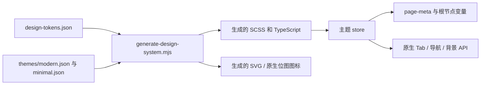

# 设计系统、主题与首页内容

当前界面由生成的语义 token、主题定义和共享组件驱动，首页图片/配置是另一层。更换 CDN 图片不能开通 Feature，只修改主题 JSON 也不能自动改变原生导航栏颜色。

## 源定义 → 生成产物 → 真实页面



| 源码或实现 | 用途 |
| --- | --- |
| `src/styles/design-tokens.json` | 基础、语义与组件 token 基线 |
| `src/styles/themes/*.json` | 主题信息与覆盖值 |
| `scripts/lib/design-themes.mjs` | 解析 token 引用并合成主题 |
| `scripts/generate-design-system.mjs` | 生成 token/样式模块、主题数据和图标 |
| `src/styles/themes.generated.ts` | 生成的运行时主题定义 |
| `src/stores/theme.ts` | 校验已保存选择、响应式颜色与原生应用 |
| `src/composables/usePageTheme.ts` | 每个页面的根节点和 `page-meta` 样式 |
| `src/main.ts` | 安装全局 `themePageMixin` |

修改源定义后，在前端仓库根目录运行：

```bash
pnpm design:generate
pnpm check:design-system
```

源文件与生成产物一起提交。校验器检查生成漂移、语义 token 使用、合成主题对比度、注册页面主题覆盖、按钮布局和项目按压反馈。`uview-plus@3.8.55` 补丁属于冻结安装的一部分，绕开它可能改变原生组件行为。

## 用户实际上能选择什么

`DEFAULT_THEME` 为 `modern`。`minimal` 仍有定义，但 `selectable:false`，且 `SETTINGS_ENTRY_VISIBLE` 为 false。因此不能将当前产品写成已经提供两个可切换主题。

启动时 `savedTheme` 只接受可选的已保存主题 ID，否则使用 modern。`setTheme` 先校验并写入存储，再改变响应式状态；写入失败时返回 false 并提示失败，不能声称选择已持久化。存储键为 `yuanzhu.theme.v1`。

`themePageMixin.onShow` 在首次进入、从分包返回和切换 Tab 时重新应用原生 API。页面还分别绑定 `themeStyle` 与 `themePageStyle`，因为页面背景与组件根节点是不同表面。`applyThemeTabBar` 在关闭项目时跳过项目 Tab，并容忍 Tab 尚未建立时原生 API 不可用。

## 首页图片与业务可用性来自不同权威

首页组合 `HeroCarousel`、`HomeBrandBar`、`HomeShortcutStrip`、`FeatureGroupEntries`、`HomeQuickEntries`、`HomeStores` 和有条件的作用域切换器。可选区块为空或图片加载失败时仍应保持布局。失败轮播图会被移除，回首页会刷新配置，同时尽量保持已经绑定的媒体稳定。

| 数据 | 归属 | 能改变什么 |
| --- | --- | --- |
| 分组树、快捷/常用功能定义 | `featureGroups.ts`、`homeEntries.ts` | 名称、顺序与导航 |
| CDN 对象路径 | `homeAssets.ts`、`designLandingAssets.ts` | 入口使用哪张图片 |
| 版本清单与 `homeHeroBanners` | CDN `config/ad-assets.json`，由 `adAssetVersions.ts` 解析 | 素材版本和有序轮播活动 |
| 功能可用性、权益与价格 | 后端目录/资料及提交校验 | 业务动作是否被允许 |

`refreshAdAssetVersions` 会合并并发刷新。省略 `homeHeroBanners` 会保留上一次有效列表，明确提供有效空数组才会清空。请求失败保留缓存并输出诊断警告。JSON 请求需要将 CDN 注册为 **request 合法域名**，不能只配置图片相关域名。

生产包装脚本使用 `cdn.yuanzhushuzhi.com`，测试包装脚本与 `.env.example` 使用 `static.yuanzhushuzhi.com`。应按所选构建配置区分，而不是把所有环境替换成同一主机。完整配置形状与操作步骤见固定版本的[首页轮播指南](https://github.com/Orientation-CD/wechat_mini_program/blob/21db6d824a7b32417bda88e7e31d3f0b91dfa51c/documents/HOME_BANNERS.md)。

## 共享组件与原生验证

`PageNavBar` 负责返回/回首页，分组面包屑从 `featureGroups` 推导路径；`FeatureShell`、选择/上传/确认步骤和账户外壳复用状态与触控行为。专业设计的可用性见[单独的集成边界](/zh/frontend/floor-plans)。

视觉变化后应检查实际微信/抖音产物。原生按钮行框与浏览器不同，共享 `_button-layout.scss` 负责重置和对齐。核对窄屏、长项目/成员名、安全区、加载/失败/空状态、禁用按钮和所有者只读视图；组件浏览器测试不能证明原生像素效果正确。

Markdown 结果渲染会净化输入 HTML，并给 rich-text 子节点明确样式，不支持的标记保留为文本。不能为了匹配设计稿而替换成不受限的 HTML 注入。

## 源码依据

核验日期 2026-10-28：[主题状态](https://github.com/Orientation-CD/wechat_mini_program/blob/21db6d824a7b32417bda88e7e31d3f0b91dfa51c/src/stores/theme.ts#L4) · [页面主题绑定](https://github.com/Orientation-CD/wechat_mini_program/blob/21db6d824a7b32417bda88e7e31d3f0b91dfa51c/src/composables/usePageTheme.ts) · [生成器](https://github.com/Orientation-CD/wechat_mini_program/blob/21db6d824a7b32417bda88e7e31d3f0b91dfa51c/scripts/generate-design-system.mjs) · [设计门禁](https://github.com/Orientation-CD/wechat_mini_program/blob/21db6d824a7b32417bda88e7e31d3f0b91dfa51c/scripts/check-design-system.mjs) · [首页生命周期](https://github.com/Orientation-CD/wechat_mini_program/blob/21db6d824a7b32417bda88e7e31d3f0b91dfa51c/src/pages/home/index.vue) · [清单解析](https://github.com/Orientation-CD/wechat_mini_program/blob/21db6d824a7b32417bda88e7e31d3f0b91dfa51c/src/services/adAssetVersions.ts#L136) · [Markdown 渲染](https://github.com/Orientation-CD/wechat_mini_program/blob/21db6d824a7b32417bda88e7e31d3f0b91dfa51c/src/pkg-plans/services/markdownSummary.ts)。
