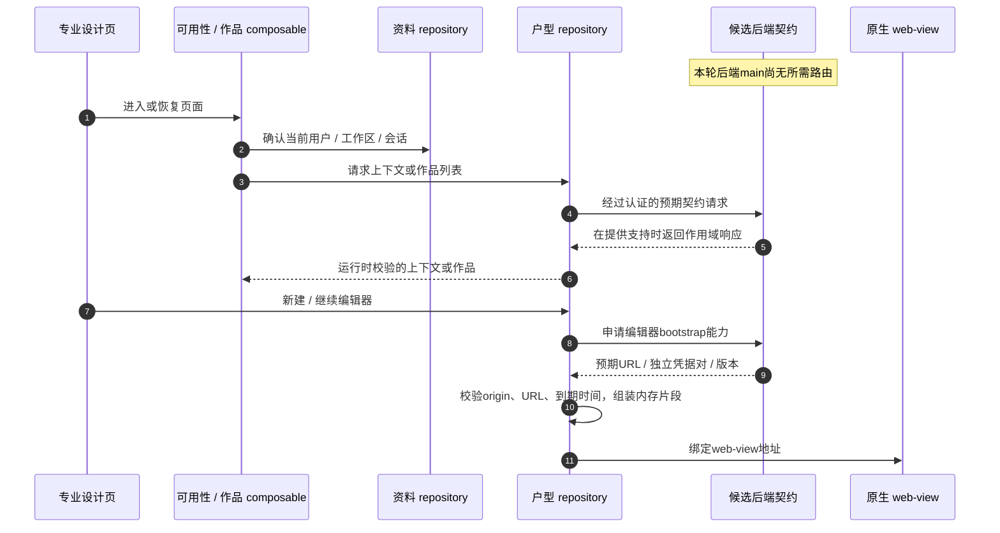

# 专业户型：前端契约与集成边界

**本轮核验的前后端还不能构成这项功能的完整闭环。** 前端 `ui-integration@3662578` 已有专业设计页面、repository 与来源于源码的契约 fixture；后端 `main@e59716c8` 没有户型编辑器/作品/全景对应路由或 Feature 运行时。下表描述前端使用的**候选契约**，不是该后端的公开接口清单，也不能证明某个部署已经启用。

[前端契约说明](https://github.com/Orientation-CD/wechat_mini_program/blob/3662578b384fd5b0fbe7509229b2a08a6fe44ab9/documents/REST_API_INTERFACE.md)明确区分候选源码片段与 live 证据；[本轮后端路由](https://github.com/Orientation-CD/YuanZhu-AI/blob/e59716c83e087deda8477da5ea7b327a40cf65c5/app/api/__init__.py)和 [REST契约](https://github.com/Orientation-CD/YuanZhu-AI/blob/e59716c83e087deda8477da5ea7b327a40cf65c5/documents/REST_API_INTERFACE.md)确定另一侧边界。后端能力合入后，需要同时更新两端版本、追踪真实实现并验证目标环境，再把本文提升为已接通功能指南。

## 区分四种身份

| 名称 | 在前端代码中的含义 |
| --- | --- |
| `colored_floor_plan` | 现有彩平图片生成功能，与专业建模独立 |
| `floor_plan_render` / `floor_plan_panorama` | 前端预期的专业图片/全景 Feature 或结果元数据 |
| 作品 Work / `group_id` | 专业作品分组，不透明字符串，保留原值并 URL编码，不强制转UUID |
| Workflow / Job ID | 关联执行的标准结果身份，不能替代作品 group |

首页 → AI设计 → AI专业设计使用 `useFloorPlanAvailability`。功能入口进入作品/新建编辑器路径，“我的”也可打开作品，但新建卡片行为不同；受支持的方案/项目结果区域还会展示关联结果。

## 阅读已经实现的前端链路

这是明确标出缺失生产方的前端读码地图，不是杜撰数据库/供应商链路。对于本轮后端，请求不能建立该功能的可用性。上下文失败不能被写成“成功读取空作品”，前端任何发布开关都不能修补不存在的路由。

| 编号 | 打开实现 | 核对什么 |
| --- | --- | --- |
| 1–3 | `useFloorPlanAvailability.ts`、`useFloorPlanWorks.ts` | API专用/游客状态、用户/工作区及代次/生命周期守卫 |
| 4–6 | `repositories/floorPlan.ts` | 响应作用域匹配、Feature启用和发布可用性、有界分页/计数 |
| 7–9 | `floorPlanHandoff.ts`、编辑器/全景页 | 独立过期凭据、精确origin、查询参数无凭据、安全绑定 |
| 返回/恢复 | 编辑器页面与作品composable | 已加载编辑器不自动重开，完成结果未知时回作品核对权威状态 |

## 前端消费的候选接口

这些是从固定版本前端源码 fixture 提取的认证操作。没有真实后端实现前，不能加入 backend-main 的接口索引。

| 操作 | 前端预期 |
| --- | --- |
| `GET /v1/floor-plan-editor/context` | 用户/工作区及可选项目/group上下文，Feature/发布可用性，可选图片/全景双能力 |
| `POST /v1/floor-plan-editor/editor-url` | `bootstrap_auth:true`的新建/继续，返回URL、版本和独立凭据对 |
| `POST /v1/floor-plan-editor/panorama-viewer-url` | 按Workflow/工作区获取全景能力 |
| `GET /v1/floor-plan-works` | page/page_size（1–100）、可选项目，返回真实作品作用域的items/total |
| `GET /v1/floor-plan-works/detail` | 按工作区和不透明group取得真实详情 |
| `PATCH /v1/floor-plan-works/{group_id}` | workspace/name重命名，校验返回作品 |
| `POST /v1/floor-plan-works/{group_id}/move` | 预期源项目和目标项目，校验最终作用域 |
| `DELETE /v1/floor-plan-works/{group_id}` | 204完成，或202及group/project/清理phase |
| `GET /v1/floor-plan-works/{group_id}/deletion` | 继续检查已接受删除，包含供应商未知/等待/清理阶段 |
| `GET /v1/floor-plan-works/workflows` | limit1–100/offset有界分页，返回关联标准Workflow及显式has_more |

作品可选 `workflow_count` 表示全部可见关联执行，不是当前页长度；字段缺失时UI不伪造零，也不开启不支持的展开。响应归一化检查计数类型、group/project及嵌入标准Workflow的身份和工作区，不扫描全部历史或扇出详情请求重建服务端缺失计数。

## 可用性、归属与认证

`useFloorPlanAvailability` 在前端Mock返回不可用，无访问凭据时为游客；API上下文同时满足 Feature启用和 release_available 才可用。可选 `features.image`、`features.panorama`、render_modes会校验并取交集，不能从展示卡片推断。

页面捕获用户、工作区、会话代次和操作修订号；隐藏/离开或切换会话使待处理操作失效，晚到能力不能为新用户打开旧编辑器。继续作品使用其真实项目，新建作品保留已明确接受的当前绑定。

`floorPlanHandoff` 要求：

- 精确 `VITE_FLOOR_PLAN_WEB_ORIGIN`，未配置则用API origin；使用HTTPS，除非明确允许本地开发HTTP。
- URL无账号凭据、已有fragment、auth/access/refresh token查询参数。
- 独立非空access/refresh凭据，且到期时间有效并在未来。
- 仅在内存组装 `editor_url#auth=<encoded-auth-pair>`。

不要把完整地址放进路由参数、日志、诊断、持久草稿或截图。功能包和方案包分别保留小型接力适配器，避免兄弟分包互引。平台业务域名白名单仍是额外前提。

## 管理与结果行为

`floorPlanManagement` 负责详情、重命名、移动、删除和删除状态。移动通过 `FloorPlanMoveRuntime` 选择实现，关闭项目能力的包不能获得移动项目行为。删除phase区分清理已接受与204完成；供应商状态未知不允许无条件删除本地记录。

`floorPlanResults.ts` 识别专业图片/全景元数据并保留group身份。全景结果需要新的查看能力，不能把输出图片当成可交互全景URL；普通图片、文案和报告保持各自路由。

## 怎样补齐集成证据

现在可用本文定位前端代码。宣称完整可用前，必须对照新的审计后端确认真实路由/Feature定义、编辑器版本选择、对象/Workflow持久化、权限与清理，再执行自有栈和真机检查：作用域切换、能力过期、继续作品、图片/全景结果与异步删除。只提交源码fixture不能关闭这些验证项。

## 源码依据

核验日期 2026-10-28：[前端契约说明](https://github.com/Orientation-CD/wechat_mini_program/blob/3662578b384fd5b0fbe7509229b2a08a6fe44ab9/documents/REST_API_INTERFACE.md) · [Repository](https://github.com/Orientation-CD/wechat_mini_program/blob/3662578b384fd5b0fbe7509229b2a08a6fe44ab9/src/repositories/floorPlan.ts) · [可用性](https://github.com/Orientation-CD/wechat_mini_program/blob/3662578b384fd5b0fbe7509229b2a08a6fe44ab9/src/pkg-features/composables/useFloorPlanAvailability.ts) · [作品生命周期](https://github.com/Orientation-CD/wechat_mini_program/blob/3662578b384fd5b0fbe7509229b2a08a6fe44ab9/src/composables/useFloorPlanWorks.ts#L31) · [管理](https://github.com/Orientation-CD/wechat_mini_program/blob/3662578b384fd5b0fbe7509229b2a08a6fe44ab9/src/repositories/floorPlanManagement.ts) · [接力](https://github.com/Orientation-CD/wechat_mini_program/blob/3662578b384fd5b0fbe7509229b2a08a6fe44ab9/src/pkg-features/services/floorPlanHandoff.ts#L8) · [编辑器页](https://github.com/Orientation-CD/wechat_mini_program/blob/3662578b384fd5b0fbe7509229b2a08a6fe44ab9/src/pkg-features/pages/floor_plan_editor/index.vue) · [全景页](https://github.com/Orientation-CD/wechat_mini_program/blob/3662578b384fd5b0fbe7509229b2a08a6fe44ab9/src/pkg-plans/pages/panorama/index.vue) · [候选契约fixture](https://github.com/Orientation-CD/wechat_mini_program/blob/3662578b384fd5b0fbe7509229b2a08a6fe44ab9/tests/fixtures/backend-floor-plan-group-6060-4bd4094c.json)。
