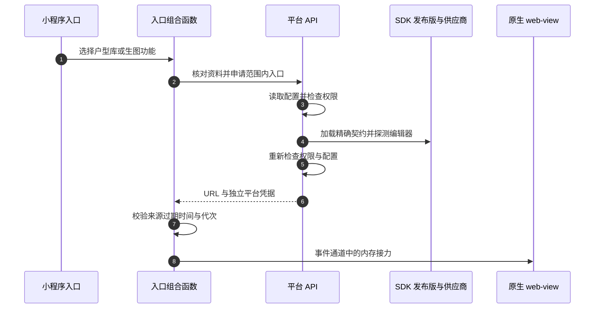

# 户型、专业设计与小程序 H5 入口

本次核验的前后端已经包含户型编辑器、作品、全景查看器，以及三维家生图／发现集成。实际可用还取决于选中的 SDK 发布版、Feature 开关、当前账号和项目权限。源码存在不代表某个部署环境或真机已通过供应商验收。继续阅读[后端模型](/zh/backend/floor-plans)和[逐接口执行链](/zh/reference/flows/floor-plan-flow)。

## 从用户选择开始读

专业设计入口使用 `useFloorPlanAvailability`：前端 Mock 为不可用，没有凭据的账号为游客，API 模式先读当前资料，再读编辑器上下文。必须同时有启用的渲染模式和可用发布版，入口才可用。上下文请求失败显示错误，不能当作作品列表为空。

用户可上传户型或从户型库选择。户型库入口会先准备能力，再跳转原生页面。`useFloorPlanEntry` 捕获账号、空间、项目和会话代次，按需请求隐私同意／定位，取得 URL 后再次核对资料。定位失败允许手选城市。准备结果经导航事件通道发送到目标页；路由只携带 `prepared=1` 等上下文，不携带 bearer fragment。

| 步骤 | 源码阅读入口 | 此时成立的事实 |
| --- | --- | --- |
| 1–2 | [useFloorPlanAvailability](https://github.com/Orientation-CD/wechat_mini_program/blob/88c75c1f15cd65f45c7fb09d560df80430ddc198/src/pkg-features/composables/useFloorPlanAvailability.ts#L13) · [useFloorPlanEntry](https://github.com/Orientation-CD/wechat_mini_program/blob/88c75c1f15cd65f45c7fb09d560df80430ddc198/src/composables/useFloorPlanEntry.ts#L24) | 操作仍属于捕获的账号；定位只是可选上下文 |
| 3–6 | [refresh_editor_url](https://github.com/Orientation-CD/YuanZhu-AI/blob/749e82df3a51c441335ba6a4db607a98bacbcf97/app/floor_plans/api.py#L156) · [prepare_editor_entry](https://github.com/Orientation-CD/YuanZhu-AI/blob/749e82df3a51c441335ba6a4db607a98bacbcf97/app/floor_plans/editor_entry.py#L182) | 供应商探测通过，最终平台权限和配置仍一致 |
| 7–8 | [floorPlanHandoff](https://github.com/Orientation-CD/wechat_mini_program/blob/88c75c1f15cd65f45c7fb09d560df80430ddc198/src/services/floorPlanHandoff.ts#L8) | 可以把可信且未过期的地址绑定到当前 web-view；尚未提交付费渲染 |

## 四种标识符分别由谁拥有

| 标识符 | 所属方与用途 |
| --- | --- |
| `group_id` | 供应商作品分组；作为不透明文本保留，放入 URL 时编码 |
| `layout_scheme_id`／供应商方案 ID | 供应商户型和渲染关联；由后端根据已登记作品解析 |
| Workflow ID | 平台执行记录，拥有独立输入、积分预留、状态和落库输出资产 |
| SDK 配置 ID + 发布版 ID／摘要 | 本次集成身份及精确协议／静态资源版本 |

`colored_floor_plan` 仍是普通图片 Feature。`floor_plan_render` 与 `floor_plan_panorama` 是共享 Workflow 的两个专业 Feature。七个三维家普通生图 Feature 使用另一条 Workflow，见[生图与发现接力](/zh/reference/flows/three-vjia-image-flow)。旧前端 schema 夹具是历史／候选证据，不能充当另一份权威 API 规范；新集成以实际后端接口索引为准。

## 读取作品时不要推断写权限

`floorPlanRepository.works` 校验分页、条目标识、权限／指派字段及可选 `workflow_count`，不会扫描所有任务历史来补造缺失计数。`useFloorPlanWorks` 只有在服务端计数为正且作品状态允许时才展开关联执行；关联接口另有受限 limit、offset 和 `has_more`。

后端保存本地归属和项目关联，标题、封面、户型元数据实时读取供应商。它应用项目／Workflow 可读规则，并在外部读取结束后再次校验。企业所有者或受指派人可读作品，并不自动获得作者专属的编辑器、重命名、删除权限。页面应尊重返回权限与只读结果路由。项目改派改变当前访问权限，不改写原始提交者身份。

源码：[floorPlanRepository](https://github.com/Orientation-CD/wechat_mini_program/blob/88c75c1f15cd65f45c7fb09d560df80430ddc198/src/repositories/floorPlan.ts#L78) · [useFloorPlanWorks](https://github.com/Orientation-CD/wechat_mini_program/blob/88c75c1f15cd65f45c7fb09d560df80430ddc198/src/composables/useFloorPlanWorks.ts#L35) · [finalize_work_views](https://github.com/Orientation-CD/YuanZhu-AI/blob/749e82df3a51c441335ba6a4db607a98bacbcf97/app/floor_plans/group_works.py#L401)。

## 可信接力与返回行为

`floorPlanHandoff` 要求来源精确等于配置的 web origin（或 API origin）、使用 HTTPS（明确允许的本地开发 HTTP 除外）、URL 不含用户名密码、已有 fragment 或凭据查询参数，并要求独立 access／refresh 凭据非空且都未过期。它仅在内存中构造 `editor_url#auth=<encoded-pair>`。不要把完整地址写入草稿、路由参数、诊断或日志。小程序业务域名配置仍是独立的部署前提。

账号、空间或会话变化后到达的旧回调被丢弃。成功导航导致原生 hide 时保留唯一预期接力；卸载和会话变化会使其他尝试失效。恢复已加载编辑器与重新申请能力不是同一动作。全景必须按 Workflow／空间取得新的查看器 URL，输出图片地址不能代替交互全景能力。

## 管理、结果不确定与恢复

`floorPlanManagement` 提供详情、重命名、移动、删除和删除状态。构建选择的 `FloorPlanMoveRuntime` 防止未启用项目的构建引入移动逻辑。移动发送预期来源项目，旧选择不能把已换项目的作品静默移动。

删除只有收到 204 才完成。202 仍保留删除中的条目和阶段；`supplier_unknown` 表示原删除可能已发出，`supplier_unconfirmed` 表示到达截止时间后停止自动轮询。手动确认沿用原声明并执行读取，不再发送一条供应商删除。超时不能成为本地移除条目或重放远程写入的依据，见[删除链路](/zh/reference/flows/floor-plan-flow#delete-work)。

源码：[floorPlanManagement](https://github.com/Orientation-CD/wechat_mini_program/blob/88c75c1f15cd65f45c7fb09d560df80430ddc198/src/repositories/floorPlanManagement.ts#L34) · [moveFloorPlanWork](https://github.com/Orientation-CD/wechat_mini_program/blob/88c75c1f15cd65f45c7fb09d560df80430ddc198/src/repositories/floorPlanMove.ts#L3) · [deletion_view](https://github.com/Orientation-CD/YuanZhu-AI/blob/749e82df3a51c441335ba6a4db607a98bacbcf97/app/floor_plans/group_works.py#L760)。

## 在真实环境中验证

使用 API 模式构建，并确认环境已有可用发布版和启用的 Feature。分别验证户型库和上传入口、准备中切换会话／空间、原始保存登记、图片／全景成功落库、企业只读访问、预期来源移动，以及受理后的异步删除。源码审计和文档浏览器检查不能代替这些真机／供应商验证。
