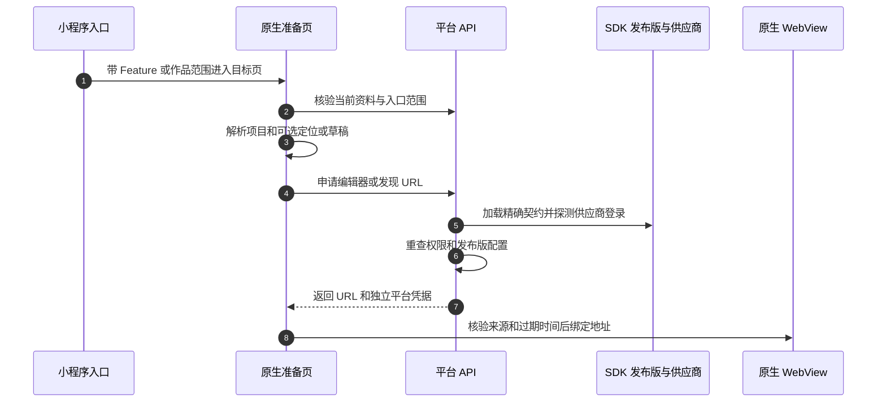

# 户型、专业设计与小程序 H5 入口

本次核验的前后端已经包含户型编辑器、作品、全景查看器，以及三维家生图／发现集成。实际可用还取决于选中的 SDK 发布版、Feature 开关、当前账号和项目权限。源码存在不代表某个部署环境或真机已通过供应商验收。继续阅读[后端模型](/zh/backend/floor-plans)和[逐接口执行链](/zh/reference/flows/floor-plan-flow)。

## 在目标页准备编辑器

专业设计目录在 API 模式检查 Feature 和发布版可用性。户型卡片在检查期间已显示包内背景图片，点击仍受可用状态约束。最近常用的专业功能和发现快捷入口直接导航到原生 `floor_plan_editor` 页。`useFloorPlanEntry` 负责导航，目标页核验用户和项目，按需准备定位、草稿和编辑器地址。游客也进入同一准备页并在那里登录。源码见 [专业设计目录卡片](https://github.com/Orientation-CD/wechat_mini_program/blob/7f1a3169338c10bd4139c24318f7a35caf86310c/src/pkg-features/components/DesignProLanding.vue) 和 [useFloorPlanEntry](https://github.com/Orientation-CD/wechat_mini_program/blob/7f1a3169338c10bd4139c24318f7a35caf86310c/src/composables/useFloorPlanEntry.ts#L11)。

准备和定位期间均显示橙色三点和“正在加载…”。原生标题在准备时清空，WebView 加载后显示目标标题。通过户型快捷入口进入时，目标页先核对功能可用性，再询问“AI找我家”或“上传户型图”。关闭选项会返回上一页，不会申请定位或计入使用次数。快捷入口在准备好 WebView 地址后计数。源码见 [原生准备](https://github.com/Orientation-CD/wechat_mini_program/blob/7f1a3169338c10bd4139c24318f7a35caf86310c/src/pkg-features/pages/floor_plan_editor/index.vue#L92) 和 [markLoaded](https://github.com/Orientation-CD/wechat_mini_program/blob/7f1a3169338c10bd4139c24318f7a35caf86310c/src/pkg-features/pages/floor_plan_editor/index.vue#L161)。

| 步骤 | 源码阅读入口 | 此时成立的事实 |
| --- | --- | --- |
| 1–3 | [useFloorPlanEntry](https://github.com/Orientation-CD/wechat_mini_program/blob/7f1a3169338c10bd4139c24318f7a35caf86310c/src/composables/useFloorPlanEntry.ts#L11) · [原生准备](https://github.com/Orientation-CD/wechat_mini_program/blob/7f1a3169338c10bd4139c24318f7a35caf86310c/src/pkg-features/pages/floor_plan_editor/index.vue#L92) | 目标页已核验路由和准备范围。恢复生图草稿会沿用保存的项目和来源。 |
| 4–7 | [refresh_editor_url](https://github.com/Orientation-CD/YuanZhu-AI/blob/f34b8a4d6307c83c6f7bbc905485a4f586d59a99/app/floor_plans/api.py#L156) · [prepare_editor_entry](https://github.com/Orientation-CD/YuanZhu-AI/blob/f34b8a4d6307c83c6f7bbc905485a4f586d59a99/app/floor_plans/editor_entry.py#L182) | 供应商探测通过，最终平台权限与配置仍一致。 |
| 8 | [floorPlanHandoff](https://github.com/Orientation-CD/wechat_mini_program/blob/7f1a3169338c10bd4139c24318f7a35caf86310c/src/pkg-features/services/floorPlanHandoff.ts#L8) · [markLoaded](https://github.com/Orientation-CD/wechat_mini_program/blob/7f1a3169338c10bd4139c24318f7a35caf86310c/src/pkg-features/pages/floor_plan_editor/index.vue#L161) | 页面绑定可信且未过期的地址。付费提交需后续用户操作。 |

仅新开的“AI找我家”、设计灵感和同城店铺会尝试原生定位。授权页说明坐标经平台发送给三维家以匹配城市，也允许直接手动选城。定位拒绝或失败后仍可在 H5 手选。上传户型、普通生图和全国店铺跳过设备定位。由灵感案例进入生图时可以携带经过校验的公开城市信息。源码见 [discoveryUsesLocation](https://github.com/Orientation-CD/wechat_mini_program/blob/7f1a3169338c10bd4139c24318f7a35caf86310c/src/services/floorPlanPage.ts#L6) 和 [微信定位用途](https://github.com/Orientation-CD/wechat_mini_program/blob/7f1a3169338c10bd4139c24318f7a35caf86310c/src/manifest.json)。

## 四种标识符分别由谁拥有

| 标识符 | 所属方与用途 |
| --- | --- |
| `group_id` | 供应商作品分组；作为不透明文本保留，放入 URL 时编码 |
| `layout_scheme_id`／供应商方案 ID | 供应商户型和渲染关联；由后端根据已登记作品解析 |
| Workflow ID | 平台执行记录，拥有独立输入、积分预留、状态和落库输出资产 |
| SDK 配置 ID + 发布版 ID／摘要 | 本次集成身份及精确协议／静态资源版本 |

`colored_floor_plan` 仍是普通图片 Feature。`floor_plan_render` 与 `floor_plan_panorama` 是共享 Workflow 的两个专业 Feature。七个三维家普通生图 Feature 使用另一条 Workflow，见[生图与发现接力](/zh/reference/flows/three-vjia-image-flow)。旧前端 schema 夹具是历史／候选证据，不能充当另一份权威 API 规范；新集成以实际后端接口索引为准。

## 读取作品时不要推断写权限

`floorPlanRepository.works` 校验分页、条目标识、权限／指派字段及可选 `workflow_count`，不会扫描所有任务历史来补造缺失计数。`useFloorPlanWorks` 只有在服务端计数为正且作品状态允许时才展开关联执行；关联接口另有受限 limit、offset 和 `has_more`。

后端保存本地归属和项目关联，标题、封面、户型元数据实时读取供应商。它应用项目／Workflow 可读规则，并在外部读取结束后再次校验。企业所有者或受指派人可读作品，并不自动获得作者专属的编辑器、重命名、删除权限。页面应尊重返回权限与只读结果路由。项目改派改变当前访问权限，不改写原始提交者身份。

源码：[floorPlanRepository](https://github.com/Orientation-CD/wechat_mini_program/blob/7f1a3169338c10bd4139c24318f7a35caf86310c/src/repositories/floorPlan.ts#L78) · [useFloorPlanWorks](https://github.com/Orientation-CD/wechat_mini_program/blob/7f1a3169338c10bd4139c24318f7a35caf86310c/src/composables/useFloorPlanWorks.ts#L35) · [finalize_work_views](https://github.com/Orientation-CD/YuanZhu-AI/blob/f34b8a4d6307c83c6f7bbc905485a4f586d59a99/app/floor_plans/group_works.py#L401)。

## 可信接力与返回行为

`floorPlanHandoff` 要求来源精确等于配置的 web origin（或 API origin）、使用 HTTPS（明确允许的本地开发 HTTP 除外）、URL 不含用户名密码、已有 fragment 或凭据查询参数，并要求独立 access／refresh 凭据非空且都未过期。它仅在内存中构造 `editor_url#auth=<encoded-pair>`。不要把完整地址写入草稿、路由参数、诊断或日志。小程序业务域名配置仍是独立的部署前提。

准备页隐藏或卸载会使尚未完成的定位和入口请求失效。会话代次变化会清空已绑定地址。`prepared=1` 保留给旧页面发出的事件通道接力，新入口由目标页准备。全景仍在独立结果页按 Workflow／空间取得查看器 URL。七项生图从草稿箱恢复，户型作品从“方案 → 编辑中”恢复。参见[生图草稿](/zh/reference/flows/three-vjia-image-flow#image-draft)。

## 管理、结果不确定与恢复

`floorPlanManagement` 提供详情、重命名、移动、删除和删除状态。构建选择的 `FloorPlanMoveRuntime` 防止未启用项目的构建引入移动逻辑。移动发送预期来源项目，旧选择不能把已换项目的作品静默移动。

删除只有收到 204 才完成。202 仍保留删除中的条目和阶段；`supplier_unknown` 表示原删除可能已发出，`supplier_unconfirmed` 表示到达截止时间后停止自动轮询。手动确认沿用原声明并执行读取，不再发送一条供应商删除。超时不能成为本地移除条目或重放远程写入的依据，见[删除链路](/zh/reference/flows/floor-plan-flow#delete-work)。

源码：[floorPlanManagement](https://github.com/Orientation-CD/wechat_mini_program/blob/7f1a3169338c10bd4139c24318f7a35caf86310c/src/repositories/floorPlanManagement.ts#L34) · [moveFloorPlanWork](https://github.com/Orientation-CD/wechat_mini_program/blob/7f1a3169338c10bd4139c24318f7a35caf86310c/src/repositories/floorPlanMove.ts#L3) · [deletion_view](https://github.com/Orientation-CD/YuanZhu-AI/blob/f34b8a4d6307c83c6f7bbc905485a4f586d59a99/app/floor_plans/group_works.py#L760)。

## 在真实环境中验证

使用 API 模式构建，并确认环境已有可用发布版和启用的 Feature。分别验证户型库和上传入口、准备中切换会话／空间、原始保存登记、图片／全景成功落库、企业只读访问、预期来源移动，以及受理后的异步删除。源码审计和文档浏览器检查不能代替这些真机／供应商验证。
