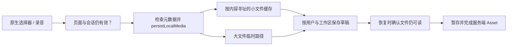

# 沿用户操作追踪前端

选一次能在界面认出的动作，再依次追页面、动作 service、repository 和传输。把用户/工作区/项目作用域、动作幂等键与返回的任务 ID 放在一起。[全链路参考](/zh/reference/system-walkthrough)会继续追到后端事务、队列、worker 和产物。

## 首页 → 功能 → 最终确认

| 步骤 | 打开的源码 | 发生什么或检查什么 |
| --- | --- | --- |
| 打开首页 | `pages/home/index.vue` | 分别加载内容、Feature 可用性和 CDN 图片 |
| 进入 AI设计/AI创作 | `services/featureGroups.ts` | 推导分组与面包屑；设计现在分为轻盈/专业 |
| 选择业务动作 | `services/useFeatureLauncher.ts` | 可用性、登录/权益说明和入口守卫 |
| 检查活跃任务 | `services/homeEntryGuard.ts` | 客户端五个活跃任务限制，不能代替服务端限制 |
| 确认本地表单 | 功能页面与 `*Submit.ts` | 重查作用域、字段、服务端配置和素材 |
| 提交 | `designJobSubmit.ts` 或 `workflowSubmission.ts` | 原请求体/幂等键与对应产品路由 |

成功目录缺少某产品，才表示不可用；网络错误表示发现失败，应保留重试，不能变成“成功获取空目录”。分组卡片可以是编辑定义的导航，不代表任何 Feature 权益。

专业设计有自己的页面级可用性加载器，并存在[后端版本尚未对齐的边界](/zh/frontend/floor-plans)，不能通过硬编码启用卡片绕过。

## 注册属于具体动作

可用的图片表单允许游客先做本地选择，在最终提交时请求注册；其他 API 专用流程可能更早需要身份。`accountGate` 协调平台注册、当前法律文档、手机号授权，以及离开页面/动作时的取消。

请求客户端与会话 store 管理凭据，动作仍需确认原作用域。注册或切换工作区使冻结上下文过时时，应让用户重新确认，不能悄悄绑定到另一个账户/项目。

## 一次室内效果图：辨认五个边界

1. 页面保存选择和本地图片；`standardDesignSubmit.ts` 解析提示词、资料、目录与项目绑定。
2. `stageDesignImages` 检查角色和本地元数据；`stageOne` 创建上传意图，用返回的签名表单上传真实字节，再完成 Asset。已 READY 的重放可以直接复用 Asset。
3. `submitDesignJob` 校验准备好的 body，重新检查写权限，用相同 `Idempotency-Key` 提交。当前图片 UI 实际调用 `POST /v1/design-jobs`，后端再适配进统一运行时。
4. `202` 建立公开 Job 身份，不表示图片已完成。后端输入归档、积分预留与耐久提交见[准入链路](/zh/reference/flows/design-job-lifecycle)。
5. 结果页轮询权威状态，校验有类型输出，再取得经过授权的 URL。预览 URL 不是 Asset ID，预览过期也不证明持久化结果已丢失。

用家居试搭再做一次练习：找到原图、蒙版、参考图角色，再比较其提交 service 与标准设计。共享传输不变，局部素材契约不同。

## 录音、视频与本地文件生命周期

录音总结接受最多三份 MP3/WAV/AAC/M4A，校验文件签名和元数据，单文件限制25,000,000字节、120分钟；原生每次录制还有自己的较短限制。总结结果渲染净化后的 Markdown，按 Asset 切换原录音，离页时暂停/释放音频资源。

视频现在有剧本、系统同款、自传参考视频同款三条路径。[工作流](/zh/frontend/workflows)解释各分支不同的必填素材、模板字段和替换指令。从完成的短视频脚本导入文本，只填充视频草稿，不会自动提交或收费。

本地素材恢复链路如下：

缓存的50MiB预算、5MiB持久化阈值和10分钟回收年龄，与上传 API 上限是不同规则。恢复草稿必须重新验证每个本地文件，不能只相信保存的路径。页面/会话变化后才返回的选择结果应释放，不能存进新草稿。详见[架构](/zh/frontend/architecture)。

## 方案 → 结果 → 重试、删除或移动

方案/结果路由区分图片、Markdown/音频、视频、报告和专业户型元数据。工作区/项目筛选及计数带作用域，账户切换会让待处理操作失效。

受支持的重试使用服务端已有任务和返回的资格；本地超时不能把任务改成失败。删除/移动需要最新写权限，并使相关计数失效。当前成员的只读视图保留结果读取/轮询，但不提供重试、删除、移动、复制输入或新提交，见[项目](/zh/frontend/projects)。

## 购买 → 原生桥 → 服务端证据

商店/套餐页从后端获取价格和允许的 Feature。创建订单带幂等；微信调用 JSAPI 支付，抖音调用行业 SDK。原生成功、取消或未知结果，都要再与服务端订单证据对账。支付记录是恢复入口；前端分组和演示权益开关不能创建真实购买。

当前有效套餐展示手动续费说明，不承诺自动扣费或提前续费。本地微信 mock 结算见[快速开始](/zh/get-started/quickstart)，选择 mock 配置不会自动替换原生支付调用。

## 源码依据

核验日期 2026-10-28：[首页](https://github.com/Orientation-CD/wechat_mini_program/blob/21db6d824a7b32417bda88e7e31d3f0b91dfa51c/src/pages/home/index.vue) · [入口守卫](https://github.com/Orientation-CD/wechat_mini_program/blob/21db6d824a7b32417bda88e7e31d3f0b91dfa51c/src/services/homeEntryGuard.ts#L9) · [图片提交](https://github.com/Orientation-CD/wechat_mini_program/blob/21db6d824a7b32417bda88e7e31d3f0b91dfa51c/src/pkg-features/services/standardDesignSubmit.ts) · [Asset 暂存](https://github.com/Orientation-CD/wechat_mini_program/blob/21db6d824a7b32417bda88e7e31d3f0b91dfa51c/src/pkg-features/repositories/designAssets.ts#L156) · [提交](https://github.com/Orientation-CD/wechat_mini_program/blob/21db6d824a7b32417bda88e7e31d3f0b91dfa51c/src/pkg-features/repositories/designJobSubmit.ts#L204) · [媒体缓存](https://github.com/Orientation-CD/wechat_mini_program/blob/21db6d824a7b32417bda88e7e31d3f0b91dfa51c/src/pkg-features/services/localMediaStore.ts) · [音频验证](https://github.com/Orientation-CD/wechat_mini_program/blob/21db6d824a7b32417bda88e7e31d3f0b91dfa51c/src/pkg-features/services/voiceAudioFiles.ts) · [支付桥](https://github.com/Orientation-CD/wechat_mini_program/blob/21db6d824a7b32417bda88e7e31d3f0b91dfa51c/src/pkg-account/services/payment.ts)。
