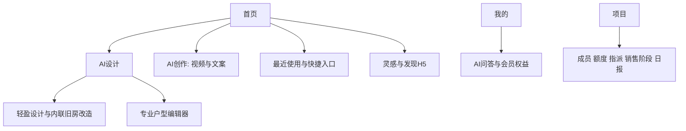

# 前端概览

uni-app 应用使用 Vue 3 和 TypeScript 构建微信与抖音小程序。应用使用 **Node 22、pnpm 9.15.9**；文档仓库有独立的 pnpm 版本。会话／主题由 Vue 模块维护，应用不依赖 Pinia 或 uView。

## 从实际操作开始

`featureGroups.ts` 定义设计／创作成员树与面包屑。语音总结、报告属于快捷／最近入口，不在轻盈设计成员树内。`useFeatureLauncher` 检查发现与权益，卡片可见不等于有执行权限。最近使用保留有界的本地 30 天记录，按次数、最近时间排序，最多展示三项；它不是服务端项目活动。

专业设计现在已有对应后端实现。从[户型客户端](/zh/frontend/floor-plans)继续追到 H5 网关与 SDK 执行。彩平图图片 Feature 是独立的普通图片动作。灵感／创建设计 H5 使用具有空间范围的服务端准备 URL，不是打开任意供应商网页。

## 代码地图

| 源码区域 | 先问什么 |
| --- | --- |
| `src/pages` | 哪个首页、方案、项目或账号事件触发导航？ |
| `src/pkg-features` | 图片／语音／视频怎样准备输入并冻结动作 body？ |
| `src/pkg-features/pages/floor_plan_editor`、`floor_plan_works` | 打开哪个原始 H5／编辑器接力或原生作品页面？ |
| `src/pkg-plans` | 图片、音频／Markdown、视频、报告、全景结果怎样刷新？ |
| `src/pkg-projects` | 当前负责人是谁，哪些成员、额度、阶段或日报操作被允许？ |
| `src/pkg-account` | 执行哪项认证、成员、邀请、订单或协议动作？ |
| `src/repositories`、`src/api/dto` | 请求哪个接口，运行时接受什么响应形状？ |
| `src/services`、`src/stores` | 哪些会话、范围、结果不确定动作或删除保护需要跨页面保留？ |

源码目录不等于产物分包：`vite.config.ts` 生成虚拟户型／专业设计组件和服务源文件，微信构建则将其页面合入功能分包，保留包体余量。查看目标产物与[包体门禁](/zh/frontend/testing)，不能假设每个产物分包都有同名源码目录。`VITE_ENABLE_PRIVATE_PROJECTS` 在构建时选择项目实现；开发 wrapper 各有显式赋值。

## 跟读一笔完整任务

室内图片从表单进入 `standardDesignSubmit.ts`、角色化上传和 `submitDesignJob`。当前 wrapper 请求 `POST /v1/design-jobs`，后端适配到统一运行时。轮询和结果读取始终保留动作 key／body、空间／项目与已接受 Job ID。新集成使用规范 [Workflows](/zh/backend/workflows)。

企业只读详情可以返回经过授权的输入，同时拒绝写操作。以响应权限与当前指派为准。删除中结果是清空媒体的占位，晚到响应不能恢复旧预览，见[历史操作](/zh/reference/flows/workflow-history-flow)与[项目](/zh/frontend/projects)。

源码: [src/services/featureGroups.ts](https://github.com/Orientation-CD/wechat_mini_program/blob/7f1a3169338c10bd4139c24318f7a35caf86310c/src/services/featureGroups.ts) · [src/services/recentFeatures.ts](https://github.com/Orientation-CD/wechat_mini_program/blob/7f1a3169338c10bd4139c24318f7a35caf86310c/src/services/recentFeatures.ts) · [src/services/jobDeletionState.ts](https://github.com/Orientation-CD/wechat_mini_program/blob/7f1a3169338c10bd4139c24318f7a35caf86310c/src/services/jobDeletionState.ts) · [src/pages.json](https://github.com/Orientation-CD/wechat_mini_program/blob/7f1a3169338c10bd4139c24318f7a35caf86310c/src/pages.json) · [package.json](https://github.com/Orientation-CD/wechat_mini_program/blob/7f1a3169338c10bd4139c24318f7a35caf86310c/package.json)
