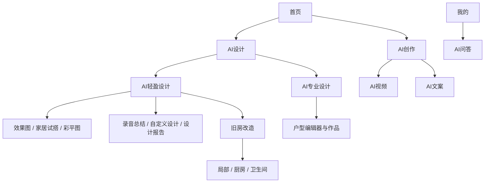

# 前端总览

本轮核验前端 `ui-integration@21db6d8`、后端 `main@e59716c8`。本文描述这两个源码版本，完整提交见[源码版本记录](/zh/reference/source-revisions)。前端出现页面或提交了接口 fixture，并不能证明本轮核验的后端已实现对应契约。

小程序使用 uni-app、Vue 3、TypeScript 和 uview-plus，工具链为 **Node 22、pnpm 9.15.9**。会话和主题通过共享模块及 Vue 状态管理，没有 Pinia 依赖。真实 API、前端 Mock、平台适配和项目能力由构建配置在产物生成前选定。

## 从真实导航找到功能

首页还组合了轮播图、快捷入口、常用功能和门店卡片。`homeEntries.ts` 提供展示信息，`featureGroups.ts` 提供分组树与面包屑，`useFeatureLauncher` 再根据功能发现和资格判断决定可用性。卡片可见、显示价格、有权提交，是三件不同的事。

**专业户型功能需要单独确认集成状态：** 当前前端已有页面和 repository，但本轮核验的后端 `main` 没有相应路由。进入此路径前先阅读[户型功能集成边界](/zh/frontend/floor-plans)。它与已存在的彩平图图片生成功能相互独立。

| 产品 | 建议开始阅读的位置 | 结果或边界 |
| --- | --- | --- |
| 标准图片与改造 | `pkg-features/components/StandardFeaturePage.vue` | 图片任务、按角色上传与提示词选择 |
| 家居试搭、自定义设计 | 对应页面与 `*DesignSubmit.ts` service | 蒙版/参考图或可编辑模板字段 |
| 录音总结 | `pages/voice_summary`、`voiceSummarySubmit.ts` | Markdown 与原始录音 |
| AI视频 | `pages/video_generation`、`videoGenerationSubmit.ts` | 剧本、系统同款、自传参考视频同款 |
| AI文案、AI问答 | `services/copywriting.ts`、`copywritingSubmit.ts` | 八项独立的纯文本 Workflow 产品 |
| 设计报告 | `reportBlueprint.ts`、`workflowSubmission.ts` | Blueprint 驱动的 HTML 和受支持的 PPTX 输出 |
| 专业户型 | `useFloorPlanAvailability`、`floorPlanRepository` | 前端已实现，本轮后端尚未接通 |

## 主包、分包与共享模块

| 位置 | 负责什么 | 初次阅读时要问的问题 |
| --- | --- | --- |
| `src/pages` | 启动、首页、联系、项目/方案/我的 Tab、诊断 | 哪个按钮打开下一页？ |
| `src/pkg-features` | 功能表单、上传与提交编排 | 什么内容会变成请求体？ |
| `src/pkg-plans` | 图片、Markdown/音频、视频、报告与全景查看 | 进度怎样更新，结果怎样呈现？ |
| `src/pkg-projects` | 项目编辑、当前成员只读视图、活动 | 正在读取谁的工作区和项目？ |
| `src/pkg-account` | 登录、法律同意、订单、套餐、企业、草稿 | 哪个账户操作授予或确认权限？ |
| `src/repositories`、`src/api/dto` | 请求和运行时响应校验 | 调哪个接口，接受什么 JSON？ |
| `src/services`、`src/stores`、`src/domain` | 编排、凭据/主题、守卫与纯规则 | 哪些状态要保留、过期或失效？ |
| `config`、`scripts`、`tests` | 构建档、生成资产、契约和产物门禁 | 真正生成的小程序里有什么？ |

`VITE_ENABLE_PRIVATE_PROJECTS=true` 才编入项目 Tab、项目分包和相关实现；关闭时保留首页、联系、方案、我的。显式微信 Mock 构建会强制关闭项目，其他命令有各自的环境赋值，见[构建模式](/zh/frontend/data-source-modes)。

## 沿一次操作读完整链路

先选一次室内效果图操作，从页面提交处理函数读到 `standardDesignSubmit.ts`，继续到 `stageDesignImages`、`submitDesignJob` 和请求客户端。追踪结果页时，保留动作幂等键、返回的 Job ID、工作区和项目。当前前端的这类操作实际经过 `POST /v1/design-jobs`，后端再适配到统一执行引擎。新的 API 集成应使用规范的 [Workflow 契约](/zh/backend/workflows)。

[架构](/zh/frontend/architecture)讲共享边界；[工作流](/zh/frontend/workflows)记录实际请求族和视频模式；[项目](/zh/frontend/projects)解释成员看板及只读权限；[全链路参考](/zh/reference/system-walkthrough)接着追到数据库、对象存储、队列和 worker。

## 源码依据

核验日期 2026-10-28：[导航树](https://github.com/Orientation-CD/wechat_mini_program/blob/21db6d824a7b32417bda88e7e31d3f0b91dfa51c/src/services/featureGroups.ts#L23) · [首页组合](https://github.com/Orientation-CD/wechat_mini_program/blob/21db6d824a7b32417bda88e7e31d3f0b91dfa51c/src/pages/home/index.vue) · [页面注册](https://github.com/Orientation-CD/wechat_mini_program/blob/21db6d824a7b32417bda88e7e31d3f0b91dfa51c/src/pages.json) · [实际提交路由](https://github.com/Orientation-CD/wechat_mini_program/blob/21db6d824a7b32417bda88e7e31d3f0b91dfa51c/src/pkg-features/repositories/designJobSubmit.ts#L182) · [工具链](https://github.com/Orientation-CD/wechat_mini_program/blob/21db6d824a7b32417bda88e7e31d3f0b91dfa51c/package.json)。
