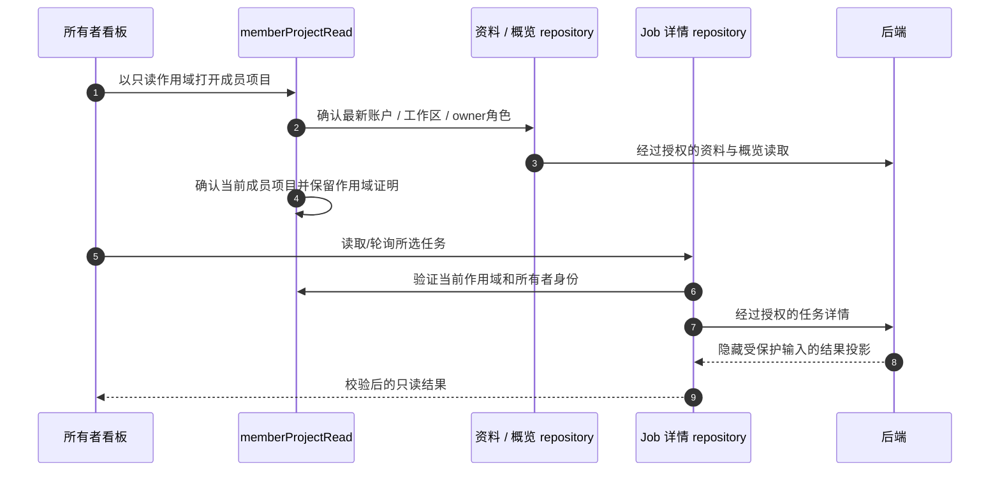

# 项目、成员看板与只读结果

项目体验通过 `VITE_ENABLE_PRIVATE_PROJECTS=true` 编入。成员关系、项目容量、状态转换和写权限由服务端负责；前端守卫阻止过时 UI 操作，但不能授予权限。本文区分当前小程序 UI 与后端新增的独立管理能力。

## 工作区 → 当前选择 → 已接受绑定

账户拥有个人工作区，也可拥有/加入企业。**当前项目**是 UI 的活动选择，**默认项目**是已保存偏好，**阶段**是项目生命周期值，三者不能混用。临时 `scratch` 项目是稳定回退，不是可任意删除的普通客户项目。

`projectContextRepository` 按用户/工作区保存选择，首页、项目页和提交 service 共用。任务准备前，绑定操作确定接受的项目和客户资料快照；之后切换选择器不能改写被冻结或结果未知的请求。提交、重试、移动、删除都会让相关项目计数失效。

| 动作 | 追踪源码 | 保留的状态 |
| --- | --- | --- |
| 选择/设为默认项目 | `repositories/projectContext.ts` | 用户、工作区、当前/默认项目 |
| 提交到项目 | 功能包内 `services/designProjectBinding.ts` | 已接受项目、客户快照、冻结动作 |
| 查看项目成果 | `ProjectResults.vue` | 当前作用域操作与列表筛选 |
| 移动方案 | `PlansJobMove.vue` | 源/目标作用域，刷新两侧计数 |
| 删除项目 | `ProjectDeleteSheet.vue` | 支持的服务端模式与异步接受状态 |

## 阶段、结果与容量

认证的 `GET /v1/project-statuses` 提供阶段、状态、可选标记、结果、流失原因与停滞天数规则。客户端使用五分钟作用域缓存和最小回退，不能把写死的 enum 当作完整当前目录。

UI 区分主阶段、旁路状态和成交/流失终态；历史最远进度独立于当前阶段。流失资料可要求原因及最多100个 Unicode 字符的 OTHER 说明。恢复跟进可能占用容量，应由服务端决定接受或拒绝。

普通项目上限统计20个进行中项目，排除临时项目和关闭结果；本轮契约允许关闭项目继续被选择/绑定。后端 `PROJECT_OUTCOMES_ENABLED` 及其迁移/发布决定结果写入是否可用，构建前端不能启用服务端行为。

删除项目支持服务端的“任务转入临时项目”或“删除任务”模式，202表示接受，不是清理完成；临时项目不能作为普通项目删除。

## 当前成员看板实际计算什么

所有者打开企业概览，`loadProjectOverview` 校验 `GET /v1/workspaces/{workspace_id}/overview`，看板消费的是**当前成员**。服务端契约可能保留历史成员记录，但当前组件有意隐藏该区域。

| 展示 | 实际计算或守卫 |
| --- | --- |
| 搜索与筛选 | 当前成员名，以及服务端派生的阶段/phase/结果；未知状态归“其他”保持可见 |
| 关注项 | 按服务端状态目录停滞规则统计项目；仅支持活跃数据且北京时间日期差大于7时提示未活跃 |
| 阶段分布 | 非终态项目；主状态超过4个时按 phase 分组 |
| 成交与转化 | 成功结果总数、成功/已关闭比例；无分母时显示横线 |
| 本月成交 | 有效关闭日期与当前同属北京时间月份的成功项目 |
| 排序 | 关注项、筛选后项目数、成交数或最后活跃，再用姓名/ID稳定排序 |
| 打开成员项目 | 必须存在所需方案计数能力，字段缺失不等于零 |

`memberProjectDashboard.ts` 提供复用计算，`EnterpriseProjectOverview.vue` 组合响应式筛选和交互守卫。北京时间是展示/分组规则，不会额外写服务端，也不会为每个项目单独轮询。

## 从成员卡片追到结果

`createMemberReadView` 记录会话代次、工作区和项目。`verifyMemberReadAccess` 在读取时刷新账户/owner上下文，成员证明仅随当前 scope 对象存活。恢复页面、会话改变、成员/项目事件都会使证明失效，晚到响应不能将其恢复。

Repository 首先调用任务详情；当前后端 `main` 已明确支持经过授权的 owner 只读投影。前端只针对特定404未找到响应保留有限的企业列表回退，不是通用绕权；它不会改用任意成员私有接口或缓存签名 URL。

成员结果页支持图片、Markdown 总结（隐藏原录音）、视频、报告读取，不提供提交、继续生成、复制输入、重试、删除或移动。账户/工作区/owner身份丢失时清空视图并返回合法入口，仅凭 URL 标记不能授予权限。

## 成员管理与后端独立的额度控制

所有者管理企业名称、席位、邀请和移除，成员可自行退出；席位包含所有者，未接受邀请不预占席位，也没有任意成员角色编辑器。原生邀请携带一次性邀请码，接受时由后端重查成员关系和容量。

最新后端还会实施成员月度 Token 额度，但当前前端没有成员额度编辑器。文档解释这些 API，不代表小程序已提供相应管理 UI。服务端额度/权限规则见[工作区链路](/zh/reference/flows/workspace-membership-flow)，准入被拒时应保留用户输入。

## 源码依据

核验日期 2026-10-28：[项目上下文](https://github.com/Orientation-CD/wechat_mini_program/blob/21db6d824a7b32417bda88e7e31d3f0b91dfa51c/src/repositories/projectContext.ts) · [概览](https://github.com/Orientation-CD/wechat_mini_program/blob/21db6d824a7b32417bda88e7e31d3f0b91dfa51c/src/repositories/projectOverview.ts#L88) · [看板计算](https://github.com/Orientation-CD/wechat_mini_program/blob/21db6d824a7b32417bda88e7e31d3f0b91dfa51c/src/services/memberProjectDashboard.ts#L9) · [看板 UI](https://github.com/Orientation-CD/wechat_mini_program/blob/21db6d824a7b32417bda88e7e31d3f0b91dfa51c/src/components/projects/EnterpriseProjectOverview.vue) · [只读作用域](https://github.com/Orientation-CD/wechat_mini_program/blob/21db6d824a7b32417bda88e7e31d3f0b91dfa51c/src/services/memberProjectRead.ts#L52) · [详情投影](https://github.com/Orientation-CD/wechat_mini_program/blob/21db6d824a7b32417bda88e7e31d3f0b91dfa51c/src/repositories/designJobDetail.ts#L190) · [后端工作区授权](https://github.com/Orientation-CD/YuanZhu-AI/blob/e59716c83e087deda8477da5ea7b327a40cf65c5/app/workspaces/workspace_api.py)。
