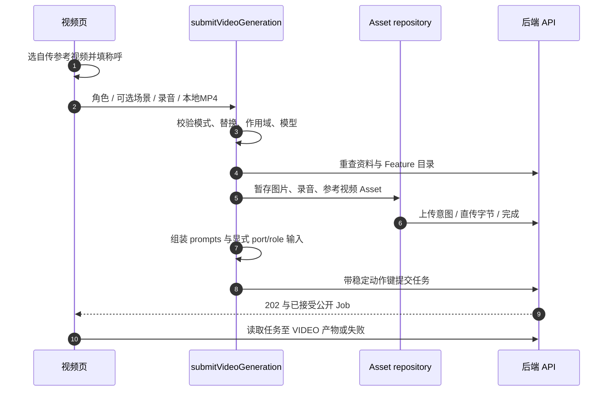

# 前端 Workflow 请求与产品路径

Feature 是可发现的业务能力，Workflow 是后端执行图，公开 Job ID 是 UI 读取任务的身份。当前小程序使用两族传输，本文记录源码实际发送的内容，不把仍在使用的适配器写成已经完成迁移。

## 当前前端选择的真实路由

| 产品 | 当前创建传输 | 请求体与代码 |
| --- | --- | --- |
| 标准图片、家居试搭、自定义设计 | `POST /v1/design-jobs` | `assets`、提示词选择、可选项目/客户快照；对应提交 service |
| 录音总结 | `POST /v1/design-jobs` | `type:voice_summary`、按顺序验证的音频 Asset |
| 三种 AI视频模式 | `POST /v1/design-jobs` | `type:video_generation`、显式 `inputs`、script **或** prompts |
| 八项文案/问答 | `POST /v1/workflows` | 精确产品键、prompts、`inputs:[]`；`prepareCopywriting` 后进入共用提交 repository |
| 新版设计报告 | `POST /v1/workflows` | `design_report_9/13/17` 和结构化输入；`prepareProjectWorkflow` → `postWorkflow` |

前四行由 `postPrepared` 选路由，报告通过 `workflowsRepository.submit`。新 API 调用方应从[规范 Workflow](/zh/backend/workflows)开始。现有 HTML报告代码不是新报告的 schema 或推荐入口。专业户型页面则属于[独立候选契约边界](/zh/frontend/floor-plans)，不能当成本轮前后端已接通的执行路径。

## 共用准备与接受流程

1. 校验本地字段，读取最新资料、目录与模板。
2. 确认工作区、套餐/Feature 权限、界面显示的 Token 余额。这些是预检，最终准入及成员额度仍以后端为准。
3. 冻结前绑定项目，按上传意图 → 签名表单 → 完成暂存所需 Asset。
4. 接受结果未知时，保留同一动作的原请求体和 `Idempotency-Key`，只能经受支持的编辑路径将新内容变成新动作。
5. 从202接受经过校验的待处理任务，再用公开身份读取状态/产物。重试资格和费用依据服务端证据，不依据本地时钟。

后端耐久输入归档与本地文件保存、Asset上传完成是不同步骤，相关事务/队列链路见[准入与 worker](/zh/reference/flows/design-job-lifecycle)。

## 视频已有三种模式

| UI模式 | 剧本/模板选择 | 参考视频 | 必需录音/素材 |
| --- | --- | --- | --- |
| 编写/导入剧本 | `script`，UI最多1000字 | 无 | 一张角色三视图合成图、恰好一张场景图；录音选填 |
| 系统同款示例 | 从 `purpose=same_style_video` 取一项 `prompts` | 绑定在后端模板，目录刷新预览地址 | 角色合成图、严格大于5秒的录音；场景选填 |
| 上传参考做同款 | 保留模板名 `__user_reference__` | 一份已完成 VIDEO Asset，port/role 为 `reference_video` | 角色合成图、严格大于5秒的录音；场景选填 |

`script` 与 `prompts` 互斥。同款模板声明字段必须**恰好只有 `称呼`**，页面限制24字。自传模式的保留名称不是让用户在后台新建的普通模板；系统同款提交实际模板名，不提交显示名或预览 URL。

页面认证请求 `GET /v1/prompt-templates?purpose=same_style_video`；`mapEditablePromptTemplates` 校验名称、字段、显示名及可选视频/缩略图 URL。预览 URL 是短期能力，刷新目录可更新访问，但不能改变已提交任务冻结的模板/参考身份。

### 分清四层限制

| 内容 | 当前小程序表单 | 公开 schema / 准入模式 |
| --- | --- | --- |
| 角色图 | 恰好一张合成图 | 恰好一个 `character_image/primary` |
| 场景图 | 剧本恰好1张，同款0–1张 | 通用 schema 为0–12，同款准入进一步限0–1 |
| 剧本 | 剧本路径1–1000字 | 公开模型最多20000字，同款不发送script |
| 录音 | 同款必填，界面录制最长120秒 | 最多1份，同款必须 audio/mpeg 且 duration_ms>5000 |
| 自传参考视频 | 一份 MP4，最多100MiB（104857600字节） | 已验证 VIDEO/reference_video Asset 及对应模式准入 |
| 台词替换 | 最多10对，每端最多200字 | 仅同款，作为指令转交渲染环节 |

通用 schema 接受某种素材数量，不等于当前供应商支持全部组合。剧本管线当前需要场景作为上游 background，同款走重制管线并允许空场景。不要照抄通用 API 最大值去“修复”UI 限制。

### 追踪一次自传参考视频同款



`stageVideoImageAssets` 将任务角色 `primary/reference` 转为上传角色 `image/reference_image`。`stageReferenceVideoAsset` 设置 `type:VIDEO` 与上传角色 `reference_video`，返回 port/role 匹配的输入。显示 URL、本地路径和 Asset UUID 不能互相代替。

下面片段放在完整准备请求中，Asset ID 由暂存步骤得到：

```json
{
  "prompts": {"prompts": [{"name": "__user_reference__", "fields": [{"name": "称呼", "value": "设计顾问"}]}]},
  "replacements": [{"from": "原台词", "to": "新台词"}],
  "replace_scope": "dialogue"
}
```

`replacements`、`replace_scope` 与 `prompts` 同为顶层字段；没有非空替换对时客户端省略两者，不发空范围或 null。`dialogue` 请求分镜台词替换，缺省范围由后端按 `all` 处理。后端冻结并转交指令，不自行改写剧本；相同内容和只填一端的替换对无效。

后端开通模型选择时，选项/价格来自目录，前端白名单和基准显示不是定价权威。从已完成短视频文案导入只会填剧本，替换不同文本前需确认，不会自动创建视频。

## 文案与问答仍是八项产品

| 产品键 | 当前名称 | 分组 |
| --- | --- | --- |
| `copywriting_short_video` | 短视频脚本 | 创作 |
| `copywriting_xiaohongshu` | 小红书笔记 | 创作 |
| `copywriting_moments` | 朋友圈文案 | 创作 |
| `copywriting_titles` | 标题金句 | 创作 |
| `copywriting_shooting` | 拍摄建议 | 创作 |
| `copywriting_knowledge` | 装修知识 | 问答 |
| `copywriting_pitfalls` | 避坑指南 | 问答 |
| `copywriting_operations_experience` | 运营经验 | 问答 |

`prepareCopywriting` 验证完整的 `feature_copywriting_*` 模板字段集，按声明顺序每个字段发送一次；UI选填空白变成字面量 `未提供`，单字段上限4000字，必填文本trim后非空。不存在通用 `ai_copywriting` 请求或这些产品的媒体上传，拍摄建议输出文本而非生成画面。即使可选文件信息缺失，安全 Markdown 仍可渲染行内文本。

## 新报告按 Blueprint 准备

表单8/12/16页内容分别产生9/13/17总页数，对应精确键 `design_report_9/13/17`。`buildReportWorkflowRequest` 从项目/客户资料、已完成录音总结、彩平原图/结果 Asset 和不同空间室内结果构建请求。

Blueprint 来源声明可以引用既有 Asset、所选生成子内容或配置的 Gallery，它们是不同形状。不要把预览 URL 填入 Asset 字段，也不要额外在前端创建子任务/费用。当前每页室内结果上限三张，修改报告大小可能需要重新选择来源。

可选附件为 `.pptx`，最多100MiB/104857600字节，在请求前上传并验证；草稿恢复要重查可用性。`prepareProjectWorkflow` 先绑定项目，再深冻结 body 并创建动作/键；`restoreWorkflowAttempt` 恢复原 body/键而不是再生成，`postWorkflow` 使用规范路由。

HTML查看器需要新的授权访问。支持的 PPTX artifact 按有类型产物消费，后端有某种 artifact 并不等于每个页面都有单独导出按钮。子执行、耐久状态和发布产物见[报告链路](/zh/reference/flows/report-view-flow)。

## 源码依据

核验日期 2026-10-28：[真实路由选择](https://github.com/Orientation-CD/wechat_mini_program/blob/21db6d824a7b32417bda88e7e31d3f0b91dfa51c/src/pkg-features/repositories/designJobSubmit.ts#L182) · [视频编排](https://github.com/Orientation-CD/wechat_mini_program/blob/21db6d824a7b32417bda88e7e31d3f0b91dfa51c/src/pkg-features/services/videoGenerationSubmit.ts#L69) · [同款字段](https://github.com/Orientation-CD/wechat_mini_program/blob/21db6d824a7b32417bda88e7e31d3f0b91dfa51c/src/pkg-features/services/sameStyleVideo.ts#L10) · [视频暂存/限制](https://github.com/Orientation-CD/wechat_mini_program/blob/21db6d824a7b32417bda88e7e31d3f0b91dfa51c/src/pkg-features/repositories/videoAssets.ts#L25) · [目录选择](https://github.com/Orientation-CD/wechat_mini_program/blob/21db6d824a7b32417bda88e7e31d3f0b91dfa51c/src/pkg-features/repositories/promptCatalog.ts#L198) · [报告构建器](https://github.com/Orientation-CD/wechat_mini_program/blob/21db6d824a7b32417bda88e7e31d3f0b91dfa51c/src/pkg-features/services/reportBlueprint.ts#L65) · [报告动作冻结](https://github.com/Orientation-CD/wechat_mini_program/blob/21db6d824a7b32417bda88e7e31d3f0b91dfa51c/src/pkg-features/services/workflowSubmission.ts) · [后端视频模式限制](https://github.com/Orientation-CD/YuanZhu-AI/blob/e59716c83e087deda8477da5ea7b327a40cf65c5/app/workflows/workflow_admission.py#L1279)。
