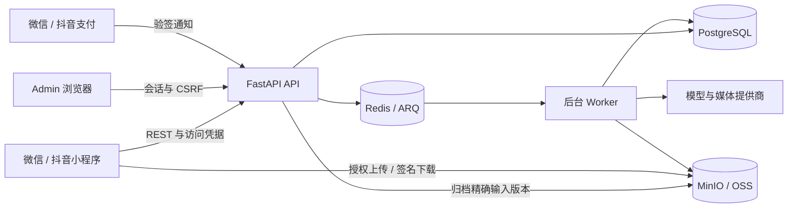

# 系统架构

小程序负责用户界面；后端负责账号、价格、权限、持久任务和结算。PostgreSQL 保存业务事实，Redis 协调异步任务，对象存储保存上传文件与生成结果。

## 请求地址

当前产品公共接口使用 **`/v1`**，例如 `/v1/me`、`/v1/billing/features`、`/v1/workflows`。健康接口 `/health/ready`、`/admin` 管理站和开发专用 `/mock` 路由使用各自前缀。不能因为服务是 API，就额外添加 `/api`。

前端将路由拼接在 `VITE_API_BASE_URL` 后。本地 8080 端口示例的基础地址为 `http://127.0.0.1:8080`，最终资料接口是 `http://127.0.0.1:8080/v1/me`。

## 一次生成请求

1. 前端发现可用 Feature、价格和套餐权限；认证后的模板发现提供可编辑字段。
2. 文件通过绑定用途的上传凭证直接进入对象存储，再由服务端校验完成。纯文字文案不上传文件；部分录音入口另有上传会话接口。
3. 前端携带幂等键向 `/v1/workflows` 或仍支持的旧 `/v1/design-jobs` 提交。`202` 表示已接收，并非生成完成。
4. 最终准入前，后端提交归档 claim，在 SQL 事务外复制自有输入字节；随后锁定复核证据、账号／空间／项目、权益、并发、钱包与成员额度，把 ACTIVE 输入归属、执行 pins、预留和 outbox 原子提交。Worker 消费此耐久执行图。
5. 前端按服务端提供的时机查询状态，完成后展示图片、Markdown、视频或报告。

规范 Workflow 与旧设计任务兼容接口见[前端工作流](/zh/frontend/workflows)和 [API 参考](/zh/reference/rest-api)。操作可以涉及图片生成、语音/文本处理、报告装配、本地媒体处理和导出，不一定是一条外部图片模型请求。

## 身份、计费和协作

微信、抖音平台凭据由后端交换身份与手机号。前端获得访问/刷新 Token；请求层合并并发刷新。AppSecret 和提供商密钥只属于服务端。

会员授予权限和额度，Token 为生成付费。服务端决定价格并执行预留、结算或释放；前端预检仅用于提前解释。原生支付成功回调不能独立证明订单已支付，前端还须确认服务端订单状态。

每个账号有个人空间，也可以拥有或加入企业空间。提交请求明确指定空间。项目在空间内组织用户方案；当前/默认项目与企业成员只读视图用途不同，见[项目与协作](/zh/frontend/projects)。

## 本地与云端

本地 Docker 栈包含 API、Worker、PostgreSQL、Redis、MinIO 和选定的模拟提供商，同时需要有效法律/产品配置。云端运行独立配置的服务和持久存储。私有视频依赖在服务端镜像构建时安装，因此本地镜像构建同样需要源码读取权限。

[快速开始](/zh/get-started/quickstart)提供本地闭环验收；部署细节见[云端架构](/zh/deploy/cloud-architecture)。

## 确认能力属于哪条分支

[对齐状态](/zh/reference/integration-status)区分当前服务端路由与前端候选户型契约。所有者只读任务详情、成员月额度、有界性能历史是不同系统边界。沿[输入归档](/zh/reference/flows/asset-upload-flow)、[额度记账](/zh/reference/flows/member-quota-flow)、[可观测性](/zh/backend/observability)阅读，不要以为上传、准入和执行共用一笔数据库事务。

## 源码依据

核对版本：前端 `21db6d8`、后端 `e59716c`（2026-10-28）。[前端请求层](https://github.com/Orientation-CD/wechat_mini_program/blob/21db6d824a7b32417bda88e7e31d3f0b91dfa51c/src/services/request.ts) · [后端应用装配](https://github.com/Orientation-CD/YuanZhu-AI/blob/e59716c83e087deda8477da5ea7b327a40cf65c5/app/main.py) · [本地运行手册](https://github.com/Orientation-CD/YuanZhu-AI/blob/e59716c83e087deda8477da5ea7b327a40cf65c5/scripts/runbook.md)。
