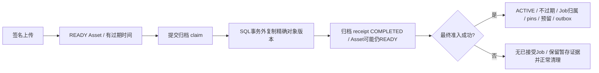

# 数据模型：身份、耐久输入与账务

本页解释当前 ORM 的关系，不替代 DDL。精确列、索引和约束以固定版本模型及打包的前向迁移为准。公开 Workflow ID 就是 `design_jobs.id`；WorkflowRun、OperationRun、提交代次和供应商任务是不同身份。

## 领域地图

| 领域 | 当前记录 | 不变量 |
| --- | --- | --- |
| 身份／同意 | `users`、`auth_sessions`、`legal_documents`、`legal_document_acceptances` | 可撤销会话与已接受文档的不可变 ID |
| Asset 类型层次 | `assets`、`images`、`audio_assets`、`documents`、`video_assets` | 已核验内容、类型、hash、大小和精确对象版本一致 |
| 上传／复制 | `asset_upload_intents`、`asset_copy_intents` | 所有者、角色、上限与动作身份不可变 |
| 输入归档 | `asset_input_archives` | Asset 自有迁移 receipt、精确源／目标版本、复制 lease 和回执可恢复 |
| 工作区 | `workspaces`、`personal_workspaces`、`enterprises`、成员关系及历史 | 钱包归属、当前权限与曾经成员身份不同 |
| 成员额度 | `enterprise_member_token_limits`、`enterprise_member_token_limit_audits`、企业默认值列 | 持久自定义配置和不可变配置审计；财务用量来自账本 |
| 项目 | `projects`、`project_preferences`、`project_activity_state` | 创建者私有管理、持久默认选择和可信活动 epoch |
| 执行 | `design_jobs`、`workflow_runs`、`operation_runs`、输入／依赖／输出行 | 冻结执行图与物理输入 pins |
| 尝试／调度 | `design_job_submissions`、`operation_provider_calls`、重试 receipt、`workflow_outbox_events` | 代次保护与事务性交接 |
| 发布 | `design_job_outputs`、`workflow_generated_sources` | 类型化不可变产物、保留依赖及精确发布身份 |
| 本地转换 | PPTX／视频 attempts 与 reservations | 有界资源和可恢复暂存／发布 |
| 配置 | Feature、Workflow／Operation 定义、节点配置、连接／模型、提示词模板 | 定价／权益、执行图／模型、提示词用途／参考媒体彼此独立 |
| 账务 | `token_ledger_entries`、套餐、订阅、积分包、支付／退款订单 | 持久财务证据，不是 UI 余额计算 |
| 协作／营销 | 企业／分享／推荐邀请、奖励、财务成本记录 | 入企业、推荐归因和奖励履约是独立协议 |

## 上传完成不等于输入激活

迁移不改变 Asset UUID 或文件字节，只把 locator 移到耐久输入存储。归档 receipt `COMPLETED` 不代表 Job 已接受，权益、企业余额或成员额度仍可能拒绝准入。最终激活锁定并复核证据，把归属、pins、资金及调度状态一起提交。借用的 ACTIVE 依赖保留原归属。见[Asset 生命周期](/zh/reference/flows/asset-upload-flow)。

归档 `id` 稳定，Asset 删除后其可空 FK 可以变 null，保留的 tombstone 仍负责迟到的复制回执。删除 receipt 来“清除卡住的上传”可能丢失对象回收及恢复依据。

## 月额度不是第二个钱包

企业 `remaining_tokens - reserved_tokens` 是共享可用余额。成员额度字段 `used` 对已提交预留和消耗只计一次，额度字段 `reserved` 是其中待结算子集，二者相加会重复计数。释放计零。按 Asia/Shanghai 的预留月份记账，跨月结算仍归原月；没有预留历史的消耗才按结算月归属。

没有 override 表示继承企业默认值；保存 null override 表示明确不限额；保存零表示暂停该成员。企业全局默认值不能是零。配置审计不产生财务流水。owner 豁免、离职历史及全局保存清空 override 见[成员额度](/zh/reference/flows/member-quota-flow)。

## 权限和状态是不同维度

项目管理仍创建者私有；当前企业 owner 有明确限定的任务／项目只读投影。他人任务详情返回 `inputs: []`，不授予重试、移动、删除或源素材复制权限。

任务状态、资金状态、提交确定性、Asset 状态及归档 receipt 状态是不同状态机。短期 URL 是访问能力，不是耐久 Asset 身份。Redis 的有界性能历史不能替代 SQL 账务／执行记录。

选择回滚镜像前看[恢复流程](/zh/deploy/production)：应用回滚保留前向 schema，不能恢复已移除表或逆转兼容边界。

源码：[app/persistence/db_models.py](https://github.com/Orientation-CD/YuanZhu-AI/blob/e59716c83e087deda8477da5ea7b327a40cf65c5/app/persistence/db_models.py) · [app/assets/asset_input_archival.py](https://github.com/Orientation-CD/YuanZhu-AI/blob/e59716c83e087deda8477da5ea7b327a40cf65c5/app/assets/asset_input_archival.py) · [app/billing/member_token_quotas.py](https://github.com/Orientation-CD/YuanZhu-AI/blob/e59716c83e087deda8477da5ea7b327a40cf65c5/app/billing/member_token_quotas.py) · [app/core/models.py](https://github.com/Orientation-CD/YuanZhu-AI/blob/e59716c83e087deda8477da5ea7b327a40cf65c5/app/core/models.py)
