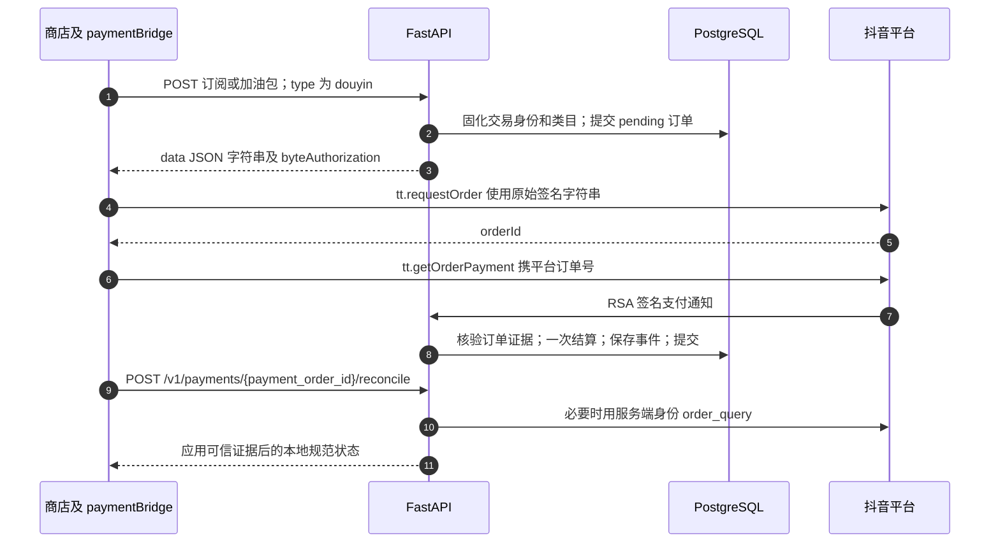
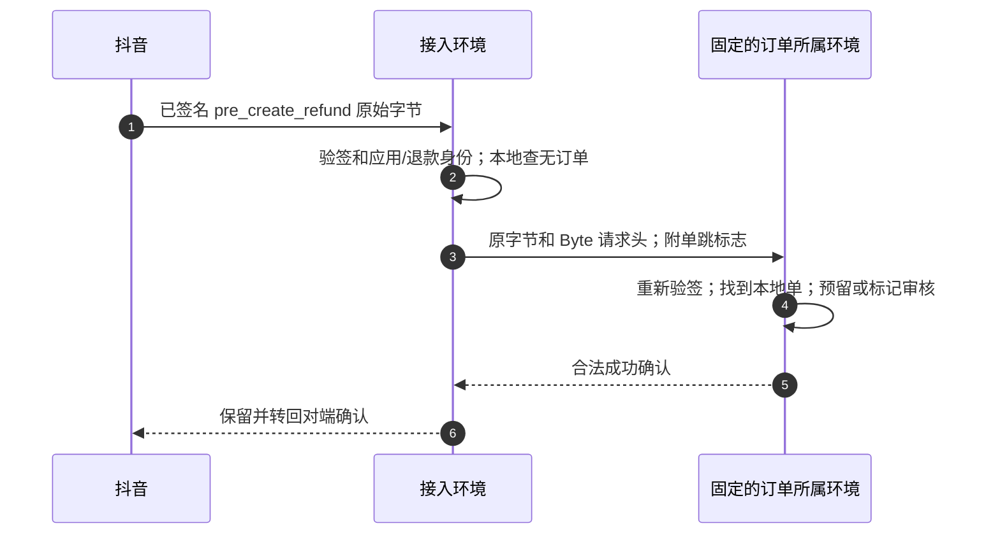

# 抖音交易全链路：下单签名、RSA 回调与补偿

共享的[购买链路](/zh/reference/flows/payment-flow)解释服务端定价、JWT、幂等和 Token 入账。本章继续追踪抖音的差异：应用私钥签的是**客户端下单数据**，平台订单由客户端创建；服务端查询使用 Redis 共享 client token；回调用平台 RSA 公钥验证；售后申请可能从小程序之外发起。

先分清三个身份：本地 `PaymentOrder.id` 是 UUID，商户 `out_trade_no` 在平台字段中叫 `outOrderNo/out_order_no`，平台 `provider_order_id` 对应 `orderId/order_id`。订单入口 `pages/payment_order/index` 会携本地 UUID 跳转支付记录，不是另一个结算接口。

## 1. 从一次真实 UI 操作开始 {#douyin-checkout}

| 编号 | 源码位置 | 数据怎样走 |
| --- | --- | --- |
| 1 | `store/index.vue` → [runCheckout](https://github.com/Orientation-CD/wechat_mini_program/blob/eca0a5f9e0a2aa1cb3fd4f9714114bb3db7fae5f/src/pkg-account/pages/store/index.vue#L209)；[currentPaymentType](https://github.com/Orientation-CD/wechat_mini_program/blob/eca0a5f9e0a2aa1cb3fd4f9714114bb3db7fae5f/src/pkg-account/services/paymentPlatform.ts#L3)；[create_subscription](https://github.com/Orientation-CD/YuanZhu-AI/blob/b13cc5668920620a274cb91a3393ed9fadac72ae/app/billing/billing_api.py#L427) / [create_token_purchase](https://github.com/Orientation-CD/YuanZhu-AI/blob/b13cc5668920620a274cb91a3393ed9fadac72ae/app/billing/billing_api.py#L570) | 构建目标选择 douyin；服务端从认证账户取付款身份，不接受请求自填 OpenID。 |
| 2 | [snapshot_checkout](https://github.com/Orientation-CD/YuanZhu-AI/blob/b13cc5668920620a274cb91a3393ed9fadac72ae/app/billing/douyin_pay.py#L123) | 按购买 kind 读 `DouyinTradeConfiguration`，固化 AppID/商户、SKU/标题、HTTPS 图片、goods/tag group、配置版本及本地订单入口 schema。快照先于提交。 |
| 3 | [create_checkout](https://github.com/Orientation-CD/YuanZhu-AI/blob/b13cc5668920620a274cb91a3393ed9fadac72ae/app/billing/douyin_pay.py#L214) → [signed_checkout](https://github.com/Orientation-CD/YuanZhu-AI/blob/b13cc5668920620a274cb91a3393ed9fadac72ae/app/billing/douyin_pay.py#L87) | 新平台单核验当前标签/期限，返回一段精确 JSON 字符串及 RSA 授权；已有平台单号则返回 `action:"get_order_payment"`。 |
| 4 | [requestDouyinPayment](https://github.com/Orientation-CD/wechat_mini_program/blob/eca0a5f9e0a2aa1cb3fd4f9714114bb3db7fae5f/src/pkg-account/services/payment.ts#L119) | `action:"request_order"` 把原始字符串和签名交 `tt.requestOrder`，不能先解析再重新排版 JSON。 |
| 5 | 同一桥接函数的成功/异常分支 | 校验 orderId；`21016` 可能代表原单已存在，先对账本地订单取回 provider_order_id，不新建另一笔购买。 |
| 6 | `requestDouyinPayment()` → `tt.getOrderPayment` | 打开收银台；错误 4 映射取消，错误 9 继续由服务端确认。客户端结果不发 Token。 |
| 7 | [douyin_notification](https://github.com/Orientation-CD/YuanZhu-AI/blob/b13cc5668920620a274cb91a3393ed9fadac72ae/app/billing/douyin_api.py#L463) → [verified_notification](https://github.com/Orientation-CD/YuanZhu-AI/blob/b13cc5668920620a274cb91a3393ed9fadac72ae/app/billing/douyin_pay.py#L100) | 先对原始字节验平台签名，再验证信封、订单身份和事件类型。 |
| 8 | [validate_order_evidence](https://github.com/Orientation-CD/YuanZhu-AI/blob/b13cc5668920620a274cb91a3393ed9fadac72ae/app/billing/douyin_pay.py#L365) → [complete_payment_order](https://github.com/Orientation-CD/YuanZhu-AI/blob/b13cc5668920620a274cb91a3393ed9fadac72ae/app/billing/billing.py#L732) | 应用/商户/订单/币种/金额全通过，才共享原子结算；事件 SHA-256 与订单级 advisory lock 防重放和并发。 |
| 9 | [paymentReconciliationRepository](https://github.com/Orientation-CD/wechat_mini_program/blob/eca0a5f9e0a2aa1cb3fd4f9714114bb3db7fae5f/src/pkg-account/repositories/paymentReconciliation.ts#L47) → [reconcile_payment](https://github.com/Orientation-CD/YuanZhu-AI/blob/b13cc5668920620a274cb91a3393ed9fadac72ae/app/billing/douyin_api.py#L257) | 抖音轮询发 POST，区别于微信只读本地状态的 GET。 |
| 10 | [reconcile_order](https://github.com/Orientation-CD/YuanZhu-AI/blob/b13cc5668920620a274cb91a3393ed9fadac72ae/app/billing/douyin_api.py#L70) → [query_order](https://github.com/Orientation-CD/YuanZhu-AI/blob/b13cc5668920620a274cb91a3393ed9fadac72ae/app/billing/douyin_pay.py#L271) → [call](https://github.com/Orientation-CD/YuanZhu-AI/blob/b13cc5668920620a274cb91a3393ed9fadac72ae/app/billing/douyin_pay.py#L179) | 用服务端 client token 查平台，验证证据、补丢失通知；live paid 还会发现漏掉的退款。 |
| 11 | `payment_response()` → `mapPaymentReconciliation()` → `applyOrder()` | UI 接受本地规范 paid/closed/refunded，paid 后刷新 profile。 |

### 哪些字段固化，哪些还会重新检查 {#trade-snapshot}

`snapshot_checkout()` 拒绝缺失交易配置、live 使用 mock 标签、非 702 类目、非法/过长 HTTPS 图片、金额超过 50,000 分（固定版本当前类目的每单 ¥500 限制）。这是本实现当前类目规则，不是所有抖音场景的通用上限。`require_mode()` 拒绝把旧订单从 mock 切 live，也拒绝改变其快照 AppID/商户。获取新下单参数还会检查标签归属及剩余期限，因此旧快照不绕过当前平台校验。

新单响应包含 mode、action、本地 id、data、byteAuthorization；data 内含 skuList、outOrderNo、totalAmount、currency、payExpireSeconds、通知 URL、订单入口 schema。已有平台单的续付响应改带 orderId。这些都不是 Token 入账流水。

## 2. 三个方向的密钥/凭证不能混淆 {#douyin-signatures}

| 方向 | 输入与凭证 | 应读函数 |
| --- | --- | --- |
| 应用 → 客户端 `tt.requestOrder` | 应用 RSA-2048 私钥对 `POST\n/requestOrder\n<timestamp>\n<nonce>\n<data>\n` 做 PKCS#1 v1.5 / SHA-256 签名；授权含 AppID 和 key version | [signed_checkout](https://github.com/Orientation-CD/YuanZhu-AI/blob/b13cc5668920620a274cb91a3393ed9fadac72ae/app/billing/douyin_pay.py#L87)、[application_private_key](https://github.com/Orientation-CD/YuanZhu-AI/blob/b13cc5668920620a274cb91a3393ed9fadac72ae/app/identity/douyin_keys.py#L9) |
| 服务端 → 平台查询/退款 API | 服务端 client-token 流程取得的 `access-token`，既不是用户 JWT，也不是下单签名 | [call](https://github.com/Orientation-CD/YuanZhu-AI/blob/b13cc5668920620a274cb91a3393ed9fadac72ae/app/billing/douyin_pay.py#L179)、[_client_token](https://github.com/Orientation-CD/YuanZhu-AI/blob/b13cc5668920620a274cb91a3393ed9fadac72ae/app/identity/douyin_auth.py#L243) |
| 平台 → 服务端通知 | 平台 RSA 公钥验证 `<timestamp>\n<nonce>\n<raw body>\n`，签名在 Byte 请求头 | [verified_notification](https://github.com/Orientation-CD/YuanZhu-AI/blob/b13cc5668920620a274cb91a3393ed9fadac72ae/app/billing/douyin_pay.py#L100) |

`_client_token()` 按应用在 Redis 缓存，通过带租约的锁在多副本间合并刷新；`call()` 遇已知 token 失效码只清理匹配的旧 token，随后重试一次。网络请求使用配置超时、不跟随重定向。mock 明确禁止交易网络请求，不会悄悄回退到 live 网关。

通知必须保留原始 JSON 字节。校验读取 `byte-timestamp`、非空 `byte-nonce-str`、base64 的 `byte-signature`，限制 1,800 秒时间窗以覆盖平台重试，然后 RSA 验签，再解析信封和其中可为 JSON 字符串/对象的 msg。先重新排版会改变签名对象。这不是退休的 SHA1/token 协议，平台验签公钥也不是上传给平台的应用公钥。

## 3. 每一个公共抖音交易入口 {#douyin-apis}

### POST /v1/payments/{payment_order_id}/reconcile {#payment-reconcile}

**UI：** 商店支付确认、支付记录轮询、`tt.requestOrder` 重复订单异常分支通过 `paymentReconciliationRepository.get()` / `requestDouyinPayment()` 调用。JWT 标识归属，不接收客户端 paid 标志。

**后端：** [reconcile_payment](https://github.com/Orientation-CD/YuanZhu-AI/blob/b13cc5668920620a274cb91a3393ed9fadac72ae/app/billing/douyin_api.py#L257) → `owned_order()` → `reconcile_order()`。非抖音返回 `409 PAYMENT_TYPE_MISMATCH`，不存在/他人单返回 `404 PAYMENT_ORDER_NOT_FOUND`。pending/closed 先释放数据库事务，再查平台；I/O 后取 `douyin-order` advisory lock、刷新记录。SUCCESS 走共享结算（包括此前 closed 的抖音单），FAIL/TIMEOUT 关单，PROCESS 保留 pending 并可保存平台 id。平台确认「尚未创建」时，只有过了已存安全关闭时间才关闭 pending，之前保留不确定。身份/金额不可信或网络异常 → `503` 安全码，不猜测关单。

**返回与后续：** `200 PaymentOrderResponse` 可能仍 pending。live paid 会进 `discover_refunds()` 补售后证据，refunded 直接返回。这里没有通用微信实现，不能把微信 GET 替换成这条 POST。

### POST /v1/webhooks/douyin/payment {#douyin-payment-webhook}

**调用方：** 平台服务器，不是页面 HTTP/JWT。`douyin_notification()` 仅 live 接收，mock 返回 `404`；验原字节签名，要求信封 version `3.0` 和受支持 type，通过商户 out_order_no 找本地 live 抖音单。核验快照 AppID/平台单 id、成功时商户身份、整数金额、商户单号和 CNY，才能改变资金效果。

**处理：** 原始 body 的 SHA-256 标识 `DouyinPaymentEvent`；取订单级 advisory lock、刷新并再次核对身份。新/未处理 payment 事件 SUCCESS 调 `complete_payment_order()`；CANCEL 仅保存 provider id 后查平台规范状态，收银台取消不等于平台订单已关。其他状态视为非法。设置 processed、提交，再回 `200 {err_no:0,err_tips:"success"}`。已处理重复支付事件跳过结算，订单状态也防重复发放。验证/渠道证据错误回滚并返回 `400` 安全码，不能确认伪造/错配支付。

### POST /v1/webhooks/douyin/refund {#douyin-refund-webhook}

**调用方：** 平台退款结果通知，无小程序 HTTP 调用。仍由 `douyin_notification()` 验 live、RSA、信封，按平台 order_id 找本地单，检查快照身份、正数且不超过原支付的退款金额，再按订单加锁。

**处理：** `apply_platform_refund()` 建立/复用合格预留或人工审核记录，必要时保留替换旧退款证据。处理器提交后调用 `reconcile_refund()` 查平台真相，才记录终态。已签通知仍不能绕过规范退款查询校验。保存事件 error/processed，提交后确认；已归档替换退款的迟到结果可直接确认而不再次扣权益。

**结果与恢复：** 成功确认 `200 {err_no:0,err_tips:"success"}`；签名/身份/金额错误 → `400`；查询/处理失败不宣称成功，平台可以重投。周期任务和 paid 单的退款发现补丢通知。[退款函数细节](/zh/reference/flows/refund-flow#refund-settlement)说明预留/扣回/释放及 `DOUYIN_REFUND_REVIEW_REQUIRED`。

### POST /v1/webhooks/douyin/refund-application {#douyin-refund-application-webhook}

FastAPI 入口：[app/billing/douyin_api.py → douyin_notification](https://github.com/Orientation-CD/YuanZhu-AI/blob/b13cc5668920620a274cb91a3393ed9fadac72ae/app/billing/douyin_api.py#L463)。

**调用方：** 平台扩展 `pre_create_refund`，当前小程序无申请退款 UI。共用已验证处理器。本地 paid/refunded 单通过 `apply_platform_refund(application=True)` 尝试整笔未用权益预留，不合条件就保存人工核对记录，不倒造预留；需要审核时保存合格 `AUDIT_AGREE` 或不合格 `AUDIT_DENY` 意图，提交后回复。

**响应：** `200 {err_no:0,err_tips:"success",data:{out_refund_no,order_entry_schema,notify_url}}`，确认申请并提供结果路由，未把退款标成功。以后对账通过 `refund_audit_callback` 提交已保存审核意图，再查新证据确认推进/结算。错误签名、应用/订单/退款身份或金额均验证失败；已归档旧证据可确认而不产生新操作。

三个 webhook 路径共用一个处理器，主要按已验证**信封 type**（payment、refund、pre_create_refund）分派。申请 URL 另有下一节明确的本地查无订单路由规则，不能仅凭 URL 就认定事件可信或类型正确。

## 4. 同一 AppID 对应两个环境时怎样路由 {#callback-routing}

支付 data 可指定 payNotifyUrl，退款创建/申请响应能指定结果 notify_url，但最初退款申请扩展 URL 在平台配置，可能先到不持有订单的环境。AppID 不会自动选阿里云 namespace。

| 编号 | 代码 | 边界 |
| --- | --- | --- |
| 1 | `douyin_notification()` | 只允许 live、已验平台签名的退款申请进入转发判断。 |
| 2 | [douyin_notification](https://github.com/Orientation-CD/YuanZhu-AI/blob/b13cc5668920620a274cb91a3393ed9fadac72ae/app/billing/douyin_api.py#L463) 本地缺失分支 | 必须是确切申请 URL、正确 AppID、有长度限制的非空订单/退款 id、正整数金额，结束读取事务。 |
| 3 | [forward_refund_application](https://github.com/Orientation-CD/YuanZhu-AI/blob/b13cc5668920620a274cb91a3393ed9fadac72ae/app/billing/douyin_callback_routing.py#L18) | 必须显式启用固定 HTTPS 对端、无已有转发标志；保留原签名/正文；总预算 1.25 秒，不跟重定向、不信环境代理。标志只限跳数，不授予信任。 |
| 4 | 对端同一处理器 | 再验平台签名/身份，仅订单所属环境写预留/退款状态。 |
| 5 | `forward_refund_application()` 响应检查 | 要求 HTTP 200、整数 err_no:0、err_tips 为 success；保留合法 data 或已归档确认。 |
| 6 | 接入处理器直接返回 | 接入方不为对端订单建财务记录。对端错误/超时变 `503 DOUYIN_REFUND_APPLICATION_FORWARD_FAILED`，平台可重投。 |

本地已有订单绝不走回退；普通支付/退款结果和用户任意目的地也不能使用它。转发默认关闭，常规 mock 验证保持关闭。

## 5. 配置、后台恢复与 Redis 的角色 {#douyin-configuration}

| 配置 | 沿代码看什么 |
| --- | --- |
| `DOUYIN_PAY_MODE` | mock/live 固化在订单；`require_mode()` 防误切 |
| `DOUYIN_APP_ID`、`DOUYIN_MINI_PROGRAM_APP_SECRET` | 应用身份与服务端 client token |
| `DOUYIN_PAY_MERCHANT_ID`、`DOUYIN_APP_KEY_VERSION` | 快照商户和已登记下单密钥版本 |
| `DOUYIN_APP_PRIVATE_KEY` / `_FILE` | 不加密 RSA-2048 私钥，手机号解密与下单签名共享；inline PEM 优先 |
| `DOUYIN_PLATFORM_PUBLIC_KEY` / `_FILE` | 平台通知验签公钥 |
| `DOUYIN_PAYMENT_NOTIFY_URL`、`DOUYIN_REFUND_NOTIFY_URL` | 公网 HTTPS 支付/退款结果地址 |
| `DOUYIN_REFUND_APPLICATION_FORWARD_ENABLED`、`DOUYIN_REFUND_APPLICATION_FALLBACK_URL` | 查无本地订单时显式转给一个固定其他 origin |

[validate_live_credentials](https://github.com/Orientation-CD/YuanZhu-AI/blob/b13cc5668920620a274cb91a3393ed9fadac72ae/app/billing/douyin_pay.py#L46) 检查 live 前提及对端 origin 规则。私钥用受保护 Secret 挂载/忽略文件，不进示例或日志。使用共享应用密钥变量，不恢复已移除的手机号专用旧名。[配置参考](/zh/reference/configuration)记录审计默认值。

[reconcile_douyin_payments](https://github.com/Orientation-CD/YuanZhu-AI/blob/b13cc5668920620a274cb91a3393ed9fadac72ae/app/workflows/maintenance_jobs.py#L386) 每轮最多选择 500 条匹配固化模式的 pending/paid/closed live 单（mock 仅 pending），另查最多 500 个 pending 退款，使用新会话逐个查询；更新 updated_at 轮转，避免旧记录独占有界批次。ARQ poll worker 每分钟第 10 秒和启动时调度。paid 单的 discover_refunds 补申请/结果，保存的审核意图跨暂时故障保留，小程序不必常驻打开。

## 6. 不把 mock 成功写成平台已验收 {#douyin-debugging}

1. 阅读 snapshot_checkout，列出每个不可变身份/类目字段；跟踪 data 进入 signed_checkout 和客户端桥接，找出重新序列化为何破坏签名。不要打印私钥或完整授权头。
2. 本地真实 API + mock 平台时，requestDouyinPayment 打开成功/取消/失败/超时及延迟/丢失/重复通知菜单。[mock_payment_scenario](https://github.com/Orientation-CD/YuanZhu-AI/blob/b13cc5668920620a274cb91a3393ed9fadac72ae/app/billing/douyin_api.py#L298) 保存模拟平台状态；success/duplicate/timeout 立即对账，delayed/lost 留到后续查询；取消/失败只关假收银台，不一定关闭平台订单。观察重试/对账前后是不是同一个本地订单。
3. 找到 reconcile_order 的 closed→paid 例外、reconcile_refund 的已存审核/退款不存在保护，使用源码或 mock 跟踪丢失回调，不能虚构 live 证据。
4. 生产验收分别记录构建/API SHA、正式域名/回调、实际设备/OS、各项结果。抖音构建声明 industrySDK:true，类目/商品权限是外部前提。固定版本支付规范不在客户端封禁 iOS CNY，同时记录了平台协议对 iOS 的 DIAMOND 要求与 CNY 可能被拒；有代码或 mock 成功都不能证明所有 iOS 现金支付获平台支持。

固定版本权威材料：[抖音支付协议与验收记录](https://github.com/Orientation-CD/YuanZhu-AI/blob/b13cc5668920620a274cb91a3393ed9fadac72ae/documents/DOUYIN_PAYMENT.md)、[非支付生产验收](https://github.com/Orientation-CD/YuanZhu-AI/blob/b13cc5668920620a274cb91a3393ed9fadac72ae/documents/DOUYIN_PRODUCTION_ACCEPTANCE.md)。真钱支付/退款验收必须是另行授权的操作流程，文档/源码检查不会执行。
