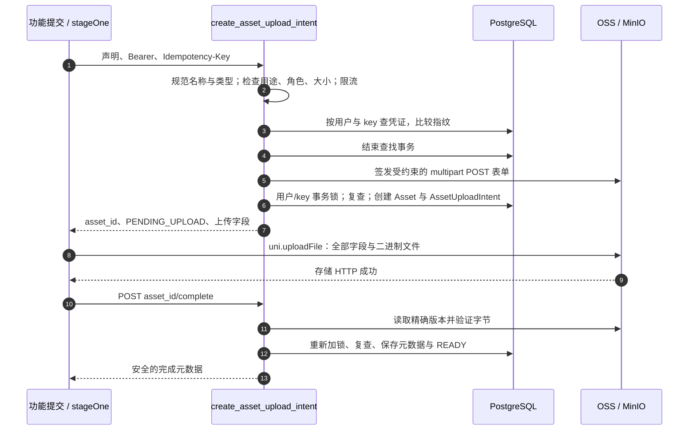
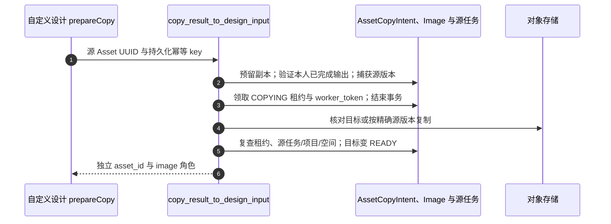

# 文件上传：从本地选择到经过验证的工作流输入

手机上选中文件时，得到的只是本地路径；上传存储成功时，得到的只是字节。Workflow 接受的是**已经验证所有权、声明用途与真实内容的 Asset ID**。本章追踪这些边界，再解释读取、复制和删除接口。源码链接固定到[审计版本](/zh/reference/source-revisions)。

## 从 UI 找到入口，分清两组角色名称 {#asset-entry}

标准图片功能组件提交时调用 [`submitStandardDesign`](https://github.com/Orientation-CD/wechat_mini_program/blob/eca0a5f9e0a2aa1cb3fd4f9714114bb3db7fae5f/src/pkg-features/services/standardDesignSubmit.ts#L51)：加载资料、Feature 与提示词可用性，检查权益，按开关绑定项目，再调用 `stageDesignImages`，之后才 `submitDesignJob`。家具功能则是 [`submit`](https://github.com/Orientation-CD/wechat_mini_program/blob/eca0a5f9e0a2aa1cb3fd4f9714114bb3db7fae5f/src/pkg-features/pages/furniture/index.vue#L605) → [`submitFurnitureDesign`](https://github.com/Orientation-CD/wechat_mini_program/blob/eca0a5f9e0a2aa1cb3fd4f9714114bb3db7fae5f/src/pkg-features/services/furnitureDesignSubmit.ts#L51)，按 Feature 要求准备场景、蒙版与可选参考图。

| 边界 | 图片角色名 | 为什么不同 |
| --- | --- | --- |
| 上传声明 | `image`、`masked_image`、`reference_image` | 描述上传策略接纳的文件用途。 |
| 规范 Workflow 输入 | `primary`、`mask`、`reference` | 描述操作如何使用已经验证的文件。 |
| 其他上传子类型 | AUDIO `recording`；PPTX DOCUMENT `attachment` | 使用不同内容校验器及 purpose/type 限制。 |

这些字符串是契约，不能随便互换。后端绑定输入时会检查兼容性；改 Workflow JSON 并不能把无关 Asset 变成有权使用的输入。

## 创建凭证：先声明一个文件，不发送字节 {#upload-intent}

**接口：`POST /v1/assets/upload-intents`。** 前端 [`stageOne`](https://github.com/Orientation-CD/wechat_mini_program/blob/eca0a5f9e0a2aa1cb3fd4f9714114bb3db7fae5f/src/pkg-features/repositories/designAssets.ts#L154) 根据用户、角色和逻辑文件 ID 得到稳定 key；带 Bearer 与 8–128 字符的 `Idempotency-Key`，发送：

```json
{
  "type": "IMAGE",
  "purpose": "DESIGN_JOB_INPUT",
  "role": "image",
  "original_filename": "living-room.jpg",
  "content_type": "image/jpeg",
  "size_bytes": 483102
}
```

`type` 选择持久化子类型，`purpose` 选择策略，`role` 声明输入角色。文件名是展示元数据，不是用户可任意指定的存储 key。类型和大小描述当前文件，complete 还会独立测量。`483102` 只是示例字节数，不是大小上限；真正限制以服务端/Feature 契约为准。



| 步骤 | 打开代码 | 应观察什么 |
| --- | --- | --- |
| 1 | [`stageOne`](https://github.com/Orientation-CD/wechat_mini_program/blob/eca0a5f9e0a2aa1cb3fd4f9714114bb3db7fae5f/src/pkg-features/repositories/designAssets.ts#L154) | 持久化幂等 key 对应一个逻辑文件/角色；响应不仅校验 UUID，还校验类型、用途和角色。 |
| 2–3 | [`create_asset_upload_intent`](https://github.com/Orientation-CD/YuanZhu-AI/blob/b13cc5668920620a274cb91a3393ed9fadac72ae/app/assets/asset_api.py#L392)、[`create_upload_intent`](https://github.com/Orientation-CD/YuanZhu-AI/blob/b13cc5668920620a274cb91a3393ed9fadac72ae/app/assets/assets.py#L236) | `_normalize_request`、`_validate_policy`、Redis 限流和指纹比较先于发布新凭证。 |
| 4–6 | [`create_upload_intent`](https://github.com/Orientation-CD/YuanZhu-AI/blob/b13cc5668920620a274cb91a3393ed9fadac72ae/app/assets/assets.py#L236)、[`S3Storage.create_upload_form`](https://github.com/Orientation-CD/YuanZhu-AI/blob/b13cc5668920620a274cb91a3393ed9fadac72ae/app/assets/storage.py#L922) | 签名可能获取外部凭证，所以在短 SQL 发布锁外完成；签完重查并发同 key 请求。 |
| 7–9 | [`directUpload`](https://github.com/Orientation-CD/wechat_mini_program/blob/eca0a5f9e0a2aa1cb3fd4f9714114bb3db7fae5f/src/pkg-features/repositories/designAssets.ts#L125) | POST multipart、`name: "file"` 与全部 `form.fields`；不把 API Authorization 带给对象存储。 |
| 10–13 | [`complete_asset_upload_route`](https://github.com/Orientation-CD/YuanZhu-AI/blob/b13cc5668920620a274cb91a3393ed9fadac72ae/app/assets/asset_api.py#L509)、[`complete_asset_upload`](https://github.com/Orientation-CD/YuanZhu-AI/blob/b13cc5668920620a274cb91a3393ed9fadac72ae/app/assets/asset_completion.py#L237) | 见下方验证算法。存储成功不是输入接纳成功。 |

首次成功返回 `201`，完全一致的重放返回 `200` 与同一身份。相同 key 搭配不同规范化声明会报 `IDEMPOTENCY_KEY_REUSED`。已 READY/RESERVED 的重放可以是 `upload: null`，`stageOne` 直接使用 ID，不再上传；尚未上传完成的重放在到期校验后可以取得新的签名表单。把 key 与草稿一起保留，每次重试都换 key 就失去这层保护。

服务端创建 `PENDING_UPLOAD` 的 `Image`、`Audio` 或 `Document` 行，以及记录用户/key 指纹、用途、角色和表单到期的 `AssetUploadIntent`。临时存储路径由服务端产生，形如 `temp/assets/...`；不能拿任意外部 URL 冒充输入身份。

### 文件传输是另一次 HTTP 请求

`upload.method` 必须是 `POST`。`url`、`fields`、`expires_at` 都来自服务端，字段应当作不可修改的签名/策略材料。`directUpload` 用 `uni.uploadFile`，不经过 JSON `request` 包装。因此开发者工具能连 API，不等于真机能连对象存储。这个边界应检查表单有效期、HTTPS/LAN 测试配置和平台上传域名设置。

## Complete：字节 → 精确对象身份 → READY {#asset-complete}

FastAPI 入口：[app/assets/asset_api.py → complete_asset_upload_route](https://github.com/Orientation-CD/YuanZhu-AI/blob/b13cc5668920620a274cb91a3393ed9fadac72ae/app/assets/asset_api.py#L509)。

**接口：`POST /v1/assets/{asset_id}/complete`。** 使用 API Bearer，不需要由客户端提交内容元数据。[`complete_asset_upload`](https://github.com/Orientation-CD/YuanZhu-AI/blob/b13cc5668920620a274cb91a3393ed9fadac72ae/app/assets/asset_completion.py#L237) 的算法是：

1. 完成操作限流，读取 Asset、upload intent 与子类型，检查所有者/管理员及临时保留到期。在访问存储与解析前结束查找事务。
2. 若已经完成，则 HEAD 对象并核对保存的身份；只有未改变才返回已有安全元数据。“完成过”不代表可以覆盖字节。
3. 对 pending 数据，HEAD 精确对象，要求非空且不超过策略大小，再读取所捕获的版本；计算 SHA-256，核对字节数与存储提供的 SHA 校验和。
4. 按子类型验证：图片真实字节及尺寸；音频容器与测得时长（[`validate_audio`](https://github.com/Orientation-CD/YuanZhu-AI/blob/b13cc5668920620a274cb91a3393ed9fadac72ae/app/assets/audio_validation.py#L53)）；PPTX 包结构；法律文本为有界、无 NUL 的 UTF-8。文件后缀/MIME 声明本身不能通过验证。
5. 再 HEAD，要求 ETag、version ID 与大小一致，防止验证中被替换。管理图片/法律文本按精确已验证版本复制到最终路径；普通设计输入保持临时存储。
6. 获取 `asset-upload-completion` 事务咨询锁，重新读行，复查 key/状态/有效期，再写类型、大小、SHA-256、ETag/版本、验证时间及宽高或时长。设计输入变 READY；管理/法律用途走 ACTIVE/finalized 策略。路由提交后才返回。

音频校验并非完整音频解码：它验证有界容器并用解析器测时长。当前支持的音频类型上限为 25,000,000 字节、7,200 秒，浏览器接力接口也会返回这些限制。把文件重命名为 `.pptx` 同样无法保证通过 PPTX 验证。

| 错误 | 发生位置 | 应保留什么 / 怎么重试 |
| --- | --- | --- |
| `ASSET_UPLOAD_INCOMPLETE` | HEAD 不存在/空对象 | 保留 Asset ID/key；确认存储请求完成，有限次延后 complete 可能成功。 |
| `ASSET_CONTENT_CHANGED` | 版本、ETag、大小或校验和不符 | 停止使用被覆盖对象，按恢复流程重新选择/声明。 |
| `INVALID_IMAGE`、`INVALID_AUDIO`、`INVALID_DOCUMENT` | 真实字节校验 | 修正文件；相同坏字节反复上传没有帮助。 |
| `ASSET_STATE_CONFLICT` | 并发状态变化后的复查 | 路由返回 `Retry-After` 时按它处理，不在前端猜 READY。 |
| 存储/保护不可用 | S3/Redis 边界 | 保留逻辑操作，按应用有限重试策略处理。 |

前端把三个边界标为 `asset-intent`、`asset-upload`、`asset-complete`，这些标签用于判断**失败发生在哪一段**。多图片角色通过 `Promise.all` 并行；每个角色保留各自持久化 key，重试时可复用已接纳的角色，不必改变身份。

## 读取单个 Asset：恢复并复查报告附件 {#asset-get}

**接口：`GET /v1/assets/{asset_id}`。** 一个真实小程序调用是恢复/复用 PPTX 附件时的 [`verifyReportAttachment`](https://github.com/Orientation-CD/wechat_mini_program/blob/eca0a5f9e0a2aa1cb3fd4f9714114bb3db7fae5f/src/pkg-features/repositories/reportAttachment.ts#L42)；提交前检查 UUID 一致、READY、DOCUMENT、DESIGN_JOB_INPUT、`attachment` 且未过期。

[`get_asset_route`](https://github.com/Orientation-CD/YuanZhu-AI/blob/b13cc5668920620a274cb91a3393ed9fadac72ae/app/assets/asset_api.py#L608) → [`get_asset`](https://github.com/Orientation-CD/YuanZhu-AI/blob/b13cc5668920620a274cb91a3393ed9fadac72ae/app/assets/asset_management.py#L229) 加载元数据与子类型，只允许所有者或管理员。未知和别人的 ID 均表现为 unavailable，避免泄露所有权。已移除企业输出对普通用户隐藏；正在删除的项目/已移除输出不返回预览地址。响应可签发有权访问的预览 URL，但不会把裸存储 key 当成通用权限交给客户端。

[`_view`](https://github.com/Orientation-CD/YuanZhu-AI/blob/b13cc5668920620a274cb91a3393ed9fadac72ae/app/assets/asset_management.py#L194) 对普通所有者返回验证元数据；`preview_url`、所有者身份与管理标题只在管理员视图中提供，还受前述预览抑制规则约束。不能假设所有者读元数据就一定获得下载 URL。

读元数据不是读存储文件，预览 URL 也不是永久身份。保存 `asset_id`，需要时从对应的授权接口更新临时地址。

## 列举 Asset：管理员 API，不是个人图库 {#asset-list}

**接口：`GET /v1/assets`。** 当前小程序没有调用，这是管理/集成入口。[`list_assets_route`](https://github.com/Orientation-CD/YuanZhu-AI/blob/b13cc5668920620a274cb91a3393ed9fadac72ae/app/assets/asset_api.py#L563) → [`list_assets`](https://github.com/Orientation-CD/YuanZhu-AI/blob/b13cc5668920620a274cb91a3393ed9fadac72ae/app/assets/asset_management.py#L254) 拒绝非管理员，应用 `type`、`status`、`q`、`page`、`page_size`，计算总数，再以 `(created_at DESC, id DESC)` 稳定分页。`page_size` 范围 1–100。

查询覆盖原文件名、展示标题及关联任务/Asset 身份，各项按安全视图规则返回。正在删除的项目或移除企业可抑制预览签名。此路径读 SQL、签预览，不入生成队列。普通 Bearer 用户得到 `403 ASSET_ADMIN_REQUIRED` 是权限结果，不代表上传坏了。

## 复用生成图：创建独立的输入副本 {#asset-copy}

**接口：`POST /v1/assets/{source_asset_id}/design-input-copies` FastAPI 入口是 `copy_design_result_to_input_route`，随后调用下方的 `copy_result_to_design_input`。。** 用生成图进入自定义设计时，经过 [`prepareCopy`](https://github.com/Orientation-CD/wechat_mini_program/blob/eca0a5f9e0a2aa1cb3fd4f9714114bb3db7fae5f/src/pkg-features/pages/customized_design/index.vue#L199) → [`copyResultInput`](https://github.com/Orientation-CD/wechat_mini_program/blob/eca0a5f9e0a2aa1cb3fd4f9714114bb3db7fae5f/src/pkg-features/repositories/customizedDesign.ts#L53)。稳定 key 包含用户、逻辑复制 ID、源 Asset ID，不是把公开结果 URL 当输入提交。



| 步骤 | 源码 | 分支 |
| --- | --- | --- |
| 1 | [`copyResultInput`](https://github.com/Orientation-CD/wechat_mini_program/blob/eca0a5f9e0a2aa1cb3fd4f9714114bb3db7fae5f/src/pkg-features/repositories/customizedDesign.ts#L53) | 仅对指定 `ASSET_COPY_IN_PROGRESS`/存储不可用做有限重试，并保留同 key。 |
| 2–3 | [`_reserve_copy`](https://github.com/Orientation-CD/YuanZhu-AI/blob/b13cc5668920620a274cb91a3393ed9fadac72ae/app/assets/asset_copies.py#L156)、[`_claim_copy`](https://github.com/Orientation-CD/YuanZhu-AI/blob/b13cc5668920620a274cb91a3393ed9fadac72ae/app/assets/asset_copies.py#L313) | 慢 I/O 前持久化 intent 与目标身份，租约 Token 决定谁可最终提交。 |
| 4 | [`copy_result_to_design_input`](https://github.com/Orientation-CD/YuanZhu-AI/blob/b13cc5668920620a274cb91a3393ed9fadac72ae/app/assets/asset_copies.py#L592) | 复制前先 HEAD 目标；存储响应不明确时做对账，避免已经完成却重复复制。 |
| 5–6 | [`_finalize_copy`](https://github.com/Orientation-CD/YuanZhu-AI/blob/b13cc5668920620a274cb91a3393ed9fadac72ae/app/assets/asset_copies.py#L455) | 复查源任务完成、项目/空间仍有效与租约，写目标元数据和 COMPLETED intent 并提交。 |

成功为 `201`，已完成重放为 `200`，返回 Asset ID 必须不同于源 ID。这里的 `worker_token` 是复制租约，不是把任务放进 submit worker 队列。对象复制期间源被删除或权限丢失，最终提交也必须被阻止。

## 删除：管理员权限与引用检查缺一不可 {#asset-delete}

**接口：`DELETE /v1/assets/{asset_id}`。** 当前小程序没有调用。[`delete_asset_route`](https://github.com/Orientation-CD/YuanZhu-AI/blob/b13cc5668920620a274cb91a3393ed9fadac72ae/app/assets/asset_api.py#L644) → [`delete_asset`](https://github.com/Orientation-CD/YuanZhu-AI/blob/b13cc5668920620a274cb91a3393ed9fadac72ae/app/assets/asset_management.py#L380) 锁相关复制/Asset 记录，拒绝预备/复制中的目标、RESERVED 状态、任务输入/输出、operation 输入、PPTX/视频预留以及法律版本引用。法律文本应走专属服务删除，因为还要保护 current 指针与接受证据。

闲置对象才删除全部存储版本并移除 Asset 行；不存在的行幂等返回 `204`。复制目标有专门的已提交解绑路径，先保留复制证据再清存储。SQL 完整性并发冲突会回滚并返回 `409 ASSET_STATE_CONFLICT`、`Retry-After: 1`；存储删除失败为 `503`。数据库事务不能原子回滚 S3，因此必须依赖版本身份与持久化证据。

## 跟读练习：证明文件经过了每个边界 {#asset-debug}

在有权使用的本地存储环境，用可丢弃文件：

1. 打开 `stageOne`，在 intent 前断点，只记录逻辑 key/角色及元数据。预期：新文件改变操作身份，同文件重试不改变。
2. Network 中分开看 JSON intent、multipart 存储 POST、JSON complete。预期：前后对应同一 Asset UUID；API Bearer 只去 API。存储 2xx 后仍要验证。
3. 打开 `complete_asset_upload`，找到两次 HEAD、中间的版本读取以及后面的咨询锁。预期：慢读取/解析在第一段 SQL 事务外，提交 READY 前再复查状态。
4. 对照脱敏持久化证据：`assets`、子类型、`asset_upload_intents`、SHA-256、版本、验证时间。预期：READY 有验证元数据；然后沿 ID 到 `/v1/workflows`，继续[工作流章节](/zh/reference/flows/design-job-lifecycle)。
5. 复用结果前读复制与删除检查。预期：源/目标 ID 不同，管理接口删除被引用结果会遭拒绝，而不是悄悄破坏工作流。

“上传成功却无法生成”要先问成功的是哪段：存储 2xx、complete READY、Workflow 接纳是三个可独立观察的事件，各有校验与权限边界。
