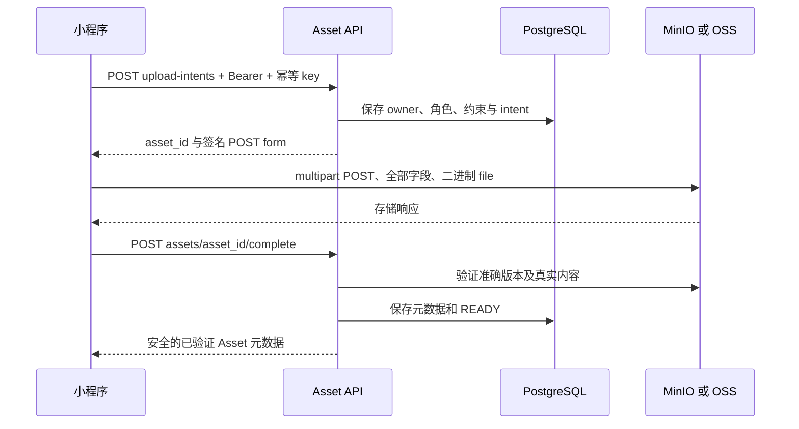

# Asset 上传调用链

客户端通过受约束的签名 **multipart POST** 直接上传对象存储；API 准入并验证对象。Workflow 输入不是 base64 图片，也不是调用者指定的对象 URL。

## 1. 声明不可变 intent

向 `POST /v1/assets/upload-intents` 提交 `type`、`purpose`、`role`、文件名、真实 `content_type`/`size_bytes`。每个二进制/角色独立持久 key；首次 `201`，相同重放 `200`。无需继续上传时 `upload` 可为空，以响应状态为准。

普通图片为 `IMAGE`、`DESIGN_JOB_INPUT`，上传 role 为 `image`、`masked_image`、`reference_image`。音频使用允许的 recording；PPTX 按授权流程使用 document/attachment。Admin 图片、法律文档另有权限/类型规则。提交 Workflow 改 JSON 不能重新分类上传。

form 返回 `method: "POST"`、`url`、`fields`、`expires_at`。全部字段是不透明签名材料，不能自行派生 endpoint/key、改成 PUT 或省略 policy/signature。

## 2. 传输字节

平台 multipart 工具携带所有字段及二进制 `file`，不向 OSS/MinIO 传 API Bearer。遵守过期、长度/类型和公网 endpoint 约束。真机必须可达该 host，Compose/VPC 内网地址不能作为手机公网目标。

多个必需角色可独立并行上传，分别保存 Asset ID/原 key。某条失败不废弃其他成功链，只重试失败链，不自动重传全部或新建 Job。

## 3. complete 与验证

存储成功后，以 API 身份调用 `POST /v1/assets/{asset_id}/complete`。完成流程核对对象版本/内容/长度，保存 hash、ETag、子类型元数据并发布 `READY`。存储 HTTP 成功不代表 Asset 已获准提交。

`ASSET_UPLOAD_INCOMPLETE`、`ASSET_STATE_CONFLICT` 或暂时保护按 `Retry-After` 做有界稍后重试。对象改变/过期、不支持内容、owner 错误按对应契约修正，不在准入后覆盖同一对象。

## 4. 绑定 Workflow

图片 Workflow 使用 Asset ID 和 canonical role `primary`、`mask`、`reference`；后端验证原 intent role、owner、ready 和角色集合。结果转输入的 copy 端点生成独立已验证 Asset，不能直接复用结果 URL。

持久保存 Asset 身份/不可变元数据，预览/下载 URL 过期后重新从授权 API 获取。删除/保留受 pin 与引用约束，删除 Job 或离开空间不授权任意删对象；Asset 删除接口本身仅限管理员。

语音浏览器交接通过受限 cookie/Origin/CSRF 路由复用 intent/complete 校验，不暴露通用应用 token，也不改变底层直传协议。

## 源码依据

已按[记录的源码版本](/zh/reference/source-revisions)核对。

- [Asset API 和状态](https://github.com/Orientation-CD/YuanZhu-AI/blob/b13cc5668920620a274cb91a3393ed9fadac72ae/app/assets/asset_api.py)
- [intent 策略与签名](https://github.com/Orientation-CD/YuanZhu-AI/blob/b13cc5668920620a274cb91a3393ed9fadac72ae/app/assets/assets.py)
- [准确对象验证](https://github.com/Orientation-CD/YuanZhu-AI/blob/b13cc5668920620a274cb91a3393ed9fadac72ae/app/assets/asset_completion.py)
- [存储实现](https://github.com/Orientation-CD/YuanZhu-AI/blob/b13cc5668920620a274cb91a3393ed9fadac72ae/app/assets/storage.py)
