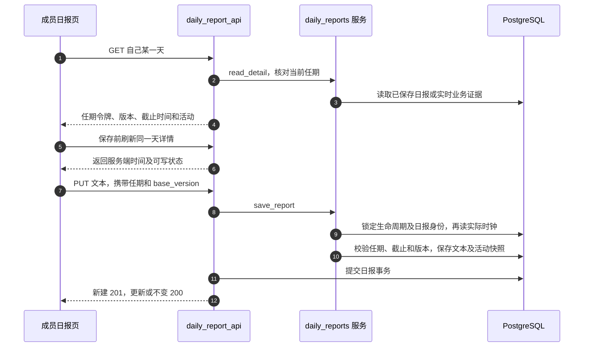

# 企业日报：成员任期、截止时间与带版本的反馈

企业成员从「项目」页的日报卡片填写、补交或查看自己的日报。企业所有者从企业看板进入「成员」，默认在「日报」按日期查看提交情况、阅读正文及写批注。九条日报接口覆盖这些操作。 [openDailyReport](https://github.com/Orientation-CD/wechat_mini_program/blob/7f1a3169338c10bd4139c24318f7a35caf86310c/src/pages/projects/index.vue#L77) · [src/pkg-projects/pages/members/index.vue](https://github.com/Orientation-CD/wechat_mini_program/blob/7f1a3169338c10bd4139c24318f7a35caf86310c/src/pkg-projects/pages/members/index.vue)

日报身份为 `(workspace_id,user_id,membership_started_at,report_date)`。加入时间区分离开后重新加入产生的新任期。开始要求填写的日期取迁移后的系统起始日与当前任期北京加入日的较晚者。所有者不提交成员日报，所有者仅能读取当前非所有者成员。保留的旧日报不会作为新任期的日报暴露。

## 真实调用与 Mock 预览

线上使用 `apiDailyReports`，在可见页面内按账号、角色、空间和会话代次核对响应。截图工具指定 Mock 数据源和专用预览开关，通过与角色匹配的 `preview=member` 或 `preview=owner` 使用本地样例。额度设置仍需真实企业空间。 [apiDailyReports](https://github.com/Orientation-CD/wechat_mini_program/blob/7f1a3169338c10bd4139c24318f7a35caf86310c/src/pkg-projects/services/dailyReports.ts#L90) · [scripts/capture-daily-report.mjs](https://github.com/Orientation-CD/wechat_mini_program/blob/7f1a3169338c10bd4139c24318f7a35caf86310c/scripts/capture-daily-report.mjs) · [mockDailyReports](https://github.com/Orientation-CD/wechat_mini_program/blob/7f1a3169338c10bd4139c24318f7a35caf86310c/src/pkg-projects/services/dailyReportsMock.ts#L97)

## 时钟与数据模型

业务日期全部采用北京日期，响应时间戳采用 UTC。D 日的按时日报可在 D+1 北京时间 00:00 **之前**编辑；若尚未提交，可在 D+1 12:00 **之前**补交。补交成功后立即锁定；已有按时日报过午夜不能再编辑。服务在等待日报锁之后读取 PostgreSQL `clock_timestamp()`，因此截止前开始的事务不能延长截止时间。

`DailyReport` 保存去首尾空白后的文本、版本、提交／补交信息、冻结的活动 JSON、所有者已读版本、批注版本和成员已看版本。`DailyReportState` 保存迁移确定的起始日；缺失状态属于完整性故障，不能偷偷把历史重置为今天。[daily_report_activity](https://github.com/Orientation-CD/YuanZhu-AI/blob/f34b8a4d6307c83c6f7bbc905485a4f586d59a99/app/workspaces/daily_report_activity.py#L49) 读取北京当天的项目创建、阶段／成交流失事件和受支持的成功根任务，使用实际操作者／作者及事件记录时间；补录的旧业务日期不会把操作挪到以前的日报。已保存日报使用快照，未保存详情使用实时证据。

| 图中步骤 | 源码 | 此时成立的事实 |
| --- | --- | --- |
| 1–4 | [refresh](https://github.com/Orientation-CD/wechat_mini_program/blob/7f1a3169338c10bd4139c24318f7a35caf86310c/src/pkg-projects/pages/daily-report/index.vue#L168) → [read_detail](https://github.com/Orientation-CD/YuanZhu-AI/blob/f34b8a4d6307c83c6f7bbc905485a4f586d59a99/app/workspaces/daily_reports.py#L209) 与 `detail` | 实时预览还不是已持久化日报 |
| 5–6 | [save](https://github.com/Orientation-CD/wechat_mini_program/blob/7f1a3169338c10bd4139c24318f7a35caf86310c/src/pkg-projects/pages/daily-report/index.vue#L221) | 先确认可写窗口，保留开始编辑时记录的版本 |
| 7–10 | [apiDailyReports](https://github.com/Orientation-CD/wechat_mini_program/blob/7f1a3169338c10bd4139c24318f7a35caf86310c/src/pkg-projects/services/dailyReports.ts#L90) → [save_report](https://github.com/Orientation-CD/YuanZhu-AI/blob/f34b8a4d6307c83c6f7bbc905485a4f586d59a99/app/workspaces/daily_reports.py#L250) 与 `locked_report` | 任期隔离、咨询锁、实际时钟和内容乐观锁一起生效 |
| 11–12 | [put_report](https://github.com/Orientation-CD/YuanZhu-AI/blob/f34b8a4d6307c83c6f7bbc905485a4f586d59a99/app/workspaces/daily_report_api.py#L65) | 返回 201／200 前事务已经提交 |

## 读取自己的首页状态 {#daily-report-status}

`GET /v1/workspaces/{workspace_id}/daily-reports/me/status`

处理函数 `status` 调用 `member_status`，核对当前成员并使用同一个服务端时间，返回今天是否提交／所有者是否已读、昨天能否补交、未看批注日期及 `primary_action`。可补交昨天时优先推荐补交，然后才是填写今天。不写日报、回执或活动记录。

项目页仅在空间、会话和读取代次仍匹配时采用状态响应。主按钮使用 `primary_action.target_date`，独立的批注提醒使用 `comment_target_date`。卡片可见时按 `server_now` 安排北京正午或午夜刷新。状态请求失败时仍可使用项目列表。 [refreshDailyStatus](https://github.com/Orientation-CD/wechat_mini_program/blob/7f1a3169338c10bd4139c24318f7a35caf86310c/src/pages/projects/index.vue#L62) · [loadDailyReportStatus](https://github.com/Orientation-CD/wechat_mini_program/blob/7f1a3169338c10bd4139c24318f7a35caf86310c/src/services/dailyReportStatus.ts#L7)

## 读取自己的日历 {#daily-report-calendar}

`GET /v1/workspaces/{workspace_id}/daily-reports/me`

处理函数 `history` 调用 `calendar`，按要求填写的每个自然日生成条目，包括缺报日，不只是列出已有记录。`cursor` 是不包含边界自身的北京 `YYYY-MM-DD`，不是日报 UUID；limit 为 1–100，默认 20。未来／格式错误游标返回 422 `DAILY_REPORT_DATE_INVALID`。`next_cursor` 为 null 时结束，每一页都重新限制当前任期。

成员详情加载后读取历史。页面、会话和成员任期一致时才更新列表。加载更多会追加不重复的日期并推进游标。返回任期不同时清空历史，提示成员重新进入。 [loadHistory](https://github.com/Orientation-CD/wechat_mini_program/blob/7f1a3169338c10bd4139c24318f7a35caf86310c/src/pkg-projects/pages/daily-report/index.vue#L197)

## 读取自己的某一天 {#daily-report-own-detail}

`GET /v1/workspaces/{workspace_id}/daily-reports/me/{date}`

`get_report` 调用 `read_detail`，校验日期在 `required_since` 与今天之间，再返回 `detail`。没有记录是合法的草稿／缺报详情：`version:null`、空白文本和实时活动，不是 404。已有记录返回活动快照和反馈版本。读取不会改变所有者已读或成员已看批注状态。

日报卡片、批注提醒和历史列表各自指定日期。请求前 `verify` 确认登录身份、所选企业和成员角色，响应后 `adopt` 核对空间、日期和用户。任期变化会清除旧草稿与历史。 [refresh](https://github.com/Orientation-CD/wechat_mini_program/blob/7f1a3169338c10bd4139c24318f7a35caf86310c/src/pkg-projects/pages/daily-report/index.vue#L168) · [adopt](https://github.com/Orientation-CD/wechat_mini_program/blob/7f1a3169338c10bd4139c24318f7a35caf86310c/src/pkg-projects/pages/daily-report/index.vue#L95)

## 保存或补交 {#daily-report-save}

`PUT /v1/workspaces/{workspace_id}/daily-reports/me/{date}`

`put_report` 调用 `save_report` 后提交。请求体必填 `membership_started_at`、`base_version`（首次创建填 null）、`today`；`next` 默认空、`needs_support` 默认 false。去首尾空白后，today 必填且最多 500 个 Unicode 字符；next 最多 500 字，请求支持时必填。严格模型拒绝多余字段和类型强制转换。

`locked_report` 以空间／用户／当前任期／日期为事务咨询锁键，即使首次创建也能串行，并锁定已有记录。任期时间戳不匹配返回 409 `DAILY_REPORT_CONFLICT`、`reason:membership_changed`；旧内容版本且文本不同，返回同一错误码、`reason:version_mismatch` 和当前详情；窗口关闭后尝试不同内容返回 `DAILY_REPORT_LOCKED` 和当前详情。保留本地草稿并核对，不能盲目覆盖并发修改。规范化文本完全相同的重放，即使过期或 base_version 已旧，也可能返回当前不变详情。在可编辑窗口内，即使文本相同，活动快照变化仍可推进内容版本。首次创建返回 201／版本 1；更新或空操作返回 200。文本和快照不存在分开的提交。

页面进入编辑时记录当时展示的任期和基准版本。点击保存先记录草稿请求，再刷新详情，仍可写时发送原请求。若刚进入补交时段，页面请成员另行确认补交。前端与服务端同样裁剪首尾空白并按 Unicode 码点计数。正文冲突时保留草稿，提供复制或载入最新版本。任期变化则清除旧草稿。 [save](https://github.com/Orientation-CD/wechat_mini_program/blob/7f1a3169338c10bd4139c24318f7a35caf86310c/src/pkg-projects/pages/daily-report/index.vue#L221) · [reportDraftError](https://github.com/Orientation-CD/wechat_mini_program/blob/7f1a3169338c10bd4139c24318f7a35caf86310c/src/pkg-projects/services/dailyReports.ts#L12)

窗口关闭后，`confirmLockedSave` 用刷新返回的详情核对任期、保存版本及裁剪后的字段。只有版本已保存或进展且内容匹配，才确认超时的那次保存。之后输入但未提交的内容可复制。 [confirmLockedSave](https://github.com/Orientation-CD/wechat_mini_program/blob/7f1a3169338c10bd4139c24318f7a35caf86310c/src/pkg-projects/pages/daily-report/index.vue#L113)

## 成员确认看过某一版本批注 {#daily-report-comment-seen}

`POST /v1/workspaces/{workspace_id}/daily-reports/me/{date}/comment-seen`

处理函数 `see_comment` 调用服务 `see_comment`，携带任期令牌并锁定同一个日报身份。没有已保存日报返回 404 `DAILY_REPORT_NOT_FOUND`。只有 `comment_version` 等于当前非空批注版本，才推进已看版本。旧版本返回 200 `applied:false` 和当前版本，不能隐藏刚到达的新反馈。路由仅提交该确认。

打开详情时，页面等待视图渲染，再确认已展示的 `owner_comment_version`。回执对应不同版本时刷新详情，替换批注仍为未看。定时刷新和保存前刷新不确认批注。 [acknowledge](https://github.com/Orientation-CD/wechat_mini_program/blob/7f1a3169338c10bd4139c24318f7a35caf86310c/src/pkg-projects/pages/daily-report/index.vue#L145)

## 所有者读取团队某天列表 {#daily-report-owner-day}

`GET /v1/workspaces/{workspace_id}/daily-reports`

`get_owner_day` 调用 `owner_day`，要求当前有效企业所有者。可选 `date` 默认服务端今天，不能早于迁移起始日或晚于今天。`load_report_day` 仅纳入符合日期要求的当前非所有者成员，按每人的当前任期令牌连接日报。`report_day_counts` 计算应交／已交／未交／求助人数。已交按提交时间倒序、用户 ID 处理同时间；未交优先连续最终缺报天数，再按加入时间和 ID。仍可补交的窗口不算最终缺报。读取提交权限事务，但不标记已读。

企业看板打开成员页，确认所有者身份后加载默认「日报」标签。日期选择受 `daily_report_started_on` 和 `today_date` 约束，可见列表按服务端时间在北京正午或午夜更新。读取失败时可重试所选日期。所有者权限仍有效时，日报读取失败不会阻塞独立的额度标签。 [openMembers](https://github.com/Orientation-CD/wechat_mini_program/blob/7f1a3169338c10bd4139c24318f7a35caf86310c/src/pages/projects/index.vue#L162) · [load](https://github.com/Orientation-CD/wechat_mini_program/blob/7f1a3169338c10bd4139c24318f7a35caf86310c/src/pkg-projects/components/OwnerReportList.vue#L15)

## 所有者读取当前成员详情 {#daily-report-owner-detail}

`GET /v1/workspaces/{workspace_id}/daily-reports/{user_id}/{date}`

`get_owner_detail` 调用 `owner_detail` → `owner_target` → `detail`，核实当前所有者与当前非所有者目标，校验该成员自己的要求日期范围，返回相同的实时／快照区别。未知、已离开、所有者目标或无权定向查询隐藏为 404 `DAILY_REPORT_NOT_FOUND`。读取不修改反馈或已读版本。

已提交的成员行把所选空间、日期和成员传给日报页。页面读取前重新确认账号、企业和所有者角色。打开活动中的项目需要再次核对只读项目权限。 [open](https://github.com/Orientation-CD/wechat_mini_program/blob/7f1a3169338c10bd4139c24318f7a35caf86310c/src/pkg-projects/components/OwnerReportList.vue#L51) · [verify](https://github.com/Orientation-CD/wechat_mini_program/blob/7f1a3169338c10bd4139c24318f7a35caf86310c/src/pkg-projects/pages/daily-report/index.vue#L75) · [openProject](https://github.com/Orientation-CD/wechat_mini_program/blob/7f1a3169338c10bd4139c24318f7a35caf86310c/src/pkg-projects/pages/daily-report/index.vue#L289)

## 所有者标记特定内容版本已读 {#daily-report-read}

`POST /v1/workspaces/{workspace_id}/daily-reports/{user_id}/{date}/read`

`read_owner_report` 携带 `membership_started_at` 与 `version` 调用 `mark_read`，锁定权限和日报，要求已有记录；只有提交版本仍为当前版本，才更新 `owner_read_version`。旧版本返回 200 `applied:false` 与 `current_version`。成员之后编辑会递增内容版本，使 `owner_read` 再次变成 false。路由提交确认；单纯打开详情不能替代它。

所有者详情渲染后，页面确认当前展示的保存版本。版本变化时按回执刷新日报。新正文须等下一次查看操作再确认。 [acknowledge](https://github.com/Orientation-CD/wechat_mini_program/blob/7f1a3169338c10bd4139c24318f7a35caf86310c/src/pkg-projects/pages/daily-report/index.vue#L145)

## 所有者保存或清除批注 {#daily-report-comment}

`PUT /v1/workspaces/{workspace_id}/daily-reports/{user_id}/{date}/comment`

`comment_owner_report` 在所有者／目标任期隔离和日报锁下调用 `save_comment`。请求体包含目标当前 `membership_started_at` 和 `comment`。去首尾空白后最多 200 个 Unicode 字符，空白清除为 null。值变化才递增 `owner_comment_version` 和更新时间；同值保存不递增。此接口没有内容 `base_version` 或批注比较交换，串行后的最后一次不同值写入生效。路由提交并返回当前批注信息；保存批注既不代表成员已看，也不标记正文已读。

保存批注要求所有者视图与已提交的日报版本。视图和日期仍匹配时，页面才采用返回的批注。成员另用批注版本发送已看确认。 [saveComment](https://github.com/Orientation-CD/wechat_mini_program/blob/7f1a3169338c10bd4139c24318f7a35caf86310c/src/pkg-projects/pages/daily-report/index.vue#L267)

## 错误边界与源码练习

Bearer 缺失／过期为 401。成员不能编辑别人的日报，所有者／个人空间自填返回 403 `DAILY_REPORT_NOT_REQUIRED`。非所有者读团队日列表为 403 `WORKSPACE_OWNER_REQUIRED`，无权定向探测使用 404。已失去权限先被拒绝，再讨论企业是否停用；仍有访问权但企业停用返回 409 `WORKSPACE_INACTIVE`。这些错误不同于合法空日历或尚无草稿。

沿 [app/workspaces/daily_report_api.py](https://github.com/Orientation-CD/YuanZhu-AI/blob/f34b8a4d6307c83c6f7bbc905485a4f586d59a99/app/workspaces/daily_report_api.py)、[app/workspaces/daily_reports.py](https://github.com/Orientation-CD/YuanZhu-AI/blob/f34b8a4d6307c83c6f7bbc905485a4f586d59a99/app/workspaces/daily_reports.py)、[tests/test_daily_report_member_api.py](https://github.com/Orientation-CD/YuanZhu-AI/blob/f34b8a4d6307c83c6f7bbc905485a4f586d59a99/tests/test_daily_report_member_api.py)、[tests/test_daily_report_owner_api.py](https://github.com/Orientation-CD/YuanZhu-AI/blob/f34b8a4d6307c83c6f7bbc905485a4f586d59a99/tests/test_daily_report_owner_api.py) 及 PostgreSQL 变体阅读。集成练习先读某一天，复制任期令牌／版本，保存后重读持久化快照，再确认特定正文／批注版本。本章提供可复现顺序，不声称本次更新运行过真实应用端到端测试。

前端用例覆盖跨午夜补交确认、断网后恢复、版本冲突、已离页响应和新任期。 [tests/dailyReportPage.test.ts](https://github.com/Orientation-CD/wechat_mini_program/blob/7f1a3169338c10bd4139c24318f7a35caf86310c/tests/dailyReportPage.test.ts) · [tests/dailyReports.test.ts](https://github.com/Orientation-CD/wechat_mini_program/blob/7f1a3169338c10bd4139c24318f7a35caf86310c/tests/dailyReports.test.ts) · [tests/membersPage.test.ts](https://github.com/Orientation-CD/wechat_mini_program/blob/7f1a3169338c10bd4139c24318f7a35caf86310c/tests/membersPage.test.ts)
