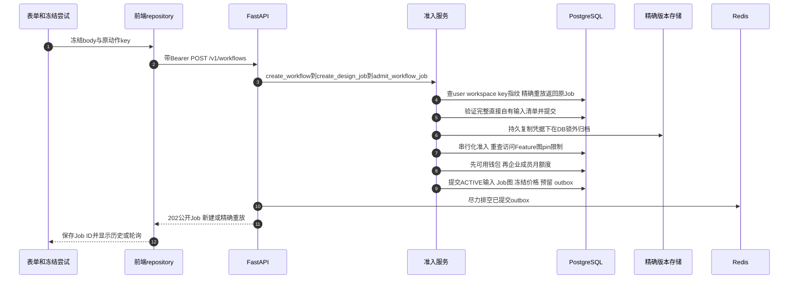
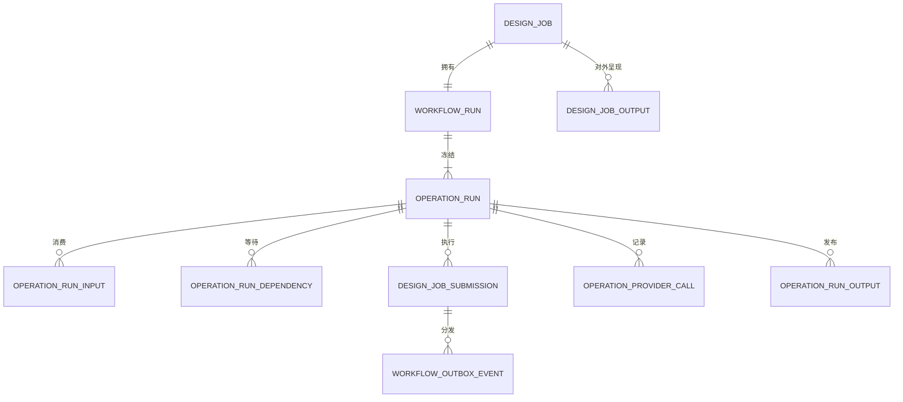
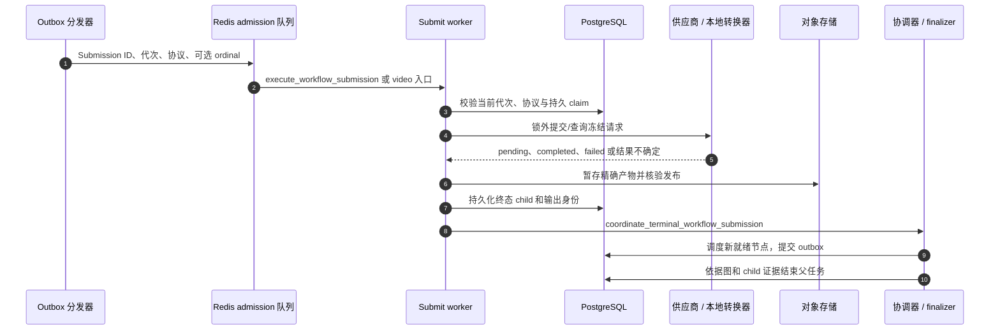

# Workflow 准入、worker 与持久结算

先从一次具体的报告或文案提交开始。本章跟进共享执行引擎；[产品分支](/zh/reference/flows/workflow-products-flow)解释图片、音频、视频差异；[历史操作](/zh/reference/flows/workflow-history-flow)解释读取、重试和删除。公开 Workflow ID 是 Job ID，不是内部 run ID。

## 从表单按钮到接受任务 {#submit-workflow}

`POST /v1/workflows`接收严格的区分联合body，由`type`选择schema。报告表单冻结`WorkflowAttempt`，`postWorkflow`经`workflowsRepository.submit`带上owner/工作区/session保护及持久8–128字符动作key。文案也使用规范路由，部分现有图片/语音/视频表单仍发送已实现的兼容适配器。真实调用见[联调状态](/zh/reference/integration-status)，不能只换文档里的路径。

| 消息 | 精确源码 | 检查点 |
| --- | --- | --- |
|1–2|[src/pkg-features/services/workflowSubmission.ts → postWorkflow](https://github.com/Orientation-CD/wechat_mini_program/blob/21db6d824a7b32417bda88e7e31d3f0b91dfa51c/src/pkg-features/services/workflowSubmission.ts#L61)与[src/repositories/workflows.ts → workflowsRepository](https://github.com/Orientation-CD/wechat_mini_program/blob/21db6d824a7b32417bda88e7e31d3f0b91dfa51c/src/repositories/workflows.ts#L13)|尝试保留body/owner/key，本地保护不代替服务端认证。|
|3|[app/workflows/api.py → create_workflow](https://github.com/Orientation-CD/YuanZhu-AI/blob/e59716c83e087deda8477da5ea7b327a40cf65c5/app/workflows/api.py#L1135) → [app/workflows/api.py → create_design_job](https://github.com/Orientation-CD/YuanZhu-AI/blob/e59716c83e087deda8477da5ea7b327a40cf65c5/app/workflows/api.py#L1014)|FastAPI依赖、严格联合、限流回调与错误映射。|
|4|[app/workflows/workflow_admission.py → admit_workflow_job](https://github.com/Orientation-CD/YuanZhu-AI/blob/e59716c83e087deda8477da5ea7b327a40cf65c5/app/workflows/workflow_admission.py#L2939)|新工作前检查当前工作区和指纹，精确重放不再预留。|
|5–6|[app/workflows/workflow_admission.py → _archive_request_inputs](https://github.com/Orientation-CD/YuanZhu-AI/blob/e59716c83e087deda8477da5ea7b327a40cf65c5/app/workflows/workflow_admission.py#L1995) → [app/assets/asset_input_archival.py → archive_direct_input](https://github.com/Orientation-CD/YuanZhu-AI/blob/e59716c83e087deda8477da5ea7b327a40cf65c5/app/assets/asset_input_archival.py#L581)|claim/复制/核验/发布以短SQL阶段围绕无锁存储I/O执行。|
|7|[app/workflows/workflow_admission.py → resolve_workflow](https://github.com/Orientation-CD/YuanZhu-AI/blob/e59716c83e087deda8477da5ea7b327a40cf65c5/app/workflows/workflow_admission.py#L420)|当前Feature、图/配置和产品契约，准备后再次校验权威。|
|8|[app/workflows/workflow_admission.py → _reserve_feature_workflow_tokens](https://github.com/Orientation-CD/YuanZhu-AI/blob/e59716c83e087deda8477da5ea7b327a40cf65c5/app/workflows/workflow_admission.py#L2295) → [app/billing/member_token_quotas.py → member_token_limit_violation](https://github.com/Orientation-CD/YuanZhu-AI/blob/e59716c83e087deda8477da5ea7b327a40cf65c5/app/billing/member_token_quotas.py#L302)|企业余额不足优先于有限成员额度。|
|9|[app/workflows/workflow_admission.py → _activate_archived_inputs](https://github.com/Orientation-CD/YuanZhu-AI/blob/e59716c83e087deda8477da5ea7b327a40cf65c5/app/workflows/workflow_admission.py#L2074)与[app/workflows/workflow_admission.py → _persist_workflow_execution](https://github.com/Orientation-CD/YuanZhu-AI/blob/e59716c83e087deda8477da5ea7b327a40cf65c5/app/workflows/workflow_admission.py#L2603)|独占ACTIVE无过期输入、不可变pin、图、账务预留和ready outbox原子提交。|
|10–12|[app/workflows/submissions/workflow_submission_dispatch.py → dispatch_workflow_submission_outbox](https://github.com/Orientation-CD/YuanZhu-AI/blob/e59716c83e087deda8477da5ea7b327a40cf65c5/app/workflows/submissions/workflow_submission_dispatch.py#L1297)与[app/workflows/api.py → job_response](https://github.com/Orientation-CD/YuanZhu-AI/blob/e59716c83e087deda8477da5ea7b327a40cf65c5/app/workflows/api.py#L760)|提交后尝试队列与安全类型响应，入队失败可从SQL恢复。|

202也包括精确重放，表示接受而非生成完成或结果已可用。响应丢失保留key/body，语义指纹变化是`IDEMPOTENCY_KEY_REUSED`。后续拒绝可留下准备好的归档凭据，但不能接受新Job/预留/outbox。[资产归档](/zh/reference/flows/asset-upload-flow#input-archive)解释READY、archive COMPLETED和接受Job的不同。

### 最终事务冻结什么

`admit_workflow_job`解析实际Project（省略时为调用者scratch）、活跃Feature、定义revision、编译图、有序输入pin、provider/model/connection配置、开放状态和商业快照。ID转换为精确版本/hash/type/position，不是可替换URL。提示词及同款替换对/scope也冻结。后改后台配置只影响新准入，不改已接受历史。

个人准入验证当前套餐/Feature授权并应用套餐折扣；企业使用共享钱包，不套个人折扣。Feature价格不是节点/模型价格之和。

| 价格20、初始remaining100/reserved10 | Remaining | Reserved | 可用 |
| --- | ---: | ---: | ---: |
|接受前|100|10|90|
|预留后|100|30|70|
|成功结算|80|10|70|
|或终态释放|100|10|90|

reserve事件负delta是审计证据，准入增加reserved而非立刻减remaining。结算扣remaining并消除hold；释放只消除hold。唯一事件身份与事务状态防重复。有限成员额度的`used`已包含待结算预留，应比较`used + required`，不能再加reserved。自然月/代次与显式重试规则见[额度链路](/zh/reference/flows/member-quota-flow)。

## 为什么队列不是任务数据库 {#durable-records}

| SQL 记录 | 链路里的职责 | 关键身份/状态 |
| --- | --- | --- |
| `design_jobs` | 公开聚合、创建人/空间/项目、动作 key、积分状态 | `id`、`status`、`explicit_retry_count`、`token_state` |
| `workflow_runs` | 冻结图与执行/商业来源 | `id`、`design_job_id`、`compiled_graph`、`state` |
| `operation_runs` | 各节点状态、租约、冻结节点配置 | `id`、`workflow_run_id`、`node_key`、`state` |
| `operation_run_inputs` / dependencies | 有序 scalar/Asset pin 和图依赖 | operation ID、port、position、上游身份 |
| `design_job_submissions` | 持久执行尝试和供应商/本地交接 | `id`、operation ID、`attempt_generation`、`dispatch_state` |
| `operation_provider_calls` | 供应商请求/结果检查点与暂存证据 | operation ID 与 attempt 证据 |
| `operation_run_outputs` / `design_job_outputs` | 已核验节点输出和公开 Job 绑定 | Asset 身份或 scalar 输出 |
| `workflow_outbox_events` | 已提交、待分发/恢复的工作 | aggregate ID、去重 key、`processed_at` |

Redis ARQ 保存可运行消息，删 Redis 消息不等于删 PostgreSQL Job。分发器按 outbox 去重 key 生成确定的 Redis job ID；worker 还要校验协议、代次和 claim。之所以多层去重，是因为进程可能在入队成功、写确认以前崩溃。

输入归档凭据`asset_input_archives`在接受付费Job之前保存精确源/目的版本及claim。它与最终Job提交不是同一个事务；不能拿归档COMPLETED当作已收费或SQL图已接受。成员月额度配置/审计分别在`enterprise_member_token_limits`和`enterprise_member_token_limit_audits`，账务用量仍由不可变Token流水推导。

## Submit worker、Poll worker 与供应商 I/O {#worker-chain}

| 消息 | 源码 | 含义 |
| --- | --- | --- |
| 1 | [app/workflows/submissions/workflow_submission_dispatch.py → dispatch_workflow_submission_outbox](https://github.com/Orientation-CD/YuanZhu-AI/blob/e59716c83e087deda8477da5ea7b327a40cf65c5/app/workflows/submissions/workflow_submission_dispatch.py#L1297) | `arq:admission_queue` 的消息参数是身份，不是模型明文凭据 |
| 2–3 | [app/worker.py → execute_workflow_submission](https://github.com/Orientation-CD/YuanZhu-AI/blob/e59716c83e087deda8477da5ea7b327a40cf65c5/app/worker.py#L254) | 旧代次、协议不符的执行不能发布新代次结果 |
| 4–5 | [app/workflows/submissions/workflow_provider_submission.py → dispatch_workflow_provider_submission](https://github.com/Orientation-CD/YuanZhu-AI/blob/e59716c83e087deda8477da5ea7b327a40cf65c5/app/workflows/submissions/workflow_provider_submission.py#L781) → [app/providers/provider_attempt.py → execute_provider_attempt](https://github.com/Orientation-CD/YuanZhu-AI/blob/e59716c83e087deda8477da5ea7b327a40cf65c5/app/providers/provider_attempt.py#L662) | 按冻结配置选分支，保留请求与受理证据 |
| 6–7 | [产品分支](/zh/reference/flows/workflow-products-flow)的执行/发布代码 | 有供应商响应还不够，须核验字节与产物身份 |
| 8–9 | [app/workflows/submissions/workflow_submission_coordinator.py → coordinate_terminal_workflow_submission](https://github.com/Orientation-CD/YuanZhu-AI/blob/e59716c83e087deda8477da5ea7b327a40cf65c5/app/workflows/submissions/workflow_submission_coordinator.py#L147) → [app/workflows/submissions/workflow_submission_scheduler.py → schedule_ready_submissions](https://github.com/Orientation-CD/YuanZhu-AI/blob/e59716c83e087deda8477da5ea7b327a40cf65c5/app/workflows/submissions/workflow_submission_scheduler.py#L227) | 所有依赖完成后才调度；有序输出成为下游冻结输入 |
| 10 | [app/workflows/submissions/workflow_submission_finalizer.py → finalize_submission_workflow](https://github.com/Orientation-CD/YuanZhu-AI/blob/e59716c83e087deda8477da5ea7b327a40cf65c5/app/workflows/submissions/workflow_submission_finalizer.py#L33) → [app/workflows/workflow_admission.py → complete_workflow_run_in_transaction](https://github.com/Orientation-CD/YuanZhu-AI/blob/e59716c83e087deda8477da5ea7b327a40cf65c5/app/workflows/workflow_admission.py#L3747) / [app/workflows/workflow_admission.py → fail_workflow_run_in_transaction](https://github.com/Orientation-CD/YuanZhu-AI/blob/e59716c83e087deda8477da5ea7b327a40cf65c5/app/workflows/workflow_admission.py#L3828) | 等活动 sibling 排空，绑定有效输出，再一次性结算/释放 |

`SubmitWorkerSettings` 注册带代次校验的 provider/PPTX submission 和独立视频入口。`PollWorkerSettings` 在 `arq:poll_queue` 上运行恢复/维护；其中 `reconcile_workflow_submissions` 扫描持久记录、产生后续交接，供应商查询工作交回执行流程。因此“Poll worker”不表示每次 GET 状态都直接查供应商。旧 operation 执行入口还用于兼容恢复；新准入明确传 `submission_backed=True`。

供应商可能同步返回，也可能可轮询。同步表示 HTTP 调用**在 worker 内**直接返回产物，公开 API 仍然异步；可轮询表示供应商先返回任务 ID，后续通过支持的 `query` 推进。后端 `ModelProvider`/`PollableProvider` 能力决定分支，不由客户端 flag 决定。

### 最危险的超时：供应商到底接单了吗 {#uncertain-provider}

Submission 的 `status` 和 `dispatch_state` 描述不同维度。`PREPARED → DISPATCHING → STAGED → TERMINAL` 表示请求/产物检查点，公开状态仍是 `pending/running/completed/failed`。受理确定性 `NOT_SENT/REJECTED/UNKNOWN` 与重试处置 `SAFE_AUTOMATIC/CLIENT_AFTER_CHANGE_OR_DELAY/NEVER` 防止把“网络错误”直接当作再次发送收费 POST 的许可。

例如供应商已接单，但连接在保存任务 ID 前断开。`provider_job_id = NULL` 不证明没有发生外部动作；请求次数、加密 envelope、attempt key、暂存候选和 uncertainty 字段可能证明请求已经发出。恢复必须使用支持的暂存/查询证据，或要求对账关注，不能假装从未发送。

| 故障点 | 查看哪些持久证据 | 恢复原则 |
| --- | --- | --- |
| API 已提交，Redis 不可用 | Job/run/预留 + 未处理 outbox | 恢复器分发原工作，客户端重放原 key |
| 队列消息重复 | 去重 key + 当前代次/claim | 旧执行和重复执行不能再次发布 |
| 供应商 POST 结果不确定 | Submission dispatch/受理字段 + 暂存 | 恢复已证实证据，不默认安全重发 |
| 字节已上传、SQL 发布中断 | 预留目的地、version/hash、stage | 只能接管精确且仍被授权的版本 |
| child 已完成，协调进程崩溃 | 终态 child + 图依赖 | 根据 SQL 恢复调度/结束 |
| 一个 child 失败，另一个仍运行 | 终态失败 + 活动 sibling | 排空 sibling 后才能结束父任务并结算 |

## 前端怎样闭环 {#client-loop}

[src/services/pollScheduler.ts → createPollScheduler](https://github.com/Orientation-CD/wechat_mini_program/blob/21db6d824a7b32417bda88e7e31d3f0b91dfa51c/src/services/pollScheduler.ts#L33) 保持一个在途轮询，按服务端提示调度，页面隐藏时暂停，切页面后丢弃旧代次响应。GET 处理函数读持久 Job 状态，生成新的授权产物链接，不让手机查模型供应商。`outputs` 携带 Artifact/Markdown 类型身份，单看 `result_kind` 无法选择所有产物。

端点授权见[详情与历史](/zh/reference/flows/workflow-history-flow)，签名浏览器 URL 见[报告发布](/zh/reference/flows/report-view-flow)。页面估算到 100% 不等于数据库状态 completed。

## 兼容提交入口 {#submit-compatibility}

`POST /v1/design-jobs` 进入 [app/workflows/api.py → create_design_job](https://github.com/Orientation-CD/YuanZhu-AI/blob/e59716c83e087deda8477da5ea7b327a40cf65c5/app/workflows/api.py#L1014)。当前图片、语音、视频表单仍使用这个适配器；新集成使用 `/v1/workflows`。类型化当前请求进入同一个 `admit_workflow_job`；仍支持的旧图片 shape 先经 `admit_legacy_image_compatibility_job`，再进共享引擎，不是第二套数据库/队列执行系统。指纹 kind/version 和可接受 body 由服务端定义，不能只替换 path 却保留不兼容 body。

## 已退休的报价请求 {#retired-quote}

`POST /v1/design-job-quotes` 到 [app/workflows/api.py → create_design_job_quote](https://github.com/Orientation-CD/YuanZhu-AI/blob/e59716c83e087deda8477da5ea7b327a40cf65c5/app/workflows/api.py#L1001)，在认证/请求校验后返回 `409 WORKFLOW_UPDATED`；不会写报价、预留积分或调用供应商。当前表单无需此往返。应刷新 Feature/提示词发现并构建当前类型请求；重复请求 quote 不会得到有效准入凭据。

## 追踪一个任务的练习 {#exercise}

在本地模拟供应商环境用 UI 创建任务，记下 Job ID。按代码表找到**首次 commit**、**队列 enqueue**、**供应商 I/O**，解释顺序为何重要。用[只读 SQL 关联](/zh/reference/flows/runtime-debugging#sql-trace)找出 run、node、submission，再核对完成产物的 Asset version/hash。最后在不改 SQL 的前提下，解释原动作 key、显式重试代次、全新任务的区别。显式重试由 [app/workflows/submissions/workflow_submission_retry.py → retry_workflow_job](https://github.com/Orientation-CD/YuanZhu-AI/blob/e59716c83e087deda8477da5ea7b327a40cf65c5/app/workflows/submissions/workflow_submission_retry.py#L185) 实现，其受理回执见[历史操作](/zh/reference/flows/workflow-history-flow#retry-workflow)。
