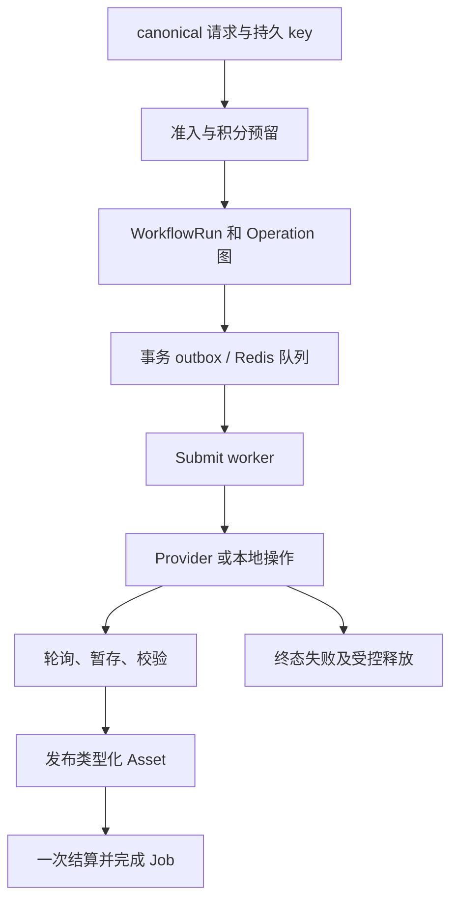

# Workflow 与作业生命周期

新客户端使用 `POST /v1/workflows`。公开 Job ID 标识持久聚合，并作为状态/历史身份。`/v1/design-jobs` 对适用 body 是兼容适配器，不是另一套独立执行系统。

## 发现与冻结

1. 读取 Feature/Workflow、精确提示词、当前订阅和空间访问。数据库决定激活图、节点模型、价格和权益。
2. 上传并 complete 所需输入，或构造文本/Blueprint；保持顺序与语义角色。
3. 跳过退休 quote 回合：`/v1/design-job-quotes` 返回 `409 WORKFLOW_UPDATED`。历史 body 按新 schema 重建。
4. 持久保存一个 action key，按原账号/空间/项目提交。省略 `project_id` 落到 caller scratch；显式 ID 在所请求空间内检查。
5. 准入检查内容/角色、配置、额度、资金和并发，冻结请求/配置/成本，预留积分，写持久 Workflow/Operation 调度。新接受与相同重放都返回 `202`。

## 执行与恢复

`workflow_runs` 冻结图/provenance，`operation_runs`、有序输入/依赖/输出与调用/submission 驱动节点。Workflow 配置选定版本化模型；API caller 不传原始 provider 凭据或任意抓取 URL。

provider `submit` 返回统一结果，只有可轮询 adapter 才实现 `query`。同步供应商调用也在异步 Job 后执行。图片、Markdown、顺序音频、报告 HTML/PPTX、本地视频有不同形状；统一接口不代表每个模型支持全部模态。

派发保存 `PREPARED`、`DISPATCHING`、`STAGED`、`TERMINAL`，以及接受确定性/重试处置。付费 POST 超时可能已被接受，不能因无 provider ID 就认定未执行。持久快照、staging、lease、reconciliation 决定恢复；adapter 禁止不安全的自动 POST 重试。

## 客户端轮询与产物

按 `status_url`、`poll_after_seconds`/`Retry-After` 查询后端，不直接轮询供应商，`completed`/`failed` 停止。四个公开状态为 `pending`、`running`、`completed`、`failed`，进度/平均时长只是展示提示。

读取类型化 `outputs`：artifact 含 modality/role/Asset ID/短时 URL，Markdown 同时包含内联内容、持久 Document Asset 身份、元数据和短时 URL；复用摘要/文案时保留该身份。Design Report 可另发 presentation。`result_kind` 只作兼容提示，不能代替端口选择；打开过期 URL 前刷新 Job。

## 显式重试、移动与删除

响应给出 `retry_eligible`、`retry_block_code`、count/limit 和 deletion/admin-failure pending。允许的 `POST /v1/workflows/{design_job_id}/retry` 使用持久 retry key，返回同 Job 的接受回执，不等于重新创建整个付费动作。资格与冻结成本由服务器决定。

移动提交 `expected_source_project_id` 和目标，检测陈旧写入。删除有执行/清理守卫，UI 隐藏不代表对象或 provider 工作已经消失。

## 当前视频边界

API 允许一个人物图、0–12 场景、最多一个录音和 20,000 字非空脚本。当前小程序只允许**一个场景、1,000 字脚本**。私有 `jinqiuai` 的入口签名/能力可能更窄，保留实际提交并验证重建包；只提高表单/API 限制不证明供应商支持。

## 源码依据

已按[记录的源码版本](/zh/reference/source-revisions)核对。

- [canonical 提交仓储](https://github.com/Orientation-CD/wechat_mini_program/blob/eca0a5f9e0a2aa1cb3fd4f9714114bb3db7fae5f/src/repositories/workflows.ts)
- [Workflow 准入](https://github.com/Orientation-CD/YuanZhu-AI/blob/b13cc5668920620a274cb91a3393ed9fadac72ae/app/workflows/workflow_admission.py)
- [持久执行](https://github.com/Orientation-CD/YuanZhu-AI/blob/b13cc5668920620a274cb91a3393ed9fadac72ae/app/workflows/workflow_execution.py)
- [类型化 provider 接口](https://github.com/Orientation-CD/YuanZhu-AI/blob/b13cc5668920620a274cb91a3393ed9fadac72ae/app/providers/base.py)
- [公开输入与轮询 schema](https://github.com/Orientation-CD/YuanZhu-AI/blob/b13cc5668920620a274cb91a3393ed9fadac72ae/app/core/models.py)
