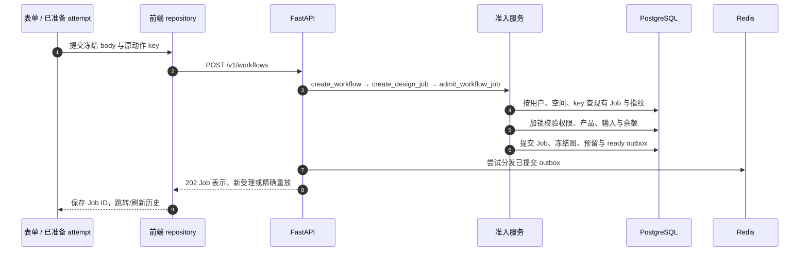
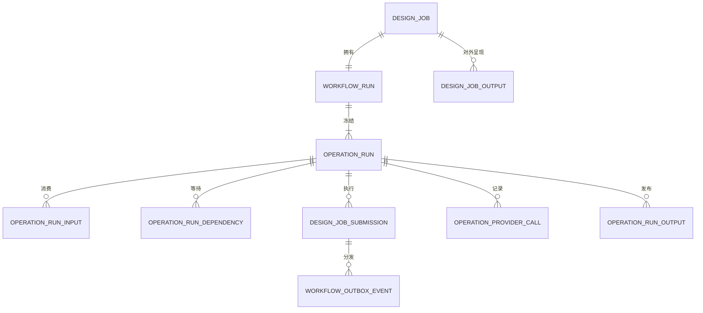
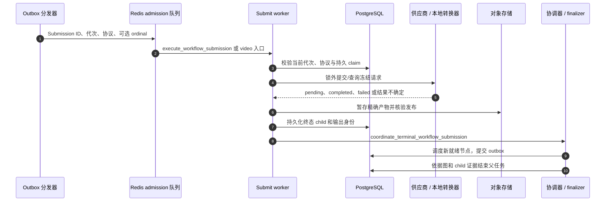

# Workflow 准入、worker 与持久结算

先从一次具体的报告或文案提交开始。本章跟进共享执行引擎；[产品分支](/zh/reference/flows/workflow-products-flow)解释图片、音频、视频差异；[历史操作](/zh/reference/flows/workflow-history-flow)解释读取、重试和删除。公开 Workflow ID 是 Job ID，不是内部 run ID。

## 从表单按钮到受理 {#submit-workflow}

`POST /v1/workflows` 接收带判别字段的请求：`type` 决定具体 schema。报告表单的 `submit` 冻结一次 attempt，`postWorkflow` 交给 `workflowsRepository.submit`，后者重新核对 owner、workspace、写入权限和当前会话代次，再带 Bearer 与持久保存的 8–128 字符 `Idempotency-Key` 发请求。响应映射为历史项，并使相关项目数量缓存失效。

| 消息 | 打开具体代码 | 观察什么 |
| --- | --- | --- |
| 1 | [src/pkg-features/services/workflowSubmission.ts → postWorkflow](https://github.com/Orientation-CD/wechat_mini_program/blob/eca0a5f9e0a2aa1cb3fd4f9714114bb3db7fae5f/src/pkg-features/services/workflowSubmission.ts#L61) | `WorkflowAttempt` 保存 body、owner、action、key，超时不是新业务动作 |
| 2 | [src/repositories/workflows.ts → workflowsRepository](https://github.com/Orientation-CD/wechat_mini_program/blob/eca0a5f9e0a2aa1cb3fd4f9714114bb3db7fae5f/src/repositories/workflows.ts#L13) | 本地校验、请求与 mapper；它们改善体验，不能代替后端授权 |
| 3 | [app/workflows/api.py → create_workflow](https://github.com/Orientation-CD/YuanZhu-AI/blob/b13cc5668920620a274cb91a3393ed9fadac72ae/app/workflows/api.py#L1075) → [app/workflows/api.py → create_design_job](https://github.com/Orientation-CD/YuanZhu-AI/blob/b13cc5668920620a274cb91a3393ed9fadac72ae/app/workflows/api.py#L967) | FastAPI 依赖、限流回调、类型分支与领域错误转换 |
| 4 | [app/workflows/workflow_admission.py → admit_workflow_job](https://github.com/Orientation-CD/YuanZhu-AI/blob/b13cc5668920620a274cb91a3393ed9fadac72ae/app/workflows/workflow_admission.py#L2426) | 先校验现有空间访问权和请求指纹，再返回原 Job |
| 5 | [app/workflows/workflow_admission.py → resolve_workflow](https://github.com/Orientation-CD/YuanZhu-AI/blob/b13cc5668920620a274cb91a3393ed9fadac72ae/app/workflows/workflow_admission.py#L392) → [app/workflows/workflow_admission.py → _reserve_feature_workflow_tokens](https://github.com/Orientation-CD/YuanZhu-AI/blob/b13cc5668920620a274cb91a3393ed9fadac72ae/app/workflows/workflow_admission.py#L1820) | 解析并冻结图和模型配置，核对扣费主体与套餐 |
| 6 | [app/workflows/workflow_admission.py → _persist_workflow_execution](https://github.com/Orientation-CD/YuanZhu-AI/blob/b13cc5668920620a274cb91a3393ed9fadac72ae/app/workflows/workflow_admission.py#L2115) | 在准入事务中保存图和输入身份，创建可运行 Submission 与 outbox |
| 7 | [app/workflows/submissions/workflow_submission_dispatch.py → dispatch_workflow_submission_outbox](https://github.com/Orientation-CD/YuanZhu-AI/blob/b13cc5668920620a274cb91a3393ed9fadac72ae/app/workflows/submissions/workflow_submission_dispatch.py#L1285) | commit 后才写队列；入队失败记录日志并保留恢复依据 |
| 8–9 | API 文件的 `job_response`；[src/repositories/workflows.ts → workflowsRepository](https://github.com/Orientation-CD/wechat_mini_program/blob/eca0a5f9e0a2aa1cb3fd4f9714114bb3db7fae5f/src/repositories/workflows.ts#L13) | 公开身份、类型化输出、轮询提示和响应身份核对 |

新受理和精确重放都返回 **202 Accepted**，不表示生成已完成或输出已存在。丢失响应时，应以原 body、原 key 重放。相同 key 换成不同指纹会得到 `IDEMPOTENCY_KEY_REUSED`。空间变化、功能关闭、提示词过时、输入不可用、并发上限、余额不足要按领域错误处理；盲目换 key 可能新建第二次收费动作。

### 准入事务到底冻结什么

`admit_workflow_job` 解析真实 Project（省略时是调用者的 scratch Project）、活动 Feature、定义版本、编译图、输入绑定、供应商/模型配置、协议激活信息和商业快照。传来的 Asset ID 会转成带版本、哈希、类型、顺序的对象身份，不是以后可任意换掉的 URL。提示词选择会合成冻结 prompt。后台后续修改配置影响新准入，不改写本次已受理执行的历史含义。

个人计费先核对有效订阅区间和 allowed Feature，再使用订阅折扣。企业按工作区积分池计费，不套个人订阅折扣。Feature 价格不是各节点/模型单价相加。

用示例成本 `C = 20`、剩余积分 `R = 100`、已预留 `V = 10` 说明：

| 检查点 | 剩余 `R` | 预留 `V` | 可用 `R − V` |
| --- | --- | --- | --- |
| 准入前 | 100 | 10 | 90 |
| 为本 Job 预留 | 100 | 30 | 70 |
| 成功结算后 | 80 | 10 | 70 |
| 或者终态失败释放 | 100 | 10 | 90 |

准入检查 `R − V >= C`，增加 `reserved_tokens`，写预留账本事件。此时**不**从 `remaining_tokens` 扣 `C`。成功才扣剩余并释放预留，失败只释放预留。唯一账本/事件 key 和状态检查防止重复结算。预留账本 delta 为负，并不表示存储的 remaining 已经扣掉；要结合事件 reason 与 reserved 一起理解。

## 为什么队列不是任务数据库 {#durable-records}

| SQL 记录 | 链路里的职责 | 关键身份/状态 |
| --- | --- | --- |
| `design_jobs` | 公开聚合、创建人/空间/项目、动作 key、积分状态 | `id`、`status`、`explicit_retry_count`、`token_state` |
| `workflow_runs` | 冻结图与执行/商业来源 | `id`、`design_job_id`、`compiled_graph`、`state` |
| `operation_runs` | 各节点状态、租约、冻结节点配置 | `id`、`workflow_run_id`、`node_key`、`state` |
| `operation_run_inputs` / dependencies | 有序 scalar/Asset pin 和图依赖 | operation ID、port、position、上游身份 |
| `design_job_submissions` | 持久执行尝试和供应商/本地交接 | `id`、operation ID、`attempt_generation`、`dispatch_state` |
| `operation_provider_calls` | 供应商请求/结果检查点与暂存证据 | operation ID 与 attempt 证据 |
| `operation_run_outputs` / `design_job_outputs` | 已核验节点输出和公开 Job 绑定 | Asset 身份或 scalar 输出 |
| `workflow_outbox_events` | 已提交、待分发/恢复的工作 | aggregate ID、去重 key、`processed_at` |

Redis ARQ 保存可运行消息，删 Redis 消息不等于删 PostgreSQL Job。分发器按 outbox 去重 key 生成确定的 Redis job ID；worker 还要校验协议、代次和 claim。之所以多层去重，是因为进程可能在入队成功、写确认以前崩溃。

## Submit worker、Poll worker 与供应商 I/O {#worker-chain}

| 消息 | 源码 | 含义 |
| --- | --- | --- |
| 1 | [app/workflows/submissions/workflow_submission_dispatch.py → dispatch_workflow_submission_outbox](https://github.com/Orientation-CD/YuanZhu-AI/blob/b13cc5668920620a274cb91a3393ed9fadac72ae/app/workflows/submissions/workflow_submission_dispatch.py#L1285) | `arq:admission_queue` 的消息参数是身份，不是模型明文凭据 |
| 2–3 | [app/worker.py → execute_workflow_submission](https://github.com/Orientation-CD/YuanZhu-AI/blob/b13cc5668920620a274cb91a3393ed9fadac72ae/app/worker.py#L203) | 旧代次、协议不符的执行不能发布新代次结果 |
| 4–5 | [app/workflows/submissions/workflow_provider_submission.py → dispatch_workflow_provider_submission](https://github.com/Orientation-CD/YuanZhu-AI/blob/b13cc5668920620a274cb91a3393ed9fadac72ae/app/workflows/submissions/workflow_provider_submission.py#L768) → [app/providers/provider_attempt.py → execute_provider_attempt](https://github.com/Orientation-CD/YuanZhu-AI/blob/b13cc5668920620a274cb91a3393ed9fadac72ae/app/providers/provider_attempt.py#L644) | 按冻结配置选分支，保留请求与受理证据 |
| 6–7 | [产品分支](/zh/reference/flows/workflow-products-flow)的执行/发布代码 | 有供应商响应还不够，须核验字节与产物身份 |
| 8–9 | [app/workflows/submissions/workflow_submission_coordinator.py → coordinate_terminal_workflow_submission](https://github.com/Orientation-CD/YuanZhu-AI/blob/b13cc5668920620a274cb91a3393ed9fadac72ae/app/workflows/submissions/workflow_submission_coordinator.py#L139) → [app/workflows/submissions/workflow_submission_scheduler.py → schedule_ready_submissions](https://github.com/Orientation-CD/YuanZhu-AI/blob/b13cc5668920620a274cb91a3393ed9fadac72ae/app/workflows/submissions/workflow_submission_scheduler.py#L225) | 所有依赖完成后才调度；有序输出成为下游冻结输入 |
| 10 | [app/workflows/submissions/workflow_submission_finalizer.py → finalize_submission_workflow](https://github.com/Orientation-CD/YuanZhu-AI/blob/b13cc5668920620a274cb91a3393ed9fadac72ae/app/workflows/submissions/workflow_submission_finalizer.py#L33) → [app/workflows/workflow_admission.py → complete_workflow_run_in_transaction](https://github.com/Orientation-CD/YuanZhu-AI/blob/b13cc5668920620a274cb91a3393ed9fadac72ae/app/workflows/workflow_admission.py#L3044) / [app/workflows/workflow_admission.py → fail_workflow_run_in_transaction](https://github.com/Orientation-CD/YuanZhu-AI/blob/b13cc5668920620a274cb91a3393ed9fadac72ae/app/workflows/workflow_admission.py#L3124) | 等活动 sibling 排空，绑定有效输出，再一次性结算/释放 |

`SubmitWorkerSettings` 注册带代次校验的 provider/PPTX submission 和独立视频入口。`PollWorkerSettings` 在 `arq:poll_queue` 上运行恢复/维护；其中 `reconcile_workflow_submissions` 扫描持久记录、产生后续交接，供应商查询工作交回执行流程。因此“Poll worker”不表示每次 GET 状态都直接查供应商。旧 operation 执行入口还用于兼容恢复；新准入明确传 `submission_backed=True`。

供应商可能同步返回，也可能可轮询。同步表示 HTTP 调用**在 worker 内**直接返回产物，公开 API 仍然异步；可轮询表示供应商先返回任务 ID，后续通过支持的 `query` 推进。后端 `ModelProvider`/`PollableProvider` 能力决定分支，不由客户端 flag 决定。

### 最危险的超时：供应商到底接单了吗 {#uncertain-provider}

Submission 的 `status` 和 `dispatch_state` 描述不同维度。`PREPARED → DISPATCHING → STAGED → TERMINAL` 表示请求/产物检查点，公开状态仍是 `pending/running/completed/failed`。受理确定性 `NOT_SENT/REJECTED/UNKNOWN` 与重试处置 `SAFE_AUTOMATIC/CLIENT_AFTER_CHANGE_OR_DELAY/NEVER` 防止把“网络错误”直接当作再次发送收费 POST 的许可。

例如供应商已接单，但连接在保存任务 ID 前断开。`provider_job_id = NULL` 不证明没有发生外部动作；请求次数、加密 envelope、attempt key、暂存候选和 uncertainty 字段可能证明请求已经发出。恢复必须使用支持的暂存/查询证据，或要求对账关注，不能假装从未发送。

| 故障点 | 查看哪些持久证据 | 恢复原则 |
| --- | --- | --- |
| API 已提交，Redis 不可用 | Job/run/预留 + 未处理 outbox | 恢复器分发原工作，客户端重放原 key |
| 队列消息重复 | 去重 key + 当前代次/claim | 旧执行和重复执行不能再次发布 |
| 供应商 POST 结果不确定 | Submission dispatch/受理字段 + 暂存 | 恢复已证实证据，不默认安全重发 |
| 字节已上传、SQL 发布中断 | 预留目的地、version/hash、stage | 只能接管精确且仍被授权的版本 |
| child 已完成，协调进程崩溃 | 终态 child + 图依赖 | 根据 SQL 恢复调度/结束 |
| 一个 child 失败，另一个仍运行 | 终态失败 + 活动 sibling | 排空 sibling 后才能结束父任务并结算 |

## 前端怎样闭环 {#client-loop}

[src/services/pollScheduler.ts → createPollScheduler](https://github.com/Orientation-CD/wechat_mini_program/blob/eca0a5f9e0a2aa1cb3fd4f9714114bb3db7fae5f/src/services/pollScheduler.ts#L33) 保持一个在途轮询，按服务端提示调度，页面隐藏时暂停，切页面后丢弃旧代次响应。GET 处理函数读持久 Job 状态，生成新的授权产物链接，不让手机查模型供应商。`outputs` 携带 Artifact/Markdown 类型身份，单看 `result_kind` 无法选择所有产物。

端点授权见[详情与历史](/zh/reference/flows/workflow-history-flow)，签名浏览器 URL 见[报告发布](/zh/reference/flows/report-view-flow)。页面估算到 100% 不等于数据库状态 completed。

## 兼容提交入口 {#submit-compatibility}

`POST /v1/design-jobs` 进入 [app/workflows/api.py → create_design_job](https://github.com/Orientation-CD/YuanZhu-AI/blob/b13cc5668920620a274cb91a3393ed9fadac72ae/app/workflows/api.py#L967)。当前图片、语音、视频表单仍使用这个适配器；新集成使用 `/v1/workflows`。类型化当前请求进入同一个 `admit_workflow_job`；仍支持的旧图片 shape 先经 `admit_legacy_image_compatibility_job`，再进共享引擎，不是第二套数据库/队列执行系统。指纹 kind/version 和可接受 body 由服务端定义，不能只替换 path 却保留不兼容 body。

## 已退休的报价请求 {#retired-quote}

`POST /v1/design-job-quotes` 到 [app/workflows/api.py → create_design_job_quote](https://github.com/Orientation-CD/YuanZhu-AI/blob/b13cc5668920620a274cb91a3393ed9fadac72ae/app/workflows/api.py#L954)，在认证/请求校验后返回 `409 WORKFLOW_UPDATED`；不会写报价、预留积分或调用供应商。当前表单无需此往返。应刷新 Feature/提示词发现并构建当前类型请求；重复请求 quote 不会得到有效准入凭据。

## 追踪一个任务的练习 {#exercise}

在本地模拟供应商环境用 UI 创建任务，记下 Job ID。按代码表找到**首次 commit**、**队列 enqueue**、**供应商 I/O**，解释顺序为何重要。用[只读 SQL 关联](/zh/reference/flows/runtime-debugging#sql-trace)找出 run、node、submission，再核对完成产物的 Asset version/hash。最后在不改 SQL 的前提下，解释原动作 key、显式重试代次、全新任务的区别。显式重试由 [app/workflows/submissions/workflow_submission_retry.py → retry_workflow_job](https://github.com/Orientation-CD/YuanZhu-AI/blob/b13cc5668920620a274cb91a3393ed9fadac72ae/app/workflows/submissions/workflow_submission_retry.py#L184) 实现，其受理回执见[历史操作](/zh/reference/flows/workflow-history-flow#retry-workflow)。
