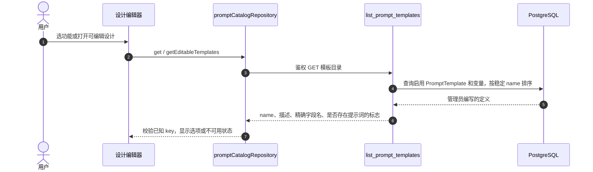
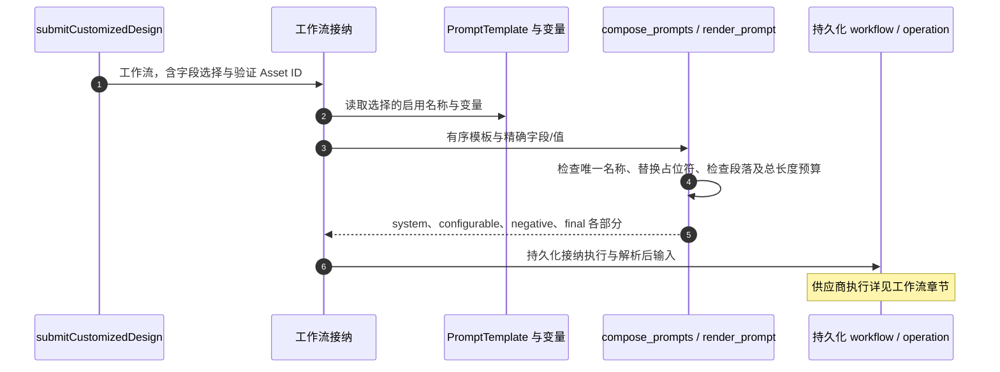
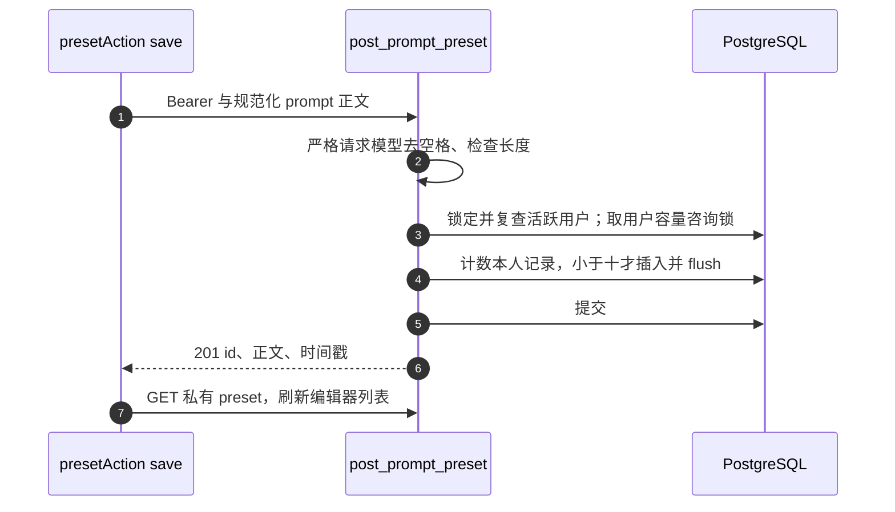

# 提示词发现与常用要求：UI 选项 → 精确 key → 服务端组装

“现代”这样的选项名称不是直接发送给模型的提示词。前端选择稳定模板 key 与字段值，服务端持有作者编写的提示词段落；个人“常用要求”则是另一种私有文本存储。先把两条链路读懂，再继续[工作流生命周期](/zh/reference/flows/design-job-lifecycle)。所有源码链接固定到[审计版本](/zh/reference/source-revisions)。

## 三个不能混淆的对象 {#prompt-model}

| 对象 | 谁控制 | 数据库 / 请求形式 | 用途 |
| --- | --- | --- | --- |
| Prompt template | 管理员 | `PromptTemplate`、`PromptVariable`；API 公开元数据 | 定义 system/configurable/negative 段落与精确必填字段名。 |
| Prompt selection | 工作流接纳时的调用者 | `{ prompts: [{ name, fields: [{ name, value }] }] }` | 选择启用模板，每个所需字段恰好给一个值。 |
| Personal preset | 单个应用用户 | `PromptPreset { id, prompt, created_at, updated_at }` | 保存编辑器复用正文，不是服务端模板，不赋予模型权限。 |

两种模板发现接口都需要登录；发现与常用要求 CRUD 都不提交 worker 任务，不等待模型，不生成图片。模型调用发生在另外的 Workflow 提交之后。

## 列出启用模板的字段契约 {#prompt-template-list}

**接口：`GET /v1/prompt-templates`。** 标准设计在提交准备中调用 [`promptCatalogRepository`](https://github.com/Orientation-CD/wechat_mini_program/blob/eca0a5f9e0a2aa1cb3fd4f9714114bb3db7fae5f/src/pkg-features/repositories/promptCatalog.ts#L170) 的 `get()`；自定义设计由 [`loadTemplates`](https://github.com/Orientation-CD/wechat_mini_program/blob/eca0a5f9e0a2aa1cb3fd4f9714114bb3db7fae5f/src/pkg-features/pages/customized_design/index.vue#L189) 调 `getEditableTemplates()`。后者要求精确 key `feature_customized_design` 且恰好一个 `user_prompt` 字段；不符合就阻止功能，不猜另一模板。



| 步骤 | 源码 | 新手应观察什么 |
| --- | --- | --- |
| 1–2 | [`loadTemplates`](https://github.com/Orientation-CD/wechat_mini_program/blob/eca0a5f9e0a2aa1cb3fd4f9714114bb3db7fae5f/src/pkg-features/pages/customized_design/index.vue#L189)、[`promptCatalogRepository`](https://github.com/Orientation-CD/wechat_mini_program/blob/eca0a5f9e0a2aa1cb3fd4f9714114bb3db7fae5f/src/pkg-features/repositories/promptCatalog.ts#L170) | 页面可在提交前读元数据，标准提交时也会复查启用目录。 |
| 3–5 | [`list_prompt_templates`](https://github.com/Orientation-CD/YuanZhu-AI/blob/b13cc5668920620a274cb91a3393ed9fadac72ae/app/prompts/api.py#L33)、[`prompt_template_load_options`](https://github.com/Orientation-CD/YuanZhu-AI/blob/b13cc5668920620a274cb91a3393ed9fadac72ae/app/prompts/api.py#L14) | 先鉴权；SQL 只选 `is_active=True`，预加载变量避免每个字段再发一次查询。 |
| 6 | [`prompt_template_response`](https://github.com/Orientation-CD/YuanZhu-AI/blob/b13cc5668920620a274cb91a3393ed9fadac72ae/app/prompts/api.py#L20) | 故意不返回 `system_prompt`、`template_text`、`negative_prompt` 和管理示例值；`has_*` 是布尔标志，不是作者正文。 |
| 7 | [`mapPromptTemplateCatalog`](https://github.com/Orientation-CD/wechat_mini_program/blob/eca0a5f9e0a2aa1cb3fd4f9714114bb3db7fae5f/src/pkg-features/repositories/promptCatalog.ts#L100)、[`mapEditablePromptTemplates`](https://github.com/Orientation-CD/wechat_mini_program/blob/eca0a5f9e0a2aa1cb3fd4f9714114bb3db7fae5f/src/pkg-features/repositories/promptCatalog.ts#L38) | 检查精确唯一名称、字段与已知启用 key。成功目录省略已知 key 就是不可用，数组位置没有业务意义。 |

标准图片功能的 `featurePromptKeys` 把功能 ID 映射到 `feature_interior_design` 等 key。`buildPromptSelection` 校验房间/风格/项目选择，确定项目顺序并检查所有 key 仍启用；这些内置选项无可编辑字段，所以 `fields: []`。可编辑功能则用 `buildEditablePromptSelection` 匹配目录宣告的字段名，并规范化用户文字。

后端返回全部启用的公开模板元数据，各前端 mapper 校验适合自己的子集。不得根据中文标签、描述或数组下标推导 `name`，应使用区分大小写的精确契约 key。

## 读取一个模板契约 {#prompt-template-get}

**接口：`GET /v1/prompt-templates/{prompt_template_name}`。** 当前小程序读列表，不调用详情接口。脚本/集成可用 [`get_prompt_template`](https://github.com/Orientation-CD/YuanZhu-AI/blob/b13cc5668920620a274cb91a3393ed9fadac72ae/app/prompts/api.py#L58) 查看单项：去掉路径名称首尾空格，空值或超过 160 字符视为不存在，按精确启用名称与变量查询，再返回相同安全元数据。未知/停用为 `404 PROMPT_TEMPLATE_NOT_FOUND`。

可用本地测试账号请求 `/v1/prompt-templates/feature_customized_design`。预期得到实际启用的 `name` 与必填 `fields`，不是可直接交供应商的完整提示词。环境没有配置该模板时，404 是正确结果，不应随便从另一环境复制一份当作补丁。

## 把字段选择追到最终模型提示词 {#prompt-composition}

本节解释发现响应**用到哪里**，不是另一个发现接口。自定义设计 [`submitCustomizedDesign`](https://github.com/Orientation-CD/wechat_mini_program/blob/eca0a5f9e0a2aa1cb3fd4f9714114bb3db7fae5f/src/pkg-features/services/customizedDesignSubmit.ts#L20) 调用 [`buildEditablePromptSelection`](https://github.com/Orientation-CD/wechat_mini_program/blob/eca0a5f9e0a2aa1cb3fd4f9714114bb3db7fae5f/src/pkg-features/repositories/promptCatalog.ts#L58)，上传/复用验证图，再把字段选择随工作流提交。

```json
{
  "prompts": [
    {
      "name": "feature_customized_design",
      "fields": [{ "name": "user_prompt", "value": "保留窗户，使用温暖木色与柔和灯光。" }]
    }
  ]
}
```

这是**工作流请求里面的 prompt selection 对象**，不是完整 `/v1/workflows` 请求体。`name` 标识服务端配置的模板，字段 `name` 必须精确等于目录要求，`value` 是用户填写的正文。它不是 preset ID、模型 ID 或文件名。



| 步骤 | 源码 | 失败边界 |
| --- | --- | --- |
| 1–2 | [`submitCustomizedDesign`](https://github.com/Orientation-CD/wechat_mini_program/blob/eca0a5f9e0a2aa1cb3fd4f9714114bb3db7fae5f/src/pkg-features/services/customizedDesignSubmit.ts#L20)、[`compose_design_prompt_parts`](https://github.com/Orientation-CD/YuanZhu-AI/blob/b13cc5668920620a274cb91a3393ed9fadac72ae/app/workflows/design_job.py#L808) | 即使此前目录 GET 成功，服务端仍重查当前启用定义，拒绝重复选择、缺少/停用名称。 |
| 3–4 | [`render_prompt`](https://github.com/Orientation-CD/YuanZhu-AI/blob/b13cc5668920620a274cb91a3393ed9fadac72ae/app/prompts/prompt_templates.py#L258) | 拒绝重复/未知字段，要求提供名称集合等于模板引用的占位符，去空格、拒绝空值/超限，再替换正文。 |
| 4–5 | [`compose_prompts`](https://github.com/Orientation-CD/YuanZhu-AI/blob/b13cc5668920620a274cb91a3393ed9fadac72ae/app/prompts/prompt_templates.py#L306) | 最多一个选择带 system prompt。Configurable 与 negative 作者段落用空行连接，不擅加编号；分项和总长度都有限制。 |
| 6 | [`compose_design_prompt_parts`](https://github.com/Orientation-CD/YuanZhu-AI/blob/b13cc5668920620a274cb91a3393ed9fadac72ae/app/workflows/design_job.py#L808) | 组合无效映射 `422 PROMPT_COMPOSITION_INVALID`，名称不可用为 `404 PROMPT_TEMPLATE_NOT_FOUND`。先前读成功不保证后续可变配置仍相同。 |

继续读 `PromptComposition` 与工作流/operation 章节，了解具体供应商适配器使用哪些部分。保存“常用要求”不能绕过这里的验证：选 preset 只是把正文放回编辑器，提交时仍是普通字段值。

## 列出私有“常用要求”正文 {#prompt-preset-list}

**接口：`GET /v1/prompt-presets`。** 自定义编辑器 `presetAction("list")` 调 [`promptPresetRepository`](https://github.com/Orientation-CD/wechat_mini_program/blob/eca0a5f9e0a2aa1cb3fd4f9714114bb3db7fae5f/src/pkg-features/repositories/customizedDesign.ts#L33) 的 `list()`。[`get_prompt_presets`](https://github.com/Orientation-CD/YuanZhu-AI/blob/b13cc5668920620a274cb91a3393ed9fadac72ae/app/prompts/prompt_preset_api.py#L53) 调 [`list_prompt_presets`](https://github.com/Orientation-CD/YuanZhu-AI/blob/b13cc5668920620a274cb91a3393ed9fadac72ae/app/prompts/prompt_presets.py#L44)，提交后序列化安全记录。

服务先拿活跃用户接纳咨询锁、重读账号，与匿名化协调；再只选 `PromptPreset.user_id == current_user.id`，按 `updated_at DESC, id DESC` 排序。前端验证 ID 唯一、正文形状与最多十项。选 preset 只把正文复制到当前编辑器，不修改原记录，也不提交生成。

## 新增正文，包括用户有意保存的重复项 {#prompt-preset-create}

**接口：`POST /v1/prompt-presets`。** “保存常用要求”走 [`presetAction`](https://github.com/Orientation-CD/wechat_mini_program/blob/eca0a5f9e0a2aa1cb3fd4f9714114bb3db7fae5f/src/pkg-features/pages/customized_design/index.vue#L266) → repository `save(prompt)` → [`post_prompt_preset`](https://github.com/Orientation-CD/YuanZhu-AI/blob/b13cc5668920620a274cb91a3393ed9fadac72ae/app/prompts/prompt_preset_api.py#L72)。请求体 `{ "prompt": "保留窗户，使用温暖木色。" }`，不包含由客户端指定的标题、用户 ID、模板或计价字段。



| 步骤 | 源码 | 为什么这样做 |
| --- | --- | --- |
| 1–2 | [`normalizedUserPrompt`](https://github.com/Orientation-CD/wechat_mini_program/blob/eca0a5f9e0a2aa1cb3fd4f9714114bb3db7fae5f/src/pkg-features/repositories/customizedDesign.ts#L15)、[`PromptPresetCreateRequest`](https://github.com/Orientation-CD/YuanZhu-AI/blob/b13cc5668920620a274cb91a3393ed9fadac72ae/app/core/models.py#L354) | UI 与服务端去首尾空格、检查配置的字段长度；数据库也限制正文去空格、非空且不超过 12,000 字符。 |
| 3–4 | [`create_prompt_preset`](https://github.com/Orientation-CD/YuanZhu-AI/blob/b13cc5668920620a274cb91a3393ed9fadac72ae/app/prompts/prompt_presets.py#L59) | 容量锁让计数/插入成为串行决定，两个并发保存不能同时拿第十槽。满时稳定返回 `409 PROMPT_PRESET_LIMIT_REACHED`。 |
| 5–7 | [`post_prompt_preset`](https://github.com/Orientation-CD/YuanZhu-AI/blob/b13cc5668920620a274cb91a3393ed9fadac72ae/app/prompts/prompt_preset_api.py#L72)、[`presetAction`](https://github.com/Orientation-CD/wechat_mini_program/blob/eca0a5f9e0a2aa1cb3fd4f9714114bb3db7fae5f/src/pkg-features/pages/customized_design/index.vue#L266) | 先提交再报成功，然后重读私有列表。 |

重复正文有意允许。POST 不按内容哈希或幂等头去重；响应不明确时盲目重发，在容量许可时会再创建一行。先读列表，再决定是否真的要再保存一次。

## 修改一条本人保存的正文 {#prompt-preset-patch}

**接口：`PATCH /v1/prompt-presets/{preset_id}`。** 选择已有项进入编辑会保留 ID；`presetAction("save", id)` 调 repository `save(prompt, id)`。[`patch_prompt_preset`](https://github.com/Orientation-CD/YuanZhu-AI/blob/b13cc5668920620a274cb91a3393ed9fadac72ae/app/prompts/prompt_preset_api.py#L88) → [`update_prompt_preset`](https://github.com/Orientation-CD/YuanZhu-AI/blob/b13cc5668920620a274cb91a3393ed9fadac72ae/app/prompts/prompt_presets.py#L103) 重做账号协调，按 **UUID 与所有者**一起查询并加变更锁。只替换 `prompt`，更新 `updated_at`，flush/commit。前端检查返回 UUID 等于正在编辑的 ID，再刷新列表。

他人 ID 与不存在 ID 都返回 `404 PROMPT_PRESET_NOT_FOUND`，不泄露他人记录。PATCH 不占新增槽位，也不会改写已经接纳的 Workflow 提示词。

## 删除一条本人保存的正文 {#prompt-preset-delete}

**接口：`DELETE /v1/prompt-presets/{preset_id}`。** 编辑器 `deletePreset(id)` 请求用户确认，再由 `presetAction("delete", id)` 调 repository `remove`。[`remove_prompt_preset`](https://github.com/Orientation-CD/YuanZhu-AI/blob/b13cc5668920620a274cb91a3393ed9fadac72ae/app/prompts/prompt_preset_api.py#L110) → [`delete_prompt_preset`](https://github.com/Orientation-CD/YuanZhu-AI/blob/b13cc5668920620a274cb91a3393ed9fadac72ae/app/prompts/prompt_presets.py#L129) 锁定并复查用户、按本人 ID 查询并加删除锁、删除、flush/commit，返回 `204`。他人与缺失同为 `404`。

UI 提示是实际行为：删除常用要求不会抹掉已复制到当前编辑器的文字。正文是私有账号数据，不是空间共享配置；账号匿名化时生命周期维护会删除本人 preset。

## 跟读练习：选项缺失与常用要求已满 {#prompt-debug}

1. 打开 `prompt_template_response`，把本地鉴权 GET 响应与 SQL 模型对照。预期：只有名称、描述、字段名、标志、时间跨公开边界，作者段落留在服务端。
2. 跟 `loadTemplates`，找到自定义模板/字段的精确检查。只在可丢弃的本地环境停用或改变模板。预期：缺配置就阻止 UI，不会悄悄选数组下一项。
3. 按顺序读 `buildEditablePromptSelection`、`compose_design_prompt_parts`、`render_prompt`，追 `user_prompt` 从输入框到占位替换。预期：客户端与服务端都精确匹配，旧/额外/缺少字段会报错，不会默默忽略。
4. 沿保存链路找两个咨询锁 namespace，用本地 API 测试工具观察接近十项时的并发保存。预期：容量由数据库决定，不只是前端把按钮置灰。
5. 选一个 preset，删其保存行，再看尚未提交的编辑正文。预期：本地文字仍在，Workflow 提交前没有开始生成。排障时分清目录失败、preset 持久化失败和后续供应商失败。
