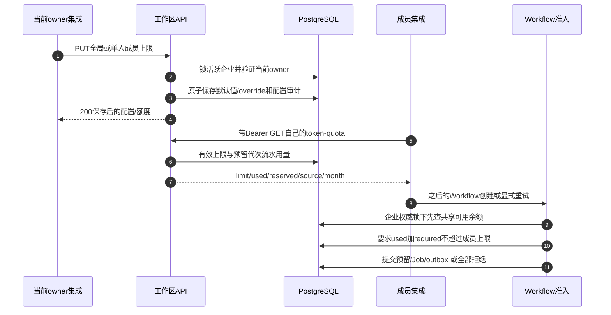

# 成员月额度：配置 → 流水投影 → 准入

本章追踪三个已实现API及其控制的账务检查。**已核验小程序没有这三个额度API的调用者。** 入口是已认证集成或操作脚本，不是虚构的页面按钮。把后端能力当成已上线UI前，先看[联调状态](/zh/reference/integration-status)。

企业钱包与成员额度是不同权威：钱包负责付钱，额度限制某成员在一个自然月能预留多少新工作。额度保存不会转积分、创建Job或调用Redis/供应商执行。



## 保存企业默认额度 {#workspace-token-limit}

**接口：** `PUT /v1/workspaces/{workspace_id}/member-token-limit`，要求Bearer及活跃企业当前OWNER。body精确为`{"limit":50000}`，null表示无限。有限值必须严格整数1..10,000,000；零、缺字段、字符串、布尔、小数和未知字段都422。

1. [app/workspaces/workspace_api.py → update_member_token_default](https://github.com/Orientation-CD/YuanZhu-AI/blob/e59716c83e087deda8477da5ea7b327a40cf65c5/app/workspaces/workspace_api.py#L208)把当前认证actor及显式workspace UUID传给`set_enterprise_member_token_limit`；保存的空间选择不是权限。
2. [app/billing/member_token_quotas.py → set_enterprise_member_token_limit](https://github.com/Orientation-CD/YuanZhu-AI/blob/e59716c83e087deda8477da5ea7b327a40cf65c5/app/billing/member_token_quotas.py#L198)调用`_locked_owner_enterprise`，验证可访问活跃Enterprise及当前OWNER，先锁企业权威再锁override行。
3. 统计当前非owner成员，写`Enterprise.member_monthly_token_limit`、配置时间，并**删除每一条override**，包括已离开成员的保留设置。保存相同值或null也执行清除。
4. 追加`EnterpriseMemberTokenLimitAudit`，记录旧/新值、来源、受影响成员数及清除override数。路由共同提交配置与审计，不写财务流水。
5.200返回`{"limit":50000,"affected_members":3}`，数量是当前非owner，不是删除行数。成功后刷新owner总览。

全局保存不是保留单人例外的patch。集成应在执行前说明清除效果。响应丢失先读当前owner总览；过后盲目重复全局保存可能清除刚新增的override。该PUT没有付费Workflow动作key的持久回执协议。

## 保存当前单人成员额度 {#member-token-limit}

**接口：** `PUT /v1/workspaces/{workspace_id}/members/{user_id}/token-limit`，仅当前OWNER。必填`limit`为null或严格整数0..10,000,000。单人0有意表示暂停新预留，与全局范围不同。

1. [app/workspaces/workspace_api.py → update_member_token_limit](https://github.com/Orientation-CD/YuanZhu-AI/blob/e59716c83e087deda8477da5ea7b327a40cf65c5/app/workspaces/workspace_api.py#L225)把actor/企业/目标/上限传给`set_member_token_limit`。
2. [app/billing/member_token_quotas.py → set_member_token_limit](https://github.com/Orientation-CD/YuanZhu-AI/blob/e59716c83e087deda8477da5ea7b327a40cf65c5/app/billing/member_token_quotas.py#L250)取得当前企业owner权威，再验证目标当前成员关系。不存在/已离开目标为404 `MEMBER_NOT_FOUND`；owner目标为409 `WORKSPACE_OWNER_TOKEN_LIMIT_FORBIDDEN`。
3. 创建/更新`EnterpriseMemberTokenLimit`并追加配置审计。每次单人保存都为`source:"custom"`，即使null或等于全局值。
4. 调用`read_member_token_quota`后路由提交。200示例：`{"limit":0,"used":120,"reserved":20,"source":"custom","month":"2026-11"}`。刷新该成员额度/总览。

退出重新加入保留override，除非之后全局保存已清除。零跨月仍暂停，等待下月不会自动恢复，必须owner改值。配置不取消已接受工作，其结算/释放仍正常完成。

## 读取认证成员自己的额度 {#me-token-quota}

**接口：** `GET /v1/workspaces/{workspace_id}/me/token-quota`，要求活跃企业当前成员或owner，不传目标成员参数或body，不改变当前空间选择。

1. [app/workspaces/workspace_api.py → get_own_member_token_quota](https://github.com/Orientation-CD/YuanZhu-AI/blob/e59716c83e087deda8477da5ea7b327a40cf65c5/app/workspaces/workspace_api.py#L242)解析当前可访问工作区/成员关系；个人空间422 `ENTERPRISE_WORKSPACE_REQUIRED`。
2. [app/billing/member_token_quotas.py → read_member_token_quota](https://github.com/Orientation-CD/YuanZhu-AI/blob/e59716c83e087deda8477da5ea7b327a40cf65c5/app/billing/member_token_quotas.py#L157)固定本次时钟，读取该成员可选override，调用`enterprise_member_token_usage`。
3. [app/billing/member_token_quotas.py → member_token_quota](https://github.com/Orientation-CD/YuanZhu-AI/blob/e59716c83e087deda8477da5ea7b327a40cf65c5/app/billing/member_token_quotas.py#L140)按owner→无限/source owner、存在显式行→custom、否则企业默认选择。null是无限，不是零或字段缺失。
4. [app/billing/member_token_quotas.py → enterprise_member_token_usage](https://github.com/Orientation-CD/YuanZhu-AI/blob/e59716c83e087deda8477da5ea7b327a40cf65c5/app/billing/member_token_quotas.py#L57)聚合不可变流水代次身份。200返回`limit`、`used`、`reserved`、`source`、`month`。

| 示例字段 | 含义 |
| --- | --- |
| `limit:50000` | 当前有效容量，不是剩余钱包余额 |
| `used:120` | 所有已接受/已结算用量各计一次 |
| `reserved:20` | 120中的待结算子集，不能显示用量140 |
| `source:"default"` | 没有单人override，不是未配置错误 |
| `month:"2026-11"` | Asia/Shanghai自然月 |

进入新月份或配置变化后刷新。缓存额度只是展示上下文，不是准入权威。owner仍有可归因用量，但`limit:null,source:"owner"`。

## 为什么跨月完成不会再计一次

`quota_month`与`beijing_month_utc_window`使用Asia/Shanghai月边界并转换为UTC。预留归属于接受月份，下月结算关闭同一个generation，used仍在原月只计一次，reserved变0。释放使该generation计0，即使之后才释放。显式重试是独立预留代次，使用原冻结价格并计入新预留月。

流水幂等身份在Job外键清除后仍保留，因此删除Job不会释放已消费额度。仅“有成员归因但找不到reserve”的历史CONSUMED回退到结算月，reserved0。个人/global/无归属/充值事件不计入。现有企业`consumption.current_month`仍按结算月统计，不必与额度投影相等。

## 随后的创建/重试事务

[app/workflows/workflow_admission.py → _reserve_feature_workflow_tokens](https://github.com/Orientation-CD/YuanZhu-AI/blob/e59716c83e087deda8477da5ea7b327a40cf65c5/app/workflows/workflow_admission.py#L2295)先检查企业可用余额`remaining_tokens - reserved_tokens`，保留`TOKEN_SHORTAGE_WORKSPACE`优先级。余额足够后，[app/billing/member_token_quotas.py → member_token_limit_violation](https://github.com/Orientation-CD/YuanZhu-AI/blob/e59716c83e087deda8477da5ea7b327a40cf65c5/app/billing/member_token_quotas.py#L302)在调用者已有企业账户锁下读取当前角色、override和流水，要求`used + required <= limit`。owner/无限成员跳过此限制。

失败为402：

```json
{"detail":{"code":"MEMBER_MONTHLY_TOKEN_LIMIT_REACHED","limit":50000,"used":49980,"required":30}}
```

拒绝不会接受新的预留、Job、retry receipt或dispatch outbox。准备好的归档凭据可作为会过期的输入准备保留，它不是付费接受。已接受创建的精确重放不再预留；重试按原冻结价格及新月重新检查容量。正上限成员可缩小请求、等下一自然月或请owner调整；零暂停必须owner改值。

## 错误与只读学习练习

| 边界 | 响应 | 正确解释 |
| --- | --- | --- |
| 没有有效Bearer |401| 按正常会话契约认证/刷新 |
| 外部/已离开调用者 |403 `WORKSPACE_ACCESS_DENIED`| 选择/缓存不能恢复成员关系 |
| 当前非owner写入 |403 `WORKSPACE_OWNER_REQUIRED`| 成员不能改自己的上限 |
| 企业已移除/停用 |409 `WORKSPACE_INACTIVE`| 不能偷偷换扣费方重试 |
| 个人空间 |422 `ENTERPRISE_WORKSPACE_REQUIRED`| 此限制只适用于企业 |
| 上限类型/范围/body错误 |422| 修正严格请求，未改变配置 |

不启动付费工作也可阅读三个handler并比较commit边界。在已授权本地环境中，检查一位已知owner总览及同账号self quota，再阅读`tests/test_enterprise_member_token_quotas.py`、`tests/test_member_quota_admission.py`中的全局重置、跨月关闭、Job删除和显式重试。解释为什么额度配置有审计而没有Token delta。
