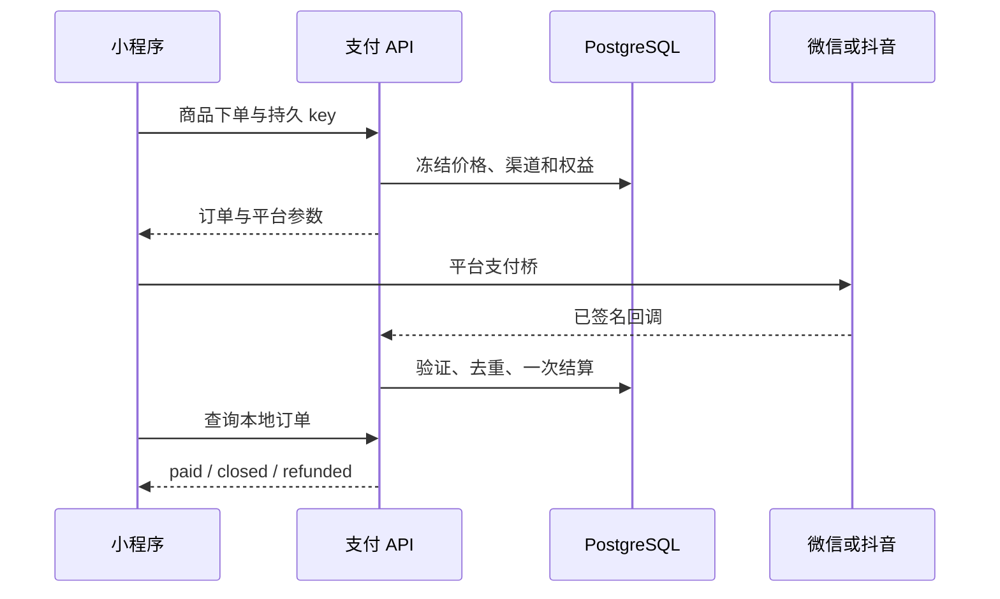

# 支付与退款调用链

微信、抖音共享服务端定价、订单、积分和订阅快照，平台桥、密钥和回调分别实现。权威支付状态是后端记录，不是小程序 success 回调。

## 下单与恢复

从 billing 发现读取商品 code/价格/权益，向 `/v1/subscriptions` 或 `/v1/token-purchases` 提交持久 key 和 `type`（微信按支持入口 `jsapi`/`app`，抖音 `douyin`）。服务端冻结金额、授权、渠道和模式，后续目录修改不能重写旧订单。

微信使用支付参数，抖音依次 `tt.requestOrder`/`tt.getOrderPayment`。参数过期或恢复时调用 `POST /v1/payments/{payment_order_id}/pay`，不因结果不明另建订单。渠道/设备变化按服务端规则处理，不能改缓存的签名参数。

## 结算与过期

微信验 APIv3 签名，抖音用 RSA 验原始字节/Byte headers。发积分和激活固定周期订阅前核对应用、订单、金额及事件幂等，重复回调不能重复发放。对账使用对应渠道可信查询证据；手机显式 `/reconcile` 端点仅针对抖音，不能当作通用微信手工对账接口。

`expires_at` 是支付截止；服务端返回的 `close_after_at` 包含配置的关闭宽限期。使用返回的时间戳，不在客户端按固定间隔推算。到期前 pending 可支付/恢复，到期后禁用支付、显示确认中并查询，后台过期/对账任务决定关闭。客户端时钟过期不能直接写成 `closed`。

支付页可见时轮询，历史进入/恢复可见时刷新；`paid`、`closed`、`refunded` 停止，不在隐藏页面无限查。结算后刷新账号/空间余额与权益。

## 退款边界

接口支持带独立持久 key 的受控全额退款、退款预留、积分回收和签名/结果对账。退款与支付状态分离，平台证据未齐时可 pending。两个小程序目前都没有用户申请入口；有 API 不代表资格/权益 UX 全部已就绪。

抖音另有退款申请扩展点和共享 AppID 的固定 peer 路由，见[抖音集成](/zh/reference/douyin-payment)。验收需明确各渠道查询/对账的限制。

## mock 验证

正确 mock 模式/`MOCK_PAYMENT_ENDPOINTS_ENABLED` 下，`/mock/payments/{payment_order_id}/complete` 和 `/mock/refunds/{refund_order_id}/complete` 为认证 owner 模拟结算。这是条件测试工具，不能作为生产 fallback，不能向真实用户暴露，也不能证明平台真实支付/退款验收。

本地还需法律文档与已配置方案/包/授权；空库或 API 启动不会自动产生可购买目录。文档更新不会执行真实交易或付费验收。

## 源码依据

已按[记录的源码版本](/zh/reference/source-revisions)核对。

- [平台支付服务](https://github.com/Orientation-CD/wechat_mini_program/blob/eca0a5f9e0a2aa1cb3fd4f9714114bb3db7fae5f/src/pkg-account/services/payment.ts)
- [支付路由](https://github.com/Orientation-CD/YuanZhu-AI/blob/b13cc5668920620a274cb91a3393ed9fadac72ae/app/billing/billing_api.py)
- [微信 APIv3 网关](https://github.com/Orientation-CD/YuanZhu-AI/blob/b13cc5668920620a274cb91a3393ed9fadac72ae/app/billing/wechat_pay.py)
- [抖音网关](https://github.com/Orientation-CD/YuanZhu-AI/blob/b13cc5668920620a274cb91a3393ed9fadac72ae/app/billing/douyin_pay.py)
- [退款限制和运维](https://github.com/Orientation-CD/YuanZhu-AI/blob/b13cc5668920620a274cb91a3393ed9fadac72ae/documents/PAYMENT_REFUNDS.md)
