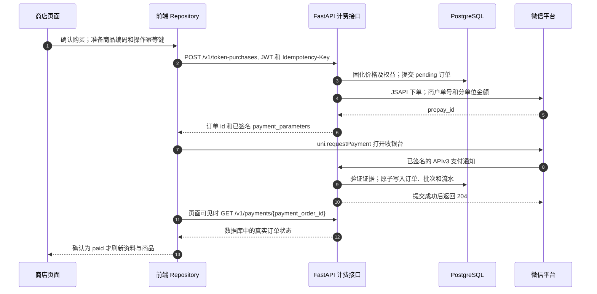
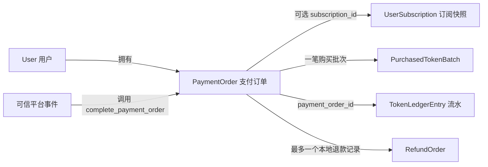
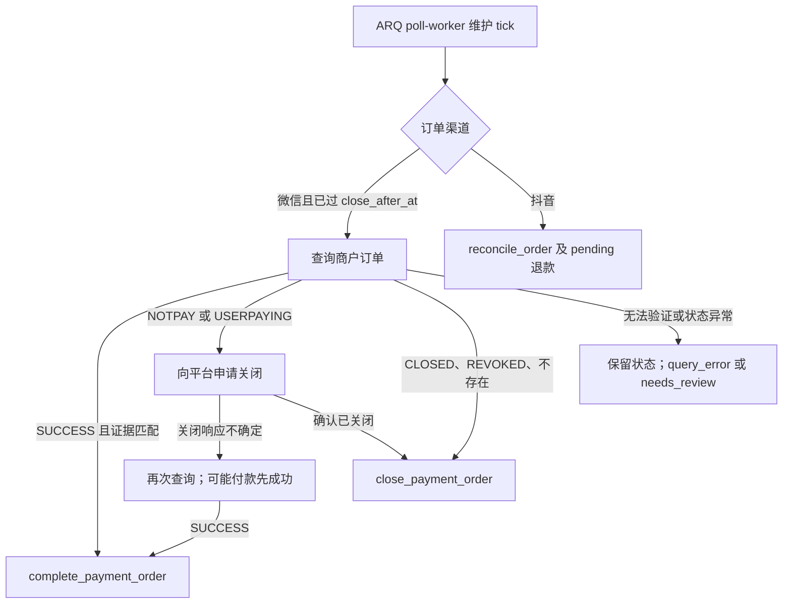

# 支付全链路：从「立即购买」到余额真正入账

先切到个人空间，打开**我的 → 商店**。本章跟踪一笔 Token 加油包购买，再对照订阅、订单恢复和平台回调。读代码时，「调用」就是一个函数把工作交给下一个函数；「数据库事务」就是把多项修改作为整体，一起提交或一起撤销；「收银台」是微信或抖音提供的付款界面。这条链路不调用 AI 模型。

建议先看有编号的图，再在第二个标签页打开表格中的函数，按同样编号追踪。所有源码链接固定到[已审计版本](/zh/reference/source-revisions)，不会因为以后移动文件而改变解释对象。[退款全链路](/zh/reference/flows/refund-flow)和[抖音交易全链路](/zh/reference/douyin-payment)继续展开分支，不把后续步骤压缩成一句「后端处理支付」。

## 1. 先分清三个不同的成功 {#three-results}

| 看到什么 | 能证明什么 | 还不能证明什么 |
| --- | --- | --- |
| 创建订单返回 `201` | 服务端价格的本地订单已存在，并返回了调起参数 | 钱已经到账、Token 已经增加 |
| `uni.requestPayment` / `tt.getOrderPayment` 成功 | 平台客户端桥接返回了结果 | 后端已经验证证据并提交结算事务 |
| 后端订单 `status: "paid"` | 可信平台回调/查询证据已通过结算函数落库 | 以后永远不会退款 |

支付不会作为 Workflow Operation 进入 AI `submit worker` 或 `poll worker`。正常创建和回调在 FastAPI 请求内完成，PostgreSQL 保存订单和资金相关效果。Redis 为 ARQ 维护任务调度、抖音 client token 缓存等提供支持，但不充当财务账本。回调丢失后靠可信平台查询恢复，不能靠前端的成功标志补发 Token。

## 2. 购买加油包：带编号的微信调用链 {#checkout-chain}

第 8 步回调和客户端收银台结果是两条独立路径，谁先到都可能。图画的是通知成功送达的主线；[恢复路径](#recovery)会解释延迟通知、支付与关闭竞争等情况。

| 编号 | 打开哪段代码 | 观察什么数据 |
| --- | --- | --- |
| 1 | `src/pkg-account/pages/store/index.vue` → [buy](https://github.com/Orientation-CD/wechat_mini_program/blob/3662578b384fd5b0fbe7509229b2a08a6fe44ab9/src/pkg-account/pages/store/index.vue#L225)、[runCheckout](https://github.com/Orientation-CD/wechat_mini_program/blob/3662578b384fd5b0fbe7509229b2a08a6fe44ab9/src/pkg-account/pages/store/index.vue#L212)；`purchaseRequest.ts` → [buildTokenPurchaseRequest](https://github.com/Orientation-CD/wechat_mini_program/blob/3662578b384fd5b0fbe7509229b2a08a6fe44ab9/src/pkg-account/repositories/purchaseRequest.ts#L84) | `@tap="buy(item)"` 弹出确认框，确认后生成 `logicalPurchaseId`。商品 code 来自发现接口，前端不传自定价格。 |
| 2 | [executePurchaseRequest](https://github.com/Orientation-CD/wechat_mini_program/blob/3662578b384fd5b0fbe7509229b2a08a6fe44ab9/src/pkg-account/repositories/purchaseRequest.ts#L93) → [request](https://github.com/Orientation-CD/wechat_mini_program/blob/3662578b384fd5b0fbe7509229b2a08a6fe44ab9/src/services/request.ts#L369) → [create_token_purchase](https://github.com/Orientation-CD/YuanZhu-AI/blob/e59716c83e087deda8477da5ea7b327a40cf65c5/app/billing/billing_api.py#L573) | `{type:"jsapi", package_code}` 是 JSON 请求体，幂等键在请求头，订单 id 尚未由客户端决定。FastAPI 通过 JWT 确认用户。 |
| 3 | [serialize_billing_order_creation](https://github.com/Orientation-CD/YuanZhu-AI/blob/e59716c83e087deda8477da5ea7b327a40cf65c5/app/billing/billing_api.py#L196)、[new_payment_deadlines](https://github.com/Orientation-CD/YuanZhu-AI/blob/e59716c83e087deda8477da5ea7b327a40cf65c5/app/billing/payment_expiry.py#L19)、[PaymentOrder](https://github.com/Orientation-CD/YuanZhu-AI/blob/e59716c83e087deda8477da5ea7b327a40cf65c5/app/persistence/db_models.py#L3025) | 同用户创建锁 → 查重复键 → 查有效商品 → 检查待支付上限 → 固化金额、Token、期限；先提交，再访问平台。 |
| 4 | [create_checkout](https://github.com/Orientation-CD/YuanZhu-AI/blob/e59716c83e087deda8477da5ea7b327a40cf65c5/app/billing/wechat_pay.py#L242) | SDK `pay()` 收到 `out_trade_no`、金额/币种、用户 OpenID、过期时间、通知 URL 和 `WeChatPayType.JSAPI`。 |
| 5 | 同一 [create_checkout](https://github.com/Orientation-CD/YuanZhu-AI/blob/e59716c83e087deda8477da5ea7b327a40cf65c5/app/billing/wechat_pay.py#L242) 的返回处理 | 平台必须返回 `prepay_id`，缺失时抛供应商错误，不能拿空响应继续支付。 |
| 6 | [_payment_parameters](https://github.com/Orientation-CD/YuanZhu-AI/blob/e59716c83e087deda8477da5ea7b327a40cf65c5/app/billing/wechat_pay.py#L208) → [refreshed_checkout_response](https://github.com/Orientation-CD/YuanZhu-AI/blob/e59716c83e087deda8477da5ea7b327a40cf65c5/app/billing/billing_api.py#L151) → [mapPaymentOrder](https://github.com/Orientation-CD/wechat_mini_program/blob/3662578b384fd5b0fbe7509229b2a08a6fe44ab9/src/pkg-account/repositories/paymentOrder.ts#L72) | 服务端为客户端参数签名，再重新读取订单，防止回调已到却继续给旧支付参数；前端校验订单种类、渠道及字段。 |
| 7 | `store/index.vue` → [launch](https://github.com/Orientation-CD/wechat_mini_program/blob/3662578b384fd5b0fbe7509229b2a08a6fe44ab9/src/pkg-account/pages/store/index.vue#L201) → [requestWechatPayment](https://github.com/Orientation-CD/wechat_mini_program/blob/3662578b384fd5b0fbe7509229b2a08a6fe44ab9/src/pkg-account/services/payment.ts#L63) | 校验时间戳、nonce、`prepay_id=…`、RSA 和签名后调 `uni.requestPayment`。取消只转换为提示，不直接关单或结算。 |
| 8 | [wechat_pay_notification](https://github.com/Orientation-CD/YuanZhu-AI/blob/e59716c83e087deda8477da5ea7b327a40cf65c5/app/billing/billing_api.py#L1365) → [receive_wechat_event](https://github.com/Orientation-CD/YuanZhu-AI/blob/e59716c83e087deda8477da5ea7b327a40cf65c5/app/billing/billing_api.py#L1188) → [callback](https://github.com/Orientation-CD/YuanZhu-AI/blob/e59716c83e087deda8477da5ea7b327a40cf65c5/app/billing/wechat_pay.py#L354) | 保留原始字节，用 APIv3 SDK 验签/解密，再核验应用、商户、金额、币种、交易号和事件类型。 |
| 9 | [complete_payment_order](https://github.com/Orientation-CD/YuanZhu-AI/blob/e59716c83e087deda8477da5ea7b327a40cf65c5/app/billing/billing.py#L750) | 锁用户和订单；改为 paid；增加购买 Token 批次及正向流水；有关联订阅则激活。通知事件也在当前请求事务内保存。 |
| 10 | [receive_wechat_event](https://github.com/Orientation-CD/YuanZhu-AI/blob/e59716c83e087deda8477da5ea7b327a40cf65c5/app/billing/billing_api.py#L1188) 末尾 | 提交后才确认；已保存事件 id 的重试直接返回 `204`。并发重复提交冲突留给平台重投，不伪造成功确认。 |
| 11 | [createPaymentReconciliationPoller](https://github.com/Orientation-CD/wechat_mini_program/blob/3662578b384fd5b0fbe7509229b2a08a6fe44ab9/src/pkg-account/repositories/paymentReconciliation.ts#L57) → [paymentReconciliationRepository](https://github.com/Orientation-CD/wechat_mini_program/blob/3662578b384fd5b0fbe7509229b2a08a6fe44ab9/src/pkg-account/repositories/paymentReconciliation.ts#L47) → [payment_detail](https://github.com/Orientation-CD/YuanZhu-AI/blob/e59716c83e087deda8477da5ea7b327a40cf65c5/app/billing/billing_api.py#L725) | 微信路径只读本地订单，不是每五秒向微信查一次单。 |
| 12 | [payment_response](https://github.com/Orientation-CD/YuanZhu-AI/blob/e59716c83e087deda8477da5ea7b327a40cf65c5/app/billing/billing_api.py#L119) → [mapPaymentReconciliation](https://github.com/Orientation-CD/wechat_mini_program/blob/3662578b384fd5b0fbe7509229b2a08a6fe44ab9/src/pkg-account/repositories/paymentReconciliation.ts#L31) | 当前轮询以 `status !== "pending"` 为终点。金额是整数分：`100` 分 = ¥1。 |
| 13 | `store/index.vue` → [applyOrder](https://github.com/Orientation-CD/wechat_mini_program/blob/3662578b384fd5b0fbe7509229b2a08a6fe44ab9/src/pkg-account/pages/store/index.vue#L184)、[initialize](https://github.com/Orientation-CD/wechat_mini_program/blob/3662578b384fd5b0fbe7509229b2a08a6fe44ab9/src/pkg-account/pages/store/index.vue#L257) | 只有 paid 才提示购买成功并重载 profile/catalog；closed、refunded 单独提示。 |

### 2.1 请求包装器与登录怎样接上 {#request-auth}

[performRequest](https://github.com/Orientation-CD/wechat_mini_program/blob/3662578b384fd5b0fbe7509229b2a08a6fe44ab9/src/services/request.ts#L211) 拼接 API 地址，设置 JSON、`X-Request-ID`、`Authorization: Bearer …`，执行 `uni.request`，再把 HTTP/网络失败转成 `ApiRequestError`。[requestWithAuth](https://github.com/Orientation-CD/wechat_mini_program/blob/3662578b384fd5b0fbe7509229b2a08a6fe44ab9/src/services/request.ts#L341) 对过期 access token 共享刷新过程，最多重放一次，使用同一份 prepared 请求体和幂等头；它不会因为结果不确定就换键创建另一笔购买。

服务端 [get_current_user](https://github.com/Orientation-CD/YuanZhu-AI/blob/e59716c83e087deda8477da5ea7b327a40cf65c5/app/identity/auth.py#L162) 解码 **access** JWT，读取仍有效的 `User`，结束认证读取事务。订单入口再通过 [checkout_openid](https://github.com/Orientation-CD/YuanZhu-AI/blob/e59716c83e087deda8477da5ea7b327a40cf65c5/app/billing/billing_api.py#L237) 从账户提取付款身份：微信需要 `wechat_openid`，抖音需要 `douyin_openid`，不能在购买请求体中随意传别人的 OpenID。未登录或登录失效时，先在认证阶段失败，不会先创建订单。

### 2.2 为什么网络重试不会多创建一单 {#idempotency}

[getOrCreateIdempotencyKey](https://github.com/Orientation-CD/wechat_mini_program/blob/3662578b384fd5b0fbe7509229b2a08a6fe44ab9/src/pkg-account/services/idempotency.ts#L71) 在本地存储按 `(scope, ownerId, actionId)` 保存键。`prepare()` 的 scope 是 `purchase`，actionId 区分订阅/加油包及本次逻辑操作。请求失败或响应丢失时保留原键；收到并校验创建响应后，`executePurchaseRequest()` 清理这个本地操作键。这里的「terminal」表示**创建操作已得到确定响应**，即使订单仍待支付；之后续付用订单 id。

后端先对同一用户的创建操作加锁，再查 `(user_id,idempotency_key)`，数据库也有唯一约束。同一键、同一商品/类型/渠道复用同一订单，pending 才重取支付参数；同一键换了商品或 `type` 返回 `409 PAYMENT_IDEMPOTENCY_KEY_REUSED`。新键代表一笔新逻辑购买，不能把生成新键当作网络重试方案。

## 3. 商品与 Feature 为什么能显示 {#discovery}

### GET /v1/billing/features {#billing-features}

**从哪里触发：** 进入商店的 `initialize()` 调用 [billingCatalogRepository](https://github.com/Orientation-CD/wechat_mini_program/blob/3662578b384fd5b0fbe7509229b2a08a6fe44ab9/src/pkg-account/repositories/billingCatalog.ts#L142)，通过 `publicRequestWithResponse()` 发起公共读取，不要求 JWT。商店另读 profile 区分个人/企业；当前企业 UI 是线下付款后由管理员添加权益，没有企业在线结账入口。

**后端做什么：** [billing_catalog](https://github.com/Orientation-CD/YuanZhu-AI/blob/e59716c83e087deda8477da5ea7b327a40cf65c5/app/billing/billing_api.py#L287) 查询 active、未 removed 的 `Feature`、`SubscriptionPlan` 和 `TokenPackage`。对每个 Feature 执行 `resolve_workflow()`、`workflow_discovery_item()`；准入失败就不展示。图片 mask/reference 要求、报告/视频结果种类都从解析后的工作流端口推导；套餐 `allowed_features` 过滤到当前可见 Feature，兼容的 `allowed_catalogs` 只含图片类。可选视频模型价格还取决于服务端模型选择开关。

**返回与排障：** `200 BillingCatalogResponse` 包括 `design_job_types`、`subscription_plans`、`token_packages`；价格单位是整数分。`billing_catalog_etag()` 对完整排序表示做哈希；请求 `If-None-Match` 可得到无正文 `304`，Cache-Control 为 `public, max-age=30, stale-while-revalidate=30`。当前商店 Repository 请求规范路径并校验商品，没有自行实现 ETag 缓存。Feature 不见了，要同时检查工作流准入/配置，不能只看 active。空数据库启动不会自动变出可购买商品。

### GET /v1/billing/catalog {#legacy-catalog}

**兼容入口：** 当前商店没有调用它。装饰器仍进入同一个 `billing_catalog()`，使用上述相同查询、ETag、`200/304` 与准入过滤，REST schema 标为 deprecated。旧集成仍能读取，新代码使用 `/v1/billing/features`。收到 `304` 必须复用客户端已存表示，不能把空正文当成一份新 JSON 解析。

### GET /v1/design-workflows {#legacy-design-workflows}

**兼容入口：** 当前商店没有调用，也标记 deprecated，仍是同一个 `billing_catalog()` 公共读取。历史命名不代表启动设计，也不返回统一 Workflow 的执行状态；它不写任务或 Token 流水。实际执行请沿[工作流调用链](/zh/reference/flows/design-job-lifecycle)学习。

## 4. 两种创建订单接口的内部区别 {#create-orders}

### POST /v1/subscriptions {#create-subscription}

**UI 与请求：** `buy()` → `runCheckout()` → [buildSubscriptionPurchaseRequest](https://github.com/Orientation-CD/wechat_mini_program/blob/3662578b384fd5b0fbe7509229b2a08a6fe44ab9/src/pkg-account/repositories/purchaseRequest.ts#L75) → `executePurchaseRequest()`。JSON 是 `{ "type": "jsapi", "plan_code": "<接口返回的编码>" }`，抖音构建传 `douyin`；`Idempotency-Key` 长度 8～128。这些模型严格限制请求，客户端不提交价格或 Token 数。

**后端步骤：** [create_subscription](https://github.com/Orientation-CD/YuanZhu-AI/blob/e59716c83e087deda8477da5ea7b327a40cf65c5/app/billing/billing_api.py#L430) 检查支付模式/身份 → 用户级创建锁 → 清理到期订阅 → 先处理幂等分支 → 查有效套餐。已有 pending 或 active 订阅返回 `409 SUBSCRIPTION_ALREADY_EXISTS`。随后创建 **pending `UserSubscription` 快照**（套餐名/编码、周期、Token、折扣、权益项），关联 pending `PaymentOrder`，必要时固化抖音交易配置，提交数据库。提交后才调用选定平台，并通过 `refreshed_checkout_response()` 重读订单。

**响应与恢复：** `201 PaymentOrderResponse` 返回 id、`kind:"subscription"`、服务端金额/期限以及 pending 时的支付参数。套餐不存在/已移除 → `404 SUBSCRIPTION_PLAN_NOT_FOUND`；键意图改变 → `409`；支付禁用或平台异常 → `503`。平台超时可能发生在**本地已经提交之后**，因此应使用原键重试或找到现有待付订单续付，不能断定「没有单」。订阅周期从可信结算时开始，不是从创建时开始；属于单次固定期限购买，不会自动周期扣款。

### POST /v1/token-purchases {#create-token-purchase}

**UI 与请求：** `buy()` → `runCheckout()` → `buildTokenPurchaseRequest()` 发 `{ "type": "jsapi", "package_code": "<接口返回的编码>" }`，遵守同样的幂等纪律。商店加油包卡片走这条分支，套餐卡片走上一条。

**后端步骤：** [create_token_purchase](https://github.com/Orientation-CD/YuanZhu-AI/blob/e59716c83e087deda8477da5ea7b327a40cf65c5/app/billing/billing_api.py#L573) 检查模式/身份、串行创建并复用匹配原键；查询有效且未移除的加油包，调用 `pending_token_purchase_count()`。达到配置的待付上限时返回 `409 PENDING_PAYMENT_LIMIT_REACHED`。订单固化 `price_fen`、`list_price_fen`、`tokens_granted=total_token_amount`、`bonus_tokens_granted`；赠送数量已经包含在 total 中，结算不能再加一次。本分支不创建 `UserSubscription`；快照、提交、平台调用、重读的边界与订阅相同。

**响应与恢复：** `201` 的 kind 为 `token_purchase`；商品不存在 → `404 TOKEN_PACKAGE_NOT_FOUND`；缺少对应平台身份 → `409`；平台失败 → `503`。创建响应丢失时先查支付记录。达到待付上限后应支付/等待关闭已有订单，不能反复换新键绕过。

## 5. 钱确认后，哪些记录一起变化 {#settlement}

把 [complete_payment_order](https://github.com/Orientation-CD/YuanZhu-AI/blob/e59716c83e087deda8477da5ea7b327a40cf65c5/app/billing/billing.py#L750) 与这几个模型并排阅读：[PaymentOrder](https://github.com/Orientation-CD/YuanZhu-AI/blob/e59716c83e087deda8477da5ea7b327a40cf65c5/app/persistence/db_models.py#L3025)、[PurchasedTokenBatch](https://github.com/Orientation-CD/YuanZhu-AI/blob/e59716c83e087deda8477da5ea7b327a40cf65c5/app/persistence/db_models.py#L3133)、[TokenLedgerEntry](https://github.com/Orientation-CD/YuanZhu-AI/blob/e59716c83e087deda8477da5ea7b327a40cf65c5/app/persistence/db_models.py#L1895)、[UserSubscription](https://github.com/Orientation-CD/YuanZhu-AI/blob/e59716c83e087deda8477da5ea7b327a40cf65c5/app/persistence/db_models.py#L2970)。函数按用户→订单顺序加锁；已经 paid/refunded 就直接返回。状态防护和通知事件去重互补，即使同一真实支付被包装成另一条通知，也不能再发一批 Token。

可信 pending 订单结算时写 `paid_at`，清除 `closed_at`，保存渠道交易号/订单号，增加 `User.remaining_tokens`，创建 original/remaining 均为发放量的 `PurchasedTokenBatch`，并写幂等键 `payment:<订单 UUID>:user:grant` 的正向流水。有关联订阅则激活，并从结算时间计算权益周期。非 mock 支付还可能创建邀请奖励候选。调用者最后整体提交，回调成功确认必须在提交之后。

抖音 closed 订单有明确例外：以后查到可信成功允许补结算；普通微信 closed 不会由此函数重新打开。因此状态迁移要连同平台证据和渠道规则理解，不能照抄一个无条件通用状态图。

### POST /v1/webhooks/wechat/payments {#wechat-payment-webhook}

**谁触发：** 微信服务器发送 APIv3 原始通知；不是小程序发 HTTP，也不带用户 JWT，可信性来自平台验证。[wechat_pay_notification](https://github.com/Orientation-CD/YuanZhu-AI/blob/e59716c83e087deda8477da5ea7b327a40cf65c5/app/billing/billing_api.py#L1365) 转交 `receive_wechat_event()`，退款 URL 也共用这个按资源分派的处理器。

1. `callback()` 拒绝与服务器时间相差超过 300 秒的时间戳，SDK 验证平台签名并解密 resource。仅 `json.loads()` 不等于验签。
2. 要求通知 id；已有 `WeChatPaymentEvent` 就返回 `204`。核验 `mchid`，通过 `out_trade_no` 找本地订单，再核验渠道 AppID、`amount.total`、币种、`TRANSACTION.SUCCESS`、`trade_state:SUCCESS`、非空交易号。
3. 调 `complete_payment_order()`，添加带原始信封及 `processed_at` 的事件，提交后返回 `204 No Content`。APP 付款身份在合适条件下摘要化用于奖励检查，不接受购买请求体传入的付款身份。
4. 签名/解密错误 → `401 WECHAT_PAY_CALLBACK_INVALID`；身份/金额/状态错误 → `400`；找不到订单 → `404`，均不结算。并发重复通知可能在提交时冲突，由平台重投后命中已存事件；失败提交后不能伪造成功确认。

微信 **APIv3** 是服务端协议、签名与加密通知版本；`type:"jsapi"` 是下单/调起表面，小程序桥接是 `uni.requestPayment`。后端支持的 `app` 是原生 App 表面，当前小程序不调用。另一个虚拟商品 `requestVirtualPayment` 桥接没有在此实现。

## 6. 读取、续付、关闭与恢复 {#recovery}

### GET /v1/payments {#payment-history}

**UI：** 进入**支付记录**，[load](https://github.com/Orientation-CD/wechat_mini_program/blob/3662578b384fd5b0fbe7509229b2a08a6fe44ab9/src/pkg-account/pages/orders/index.vue#L48) 调 [paymentHistoryRepository](https://github.com/Orientation-CD/wechat_mini_program/blob/3662578b384fd5b0fbe7509229b2a08a6fe44ab9/src/pkg-account/repositories/paymentHistory.ts#L26)，带 `?type=jsapi` 或 `?type=douyin`，不带自选 user id。[payment_history](https://github.com/Orientation-CD/YuanZhu-AI/blob/e59716c83e087deda8477da5ea7b327a40cf65c5/app/billing/billing_api.py#L865) 按 JWT 用户和渠道过滤、创建时间倒序，最多返回 250 条 `{items:[…]}`。纯本地数据库读取，不请求平台、不结算、不为每单生成调起参数。缺失/非法 `type` 属于请求校验错误，空列表是正常 `200`。UI 加载更多只是扩展已取回列表，不是后端游标分页。

### GET /v1/payments/{payment_order_id} {#payment-detail}

**UI：** 微信轮询器和指定订单深链接调用。[payment_detail](https://github.com/Orientation-CD/YuanZhu-AI/blob/e59716c83e087deda8477da5ea7b327a40cf65c5/app/billing/billing_api.py#L725) 只查 `(id,current_user.id)`，交 `payment_response()` 序列化时间和状态。`200` 不重取 `payment_parameters`；不存在/他人订单 → `404 PAYMENT_ORDER_NOT_FOUND`。抖音也能读取本地视图，但支付确认轮询使用 [POST reconcile](/zh/reference/douyin-payment#payment-reconcile)。本地一直 pending 不能证明平台没有收钱。

### POST /v1/payments/{payment_order_id}/pay {#payment-resume}

**UI：** 支付记录的**支付/继续支付** → [resumePayment](https://github.com/Orientation-CD/wechat_mini_program/blob/3662578b384fd5b0fbe7509229b2a08a6fe44ab9/src/pkg-account/pages/orders/index.vue#L176) → [paymentResumeRepository](https://github.com/Orientation-CD/wechat_mini_program/blob/3662578b384fd5b0fbe7509229b2a08a6fe44ab9/src/pkg-account/repositories/paymentResume.ts#L35)，发送 `{type:<当前渠道>}` 并复用订单 UUID。[resume_owned_payment](https://github.com/Orientation-CD/YuanZhu-AI/blob/e59716c83e087deda8477da5ea7b327a40cf65c5/app/billing/billing_api.py#L750) 同时要求归属和原渠道；非 pending 原样返回；pending 到达已存 `expires_at` 返回 `409 PAYMENT_ORDER_EXPIRED`；检查关联订阅/商品，结束读取事务后获取新调起参数，再重读状态避免回调已到却返回旧参数。

`200` 可能是带参数的 pending，也可能是无参数终态；归属/渠道不同 → `404`；关联损坏 → `409`；平台异常 → `503`。前端发送前也检查期限和渠道。抖音已保存平台订单号走 `get_order_payment`，无订单号走已签名 `request_order`。不能手改旧签名，也不能更换旧订单渠道来跨平台续付。

### POST /v1/payments/{payment_order_id}/close {#payment-close}

**UI：** 支付记录**关闭订单** → 确认框 → [executeClose](https://github.com/Orientation-CD/wechat_mini_program/blob/3662578b384fd5b0fbe7509229b2a08a6fe44ab9/src/pkg-account/pages/orders/index.vue#L198) → [paymentCloseRepository](https://github.com/Orientation-CD/wechat_mini_program/blob/3662578b384fd5b0fbe7509229b2a08a6fe44ab9/src/pkg-account/repositories/paymentClose.ts#L30)。[close_owned_payment](https://github.com/Orientation-CD/YuanZhu-AI/blob/e59716c83e087deda8477da5ea7b327a40cf65c5/app/billing/billing_api.py#L827) 查归属、检查模式，先拒绝所有抖音订单并返回 `409 DOUYIN_ACTIVE_CLOSE_UNSUPPORTED`，再对终态微信订单原样返回。pending 微信先释放读取事务，等待 `close_checkout()` 确认，随后调用 [close_payment_order](https://github.com/Orientation-CD/YuanZhu-AI/blob/e59716c83e087deda8477da5ea7b327a40cf65c5/app/billing/billing.py#L852) 并提交。带锁关闭函数不改已经 paid/refunded 的单，会关闭其 pending 订阅。

`200` 是规范状态；平台结果不确定/失败 → `503`，UI 应刷新而不是本地认定 closed。当前小程序关闭入口仅用于微信 JSAPI，服务端按其支持范围处理微信订单。关闭未付订单不退款，已付订单退款要走独立流程。

### 截止时间与 ARQ 维护任务 {#expiry-reconciliation}

`expires_at` 是支付截止，`close_after_at` 是更晚的安全关闭时间。[new_payment_deadlines](https://github.com/Orientation-CD/YuanZhu-AI/blob/e59716c83e087deda8477da5ea7b327a40cf65c5/app/billing/payment_expiry.py#L19) 创建时按照配置的有效期和宽限期固化二者；[payment_deadlines](https://github.com/Orientation-CD/YuanZhu-AI/blob/e59716c83e087deda8477da5ea7b327a40cf65c5/app/billing/payment_expiry.py#L31) 为旧的无时间戳记录提供回退。客户端不能写死一个关闭间隔。到期后 UI 禁止支付并显示确认中，只有可信的服务端处理才能修改数据库状态。

[PollWorkerSettings](https://github.com/Orientation-CD/YuanZhu-AI/blob/e59716c83e087deda8477da5ea7b327a40cf65c5/app/worker.py#L921) 注册微信对账每分钟第 20 秒、抖音第 10 秒，也在启动时运行。这是调度时机，不是保证完成时限。[reconcile_old_pending_payments](https://github.com/Orientation-CD/YuanZhu-AI/blob/e59716c83e087deda8477da5ea7b327a40cf65c5/app/workflows/maintenance_jobs.py#L236) 对合资格过期微信 pending 单按 keyset 分页、顺序查平台，并把有限进度写 Redis 供后台读取。[_reconcile_pending_payment](https://github.com/Orientation-CD/YuanZhu-AI/blob/e59716c83e087deda8477da5ea7b327a40cf65c5/app/workflows/maintenance_jobs.py#L113) 验证证据，成功则结算；确认未付/已关/不存在则关闭；关单响应不确定时再查一次，保护竞争中的付款。平台 `REFUND` 或异常状态需要进一步人工/退款证据，不能猜测退款成功。[reconcile_douyin_payments](https://github.com/Orientation-CD/YuanZhu-AI/blob/e59716c83e087deda8477da5ea7b327a40cf65c5/app/workflows/maintenance_jobs.py#L386) 独立于微信可用性运行，详见抖音章节的查询/退款发现分支。

## 7. 页面为什么会停止轮询 {#polling}

[createPollScheduler](https://github.com/Orientation-CD/wechat_mini_program/blob/3662578b384fd5b0fbe7509229b2a08a6fe44ab9/src/services/pollScheduler.ts#L33) 在变为可见时立即查询，通常每五秒重复，避免请求重叠，对网络/503 按上限退避并尊重 429 的重试提示。`setVisible(false)` 清定时器、让迟到响应失效，`dispose()` 结束生命周期。商店绑定 `onShow/onHide/onUnmounted`；支付记录为每个 pending 单管理轮询器。这里终态是当前轮询周期的 paid/closed/refunded，并不代表未来退款永远不能再更新它。

如果用户收银台显示成功、余额却没增加，先记下订单 UUID 和 request id，查本地状态、通知事件与维护任务日志；确认为 paid 后再查 profile 刷新。重开一笔收银台或手动加积分会掩盖原始故障，也可能制造第二笔不一致。

## 8. 不花真钱的源码追踪练习 {#debugging-exercise}

按[本地上手](/zh/get-started/quickstart)准备一次性本地数据库、测试账户、可售商品和 mock 供应商。本练习不调用真实支付网关。

1. 在前端源码目录打开 `store/index.vue`，找到 `@tap.stop="buy(item)"`、`buy`、`runCheckout`、`launch`。写出哪里持有商品 code、哪里创建键、哪里拉收银台。前端 Mock 模式走 `runStoreDemoCheckout` 本地演示 Repository，不证明 FastAPI 入账。
2. 对本地真实 API + 微信 mock 供应商，观察创建后的 `PaymentOrder`：应为 pending，有服务端金额/发放量/期限，尚无购买到账流水。条件开放的 `/mock/payments/{payment_order_id}/complete` 由 [mock_complete_payment](https://github.com/Orientation-CD/YuanZhu-AI/blob/e59716c83e087deda8477da5ea7b327a40cf65c5/app/billing/billing_api.py#L691) 验证归属、要求微信 mock、排除抖音后才复用结算函数；路由还受 mock 端点配置挂载策略控制。挂载开关是 `MOCK_PAYMENT_ENDPOINTS_ENABLED`，生产配置禁止启用；生产不能用它替代平台桥接。
3. 逐行跟踪 `complete_payment_order`，对照完成后的 `User.remaining_tokens`、一个购买批次和 `payment:…:grant` 流水。同一测试单再次完成不应产生第二次发放。批次 original/remaining 的差别会决定退款资格。
4. 在源码中找到 `create_checkout` 前的 `commit()`，解释为什么平台响应丢失仍会留下一笔 pending，再找到原键重试/续付入口。无需制造真实平台超时就能完成这个练习。
5. 沿 `_reconcile_pending_payment` 跟踪过期单，指出成功、不存在、关单竞争、无法验证四条分支分别在哪里写状态、哪里只记录并重试。真实账户不能用伪造成功通知或 SQL 改状态做练习。

字段级请求/响应请继续看[接口索引](/zh/reference/rest-api)、[固定版本契约](/zh/reference/source-revisions)及以上路由/模型源码。
