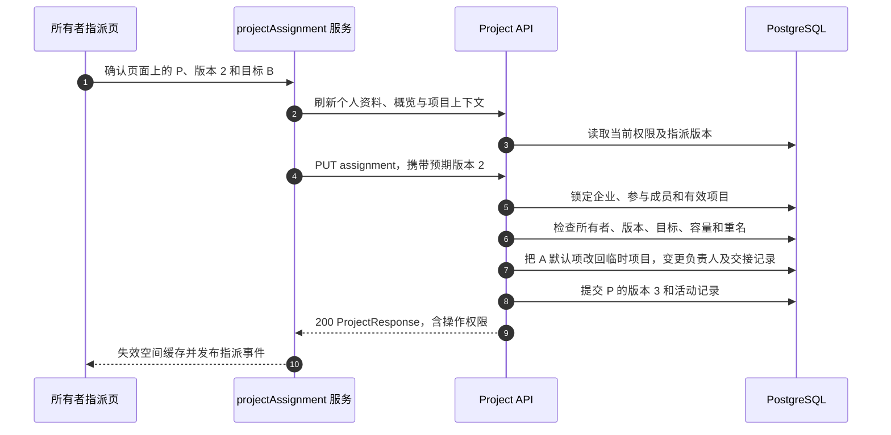

# 项目指派：负责人改变，历史内容保留原作者

企业所有者打开项目，选择“指派／改派”，再选择当前成员。项目 ID、创建者、已有任务和户型作品保持原有身份；`assignee_user_id` 决定现在由谁推进。`creator_user_id` 是历史创建记录，不能替代当前负责人校验。所有者也可以直接替成员创建项目，或把自己的项目标为 `awaiting_assignment` 等待指派；个人空间和临时项目不支持交接。

贯穿例子：所有者 O 使用页面展示的指派版本 2，把项目 P 从 A 交给 B。A 已受理的任务 J 仍由 A 创作，并按原预留记账。B 提交的新任务使用 B 的月度额度。交接不重启 J、不搬运产物、不更换空间付款方，也不授予 B 复用 A 输入的权限。

| 图中步骤 | 源码 | 应阅读的分支与目的 |
| --- | --- | --- |
| 1–4 | [assignProject](https://github.com/Orientation-CD/wechat_mini_program/blob/7f1a3169338c10bd4139c24318f7a35caf86310c/src/pkg-projects/services/projectAssignment.ts#L40) 与 `assignmentSnapshot` | 刷新权限，但不偷偷替换用户确认时看到的乐观锁版本 |
| 5–8 | [assign_project](https://github.com/Orientation-CD/YuanZhu-AI/blob/f34b8a4d6307c83c6f7bbc905485a4f586d59a99/app/workspaces/project_api.py#L634) | 企业／成员锁、嵌套事务以及默认项目外键的原子修复 |
| 9–10 | [projectContextRepository](https://github.com/Orientation-CD/wechat_mini_program/blob/7f1a3169338c10bd4139c24318f7a35caf86310c/src/repositories/projectContext.ts#L203) | 用指派版本挡住迟到响应，防止旧负责人状态恢复 |

## 指派或改派项目 {#assign-project}

`PUT /v1/workspaces/{workspace_id}/projects/{project_id}/assignment`

`assign_project` 要求当前有效企业的所有者。请求体为 `{"assignee_user_id":"<成员 UUID>","expected_assignment_version":2}`；可选 `name` 只用于真正转交时解决目标名下重名。先锁空间权限和相关成员，再锁有效项目，拒绝临时项目，比较版本，并通过 `_require_assignee` 确认目标仍是有效当前成员。原负责人已经离开企业时，所有者仍可接管其项目，不要求原负责人保持成员身份。

容量和大小写折叠后的名称唯一性都以“**目标负责人＋空间**”为范围。转交进行中项目会检查目标的 20 个项目容量；启用成交流失时，已关闭项目不占该容量。负责人不变却携带 `name` 会返回 422 `PROJECT_ASSIGNMENT_RENAME_REQUIRES_TRANSFER`。

嵌套事务中，如果 A 的服务端默认项目为 P，先把它改成 A 的永久临时项目并 flush，以满足即时外键。真正交接才更新负责人／名称、递增 `assignment_version`、清零 `assignment_seen_version`，记录操作者、原负责人和时间；同时清除 `awaiting_assignment`，更新项目及成员活动，提交后返回 200。同负责人清除待指派标记不制造新的交接版本。空操作和已读确认都不消耗积分，也不派发任务。

409 `PROJECT_ASSIGNMENT_STALE` 要求刷新后让用户重新确认，不能自动换成新版本再次提交。`PROJECT_ASSIGNEE_UNAVAILABLE`、`PROJECT_LIMIT_REACHED` 和 `PROJECT_NAME_CONFLICT` 分别要求重新核对成员、容量或名称。网络失败可能发生在提交之后，页面提供“刷新核对”，不自动重放；`assignProject` 即使结果不确定也会发布空间缓存失效事件。

## 新负责人确认已看到本次交接 {#assignment-seen}

`PUT /v1/workspaces/{workspace_id}/projects/{project_id}/assignment/seen`

详情页的 [acknowledgeAssignment](https://github.com/Orientation-CD/wechat_mini_program/blob/7f1a3169338c10bd4139c24318f7a35caf86310c/src/pkg-projects/services/projectAssignment.ts#L59) 仅在当前账号是展示的负责人且尚未读过时发送 `expected_assignment_version`。`acknowledge_assignment` 锁定有效企业上下文，调用 [require_assignee_project](https://github.com/Orientation-CD/YuanZhu-AI/blob/f34b8a4d6307c83c6f7bbc905485a4f586d59a99/app/workspaces/project_jobs.py#L81)（在路由文件中别名为 `_owned_project`），再核对版本。它只更新已读版本并提交响应，刻意保留 `updated_at` 与活动时间。同版本重复确认无害；版本 2 的迟到请求不能确认新的版本 3，会返回 409 stale。

## 交接后的读取与写入边界

[readable_design_job](https://github.com/Orientation-CD/YuanZhu-AI/blob/f34b8a4d6307c83c6f7bbc905485a4f586d59a99/app/workflows/read_access.py#L79) 允许原任务作者、当前企业所有者或当前项目负责人读取符合条件的历史。打开项目另需当前负责关系或有边界的企业所有者权限。因此 A 可以保留自己的历史结果入口，同时失去打开 P 的权限。响应保留真实提交者、当前项目负责人和明确的操作权限。

B 可只读查看 A 的结果，但不会变成作者。`finalize_workflow_reads` 在外部签名之后重新计算权限：变更需要“原作者＋当前负责人＋有效空间”。复用输入还要经过 Asset 自身权限；可见结果或签名 URL 不等于获得复用权。前端 [verifyAssignmentRead](https://github.com/Orientation-CD/wechat_mini_program/blob/7f1a3169338c10bd4139c24318f7a35caf86310c/src/services/assignmentReadAccess.ts#L7) 在读取／下载时防止会话、空间或负责关系变化。

已受理任务通过 [active_task_project](https://github.com/Orientation-CD/YuanZhu-AI/blob/f34b8a4d6307c83c6f7bbc905485a4f586d59a99/app/workspaces/project_jobs.py#L138) 继续执行，交接不是取消，也不会对旧预留重新定价。交接后 A 发起新的原作者变更会被 `PROJECT_NOT_ASSIGNEE` 拦截。整项目删除同时检查任务与没有任务的户型作品；存在前任内容时，只有所有者能授权清理（`PROJECT_OWNER_REQUIRED_FOR_FOREIGN_CONTENT`）。`move_to_scratch` 把内容送回各自作者的临时项目，不把所有历史都交给 B。

结合 [tests/test_project_assignment.py](https://github.com/Orientation-CD/YuanZhu-AI/blob/f34b8a4d6307c83c6f7bbc905485a4f586d59a99/tests/test_project_assignment.py)、[tests/test_project_assignment_deletion.py](https://github.com/Orientation-CD/YuanZhu-AI/blob/f34b8a4d6307c83c6f7bbc905485a4f586d59a99/tests/test_project_assignment_deletion.py) 阅读处理函数。本章是源码跟读，不代表已完成真机或生产验收。
