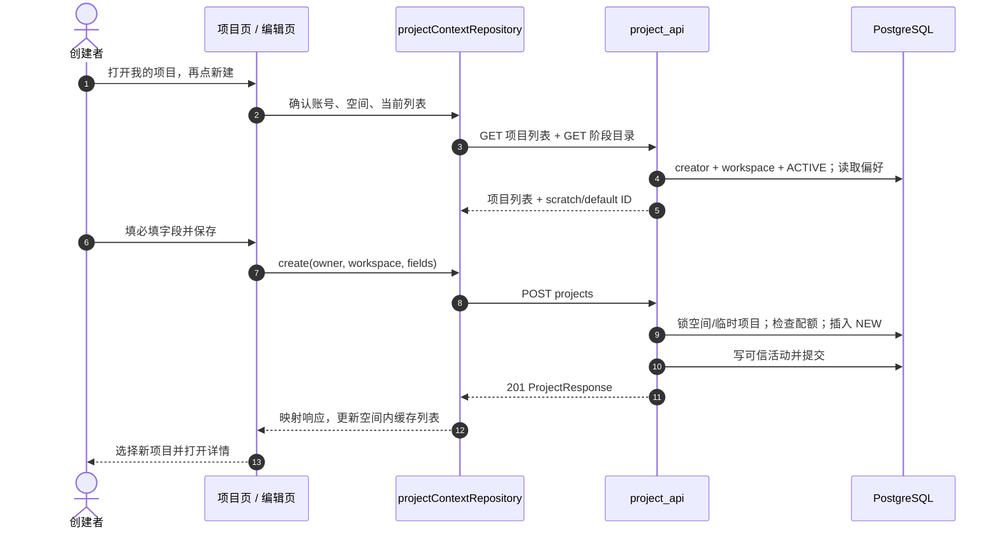
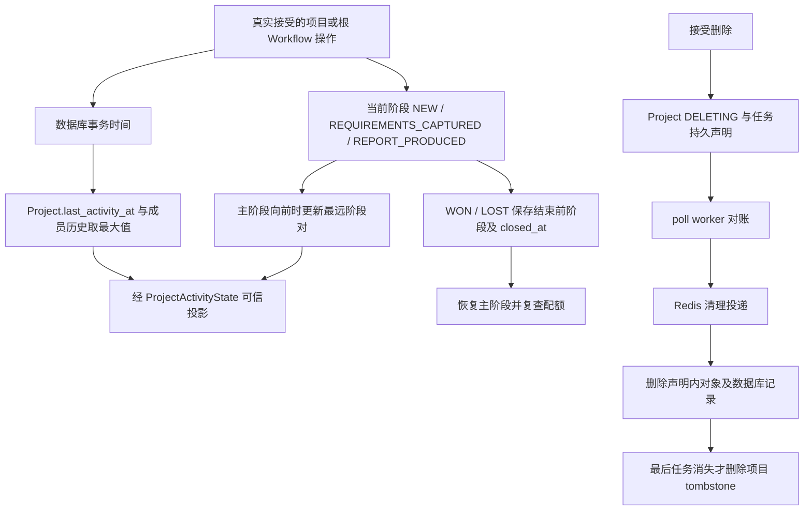

# 项目全链路：创建、推进、观察活动与删除

Project 是一个空间内由创建者私有管理的设计历史分组。空间所有者有专门的只读概览；所有者并不会成为每个成员项目的创建者。本章从“我的项目”进入第一个项目的 PostgreSQL 记录，再追踪阶段/成交流失变更和物理清理。

前端 `VITE_ENABLE_PRIVATE_PROJECTS` 与后端 `PROJECT_OUTCOMES_ENABLED` 控制不同事情。后者决定公布的阶段词汇以及是否允许选择 WON/LOST。应读取返回的阶段目录，不能自行增加状态码。



## 按编号定位源码

| 步骤 | 源码 | 停下来核对 |
| --- | --- | --- |
| 1–4 | [`loadProjects` · `src/pages/projects/index.vue:224`](https://github.com/Orientation-CD/wechat_mini_program/blob/eca0a5f9e0a2aa1cb3fd4f9714114bb3db7fae5f/src/pages/projects/index.vue#L224) → [`projectContextRepository` · `src/repositories/projectContext.ts:181`](https://github.com/Orientation-CD/wechat_mini_program/blob/eca0a5f9e0a2aa1cb3fd4f9714114bb3db7fae5f/src/repositories/projectContext.ts#L181) → [`list_projects` · `app/workspaces/project_api.py:216`](https://github.com/Orientation-CD/YuanZhu-AI/blob/b13cc5668920620a274cb91a3393ed9fadac72ae/app/workspaces/project_api.py#L216) | 当前设备选择与服务端默认项目不同；列表范围是 `(creator, workspace)`。 |
| 5–8 | [`save` · `src/pkg-projects/pages/editor/index.vue:102`](https://github.com/Orientation-CD/wechat_mini_program/blob/eca0a5f9e0a2aa1cb3fd4f9714114bb3db7fae5f/src/pkg-projects/pages/editor/index.vue#L102) → [`create_project` · `app/workspaces/project_api.py:254`](https://github.com/Orientation-CD/YuanZhu-AI/blob/b13cc5668920620a274cb91a3393ed9fadac72ae/app/workspaces/project_api.py#L254) → [`lock_accessible_workspace` · `app/workspaces/workspaces.py:250`](https://github.com/Orientation-CD/YuanZhu-AI/blob/b13cc5668920620a274cb91a3393ed9fadac72ae/app/workspaces/workspaces.py#L250) | 表单校验提前反馈；服务端锁与验证仍是权威。 |
| 9–12 | [`activity_transaction_time` · `app/workspaces/project_activity.py:43`](https://github.com/Orientation-CD/YuanZhu-AI/blob/b13cc5668920620a274cb91a3393ed9fadac72ae/app/workspaces/project_activity.py#L43) → [`Project` · `app/persistence/db_models.py:954`](https://github.com/Orientation-CD/YuanZhu-AI/blob/b13cc5668920620a274cb91a3393ed9fadac72ae/app/persistence/db_models.py#L954) | 活动用数据库事务时间和可信时间界线；成功响应意味着已提交。 |

图展示正常路径；后面的逐接口章节解释各自读取、写入和错误分支。

## 加载代码维护的阶段目录 {#project-status-catalog}

`GET /v1/project-statuses`

**界面 / 入口：** 项目阶段预加载、项目页和详情页使用 `projectStatusCatalogRepository`。

**跟着请求读代码：**

1. 需要登录，但这是全局目录，不要求 workspace ID 或成员资格。

2. handler 读取代码维护的阶段定义；`outcomes_enabled()` 决定 base/outcomes 版本，base 排除结果型阶段，开启版另有 `lost_reasons`。

3. 返回 `Cache-Control: private, max-age=300`；前端校验并映射标签、顺序、kind、terminal/tone/selectable 和停滞阈值。

**响应和失败分支：** 不修改数据库、不提交 Redis 任务、不调模型。新服务端返回未知状态时应安全展示，不能因旧客户端枚举不认识就写回 NEW。

**源码停靠点：** [`projectStatusCatalogRepository` · `src/repositories/projectStatusCatalog.ts:83`](https://github.com/Orientation-CD/wechat_mini_program/blob/eca0a5f9e0a2aa1cb3fd4f9714114bb3db7fae5f/src/repositories/projectStatusCatalog.ts#L83) → [`get_project_statuses` · `app/workspaces/project_status_api.py:19`](https://github.com/Orientation-CD/YuanZhu-AI/blob/b13cc5668920620a274cb91a3393ed9fadac72ae/app/workspaces/project_status_api.py#L19) → [`visible_project_statuses` · `app/workspaces/project_statuses.py:108`](https://github.com/Orientation-CD/YuanZhu-AI/blob/b13cc5668920620a274cb91a3393ed9fadac72ae/app/workspaces/project_statuses.py#L108)

## 读取本人项目、临时和默认项目 {#list-projects}

`GET /v1/workspaces/{workspace_id}/projects`

**界面 / 入口：** “我的项目” `loadProjects()` → context enter/refresh → `fetchList`。

**跟着请求读代码：**

1. 先检查当前空间访问，再仅选 `creator_user_id=user.id`、指定空间和 ACTIVE 生命周期。OWNER 身份不会去掉创建者过滤。

2. `_project_responses` 以 ProjectActivityState 为查询锚点，投影可信最远阶段对；空列表不能掩盖可信单例缺失。

3. 找到该 `(user,workspace)` 的临时项目和 ProjectPreference，返回列表及 scratch/default ID。前端另外选择设备当前项目，并用账号/session/缓存修订号隔离过期结果。

**响应和失败分支：** 临时项目/偏好缺失为 404 `PROJECT_UNAVAILABLE`，可信状态失败为 503。这不是合法的“没有项目”空列表。正在删除的 tombstone 不出现在有效结果中。

**源码停靠点：** [`loadProjects` · `src/pages/projects/index.vue:224`](https://github.com/Orientation-CD/wechat_mini_program/blob/eca0a5f9e0a2aa1cb3fd4f9714114bb3db7fae5f/src/pages/projects/index.vue#L224) → [`fetchList` · `src/repositories/projectContext.ts:97`](https://github.com/Orientation-CD/wechat_mini_program/blob/eca0a5f9e0a2aa1cb3fd4f9714114bb3db7fae5f/src/repositories/projectContext.ts#L97) → [`list_projects` · `app/workspaces/project_api.py:216`](https://github.com/Orientation-CD/YuanZhu-AI/blob/b13cc5668920620a274cb91a3393ed9fadac72ae/app/workspaces/project_api.py#L216) → [`_project_responses` · `app/workspaces/project_api.py:185`](https://github.com/Orientation-CD/YuanZhu-AI/blob/b13cc5668920620a274cb91a3393ed9fadac72ae/app/workspaces/project_api.py#L185)

## 创建第一个普通项目 {#create-project}

`POST /v1/workspaces/{workspace_id}/projects`

**界面 / 入口：** 我的项目 → + 新建 → 编辑页保存（`save`）。

**跟着请求读代码：**

1. 必填 name/customer_name/address；description、严格整数 floor_area、home_layout 可选。服务端去必填字段两端空白，名称/客户/地址上限为 80/40/200，保留临时项目名称。

2. 锁可访问空间和本人临时项目，检查配额（普通项目 20；开启结果状态时排除 WON/LOST），要求活动状态并获取数据库事务时间。

3. 插入普通 ACTIVE 项目，状态 NEW，初始化最远阶段 NEW 和活动。casefold 后名称在同创建者/空间内唯一；嵌套事务将重复转换为 `PROJECT_NAME_CONFLICT`。

4. 企业内同步写成员活动历史；提交返回 201。UI 明确选择返回项目；创建不会更改服务端默认。

**响应和失败分支：** 没有动作键契约：编辑页标记创建结果不确定，先刷新核对再允许再次创建。字段/配额/重名错误属于明确 4xx；网络超时不能证明事务回滚。

**源码停靠点：** [`save` · `src/pkg-projects/pages/editor/index.vue:102`](https://github.com/Orientation-CD/wechat_mini_program/blob/eca0a5f9e0a2aa1cb3fd4f9714114bb3db7fae5f/src/pkg-projects/pages/editor/index.vue#L102) → [`projectContextRepository` · `src/repositories/projectContext.ts:181`](https://github.com/Orientation-CD/wechat_mini_program/blob/eca0a5f9e0a2aa1cb3fd4f9714114bb3db7fae5f/src/repositories/projectContext.ts#L181) → [`create_project` · `app/workspaces/project_api.py:254`](https://github.com/Orientation-CD/YuanZhu-AI/blob/b13cc5668920620a274cb91a3393ed9fadac72ae/app/workspaces/project_api.py#L254) → [`_check_project_capacity` · `app/workspaces/project_api.py:241`](https://github.com/Orientation-CD/YuanZhu-AI/blob/b13cc5668920620a274cb91a3393ed9fadac72ae/app/workspaces/project_api.py#L241) → [`stamp_member_activity` · `app/workspaces/project_activity.py:80`](https://github.com/Orientation-CD/YuanZhu-AI/blob/b13cc5668920620a274cb91a3393ed9fadac72ae/app/workspaces/project_activity.py#L80)

## 设置服务端默认而不强制切换各设备 {#set-default-project}

`PUT /v1/workspaces/{workspace_id}/projects/default`

**界面 / 入口：** 项目详情 → 更多操作 → 设为默认；repository `setDefault`。

**跟着请求读代码：**

1. PUT `{ "project_id": "<UUID>" }`；锁定可访问空间，查临时项目，并证明目标 ACTIVE 项目属于本人和该空间。

2. 仅更新 ProjectPreference.default_project_id 并提交；临时项目可作为默认，其他创建者项目不行。

3. 前端校验回传 ID，更新缓存列表 default；设备内 `currentProjectId` 仍是另一状态。

**响应和失败分支：** 200 回传 `default_project_id`；目标/偏好不可用为 404。进入空间时可按默认选择，但设置默认不会移动历史任务。

**源码停靠点：** [`projectContextRepository` · `src/repositories/projectContext.ts:181`](https://github.com/Orientation-CD/wechat_mini_program/blob/eca0a5f9e0a2aa1cb3fd4f9714114bb3db7fae5f/src/repositories/projectContext.ts#L181) → [`set_default_project` · `app/workspaces/project_api.py:304`](https://github.com/Orientation-CD/YuanZhu-AI/blob/b13cc5668920620a274cb91a3393ed9fadac72ae/app/workspaces/project_api.py#L304) → [`_owned_project` · `app/workspaces/project_api.py:162`](https://github.com/Orientation-CD/YuanZhu-AI/blob/b13cc5668920620a274cb91a3393ed9fadac72ae/app/workspaces/project_api.py#L162)

## 打开本人项目详情 {#get-project}

`GET /v1/workspaces/{workspace_id}/projects/{project_id}`

**界面 / 入口：** 项目行 → 详情或编辑页加载 → repository `detail`。

**跟着请求读代码：**

1. 证明当前空间访问并定位本人临时项目；按确切 Project ID 及 creator/workspace/ACTIVE 条件查询。

2. 与列表一样投影可信进度对，结果状态与可信历史最高阶段分开。

3. 前端校验 ID/空间；仅在缓存修订号与时间仍允许时合并详情，避免迟到读取覆盖新写入。

**响应和失败分支：** 404 `PROJECT_UNAVAILABLE` 附 `scratch_project_id` 方便 UI 回退选择。创建者接口不是所有者概览，OWNER 也不能用它打开/编辑别人的私有行。

**源码停靠点：** [`projectContextRepository` · `src/repositories/projectContext.ts:181`](https://github.com/Orientation-CD/wechat_mini_program/blob/eca0a5f9e0a2aa1cb3fd4f9714114bb3db7fae5f/src/repositories/projectContext.ts#L181) → [`get_project` · `app/workspaces/project_api.py:322`](https://github.com/Orientation-CD/YuanZhu-AI/blob/b13cc5668920620a274cb91a3393ed9fadac72ae/app/workspaces/project_api.py#L322) → [`_project_responses` · `app/workspaces/project_api.py:185`](https://github.com/Orientation-CD/YuanZhu-AI/blob/b13cc5668920620a274cb91a3393ed9fadac72ae/app/workspaces/project_api.py#L185)

## 修改字段、阶段、成交/流失及活动 {#update-project}

`PATCH /v1/workspaces/{workspace_id}/projects/{project_id}`

**界面 / 入口：** 编辑保存、详情阶段按钮、标记成交/流失弹层 → `changeProjectStatus`。

**跟着请求读代码：**

1. 锁空间和本人 ACTIVE 项目；临时项目拒绝修改。`exclude_unset=True` 区分省略字段与显式 null，必填文本/status 不能设 null。

2. 按当前可选目录验证目标。进入结果状态保存 `outcome_from_status` 和 `closed_at`；WON 清除流失字段；LOST 仅 OTHER 允许 lost_note。恢复跟进会清除结果字段并重查 20 项目配额。

3. 只有实际变更才按数据库事务时间写活动。向前推进主阶段更新 `furthest_status/furthest_reached_at`；向后退不抹去历史最高阶段。从结果重新开启可建立新主阶段进度对。

4. 活动时间用考虑 null 的最大值更新，企业内同步成员活动，投影响应后提交。UI 映射结果字段，对不确定写入使缓存失效并核对。

**响应和失败分支：** 409 临时项目/配额/重名与 422 字段无效不同。`furthest_*` 不是客户端任意填写字段，客户端不能制造活动时间。无实际变更的 PATCH 不伪造活动。

**源码停靠点：** [`changeProjectStatus` · `src/pkg-projects/pages/detail/index.vue:170`](https://github.com/Orientation-CD/wechat_mini_program/blob/eca0a5f9e0a2aa1cb3fd4f9714114bb3db7fae5f/src/pkg-projects/pages/detail/index.vue#L170) → [`projectContextRepository` · `src/repositories/projectContext.ts:181`](https://github.com/Orientation-CD/wechat_mini_program/blob/eca0a5f9e0a2aa1cb3fd4f9714114bb3db7fae5f/src/repositories/projectContext.ts#L181) → [`update_project` · `app/workspaces/project_api.py:343`](https://github.com/Orientation-CD/YuanZhu-AI/blob/b13cc5668920620a274cb91a3393ed9fadac72ae/app/workspaces/project_api.py#L343) → [`maximum_activity_time` · `app/workspaces/project_activity.py:51`](https://github.com/Orientation-CD/YuanZhu-AI/blob/b13cc5668920620a274cb91a3393ed9fadac72ae/app/workspaces/project_activity.py#L51) → [`stamp_member_activity` · `app/workspaces/project_activity.py:80`](https://github.com/Orientation-CD/YuanZhu-AI/blob/b13cc5668920620a274cb91a3393ed9fadac72ae/app/workspaces/project_activity.py#L80)

## 整组删除或将任务移至临时项目 {#delete-project}

`POST /v1/workspaces/{workspace_id}/projects/{project_id}/delete`

**界面 / 入口：** 我的项目左滑删除 / 详情更多删除 → ProjectDeleteSheet → `remove(mode)`。

**跟着请求读代码：**

1. 弹层先读取详情和不按状态过滤的任务存在性，决定确认文案，再发送 `{ "mode": "delete_jobs" }` 或 `{ "mode": "move_to_scratch" }`。该预检不构成删除授权。

2. `delete_project_group` 获取创建者准入锁，快照/锁全部任务，锁空间与源/临时项目，再复查整组任务是否变化，变化时最多重试三次。临时项目、非终态/待提交/删除中任务、范围错误会阻止两种模式；预留记账另外阻止 `delete_jobs`。

3. `delete_jobs` 时 `_outside_reference_exists` 检查组外生成工作流消费者、输入输出资产和 PPTX 预留引用。若删的是默认项目，先把偏好改到临时项目。

4. `move_to_scratch` 原子修改全部任务的 project_id 后删除项目，返回 204；空项目也以 204 完成。非空 `delete_jobs` 写 DELETING 和每个任务的 deletion_requested_at，提交持久化删除声明，返回 202。

5. poll worker 对账读取已提交声明，依据组内引用安排清理并通过 Redis 投递 `delete_design_job_task`。任务核验代次、终态、声明，经 `delete_terminal_design_job` 清理对象存储和数据库，最后一个任务消失后才删除项目 tombstone。

6. repository 把 202 视为已受理，使列表失效并 GET 刷新。删除已确认但刷新失败时，UI 重试读取而不是再发破坏性 POST。

**响应和失败分支：** 202 不代表物理清理完成；删除中项目退出有效列表，清理仍在继续。409 `PROJECT_DELETE_BLOCKED` 与 `PROJECT_DELETE_CONFLICT` 不同。组外引用可能阻止删成果但允许移到临时项目。Redis 投递可从数据库持久声明恢复。

**源码停靠点：** [`remove` · `src/components/projects/ProjectDeleteSheet.vue:46`](https://github.com/Orientation-CD/wechat_mini_program/blob/eca0a5f9e0a2aa1cb3fd4f9714114bb3db7fae5f/src/components/projects/ProjectDeleteSheet.vue#L46) → [`projectContextRepository` · `src/repositories/projectContext.ts:181`](https://github.com/Orientation-CD/wechat_mini_program/blob/eca0a5f9e0a2aa1cb3fd4f9714114bb3db7fae5f/src/repositories/projectContext.ts#L181) → [`delete_project` · `app/workspaces/project_api.py:449`](https://github.com/Orientation-CD/YuanZhu-AI/blob/b13cc5668920620a274cb91a3393ed9fadac72ae/app/workspaces/project_api.py#L449) → [`delete_project_group` · `app/workspaces/project_deletion.py:138`](https://github.com/Orientation-CD/YuanZhu-AI/blob/b13cc5668920620a274cb91a3393ed9fadac72ae/app/workspaces/project_deletion.py#L138) → [`reconcile_claimed_design_job_deletions` · `app/workflows/design_job.py:679`](https://github.com/Orientation-CD/YuanZhu-AI/blob/b13cc5668920620a274cb91a3393ed9fadac72ae/app/workflows/design_job.py#L679) → [`delete_design_job_task` · `app/worker.py:458`](https://github.com/Orientation-CD/YuanZhu-AI/blob/b13cc5668920620a274cb91a3393ed9fadac72ae/app/worker.py#L458) → [`delete_terminal_design_job` · `app/workflows/design_job.py:159`](https://github.com/Orientation-CD/YuanZhu-AI/blob/b13cc5668920620a274cb91a3393ed9fadac72ae/app/workflows/design_job.py#L159)

## 阶段历史、活动与清理是三种不同的时钟



`updated_at`、`last_activity_at`、`furthest_reached_at`、`closed_at` 回答不同问题。可以退回阶段而不抹掉可信历史最高点。活动 service 用考虑 null 的最大值，迟提交事务不能把时钟倒退。`ProjectActivityState` 定义事故后哪些旧时间仍可信；状态缺失/无效会返回 `PROJECT_ACTIVITY_STATE_UNAVAILABLE`，不是猜一个“刚活跃”时间。继续读 [`trusted_project_progress` · `app/workspaces/project_activity.py:64`](https://github.com/Orientation-CD/YuanZhu-AI/blob/b13cc5668920620a274cb91a3393ed9fadac72ae/app/workspaces/project_activity.py#L64) 与前端 [`activityTitle` · `src/pkg-projects/services/projectActivityTimeline.ts:4`](https://github.com/Orientation-CD/wechat_mini_program/blob/eca0a5f9e0a2aa1cb3fd4f9714114bb3db7fae5f/src/pkg-projects/services/projectActivityTimeline.ts#L4)。

Project 自己不调用模型。根 Workflow 绑定 `workspace_id/project_id`；接受的操作可经 [`stamp_root_workflow_activity` · `app/workspaces/project_activity.py:170`](https://github.com/Orientation-CD/YuanZhu-AI/blob/b13cc5668920620a274cb91a3393ed9fadac72ae/app/workspaces/project_activity.py#L170) 更新项目/成员活动。移动、删除属于分组身份操作，不是供应商重试。提交见[工作流执行](/zh/reference/flows/design-job-lifecycle)，离开后的权限见[成员全链路](/zh/reference/flows/workspace-membership-flow)。

## 第一次跟读练习

1. 打开 editor `save` → repository `create` → `create_project`。用 `{ "name": "Apartment A", "customer_name": "Test customer", "address": "Test address" }` 指出 UI 在哪里校验，后端在哪里 trim、检查和插入。记录返回的 `id`、`workspace_id`、`status`、`created_at`，不要从显示名推断身份。
2. 重读列表，对比 `currentProjectId`（前端选择）与 `default_project_id`（数据库偏好）。设置默认，确认已有 Job.project_id 不变。
3. 本地开启结果状态后按 NEW → REQUIREMENTS_CAPTURED → REPORT_PRODUCED 推进，再退回。比较当前阶段与可信最远阶段对。标记 LOST、OTHER 和说明，再恢复跟进观察结果字段清空。
4. 在项目里完成一个本地/mock-provider 结果。先预检删除，比较移至临时项目的 204 和删除任务的 202，并跟踪声明到 worker 对账。仅使用可丢弃本地测试数据，这些操作确实删除选中成果。
5. 202 后刷新失败时，找到 `removeAndRefresh` 返回 `refreshed:false`，解释为什么安全恢复是列表 GET，而不是重复 POST。

每一步代码都固定到已审核版本，main 更新后行链接仍可用。

## 不必读完 Vue，也能检查 HTTP 边界

repository 把路由和 `{ auth:true, method, data }` 交给 [`request` · `src/services/request.ts:369`](https://github.com/Orientation-CD/wechat_mini_program/blob/eca0a5f9e0a2aa1cb3fd4f9714114bb3db7fae5f/src/services/request.ts#L369)。共享 transport 组装配置的 API URL、加入 bearer 身份和请求观测信息、通过平台请求 API 发送 JSON，并把非 2xx detail 规范化为 ApiRequestError（`statusCode`、`code`、`message`、`requestId`）。随后 repository mapper 将契约的 snake_case 转为 UI 值，拒绝不属于正确账号/空间/项目的响应。学习一个动作时，分别在页面 handler、repository、transport 打断点，按 data → URL → 响应 → 规范化错误观察；不要把 bearer token 粘进文档或 issue 截图。

FastAPI 的 [`get_current_user` · `app/identity/auth.py:161`](https://github.com/Orientation-CD/YuanZhu-AI/blob/b13cc5668920620a274cb91a3393ed9fadac72ae/app/identity/auth.py#L161) 验证 bearer 与有效账号；[`get_db` · `app/core/database.py:86`](https://github.com/Orientation-CD/YuanZhu-AI/blob/b13cc5668920620a274cb91a3393ed9fadac72ae/app/core/database.py#L86) 提供 AsyncSession。然后接口对应 service 再证明空间/项目/奖励范围。登录回答“谁在调用”，不能代替资源授权。本章源码链接固定前后端版本，不随 main 漂移。

## 读懂真正保护隐私的查询

`_owned_project` 的 SQLAlchemy 查询包含这些关键条件：

```py
select(Project).where(
    Project.id == project_id,
    Project.creator_user_id == user_id,
    Project.workspace_id == workspace_id,
    Project.lifecycle == ProjectLifecycle.ACTIVE,
)
```

`select(Project)` 向数据库读取 Project 行，所有 `.where` 条件必须同时成立。只知道 UUID 不够：调用者要是创建者、使用原空间、目标仍有效。查询前，路由还证明当前空间访问。这里不存在“所有者角色覆盖”分支。与 `enterprise_overview` 对照，后者为只读管理投影明确读取多个创建者。

新建普通项目的最小 JSON 请求体：

```json
{
  "name": "Apartment A",
  "customer_name": "Test customer",
  "address": "Test address"
}
```

服务端返回新 Project，包括生成 ID 和初始 NEW 状态。不要发送 `creator_user_id`、生命周期、活动时间，这些由登录身份和服务端事务决定。后续 PATCH 仅包含变更字段；省略代表保持原值，显式 null 则按字段规则校验。
