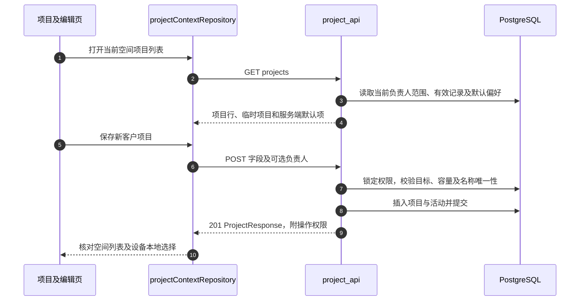

# 项目：选择、当前负责关系、执行与清理

项目在一个工作区内组织工作流和户型作品。创建者是不可变的来源记录；当前负责人控制新任务和管理。企业所有者另有有边界的查看、指派、阶段与清理权限。判断交接后的权限前先读[项目指派](/zh/reference/flows/project-assignment-flow)，不能默认原创建者仍负责项目。

设备当前选择、服务端默认偏好和项目销售进度是不同记录。切换选择不搬运历史。临时项目是用户／空间永久保留的回退项，不是普通客户项目。请求仍显式携带空间／项目，并重新检查当前访问权。

| 图中步骤 | 源码 | 应核对的内容 |
| --- | --- | --- |
| 1–4 | [fetchList](https://github.com/Orientation-CD/wechat_mini_program/blob/88c75c1f15cd65f45c7fb09d560df80430ddc198/src/repositories/projectContext.ts#L114) → [list_projects](https://github.com/Orientation-CD/YuanZhu-AI/blob/749e82df3a51c441335ba6a4db607a98bacbcf97/app/workspaces/project_api.py#L373) | 列表按 `assignee_user_id` 过滤，不再按历史创建者 |
| 5–8 | [save](https://github.com/Orientation-CD/wechat_mini_program/blob/88c75c1f15cd65f45c7fb09d560df80430ddc198/src/pkg-projects/pages/editor/index.vue#L145) → [create_project](https://github.com/Orientation-CD/YuanZhu-AI/blob/749e82df3a51c441335ba6a4db607a98bacbcf97/app/workspaces/project_api.py#L414) | 必填字段、代创建、目标容量／名称和提交边界 |
| 9–10 | [_project_responses](https://github.com/Orientation-CD/YuanZhu-AI/blob/749e82df3a51c441335ba6a4db607a98bacbcf97/app/workspaces/project_api.py#L238) | 响应同时携带创建者、负责人、指派版本、阶段证据和逐操作权限 |

## 加载代码维护的阶段目录 {#project-status-catalog}

`GET /v1/project-statuses`

`get_project_statuses` 需要登录，但不要求选定空间。`visible_project_statuses` 根据后端开关选择基础、成交流失或销售模式，返回标签／顺序、分组、停滞阈值和能力字段，并提供私有五分钟缓存；前端 [projectStatusCatalogRepository](https://github.com/Orientation-CD/wechat_mini_program/blob/88c75c1f15cd65f45c7fb09d560df80430ddc198/src/repositories/projectStatusCatalog.ts#L92) 校验响应。销售模式公布可独立点亮的阶段和成交流失，旧枚举不能证明某阶段已经完成。见[销售阶段](/zh/reference/flows/project-stages-flow)。读取不修改状态，也不调用供应商。

## 读取负责人列表、临时项目和默认项 {#list-projects}

`GET /v1/workspaces/{workspace_id}/projects`

`loadProjects` 进入账号／空间上下文，`fetchList` 调用 `list_projects`。处理函数取得读取权限，按 `assignee_user_id=user.id`、指定空间和 ACTIVE 生命周期过滤，用 `_project_responses` 生成可信活动、交接和阶段投影。所有者身份不会让此列表自动变成全企业，跨成员查看要走概览／详情的独立权限。

它读取调用者临时项目和 ProjectPreference，提交读取权限事务，分别返回项目行及相关 ID。缺少临时项目／偏好为 404 `PROJECT_UNAVAILABLE`；可信活动状态缺失不能被当作空列表。DELETING 项目不出现在有效列表。前端缓存代次和已知指派版本拦截迟到旧响应。

## 创建普通项目及替成员创建 {#create-project}

`POST /v1/workspaces/{workspace_id}/projects`

编辑页 `save` 经 `projectContextRepository` 传 name/customer_name/address，以及可选 description、整数 floor_area 和 home_layout。`create_project` 去除必填文本首尾空白，名称／客户／地址上限为 80／40／200 字符，保留临时项目名称并校验负责人。普通成员为自己创建；企业中只有所有者可以指定其他当前成员 `assignee_user_id`，或给自己设置 `awaiting_assignment:true`。待指派却指定他人为负责人无效，个人空间拒绝代创建。

先锁空间／参与成员和创建者临时项目，对**负责人**执行 `_check_project_capacity`，检查可信活动状态，插入 NEW／ACTIVE 项目。名称大小写折叠唯一性以负责人／空间为范围。代创建初始化指派版本 1 和操作者信息，自建为版本 0。`stamp_member_activity` 记录真实创建操作者，提交后才返回 201。创建本身不修改设备当前项目或服务端默认项；UI 校验受理结果后再选择。

每位负责人每个空间最多 20 个普通项目，启用成交流失时排除已关闭结果；清理中的项目仍可能占用容量。创建没有动作键回执，超时属于结果不确定，编辑页先刷新再允许再次创建。409 重名／容量冲突携带目标负责人，供页面展示正确的目标提示。

## 设置服务端默认项目 {#set-default-project}

`PUT /v1/workspaces/{workspace_id}/projects/default`

`set_default_project` 接收 `{"project_id":"<UUID>"}`，锁定可访问空间，经 [require_assignee_project](https://github.com/Orientation-CD/YuanZhu-AI/blob/749e82df3a51c441335ba6a4db607a98bacbcf97/app/workspaces/project_jobs.py#L81)（导入别名 `_owned_project`）验证调用者负责的有效目标。只修改本人偏好并提交，200 回显默认 ID，临时项目可以作为默认。前任不能继续把已交接项目保留为服务端默认，指派事务会原子修复。设备本地当前选择仍独立，历史任务不移动。

## 打开当前项目详情 {#get-project}

`GET /v1/workspaces/{workspace_id}/projects/{project_id}`

`get_project` 重新核对空间，允许当前负责人，或企业所有者查看普通项目。`_project_responses` 返回创建者／负责人、最近交接、明确权限及阶段证据，提交读取权限事务。不存在或不符合权限返回 404 并携带调用者临时项目 ID；创建过项目或历史任务本身不授予项目导航权。前端 `detail` 拒绝低于已知指派版本的响应。

## 修改字段、成交流失与旧版阶段 {#update-project}

`PATCH /v1/workspaces/{workspace_id}/projects/{project_id}`

`update_project` 在销售模式转入 `_update_sales_project`，否则保留旧版可选阶段／成交流失实现。必填文本／status 不能设 null，省略字段保持不变，lost_note 要求 OTHER，临时项目拒绝变更。真实修改与 `maximum_activity_time`、`stamp_member_activity` 一起提交；空操作不制造活动。

销售模式下，负责人编辑客户字段，企业所有者查看其他负责人普通项目时只能改阶段／成交流失。WON 要求量房或到店证据。恢复跟进检查负责人容量，保留来源并投影最高现存阶段。旧模式中，前进更新可信历史最远阶段，回退保留历史最大值，重开按旧周期规则处理。不要把旧版重置规则套到销售模式。`changeProjectStatus` 与专门销售控件会失效缓存并核对不确定响应，不以缓存替代权限。

## 整项目删除或把内容放回临时项目 {#delete-project}

`POST /v1/workspaces/{workspace_id}/projects/{project_id}/delete`

`ProjectDeleteSheet` → `remove` → `projectContextRepository` 显式发送 `delete_jobs` 或 `move_to_scratch`。`delete_project` 调用 [delete_project_group](https://github.com/Orientation-CD/YuanZhu-AI/blob/749e82df3a51c441335ba6a4db607a98bacbcf97/app/workspaces/project_deletion.py#L147)，先检查当前权限，快照全部任务和未删除户型作品，依序锁定参与作者的准入权限、任务／空间／项目／作品，再检查完整集合。快照变化最多重试三次。临时项目、执行中／删除中／提交中的任务及保留的外部依赖都可能阻止操作；弹层预读不能授权删除。

项目包含前任任务或没有任务的户型作品时，负责人不能整组销毁，`PROJECT_OWNER_REQUIRED_FOR_FOREIGN_CONTENT` 要求所有者。`move_to_scratch` 把每位作者的内容放回该作者自己的永久临时项目，必要时修复当前负责人默认项，原子返回 204。空项目清理也返回 204。非空 `delete_jobs` 保存 DELETING 和持久化子删除认领，提交后返回 202。

`reconcile_claimed_design_job_deletions`、`delete_design_job_task` 通过 Redis 派发／恢复异步清理，`delete_terminal_design_job` 清除合格的数据库和存储产物。户型整组删除另有持久化供应商清理与恢复。整个集合处理完才删除项目墓碑。202 表示已接纳，不表示物理清理完成。前端收到确认后刷新列表，读取失败只重试读，不重复破坏性写入。409 阻塞／依赖错误需要解释，不能通过换项目／URL 绕过。

## 把授权读成具体条件

`require_assignee_project` 按完整空间／ACTIVE 身份刷新 Project，再比较 `assignee_user_id` 和当前人。失去负责关系的原创建者／作者得到 409 `PROJECT_NOT_ASSIGNEE`，无关调用者得到不可用 404。已受理执行使用独立 `active_task_project` 检查，因此交接不是取消。不同 helper 解释了历史读取、新提交和已运行任务为何具有不同边界。

首次练习先列出一个空间，创建自己负责的普通项目，核对 201／详情／默认项三者独立；再追所有者交接，确认旧默认回到临时项目，而任务原作者不变。销售模式下对比一次手动点亮前后的来源和事件。本次文档审计不声称运行过真实应用端到端测试。

源码测试：[tests/test_project_assignment.py](https://github.com/Orientation-CD/YuanZhu-AI/blob/749e82df3a51c441335ba6a4db607a98bacbcf97/tests/test_project_assignment.py) · [tests/test_project_assignment_deletion.py](https://github.com/Orientation-CD/YuanZhu-AI/blob/749e82df3a51c441335ba6a4db607a98bacbcf97/tests/test_project_assignment_deletion.py) · [tests/test_project_sales_stage_api.py](https://github.com/Orientation-CD/YuanZhu-AI/blob/749e82df3a51c441335ba6a4db607a98bacbcf97/tests/test_project_sales_stage_api.py)。
