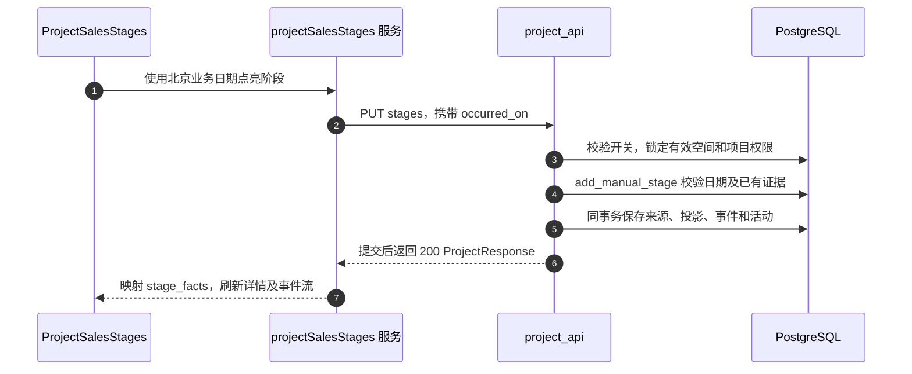

# 销售阶段：独立证据与分组转化统计

`PROJECT_SALES_STAGES_ENABLED` 为 true 时，阶段目录公布销售模式。它替代旧的单阶段推进模型：七个阶段可独立点亮，允许中间存在空缺。除非 WON／LOST 关闭项目，`status` 为已点亮的最高阶段。该开关默认关闭，编译当前前端不等于启用它。销售模式中的 `outcomes_enabled()` 即使旧成交流失开关关闭也为 true。

| 阶段代码 | 含义 | 证据来源 |
| --- | --- | --- |
| `MEASURED` | 量房 | 手动／迁移 |
| `REQUIREMENTS_CAPTURED` | 已采集需求 | 手动或受支持的语音任务成功 |
| `IMAGE_PRODUCED` | 出图 | 手动或符合条件的图片任务成功 |
| `REPORT_PRODUCED` | 出 PPT | 手动或受支持的报告／PPT 任务成功 |
| `STORE_VISITED` | 到店 | 手动／迁移 |
| `SECOND_VISIT` | 二访 | 手动／迁移 |
| `MULTIPLE_VISITS` | 多访 | 手动／迁移 |

[app/workflows/project_stage_completion.py](https://github.com/Orientation-CD/YuanZhu-AI/blob/f34b8a4d6307c83c6f7bbc905485a4f586d59a99/app/workflows/project_stage_completion.py) 选择自动完成证据；子任务／不受支持结果不能被当成通用人工阶段变更。`ProjectStageSource` 保存来源身份、业务日期和来源快照，`ProjectStageEvent` 保存变更事件。`stage_facts` 按阶段聚合来源，取最早已知日期并推导可撤销性。迁移历史中未知的日期保持未知，不补成今天。

| 图中步骤 | 源码 | 为什么需要 |
| --- | --- | --- |
| 1–2 | [writeSalesStage](https://github.com/Orientation-CD/wechat_mini_program/blob/7f1a3169338c10bd4139c24318f7a35caf86310c/src/pkg-projects/services/projectSalesStages.ts#L27) | 检查服务端逐阶段权限，编码空间并保留会话代次 |
| 3–5 | [put_project_stage](https://github.com/Orientation-CD/YuanZhu-AI/blob/f34b8a4d6307c83c6f7bbc905485a4f586d59a99/app/workspaces/project_api.py#L884)、[add_manual_stage](https://github.com/Orientation-CD/YuanZhu-AI/blob/f34b8a4d6307c83c6f7bbc905485a4f586d59a99/app/workspaces/project_stages.py#L185) | 业务修改共用项目锁，与活动记录一起提交 |
| 6–7 | [project_stage_projections](https://github.com/Orientation-CD/YuanZhu-AI/blob/f34b8a4d6307c83c6f7bbc905485a4f586d59a99/app/workspaces/project_stage_views.py#L161) | 展示证据和权限，不再用线性枚举猜测完成情况 |

## 点亮一个阶段 {#put-project-stage}

`PUT /v1/workspaces/{workspace_id}/projects/{project_id}/stages/{stage}`

`put_project_stage` 要求销售模式，以及有效普通项目的当前负责人或当前企业所有者权限；临时项目被拒绝。请求体 `{"occurred_on":"2026-11-09"}` 使用规范 `YYYY-MM-DD`，范围从项目创建的北京日期到服务端今天。`add_manual_stage` 插入 `manual` 来源和 LIT 事件，更新投影与活动后提交。同一人工日期重复提交为空操作，不同人工日期返回 409 `STAGE_ALREADY_LIT` 并带回 `current_stage`。已有自动证据不会被人工调用覆盖。阶段／日期无效为 422；开关关闭为 409 `PROJECT_SALES_STAGES_DISABLED`。

## 取消可撤销的阶段证据 {#delete-project-stage}

`DELETE /v1/workspaces/{workspace_id}/projects/{project_id}/stages/{stage}`

`delete_project_stage` 使用同一权限和锁，再由 `cancel_stage` 删除人工／迁移阶段来源，记录含来源快照的 UNLIT。阶段未点亮时重复撤销为空操作。任何自动或迁移任务证据都会使整个阶段不可撤销，返回 409 `STAGE_NOT_CANCELLABLE` 和当前证据。WON 必须保留至少一个量房或到店资格；撤销最后一个资格返回 `PROJECT_WON_STAGE_REQUIRED`。活动校验失败时，来源、事件及投影一起回滚。

标记 WON／LOST 继续使用已有项目 PATCH。WON 要求量房或到店证据，不要求点亮全部中间阶段。恢复跟进检查负责人容量，清除结果字段并重新投影既有来源；**不会清空阶段证据，也不会建立空白新周期**。所有者可修改其他负责人普通项目的阶段／成交流失，但不能据此编辑客户字段。

## 读取阶段事件流 {#project-stage-events}

`GET /v1/workspaces/{workspace_id}/projects/{project_id}/stage-events`

`get_project_stage_events` 先授权再检查游标，按 `(recorded_at,id)` 倒序读取，支持 1–100 条、默认 20 条，返回 `next_cursor`。前端 `readSalesEvents` 用它展示时间线。默认在限制条数前过滤 SOURCE_ADDED；集成客户端可用 `include_source_added=true` 查看追加来源审计。其他项目或未知游标返回 422 `PROJECT_STAGE_CURSOR_INVALID`。`stage_event_responses` 保留历史快照，但当前任务链接仍需授权。`occurred_on` 是业务日期，`recorded_at` 是记录时间，补录不能伪装成今天发生的到店。

## 所有者读取销售转化统计 {#enterprise-sales-metrics}

`GET /v1/workspaces/{workspace_id}/sales-metrics`

所有者看板通过 [loadSalesMetrics](https://github.com/Orientation-CD/wechat_mini_program/blob/7f1a3169338c10bd4139c24318f7a35caf86310c/src/repositories/projectSalesMetrics.ts#L35) 发送 `period=YYYY-MM` 或 `all`。`get_enterprise_sales_metrics` 要求当前有效企业所有者与销售模式，省略周期时取当前北京月，调用 [enterprise_sales_metrics](https://github.com/Orientation-CD/YuanZhu-AI/blob/f34b8a4d6307c83c6f7bbc905485a4f586d59a99/app/admin/enterprise_sales_metrics.py#L56)，提交读取权限事务后返回 200，并设置 `Cache-Control: private, no-store`。

查询按**当前负责人**统计当前成员名下的有效普通项目。即使一个阶段有多个来源，每个项目也只计一次。量房到店率的分母是最早量房日期在该周期的项目，分子是其中同时具有到店证据的项目；到店签单率使用到店日期分组及当前 WON 状态。签单数另按当前 WON 与本周期 `closed_at` 计算。因此它是当前状态下的分组转化，不是不可变的历史漏斗，交接或成交流失变更都可能改变统计。团队比例先求原始分子／分母总和，不平均成员百分比。分母为零时 `ratio:null`，前端显示横杠；成员集合不匹配、数据不可用或响应无效都不能伪装为零。

结合 [tests/test_project_sales_stage_api.py](https://github.com/Orientation-CD/YuanZhu-AI/blob/f34b8a4d6307c83c6f7bbc905485a4f586d59a99/tests/test_project_sales_stage_api.py)、[tests/test_project_sales_stage_completion.py](https://github.com/Orientation-CD/YuanZhu-AI/blob/f34b8a4d6307c83c6f7bbc905485a4f586d59a99/tests/test_project_sales_stage_completion.py)、[tests/test_enterprise_sales_metrics.py](https://github.com/Orientation-CD/YuanZhu-AI/blob/f34b8a4d6307c83c6f7bbc905485a4f586d59a99/tests/test_enterprise_sales_metrics.py) 阅读空缺、并发、自动证据、过滤后的游标同时间排序与分组边界。启用开关前必须协调迁移与发布，见 [SAE 部署](/zh/deploy/sae-deployment)。
