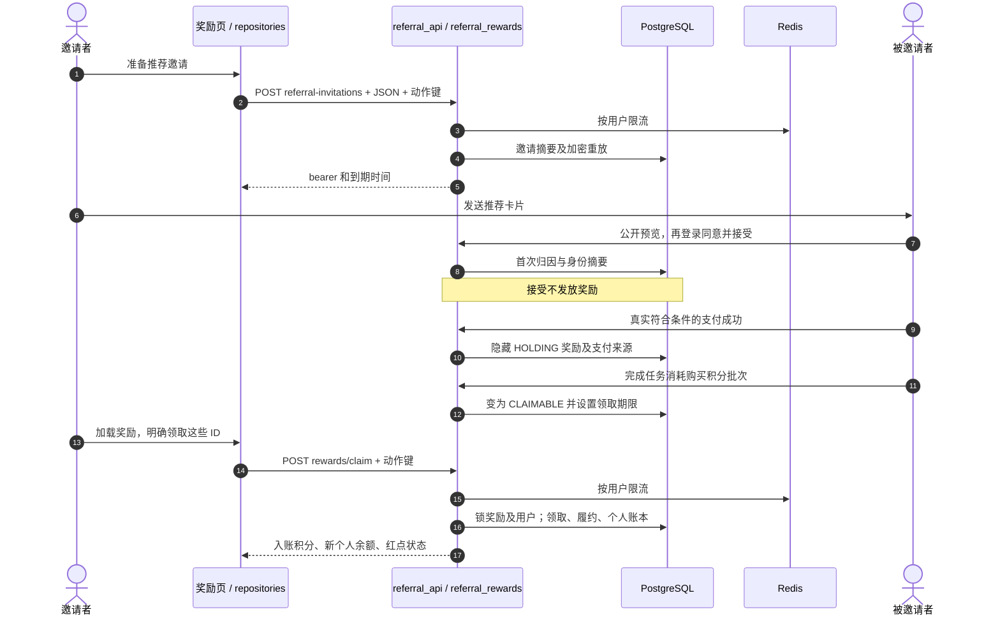
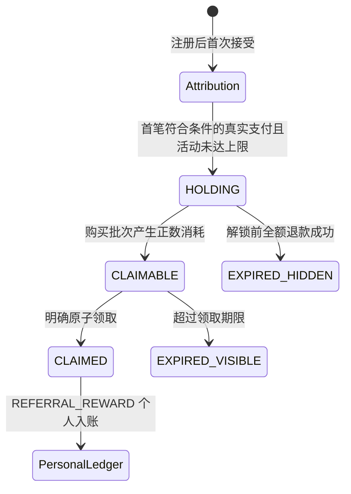

# 推荐奖励全链路：从分享卡片到个人账本入账

推荐邀请记录“谁介绍了新用户”，不会加入企业、预占席位，也不会立刻给邀请者积分。奖励路径跨越注册、真实符合条件的支付、购买批次消耗、明确领取、个人积分账本。应该跟踪这些状态转换，而不是把“接受邀请”理解成“奖励到账”。



## 每次转换对应的源码停靠点

| 图中步骤 | 源码 | 数据库约束 |
| --- | --- | --- |
| 1–5 | [`prepareInvitation` · `src/pkg-account/pages/rewards/index.vue:122`](https://github.com/Orientation-CD/wechat_mini_program/blob/3662578b384fd5b0fbe7509229b2a08a6fe44ab9/src/pkg-account/pages/rewards/index.vue#L122) → [`create_referral_invitation` · `app/marketing/referral_rewards.py:156`](https://github.com/Orientation-CD/YuanZhu-AI/blob/e59716c83e087deda8477da5ea7b327a40cf65c5/app/marketing/referral_rewards.py#L156) | 明文 bearer 返回创建者，数据库存带密钥摘要；原响应加密重放。 |
| 6–8 | [`acceptInvitation` · `src/pkg-account/pages/rewards/index.vue:145`](https://github.com/Orientation-CD/wechat_mini_program/blob/3662578b384fd5b0fbe7509229b2a08a6fe44ab9/src/pkg-account/pages/rewards/index.vue#L145) → [`accept_referral_invitation` · `app/marketing/referral_rewards.py:672`](https://github.com/Orientation-CD/YuanZhu-AI/blob/e59716c83e087deda8477da5ea7b327a40cf65c5/app/marketing/referral_rewards.py#L672) | 一个邀请只用一次；被邀请者只接受首次归因；检查身份复用。 |
| 9–12 | [`complete_payment_order` · `app/billing/billing.py:750`](https://github.com/Orientation-CD/YuanZhu-AI/blob/e59716c83e087deda8477da5ea7b327a40cf65c5/app/billing/billing.py#L750) → [`create_referral_reward_for_payment` · `app/marketing/referral_rewards.py:220`](https://github.com/Orientation-CD/YuanZhu-AI/blob/e59716c83e087deda8477da5ea7b327a40cf65c5/app/marketing/referral_rewards.py#L220) → [`settle_design_tokens` · `app/billing/billing.py:413`](https://github.com/Orientation-CD/YuanZhu-AI/blob/e59716c83e087deda8477da5ea7b327a40cf65c5/app/billing/billing.py#L413) → [`make_referral_rewards_claimable` · `app/marketing/referral_rewards.py:313`](https://github.com/Orientation-CD/YuanZhu-AI/blob/e59716c83e087deda8477da5ea7b327a40cf65c5/app/marketing/referral_rewards.py#L313) | 真实支付创建 HOLDING；消耗购买批次后解锁；退款使隐藏奖励失效。 |
| 13–17 | [`claimRewards` · `src/pkg-account/pages/rewards/index.vue:92`](https://github.com/Orientation-CD/wechat_mini_program/blob/3662578b384fd5b0fbe7509229b2a08a6fe44ab9/src/pkg-account/pages/rewards/index.vue#L92) → [`claim_referral_rewards` · `app/marketing/referral_rewards.py:488`](https://github.com/Orientation-CD/YuanZhu-AI/blob/e59716c83e087deda8477da5ea7b327a40cf65c5/app/marketing/referral_rewards.py#L488) | 明确快照整批成功或失败；余额、履约、账本、重放一起提交。 |

模型见 [`ReferralAttribution` · `app/persistence/db_models.py:1309`](https://github.com/Orientation-CD/YuanZhu-AI/blob/e59716c83e087deda8477da5ea7b327a40cf65c5/app/persistence/db_models.py#L1309)。Redis 负责限流，不是归因或奖励余额的权威。这些奖励 API 不调用 AI 供应商、不提交 worker；工作流完成可通过积分结算间接使奖励变为可领取。

## 准备推荐分享卡片 {#create-referral-invitation}

`POST /v1/referral-invitations`

**界面 / 入口：** 奖励中心 → 准备/发送邀请 → `prepareInvitation()`。

**跟着请求读代码：**

1. 前端创建一个逻辑动作 ID；repository 提供必需 `{}` 与 Idempotency-Key。API 要求登录并按 `referral-invitation-create-user` 进行 Redis 限流。

2. service 对 `(user,key)` 加事务 advisory lock，检查指纹/重放，生成随机 bearer 和含带密钥 token_digest、配置有效期的 ReferralInvitation。

3. 加密响应重放让不确定重试返回同一 ID/bearer/到期时间，而不是再发新邀请；handler 提交后返回 201。

**响应和失败分支：** 响应是营销推荐邀请，不是企业邀请。bearer 不应写入日志/分析。Redis 保护不可用为 503；动作键指纹冲突不能通过同键偷偷改请求体解决。

**源码停靠点：** [`prepareInvitation` · `src/pkg-account/pages/rewards/index.vue:122`](https://github.com/Orientation-CD/wechat_mini_program/blob/3662578b384fd5b0fbe7509229b2a08a6fe44ab9/src/pkg-account/pages/rewards/index.vue#L122) → [`referralInvitationRepository` · `src/pkg-account/repositories/referralInvitations.ts:58`](https://github.com/Orientation-CD/wechat_mini_program/blob/3662578b384fd5b0fbe7509229b2a08a6fe44ab9/src/pkg-account/repositories/referralInvitations.ts#L58) → [`create_user_referral_invitation` · `app/marketing/referral_api.py:52`](https://github.com/Orientation-CD/YuanZhu-AI/blob/e59716c83e087deda8477da5ea7b327a40cf65c5/app/marketing/referral_api.py#L52) → [`create_referral_invitation` · `app/marketing/referral_rewards.py:156`](https://github.com/Orientation-CD/YuanZhu-AI/blob/e59716c83e087deda8477da5ea7b327a40cf65c5/app/marketing/referral_rewards.py#L156)

## 注册前预览推荐 {#preview-referral-invitation}

`POST /v1/referral-invitations/preview`

**界面 / 入口：** 打开推荐卡片 → 奖励落地页 `loadPreview()`。

**跟着请求读代码：**

1. 公开 POST 在 JSON 提交 token；Redis `referral-invitation-preview-ip` 限制验证后的客户端地址。

2. 以推荐专用 purpose 计算摘要，关联邀请和邀请者显示名并比较；查询归因判断该邀请是否已使用。

3. 返回 pending/used/revoked/expired、邀请者显示名、到期和 `can_accept`；不披露被邀请者身份、不创建归因。

**响应和失败分支：** 未知 token 为 404；已知但不可用的 token 仍返回 `can_accept=false` 展示状态。预览成功不能保证最终登录用户符合新注册要求或没有身份复用。

**源码停靠点：** [`loadPreview` · `src/pkg-account/pages/rewards/index.vue:138`](https://github.com/Orientation-CD/wechat_mini_program/blob/3662578b384fd5b0fbe7509229b2a08a6fe44ab9/src/pkg-account/pages/rewards/index.vue#L138) → [`referralInvitationRepository` · `src/pkg-account/repositories/referralInvitations.ts:58`](https://github.com/Orientation-CD/wechat_mini_program/blob/3662578b384fd5b0fbe7509229b2a08a6fe44ab9/src/pkg-account/repositories/referralInvitations.ts#L58) → [`preview_user_referral_invitation` · `app/marketing/referral_api.py:131`](https://github.com/Orientation-CD/YuanZhu-AI/blob/e59716c83e087deda8477da5ea7b327a40cf65c5/app/marketing/referral_api.py#L131) → [`preview_referral_invitation` · `app/marketing/referral_rewards.py:631`](https://github.com/Orientation-CD/YuanZhu-AI/blob/e59716c83e087deda8477da5ea7b327a40cf65c5/app/marketing/referral_rewards.py#L631)

## 提交首次新用户归因 {#accept-referral-invitation}

`POST /v1/referral-invitations/accept`

**界面 / 入口：** 推荐落地页 → 注册登录同意 → `acceptInvitation()`。

**跟着请求读代码：**

1. repository 把动作绑定到用户，发送 token 与必需 Idempotency-Key；API 登录并按 `referral-invitation-accept-user` 限流。

2. service 锁动作重放，再锁邀请与被邀请 User；拒绝自邀、撤销/过期/已用邀请、已有归因；配置要求新注册时还验证注册晚于邀请创建。

3. 对手机、微信 openid、抖音 openid 分 purpose 计算身份摘要，移除过期 claim，拒绝仍保留的身份复用；写不可变 ReferralAttribution 与有保留期限的 ReferralIdentityClaim。

4. 保存原响应重放，提交，返回 `attribution_status=attributed` 和 `referral_id`。此 accept 不创建 EnterpriseMembership、RewardGrant 或 TokenLedgerEntry。

**响应和失败分支：** 410 表示 bearer 不可再用；409 包括自邀、已有归因、非新用户、身份复用。相同成功动作/键会重放；换新键也不能覆盖首次归因。

**源码停靠点：** [`acceptInvitation` · `src/pkg-account/pages/rewards/index.vue:145`](https://github.com/Orientation-CD/wechat_mini_program/blob/3662578b384fd5b0fbe7509229b2a08a6fe44ab9/src/pkg-account/pages/rewards/index.vue#L145) → [`referralInvitationRepository` · `src/pkg-account/repositories/referralInvitations.ts:58`](https://github.com/Orientation-CD/wechat_mini_program/blob/3662578b384fd5b0fbe7509229b2a08a6fe44ab9/src/pkg-account/repositories/referralInvitations.ts#L58) → [`accept_user_referral_invitation` · `app/marketing/referral_api.py:157`](https://github.com/Orientation-CD/YuanZhu-AI/blob/e59716c83e087deda8477da5ea7b327a40cf65c5/app/marketing/referral_api.py#L157) → [`accept_referral_invitation` · `app/marketing/referral_rewards.py:672`](https://github.com/Orientation-CD/YuanZhu-AI/blob/e59716c83e087deda8477da5ea7b327a40cf65c5/app/marketing/referral_rewards.py#L672)

## 列出可见奖励并处理到期 {#list-rewards}

`GET /v1/rewards`

**界面 / 入口：** 奖励页加载 / 加载更多 → `loadRewards`、`loadMore`。

**跟着请求读代码：**

1. 验证用户、limit 1–100（默认20）及可选 UUID cursor。`has_claimable_rewards` 惰性地把到期可领取奖励改为 EXPIRED。

2. 只查该受益人的 CLAIMABLE/CLAIMED/EXPIRED，且 `claimable_at` 非空。隐藏 HOLDING、尚未解锁即因退款失效的奖励不公开。

3. 验证 cursor 归属/公开历史，按 `(created_at,id)` 倒序查 limit+1，汇总积分条目并返回 next_cursor；handler 提交惰性过期。repository 在旧 cursor 被拒时重置首页。

**响应和失败分支：** GET 可能提交生命周期过期，但不会入账积分。缺失/其他用户 cursor 为 422 `REWARD_CURSOR_INVALID`。接受/支付后列表仍空可能正常，因为候选仍为 HOLDING。

**源码停靠点：** [`loadRewards` · `src/pkg-account/pages/rewards/index.vue:70`](https://github.com/Orientation-CD/wechat_mini_program/blob/3662578b384fd5b0fbe7509229b2a08a6fe44ab9/src/pkg-account/pages/rewards/index.vue#L70) → [`rewardRepository` · `src/pkg-account/repositories/rewards.ts:84`](https://github.com/Orientation-CD/wechat_mini_program/blob/3662578b384fd5b0fbe7509229b2a08a6fe44ab9/src/pkg-account/repositories/rewards.ts#L84) → [`list_user_rewards` · `app/marketing/referral_api.py:80`](https://github.com/Orientation-CD/YuanZhu-AI/blob/e59716c83e087deda8477da5ea7b327a40cf65c5/app/marketing/referral_api.py#L80) → [`list_referral_rewards` · `app/marketing/referral_rewards.py:417`](https://github.com/Orientation-CD/YuanZhu-AI/blob/e59716c83e087deda8477da5ea7b327a40cf65c5/app/marketing/referral_rewards.py#L417) → [`has_claimable_rewards` · `app/marketing/referral_rewards.py:377`](https://github.com/Orientation-CD/YuanZhu-AI/blob/e59716c83e087deda8477da5ea7b327a40cf65c5/app/marketing/referral_rewards.py#L377)

## 将明确奖励快照入账一次 {#claim-rewards}

`POST /v1/rewards/claim`

**界面 / 入口：** 奖励中心 → 领取 → `claimRewards()` 快照当前最多100个可领取 ID。

**跟着请求读代码：**

1. 提交 `{ "reward_ids": ["<UUID>"] }` 和动作键；API 使用 Redis `reward-claim-user`。service 要求 1–100 唯一 ID，排序生成规范请求指纹，获取动作锁/重放。

2. 先锁 User，再按 ID 顺序锁选中奖励；要求数量完整、受益人为本人、全部仍可领取未到期、仅支持的正数积分条目。任一失败则整批失败，不部分领取其余条目。

3. 写 RewardClaim；逐个增加个人 User.remaining_tokens，改 CLAIMED，写 RewardFulfillment 和 reason 为 REFERRAL_REWARD、稳定 `reward:<id>:credit` 记账键的 TokenLedgerEntry。

4. 重新计算红点，存加密响应重放并提交。返回实际领取 ID、tokens_granted、personal_remaining_tokens、rewards_summary；UI 更新个人余额/红点再刷新列表。

**响应和失败分支：** 404 隐藏缺失/非本人奖励；409 拒绝已领、到期、不支持类型或内容不一致。同键同 ID 重放不会重复入账。即使当前选择企业，目标仍是个人积分，不增加企业 remaining_tokens。

**源码停靠点：** [`claimRewards` · `src/pkg-account/pages/rewards/index.vue:92`](https://github.com/Orientation-CD/wechat_mini_program/blob/3662578b384fd5b0fbe7509229b2a08a6fe44ab9/src/pkg-account/pages/rewards/index.vue#L92) → [`rewardRepository` · `src/pkg-account/repositories/rewards.ts:84`](https://github.com/Orientation-CD/wechat_mini_program/blob/3662578b384fd5b0fbe7509229b2a08a6fe44ab9/src/pkg-account/repositories/rewards.ts#L84) → [`claim_user_rewards` · `app/marketing/referral_api.py:99`](https://github.com/Orientation-CD/YuanZhu-AI/blob/e59716c83e087deda8477da5ea7b327a40cf65c5/app/marketing/referral_api.py#L99) → [`claim_referral_rewards` · `app/marketing/referral_rewards.py:488`](https://github.com/Orientation-CD/YuanZhu-AI/blob/e59716c83e087deda8477da5ea7b327a40cf65c5/app/marketing/referral_rewards.py#L488) → [`TokenLedgerEntry` · `app/persistence/db_models.py:1895`](https://github.com/Orientation-CD/YuanZhu-AI/blob/e59716c83e087deda8477da5ea7b327a40cf65c5/app/persistence/db_models.py#L1895)

## 隐藏的中间状态：为什么接受推荐后还看不到奖励



转换由业务事务推动，不是邀请页面的计时器：

1. `complete_payment_order` 调用 `create_referral_reward_for_payment`。后者要求 PAID、具体字段 **`payment.wechat_transaction_id`** 非空且不以 `MOCK` 开头、金额达到配置门槛、已有归因。更早存在符合条件真实支付时排除本笔，已有 payment source 则复用；序列化活动总量检查，将生效奖励数量快照到 RewardGrantItem。RewardGrant 初始 HOLDING，ReferralRewardSource 关联归因与支付。
2. 个人账号任务的 `settle_design_tokens` 调用 [`consume_purchased_tokens` · `app/billing/finance.py:244`](https://github.com/Orientation-CD/YuanZhu-AI/blob/e59716c83e087deda8477da5ea7b327a40cf65c5/app/billing/finance.py#L244)。先消耗免费/管理员发放等未跟踪积分，再按最早购买批次消耗。**该被推荐支付批次只要发生正数消耗**，其 payment ID 就进入解锁集合，不要求整批耗尽。`make_referral_rewards_claimable` 将对应隐藏奖励改 CLAIMABLE、记录 `nonrefundable_at` 并开始配置的领取窗口。仅预留积分、或完全由未跟踪积分支付的任务完成，都不解锁该购买批次。
3. 全额退款成功通过 [`complete_refund_order` · `app/billing/finance.py:374`](https://github.com/Orientation-CD/YuanZhu-AI/blob/e59716c83e087deda8477da5ea7b327a40cf65c5/app/billing/finance.py#L374) 和 `expire_referral_reward_for_refund` 将仍隐藏奖励改为 EXPIRED，原因为 PAYMENT_REFUNDED。从未可领取的记录继续不向用户列表公开；这与可领取后超时的可见奖励不同。
4. 列表/用户读取可惰性过期旧奖励，并计算权威红点。领取则产生带 reward_grant_id 的独立个人积分入账，当前企业选择不影响目的账户。

当前核验版本的抖音结算写入 `provider_order_id`，不写 `wechat_transaction_id`，因此即使抖音真实支付也**不会**创建这类推荐奖励候选。跨平台身份归因不等于两种支付渠道都参与奖励创建。

活动配置与数量以源码为准，本教程不硬编码发放承诺。活动变化时应结合配置参考与来源版本核对。

## 用 ID 跟完一笔奖励

| ID | 本地测试数据库中可检查的关联 |
| --- | --- |
| `ReferralInvitation.id` | bearer 摘要行；不要在日志里搜索原始 bearer。 |
| `referral_id` / ReferralAttribution.id | 邀请者 → 被邀请者的首次归因，关联 invitation_id。 |
| `PaymentOrder.id` | ReferralRewardSource.payment_order_id 将合格支付关联候选奖励。 |
| `RewardGrant.id` | 受益人/状态；items 是内容快照，source 标出支付来源。 |
| `RewardClaim.id` | 一次明确快照领取；RewardFulfillment 把每条 grant 关联到 claim。 |
| `TokenLedgerEntry.reward_grant_id` | 实际 REFERRAL_REWARD 个人入账，有每条 grant 的稳定记账键。 |

## 引导式读代码练习

仅使用可丢弃本地环境与测试替身，不要为学代码真实付款。先在开发者工具追 HTTP，再读支付/结算函数及现有测试中的内部转换。Mock payment 被刻意排除生产奖励资格，点击 mock“已支付”不能证明奖励已经产生。

1. 创建推荐并同键重试，比较 ID/到期时间。匿名打开预览，指出故意不返回的字段：被邀请人身份、成员关系、奖励数量。
2. 用新测试账号接受。跟读事务直到返回 `referral_id`，确认 accept 没插入成员或积分账本。尝试另一归因，解释首次生效的拒绝分支。
3. 跟读 `create_referral_reward_for_payment` 资格条件和 `consume_purchased_tokens` 的免费/管理员积分优先顺序。解释哪些完成任务能解锁候选、哪些不能。
4. 在 `claimRewards` 记录明确 reward_ids 快照，追踪本次领取全部写入行；核对 `tokens_granted` 和个人余额。用同键同 ID 重放，确认每条 grant 只有一次账本入账。
5. 在本地已有测试 fixture 中先改变一条 grant 状态，再领取，确认整批拒绝并刷新，而非悄悄领取其余部分。

继续阅读[支付](/zh/reference/flows/payment-flow)、[成员全链路](/zh/reference/flows/workspace-membership-flow)和[工作流执行](/zh/reference/flows/design-job-lifecycle)。

## 不必读完 Vue，也能检查 HTTP 边界

repository 把路由和 `{ auth:true, method, data }` 交给 [`request` · `src/services/request.ts:369`](https://github.com/Orientation-CD/wechat_mini_program/blob/3662578b384fd5b0fbe7509229b2a08a6fe44ab9/src/services/request.ts#L369)。共享 transport 组装配置的 API URL、加入 bearer 身份和请求观测信息、通过平台请求 API 发送 JSON，并把非 2xx detail 规范化为 ApiRequestError（`statusCode`、`code`、`message`、`requestId`）。随后 repository mapper 将契约的 snake_case 转为 UI 值，拒绝不属于正确账号/空间/项目的响应。学习一个动作时，分别在页面 handler、repository、transport 打断点，按 data → URL → 响应 → 规范化错误观察；不要把 bearer token 粘进文档或 issue 截图。

FastAPI 的 [`get_current_user` · `app/identity/auth.py:162`](https://github.com/Orientation-CD/YuanZhu-AI/blob/e59716c83e087deda8477da5ea7b327a40cf65c5/app/identity/auth.py#L162) 验证 bearer 与有效账号；[`get_db` · `app/core/database.py:86`](https://github.com/Orientation-CD/YuanZhu-AI/blob/e59716c83e087deda8477da5ea7b327a40cf65c5/app/core/database.py#L86) 提供 AsyncSession。然后接口对应 service 再证明空间/项目/奖励范围。登录回答“谁在调用”，不能代替资源授权。本章源码链接固定前后端版本，不随 main 漂移。

## 读记账行，而不只看成功提示

领取 service 写入下面的账本内容（摘录）：

```py
TokenLedgerEntry(
    scope="user",
    user_id=locked_user.id,
    reward_grant_id=grant.id,
    delta=value,
    balance_after=locked_user.remaining_tokens,
    reason=TokenDetailType.REFERRAL_REWARD,
    idempotency_key=f"reward:{grant.id}:credit",
)
```

`scope="user"` 指个人钱包；`reward_grant_id` 标出业务来源；`delta` 是本次增加数量；`balance_after` 是入账后个人余额。每条 grant 的记账键与 HTTP Idempotency-Key 不同：HTTP 键标识一次多奖励领取动作，账本键标识一笔经济入账。二者与奖励状态、履约同事务提交；成功提示只是这些持久记录在 UI 的最后反映。
