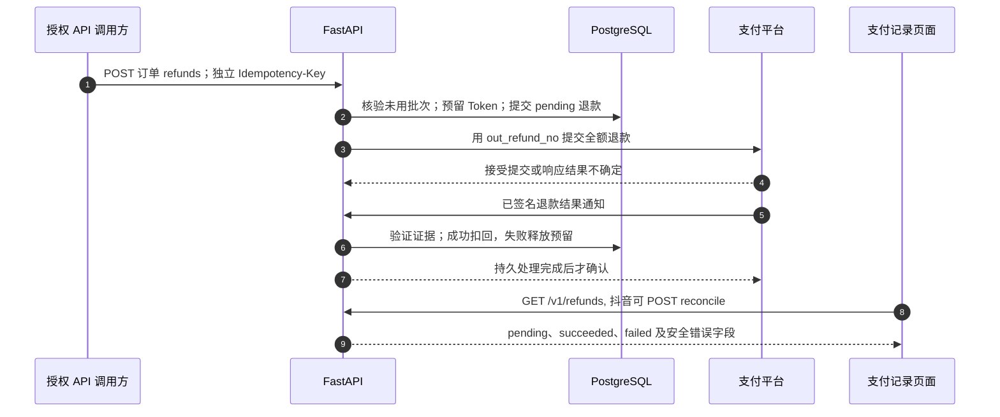
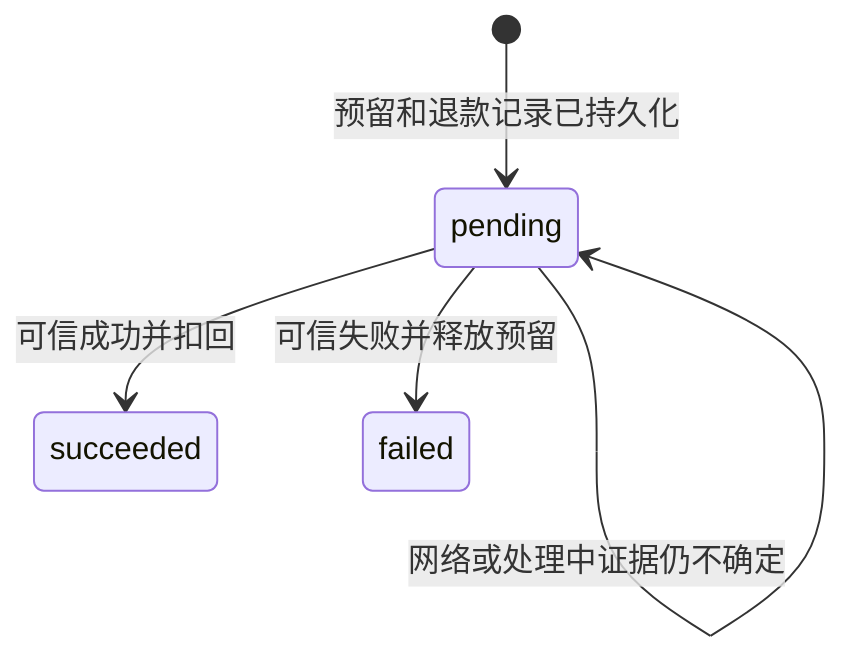

# 退款全链路：先预留，后提交，再确认扣回或释放

退款逆转一笔已支付购买，不是关闭未付订单。它有独立的 `RefundOrder`、状态、幂等键和平台证据。先读[购买链路](/zh/reference/flows/payment-flow)，尤其是 `PurchasedTokenBatch` 如何把支付与发放 Token 对应起来。

当前小程序会在抖音支付记录显示已有退款，并提供**刷新进度**，但没有面向用户的「申请退款」按钮。代码里存在 `paymentRefundRepository.create()`，当前没有页面调用它；不能看见 Repository 方法就推断 UI 已完成。退款可能由授权 API 调用方发起，也可能来自抖音平台售后。阅读源码/测试工具不等于获准发起真实退款。

## 1. 本地记录与外部退钱是两件事 {#refund-chain}

| 编号 | 打开哪段函数 | 发生了什么，为什么 |
| --- | --- | --- |
| 1 | [request_payment_refund](https://github.com/Orientation-CD/YuanZhu-AI/blob/e59716c83e087deda8477da5ea7b327a40cf65c5/app/billing/billing_api.py#L892) | 验证订单归属，使用退款自己的幂等键，不能复用购买键；当前没有页面申请入口。 |
| 2 | [create_refund_order](https://github.com/Orientation-CD/YuanZhu-AI/blob/e59716c83e087deda8477da5ea7b327a40cf65c5/app/billing/finance.py#L282) | 按用户→订单→购买批次加锁，核验整笔未使用和可用余额；先预留再接触平台。 |
| 3 | [create_refund](https://github.com/Orientation-CD/YuanZhu-AI/blob/e59716c83e087deda8477da5ea7b327a40cf65c5/app/billing/wechat_pay.py#L336) 或 [create_refund](https://github.com/Orientation-CD/YuanZhu-AI/blob/e59716c83e087deda8477da5ea7b327a40cf65c5/app/billing/douyin_pay.py#L295) | 不确定重试使用同一个持久化商户退款号；网络 I/O 在数据库提交后执行，不持有事务等待平台。 |
| 4 | `request_payment_refund()` 返回/异常分支 | 接受提交仍是 pending；`503` 不能证明平台已拒绝，也不能证明本地无退款。 |
| 5 | [receive_wechat_event](https://github.com/Orientation-CD/YuanZhu-AI/blob/e59716c83e087deda8477da5ea7b327a40cf65c5/app/billing/billing_api.py#L1188) 或 [douyin_notification](https://github.com/Orientation-CD/YuanZhu-AI/blob/e59716c83e087deda8477da5ea7b327a40cf65c5/app/billing/douyin_api.py#L463) | 微信验签解密 APIv3；抖音验证 RSA 原始字节，并查询规范退款证据后才最终结算。 |
| 6 | [complete_refund_order](https://github.com/Orientation-CD/YuanZhu-AI/blob/e59716c83e087deda8477da5ea7b327a40cf65c5/app/billing/finance.py#L374)、[fail_refund_order](https://github.com/Orientation-CD/YuanZhu-AI/blob/e59716c83e087deda8477da5ea7b327a40cf65c5/app/billing/finance.py#L472) | 成功扣回预留权益、写负流水；失败仅释放预留，不扣余额。 |
| 7 | 回调处理器末尾 | 微信 `204`；抖音 `200 {err_no:0,err_tips:"success"}`。验证/处理失败不能伪造成功确认。 |
| 8 | [load](https://github.com/Orientation-CD/wechat_mini_program/blob/21db6d824a7b32417bda88e7e31d3f0b91dfa51c/src/pkg-account/pages/orders/index.vue#L48)、[checkRefund](https://github.com/Orientation-CD/wechat_mini_program/blob/21db6d824a7b32417bda88e7e31d3f0b91dfa51c/src/pkg-account/pages/orders/index.vue#L215) → [paymentRefundRepository](https://github.com/Orientation-CD/wechat_mini_program/blob/21db6d824a7b32417bda88e7e31d3f0b91dfa51c/src/pkg-account/repositories/paymentRefund.ts#L16) | 当前抖音页面加载退款列表；刷新进度会对账一笔 pending 退款并刷新付款状态。 |
| 9 | [refund_response](https://github.com/Orientation-CD/YuanZhu-AI/blob/e59716c83e087deda8477da5ea7b327a40cf65c5/app/billing/billing_api.py#L178) → 前端 `mapRefund()` | UI 显示状态、金额/币种、安全错误，不自行推断银行是否已退钱。 |

## 2. 预留不是扣款，用一组数字读懂 {#refund-accounting}

假设一笔测试购买发放 100 Token，此前没有余额或其他预留。下面只演示实现中的算术，不代表真实商品价格。

| 时刻 | `User.remaining_tokens` | `User.reserved_tokens` | 批次 remaining / reserved refund / refunded | Token 流水 |
| --- | --- | --- | --- | --- |
| 支付结算 | 100 | 0 | 100 / 0 / 0 | 购买 `+100` |
| 创建退款 | 100 | 100 | 100 / 100 / 0 | 尚无退款扣减 |
| 平台可信成功 | 0 | 0 | 0 / 0 / 100 | 退款 `-100` |
| 若平台可信失败 | 100 | 0 | 100 / 0 / 0 | 无扣减 |

预留让等待退钱的权益不能同时被另一项 Workflow 消耗。第一次提交就扣当前余额不安全，因为平台可能失败、响应也可能丢失。批次跟踪这些 Token 来自**哪笔购买**，所以其他免费/管理员赠送的 Token 不能代替已经用掉的购买批次来满足退款条件。

[consume_purchased_tokens](https://github.com/Orientation-CD/YuanZhu-AI/blob/e59716c83e087deda8477da5ea7b327a40cf65c5/app/billing/finance.py#L244) 先消耗免费/管理赠送余额，再按购买批次从旧到新消耗，并排除 `reserved_refund_tokens`。[create_refund_order](https://github.com/Orientation-CD/YuanZhu-AI/blob/e59716c83e087deda8477da5ea7b327a40cf65c5/app/billing/finance.py#L282) 要求原订单 paid、尚无本地退款、批次剩余等于整笔原发放量、没有批次退款预留/已退量，以及 `remaining_tokens - reserved_tokens` 足够。普通 API 不支持部分退款，也不支持已经使用的购买批次退款。

成功退款再次进入 `complete_refund_order()` 直接返回，不重复扣回。失败退款不能随意用新本地退款重做，普通接口的每订单唯一退款、幂等约束仍在。抖音平台替换/强制退款证据另有明确[恢复分支](#platform-refunds)。

## 3. 每个 API 的入口、处理与恢复 {#refund-apis}

### POST /v1/payments/{payment_order_id}/refunds {#request-refund}

**触发和参数：** 当前没有页面调用。经授权的已登录调用方传本人支付 UUID 和独立 `Idempotency-Key`（8～128 字符），不提交可自定义金额的 body。前端未接入 UI 的 `paymentRefundRepository.create()` 若将来调用，会限 paid 抖音订单、传 `douyin-refund:<订单 UUID>`；这个辅助方法不能证明完整退款体验已经存在。

**路由到服务：** [request_payment_refund](https://github.com/Orientation-CD/YuanZhu-AI/blob/e59716c83e087deda8477da5ea7b327a40cf65c5/app/billing/billing_api.py#L892) 查本人的支付，检查渠道模式，抖音额外用 `require_mode()` 检查订单固化模式与当前模式。调用 `create_refund_order()` 后提交预留，重新读父订单并结束读取事务，再经对应适配器 `create_refund()` 提交平台。抖音返回的 provider refund id 会保存，微信最终身份由通知确认；持久化 `out_refund_no` 只生成一次。

**响应与写入：** `201 RefundOrderResponse` 通常仍为 pending，含 id、payment_order_id、商户退款号、全额金额/币种、`tokens_reclaimed`、时间和安全错误。创建只是预留，尚无负流水，也没宣称钱已退。同一键同一支付返回现有退款，可使用同一号码重新提交；同一键改支付返回 `409 REFUND_IDEMPOTENCY_KEY_REUSED`。

**错误与恢复：** 不存在/他人订单 → `404 PAYMENT_ORDER_NOT_FOUND`；未支付 → `409 PAYMENT_NOT_REFUNDABLE`；已有另一退款 → `409 REFUND_ALREADY_EXISTS`；批次已用/不合格 → `409 PAYMENT_TOKENS_ALREADY_USED`；可用余额不足 → `409 REFUND_TOKENS_UNAVAILABLE`；平台失败 → `503`。平台异常在预留提交之后，不能凭猜测释放 Token。应查退款历史、合适时用**同一键和号码**重试，等待可信结果/查询；微信没有与抖音对应的公共移动端退款对账入口。

### GET /v1/refunds {#refund-history}

**UI：** 抖音支付记录 `load()` → `paymentRefundRepository.list()`。当前微信页面不加载这个列表，但服务端可为已认证调用方返回其各渠道退款。

**处理：** [refund_history](https://github.com/Orientation-CD/YuanZhu-AI/blob/e59716c83e087deda8477da5ea7b327a40cf65c5/app/billing/billing_api.py#L943) 按 `RefundOrder.user_id == current_user.id` 查询，创建时间倒序，最多 250 条，交 `refund_response()` 转换。不调用平台、不写结算。**返回：** `200` JSON 数组，不是 `{items:…}`，空数组正常。**恢复：** pending 表示本地尚未确定，不证明钱一定没退；按 `payment_order_id` 对上原订单，选择正确渠道查询/人工核验。此路径不能通过任意 user id 读取他人的退款。

### POST /v1/refunds/{refund_order_id}/reconcile {#refund-reconcile}

**UI：** 已有 pending 退款的**刷新进度** → `checkRefund()` → `paymentRefundRepository.reconcile()`；发送退款 UUID、JWT，不发送客户端自定成功状态。

**处理：** [reconcile_owned_refund](https://github.com/Orientation-CD/YuanZhu-AI/blob/e59716c83e087deda8477da5ea7b327a40cf65c5/app/billing/douyin_api.py#L273) 先查本人退款，再查本人父订单；非抖音返回 `409 PAYMENT_TYPE_MISMATCH`。[reconcile_refund](https://github.com/Orientation-CD/YuanZhu-AI/blob/e59716c83e087deda8477da5ea7b327a40cf65c5/app/billing/douyin_api.py#L113) 终态原样返回；pending 在平台请求前释放数据库事务。若保存了 `AUDIT_AGREE/AUDIT_DENY`，先提交 `refund_audit_callback`，再查询新证据；核验整数全额金额、商户退款号、平台支付 id、退款 id 后，才调用共享成功/失败函数。

**响应与恢复：** `200 RefundOrderResponse` 可能仍 pending，PROCESSING 不等于成功。不存在/他人退款 → `404 REFUND_NOT_FOUND`；平台异常 → `503` 安全渠道错误码。可信 `refund_query` 报不存在，且本地尚无 provider id、创建已过至少 30 秒时，先重查支付必须为 SUCCESS，再用**同一个**持久化退款号重提。这 30 秒是退款传播保护，与可配置的支付关闭宽限期无关。审核接口确认不立即清掉审核意图，必须新查询证明已向前推进。

### POST /v1/webhooks/wechat/refunds {#wechat-refund-webhook}

**谁触发：** 微信平台服务器，无小程序 HTTP 调用、无 JWT。该装饰器和支付装饰器同进 `wechat_pay_notification()` → `receive_wechat_event()`，按解密后 `out_refund_no/out_trade_no` 分派，不只看 URL。`create_refund()` 使用配置的公共通知地址。

**验证与写入：** APIv3 SDK 对原始字节验签/解密并检查时间新鲜度；要求通知 id 和商户身份。按 `out_refund_no` 连接父支付查退款，核验存在时的 AppID、`amount.refund`、父单 `amount.total`、币种和状态/事件配对：`SUCCESS/REFUND.SUCCESS`、`ABNORMAL/REFUND.ABNORMAL`、`CLOSED/REFUND.CLOSED`。成功还要求 refund_id，调 `complete_refund_order()`；异常/关闭调 `fail_refund_order()` 并保存有长度限制的安全错误。保存 `WeChatPaymentEvent`，提交后才 `204`。

**错误与恢复：** 签名/解密错 → `401`；身份/金额/事件配对错 → `400`；退款不存在 → `404`。已有事件 id 直接确认、不重复财务效果；并发冲突靠平台重投恢复。微信支付查询返回 REFUND 不足以虚构退款完成，需要独立可信退款证据。固定版本没有对应的公共微信退款主动对账路由，支付维护查询遇到这类状态会保留 `needs_review`。

## 4. 成功/失败函数究竟改了什么 {#refund-settlement}

把 [complete_refund_order](https://github.com/Orientation-CD/YuanZhu-AI/blob/e59716c83e087deda8477da5ea7b327a40cf65c5/app/billing/finance.py#L374) 与 [RefundOrder](https://github.com/Orientation-CD/YuanZhu-AI/blob/e59716c83e087deda8477da5ea7b327a40cf65c5/app/persistence/db_models.py#L3182)、[PurchasedTokenBatch](https://github.com/Orientation-CD/YuanZhu-AI/blob/e59716c83e087deda8477da5ea7b327a40cf65c5/app/persistence/db_models.py#L3133) 并排读。锁顺序是用户→支付→批次→退款，抖音关联订阅还会在批次前锁定。函数核验预留量一致，扣用户 remaining/reserved，扣批次 remaining/reserved、增加 refunded，支付变 refunded、退款变 succeeded，保存平台退款 id/完成时间，写 `refund:<退款 UUID>:user:reclaim` 的负 `REFUND_DEDUCTION` 流水，同时使对应邀请奖励失效。

这里有一个必须照代码理解的渠道差异：抖音使用的 `provider_refund_id` 分支明确把关联订阅改为 EXPIRED；微信 `wechat_refund_id` 分支没有执行同一个订阅状态赋值。因此不能笼统写「所有渠道退款都会同样回滚订阅」，验收时应查看真实订阅快照。文档不修改这一应用行为。

[fail_refund_order](https://github.com/Orientation-CD/YuanZhu-AI/blob/e59716c83e087deda8477da5ea7b327a40cf65c5/app/billing/finance.py#L472) 释放用户/批次预留，保留总剩余余额，写失败/错误/完成字段，不写退款扣减。网络错误不能直接调这个函数，只有可信的终态平台拒绝，才说明可以释放预留。

## 5. 抖音平台申请、补发现和强制退款 {#platform-refunds}

完整 RSA 与回调路由见[抖音回调](/zh/reference/douyin-payment#douyin-refund-application-webhook)。下面三条路径会合：

- 平台申请 `pre_create_refund` 调 [apply_platform_refund](https://github.com/Orientation-CD/YuanZhu-AI/blob/e59716c83e087deda8477da5ea7b327a40cf65c5/app/billing/douyin_api.py#L376)，为符合条件的全额退款预留，或建立待人工核对记录；需要审核时保存 `AUDIT_AGREE/AUDIT_DENY` 意图。响应提供本地商户退款号、订单入口 schema、结果通知 URL，不代表钱已退。
- 结果通知先验证，再由 [reconcile_refund](https://github.com/Orientation-CD/YuanZhu-AI/blob/e59716c83e087deda8477da5ea7b327a40cf65c5/app/billing/douyin_api.py#L113) 查询规范平台状态后结算。查询暂时失败就不成功确认，让平台继续投递。
- live paid 订单对账调用 [discover_refunds](https://github.com/Orientation-CD/YuanZhu-AI/blob/e59716c83e087deda8477da5ea7b327a40cf65c5/app/billing/douyin_api.py#L225) 查平台退款列表，逐条验证身份/金额，补建漏掉的申请/结果并进入同一对账路径。即使小程序未打开，poll-worker 维护也会运行。

如果资格不满足（已使用、平台部分退款、此前拒绝后平台又明确替换退款），`DOUYIN_REFUND_REVIEW_REQUIRED` 会保留平台实际资金结果，不倒造 Token 预留。可信强制成功可以将退款记 succeeded、支付记 refunded，`tokens_reclaimed=0`，不扣其他购买/已用权益。失败退款后来出现不同平台退款 id 时，以 `refund_replacement` 事件归档不可变旧证据，迟到旧通知会被识别忽略。这些情况需要人工财务/权益核对，不能二次自动扣分。

## 6. 源码练习与安全的本地验证 {#refund-debugging}

以下只用一次性本地数据库和 mock 供应商，不因验证文档发起真实付款/退款。

1. 从 `create_refund_order()` 出发，为每个 `409` 写出比较了哪个字段，解释「有 100 免费 Token」为什么不能让已消耗购买批次退款；在 `RefundOrder` 找到每支付唯一退款约束。
2. 沿共享函数跟踪上面的 100 Token 算例：pending 有预留、无负流水；成功恰好一次扣减；失败只恢复可用量，不凭空增加总余额。
3. 微信条件端点 `/mock/refunds/{refund_order_id}/complete` 进入 [mock_complete_refund](https://github.com/Orientation-CD/YuanZhu-AI/blob/e59716c83e087deda8477da5ea7b327a40cf65c5/app/billing/billing_api.py#L964)：本人退款、微信 mock、排除抖音，随后复用生产结算函数。抖音 `/mock/douyin/refunds/{refund_order_id}/scenario` 进入 [mock_refund_scenario](https://github.com/Orientation-CD/YuanZhu-AI/blob/e59716c83e087deda8477da5ea7b327a40cf65c5/app/billing/douyin_api.py#L332)，使用 success/fail/pending 并复用 `reconcile_refund()`。微信完成端点仅在 `MOCK_PAYMENT_ENDPOINTS_ENABLED` 打开时挂载；抖音 scenario 仅在非 production 且 `DOUYIN_PAY_MODE=mock` 时挂载。生产配置还会拒绝微信 mock/端点开关，均不是生产回退。
4. 在预留 `commit()` 后停下，跟踪外部提交的异常路径，指出响应丢失后原键和 `out_refund_no` 如何保留；抖音特别区分「退款不存在等待 30 秒」和「支付关闭宽限期」。
5. 真实故障先收集本地支付/退款 id、商户号、渠道、模式、状态、平台 id 和安全错误码，再查通知事件/维护日志；不要把私钥、完整签名正文贴工单。释放预留/扣回 Token 前必须经授权流程核实平台证据。
