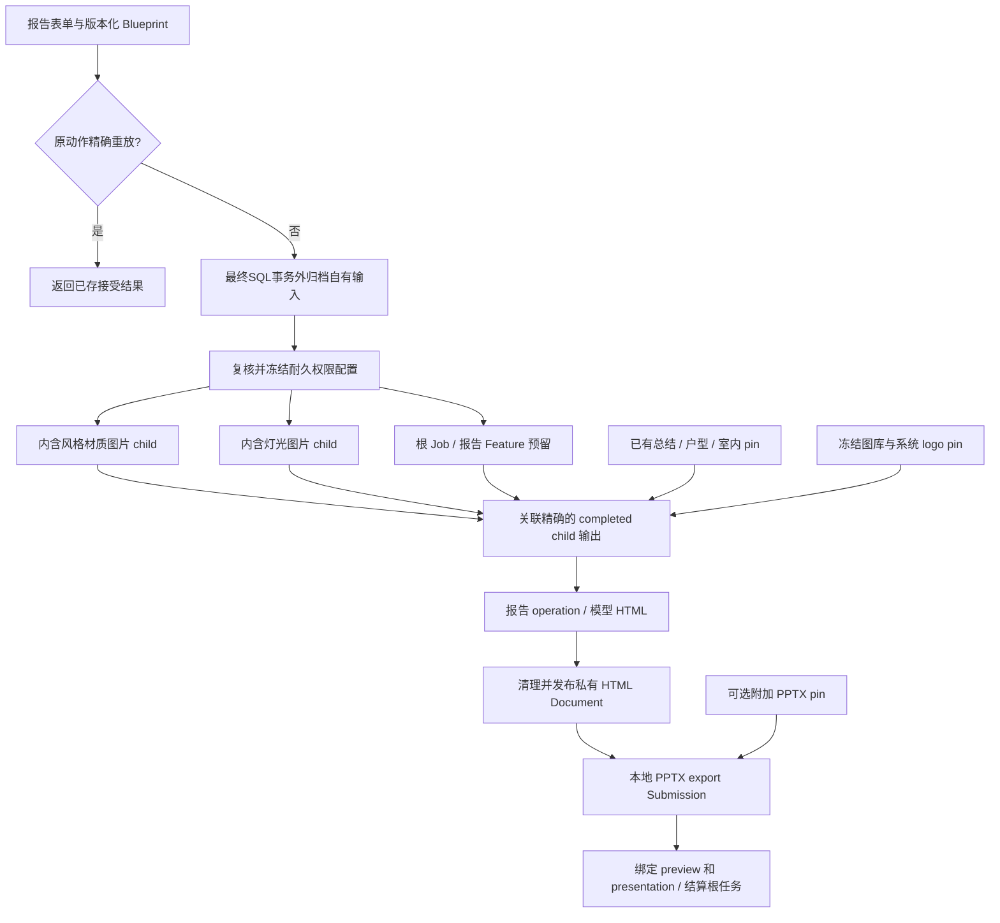
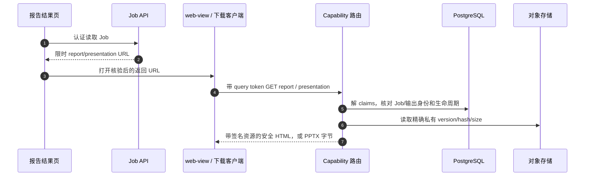

# 报告 Blueprint、子设计、HTML 与 PPTX

当前设计报告是**不可变来源和两种产物构成的执行图**，不是一份保存好的 HTML 模板。本章把表单、内含图片生成、模型合成、清理发布、本地转换和最终浏览/下载 API 连起来。不熟悉 Job/run/Submission，先看[共享生命周期](/zh/reference/flows/design-job-lifecycle)。

## 1. 表单怎样准备 Blueprint {#blueprint}

从设计报告提交按钮进入 [src/pkg-features/pages/design_report/index.vue → submit](https://github.com/Orientation-CD/wechat_mini_program/blob/21db6d824a7b32417bda88e7e31d3f0b91dfa51c/src/pkg-features/pages/design_report/index.vue#L577)，再看 [src/pkg-features/services/reportBlueprint.ts → buildReportWorkflowRequest](https://github.com/Orientation-CD/wechat_mini_program/blob/21db6d824a7b32417bda88e7e31d3f0b91dfa51c/src/pkg-features/services/reportBlueprint.ts#L65)。用户选择已完成沟通总结、彩平图、室内方案，填项目/客户事实、选内容页数，可附已有 PPTX。builder 解析真实输出 Asset ID（含原始户型图输入）、核对角色/房间信息，创建有序页面声明。

当前 UI 的 **8 / 12 / 16 内容页**对应公开产品 `design_report_9 / design_report_13 / design_report_17`，完整页库存是 **9 / 13 / 17 页**。不要换成历史 S01 固定 `page_count: 8` 请求。产品 key、页面模板顺序、来源库存必须与当前协议一致。契约要求恰好一个 `kind: "json", role: "blueprint"` 输入，最多加一个支持的附加 PPTX 输入；不接受客户端自己传生成 HTML。

| Blueprint 来源 | 从哪里产生 | 后端冻结什么 |
| --- | --- | --- |
| 现有 `asset_id` | 表单选择的 completed Job 结果/来源 | 有权限的对象身份、hash、version、尺寸/类型 |
| generated 声明 | builder 请求内含 `style_material_board` / `lighting_design` | child Feature/模型/prompt/输入权限、稳定文件名绑定 |
| `gallery_path` 声明 | builder 选择配置图库 | 允许的图库对象选择、精确 version/hash、alias |
| 项目/客户事实 | 有界表单字段 | 版本化规范事实和有序页面契约 |
| 可选附加 PPTX | 已完成核验的 Document 上传 | 归档后的包身份、转换输入 pin |

这些是不同来源类型。Blueprint alias 文件名是内部逻辑引用，不授予模型访问任意 URL 的权限。独立来源选择重复（规定的封面复用一张室内图除外）、缺房间角色、原图不可用、页面库存不符、来源证据变化，都会在生成前失败。

此报告请求直接拥有并需要归档的是可选新上传的追加 PPTX。选中的 ACTIVE 产物和既有已执行来源 pins 属于借用引用，不重新迁移或改归属于报告。最终准入分别复核这些类别，再冻结各自对应身份。

## 2. 父任务与内含 child 怎样执行 {#report-graph}

| 转换 | 跟进哪个具体函数 | SQL / 产物影响 |
| --- | --- | --- |
| 表单 → 根准入 | [src/pkg-features/pages/design_report/index.vue → submit](https://github.com/Orientation-CD/wechat_mini_program/blob/21db6d824a7b32417bda88e7e31d3f0b91dfa51c/src/pkg-features/pages/design_report/index.vue#L577) → `admit_workflow_job` | 先重放／归档自有输入，再锁定冻结Blueprint／产品／耐久pins |
| 准备内含 child | [app/workflows/workflow_report_children.py → prepare_report_children](https://github.com/Orientation-CD/YuanZhu-AI/blob/e59716c83e087deda8477da5ea7b327a40cf65c5/app/workflows/workflow_report_children.py#L94) | 按稳定顺序锁相关 Feature/定义/模型/来源权限 |
| 保存根与 child | [app/workflows/workflow_report_children.py → persist_report_children](https://github.com/Orientation-CD/YuanZhu-AI/blob/e59716c83e087deda8477da5ea7b327a40cf65c5/app/workflows/workflow_report_children.py#L262) | `workflow_generated_sources` 把文件名绑到 child run，child 的 `parent_workflow_id` 指向根 |
| child 终态 → 父可执行 | [app/workflows/workflow_report_dependencies.py → reconcile_report_dependencies](https://github.com/Orientation-CD/YuanZhu-AI/blob/e59716c83e087deda8477da5ea7b327a40cf65c5/app/workflows/workflow_report_dependencies.py#L152) | 只关联预期 child/代次的有效完成输出，暂存父输入 pin |
| 合成模型输入 | [app/workflows/operations/design_report/design_report_composer.py → compose_blueprint_design_report](https://github.com/Orientation-CD/YuanZhu-AI/blob/e59716c83e087deda8477da5ea7b327a40cf65c5/app/workflows/operations/design_report/design_report_composer.py#L546) | 读冻结 Markdown，构建报告文档/图片 alias 和指令 |
| HTML → 私有 Document | [app/workflows/operations/design_report/workflow_report_publication.py → publish_workflow_report](https://github.com/Orientation-CD/YuanZhu-AI/blob/e59716c83e087deda8477da5ea7b327a40cf65c5/app/workflows/operations/design_report/workflow_report_publication.py#L913) | 清理、预留、写入/恢复精确对象，再关联输出 |
| export 就绪 → PPTX | [app/workflows/submissions/workflow_local_pptx_submission.py → execute_local_pptx_submission](https://github.com/Orientation-CD/YuanZhu-AI/blob/e59716c83e087deda8477da5ea7b327a40cf65c5/app/workflows/submissions/workflow_local_pptx_submission.py#L1022) | 消费冻结 HTML/图片/附加输入，暂存转换证据并发布 PPTX |
| 双输出 → 公开完成 | [生命周期](/zh/reference/flows/design-job-lifecycle#worker-chain)中的 `finalize_submission_workflow` | 绑定 `preview`、`presentation`，根结算一次并推进报告项目状态 |

根任务按报告 Feature 冻结价格付费。内含 child 的 `token_cost=0`，来源标记 `report_included_v1`，不是独立收费图片动作，也不进入普通创建人根历史。单独重试内含 child 会被阻止，由父任务控制恢复。child 绑定跨重试保留，不能让父新代次偷偷换成另一个生成来源。

根准入推迟 report Submission，直到所需生成 child 成功关联。child 未完成，父合成等待；child 失败，结合活动 sibling 证据决定父失败和受保护释放。因此“报告失败”可能发生在模型 HTML 请求以前，先看依赖记录，再判断是不是报告供应商的问题。

## 3. 模型 HTML 怎样暂存、核验、发布 {#html-publication}

供应商 HTML 是不可信设计材料。[app/workflows/operations/design_report/workflow_report_publication.py → publish_workflow_report](https://github.com/Orientation-CD/YuanZhu-AI/blob/e59716c83e087deda8477da5ea7b327a40cf65c5/app/workflows/operations/design_report/workflow_report_publication.py#L913) 加载 staged locator，按精确 version/ETag/hash/字节数读取。[app/workflows/operations/design_report/workflow_report_html.py → sanitize_design_report_html](https://github.com/Orientation-CD/YuanZhu-AI/blob/e59716c83e087deda8477da5ea7b327a40cf65c5/app/workflows/operations/design_report/workflow_report_html.py#L439) 在有界范围解析/修复 markup，校验结构/CSS/资源/页面契约，移除主动执行并要求声明的图片 alias；保留约束内的静态设计布局，不执行任意脚本、不访问任意模型 URL。

发布有明确检查点：

1. 加载有权限的来源/attempt，锁外读取精确暂存字节。
2. 从冻结 Blueprint 和 pin 推导 alias，核对客户/项目、页面库存。
3. 清理并计算 canonical 内容 hash，推导 publication 指纹/目的地。
4. SQL 预留私有 Document；已被证明的 canonical 结果可复用。
5. 写入或恢复精确存储版本，比对身份/大小/hash。
6. 当前权限下完成 Document、`operation_run_outputs`，再按受保护逻辑清理非 canonical 版本。

供应商响应成功，不代表证据齐全可以 completed。原始候选 HTML、清理后的存储 HTML、浏览器动态渲染 HTML 各有职责。存储文档保留逻辑图片引用，浏览时只为批准的冻结资源签名/替换，避免把永久过期的 URL 固化在不可变文档里。

## 4. 导出是本地 operation，不是再调一次 LLM {#pptx-execution}

`convert_design_report_to_pptx` 在报告输出就绪后执行。[app/workflows/submissions/workflow_local_pptx_submission.py → execute_local_pptx_submission](https://github.com/Orientation-CD/YuanZhu-AI/blob/e59716c83e087deda8477da5ea7b327a40cf65c5/app/workflows/submissions/workflow_local_pptx_submission.py#L1022) claim 代次，从存储 HTML、图片/系统资源 pin 构建精确输入包，调用 [app/conversion/pptx_subprocess.py → SubprocessPptxClient](https://github.com/Orientation-CD/YuanZhu-AI/blob/e59716c83e087deda8477da5ea7b327a40cf65c5/app/conversion/pptx_subprocess.py#L166)。有界子进程用 [app/conversion/pptx_converter.py → convert_design_report_html](https://github.com/Orientation-CD/YuanZhu-AI/blob/e59716c83e087deda8477da5ea7b327a40cf65c5/app/conversion/pptx_converter.py#L456)，走开启 sandbox 的 Chromium 布局/转换，再核验包结构、页面测量、hash、result manifest。可选附加输入走核验过的 native append，另查身份和包限制。

worker 拿到候选 PPTX 后暂存 manifest/大小/digest，上传精确私有对象版本，关联 Document 与 `presentation` 输出，不能仅相信 converter 一句 success。暂存产物/上传可恢复，不必重复模型生成。worker export lock 串行转换，并有超时、内存、运行时前提；macOS 能浏览源码不证明 Linux 部署已经有可用 Chromium/converter。

当前报告流水线从同一根任务返回 HTML 与 PPTX。独立 `type: "design_report_pptx"` schema 仍为兼容保留，但新准入返回 `WORKFLOW_UNAVAILABLE`，不能把它讲成当前导出按钮能成功调用的 POST。历史存储导出仍可有下载/读取路径。

## 5. 用新 capability 打开报告 {#report}

`GET /v1/workflows/{design_job_id}/report` 使用 **query `token`**，不是通用 Bearer header。UI 先认证读取 Job 取得新链接。[src/pkg-plans/pages/report/index.vue → load](https://github.com/Orientation-CD/wechat_mini_program/blob/21db6d824a7b32417bda88e7e31d3f0b91dfa51c/src/pkg-plans/pages/report/index.vue#L22) 调 [src/services/reportCapability.ts → getFreshReportCapability](https://github.com/Orientation-CD/wechat_mini_program/blob/21db6d824a7b32417bda88e7e31d3f0b91dfa51c/src/services/reportCapability.ts#L15)，核对配置 origin、过期和 scope，再把返回 URL 交给平台 `web-view`。页面重开是更新 capability，不是重新生成或扣费。

| 消息 | 代码 |
| --- | --- |
| 1–2 | `job_response` / `workflow_preview_response` / `workflow_presentation_response` → [app/workflows/operations/design_report/workflow_report_publication.py → create_workflow_report_view_token](https://github.com/Orientation-CD/YuanZhu-AI/blob/e59716c83e087deda8477da5ea7b327a40cf65c5/app/workflows/operations/design_report/workflow_report_publication.py#L1002) |
| 3 | [src/services/reportCapability.ts → getFreshReportCapability](https://github.com/Orientation-CD/wechat_mini_program/blob/21db6d824a7b32417bda88e7e31d3f0b91dfa51c/src/services/reportCapability.ts#L15) / [src/services/workflowDownload.ts → openWorkflowPresentation](https://github.com/Orientation-CD/wechat_mini_program/blob/21db6d824a7b32417bda88e7e31d3f0b91dfa51c/src/services/workflowDownload.ts#L6) |
| 4 | [app/workflows/api.py → view_design_report](https://github.com/Orientation-CD/YuanZhu-AI/blob/e59716c83e087deda8477da5ea7b327a40cf65c5/app/workflows/api.py#L1297) / [app/workflows/api.py → download_design_presentation](https://github.com/Orientation-CD/YuanZhu-AI/blob/e59716c83e087deda8477da5ea7b327a40cf65c5/app/workflows/api.py#L1258) |
| 5 | [app/workflows/operations/design_report/workflow_report_publication.py → decode_workflow_report_view_token](https://github.com/Orientation-CD/YuanZhu-AI/blob/e59716c83e087deda8477da5ea7b327a40cf65c5/app/workflows/operations/design_report/workflow_report_publication.py#L1036) → [app/workflows/operations/design_report/workflow_report_publication.py → render_published_workflow_report](https://github.com/Orientation-CD/YuanZhu-AI/blob/e59716c83e087deda8477da5ea7b327a40cf65c5/app/workflows/operations/design_report/workflow_report_publication.py#L1060) 或 [app/workflows/operations/design_report/workflow_pptx_download.py → download_presentation](https://github.com/Orientation-CD/YuanZhu-AI/blob/e59716c83e087deda8477da5ea7b327a40cf65c5/app/workflows/operations/design_report/workflow_pptx_download.py#L36) |
| 6–7 | 上述函数的精确读取和 `render_sanitized_report_html` |

签名 claims 绑定 Job ID、workspace ID、Asset ID、内容 hash、token 类型和过期。登录 JWT 不能代替它。[app/workflows/operations/design_report/workflow_report_publication.py → render_published_workflow_report](https://github.com/Orientation-CD/YuanZhu-AI/blob/e59716c83e087deda8477da5ea7b327a40cf65c5/app/workflows/operations/design_report/workflow_report_publication.py#L1060) 再核对 Job/run/operation 完成、删除/移除状态、公开输出与节点输出一致、私有 active Document、精确 hash/version/ETag，才读存储。签名有效也不能让旧 token 绕过已删除/替换输出。

token 失效/过期会得到 `401 REPORT_VIEW_TOKEN_INVALID`；身份不符/不可用映射为该路由的不泄露错误；真实存储故障可为 `503 REPORT_STORAGE_UNAVAILABLE`。应认证重读 Job，不把 query-token URL 当永久身份，也不把它写进诊断日志或手改 origin。

## 6. 下载 PowerPoint {#presentation}

`GET /v1/workflows/{design_job_id}/presentation` 进入 [app/workflows/api.py → download_design_presentation](https://github.com/Orientation-CD/YuanZhu-AI/blob/e59716c83e087deda8477da5ea7b327a40cf65c5/app/workflows/api.py#L1258) 和 [app/workflows/operations/design_report/workflow_pptx_download.py → download_presentation](https://github.com/Orientation-CD/YuanZhu-AI/blob/e59716c83e087deda8477da5ea7b327a40cf65c5/app/workflows/operations/design_report/workflow_pptx_download.py#L36)，使用同类 capability 和精确输出核验。它专门要求 `convert_design_report_to_pptx` operation、`presentation` 公开/节点绑定、PPTX MIME/owner/hash/version 一致，精确读字节后以附件返回，带 `Cache-Control: no-store`、`Referrer-Policy: no-referrer`、`X-Content-Type-Options: nosniff`。

UI 的 [src/services/reportPresentation.ts → openReportPresentation](https://github.com/Orientation-CD/wechat_mini_program/blob/21db6d824a7b32417bda88e7e31d3f0b91dfa51c/src/services/reportPresentation.ts#L8) 先刷新 Job，要求 completed 报告及 presentation Artifact，再调 [src/services/workflowDownload.ts → openWorkflowPresentation](https://github.com/Orientation-CD/wechat_mini_program/blob/21db6d824a7b32417bda88e7e31d3f0b91dfa51c/src/services/workflowDownload.ts#L6)：检查 URL/有效期/MIME，下载到平台临时文件，调用 `uni.openDocument(...fileType: "pptx", showMenu: true)`。手机打开失败可能发生在导出成功后，属于平台/域名/运行时问题，不代表可以重新生成报告。

## 兼容浏览路由

### 历史 HTML 路由 {#report-compatibility}

`GET /v1/design-jobs/{design_job_id}/report` 绑定同一个 `view_design_report`、query token 解码和精确发布核验。旧链接可指向它，不复活已删除模板编辑器，也不接受 template ID；HTTP 响应是授权后的已发布 HTML。

### 历史 PPTX 路由 {#presentation-compatibility}

`GET /v1/design-jobs/{design_job_id}/presentation` 绑定同一 `download_design_presentation` / `download_presentation`。路径叫法不改变产物身份或 token 边界。当前下载客户端打开服务端返回 URL，不自行猜别名。

## 按检查点读一份报告 {#exercise}

使用已有本地模拟报告，不发起收费生成。在表单 builder 对应内容页数、产品和模板顺序。沿一个 generated filename 找 `workflow_generated_sources`、child Job/run、完成图片输出、父 pin；再找根 `operation_runs` 的 `report`、`export` 节点，解释为什么候选 HTML 已存在但公开根仍未 completed。最后在 capability 代码中找到 claims hash、Document/output 相同 hash、精确 version 读取。浏览器链接过期应重读 Job，而不是新 POST。

## 自有追加输入与执行准备

自有追加 PPTX 现走[先归档再准入](/zh/reference/flows/asset-upload-flow)：已接受任务冻结耐久对象 locator，不依赖临时 READY 上传。已执行输入 pins 保持不可变。转换路径把有界输入准备、外部存储／转换工作与发布事务分开；性能阶段计时用于定位工作，不把重叠累计耗时当 CPU 使用率。已有输入的可选修复必须保留执行／资金身份，见[定点恢复](/zh/deploy/production#input-recovery)。
