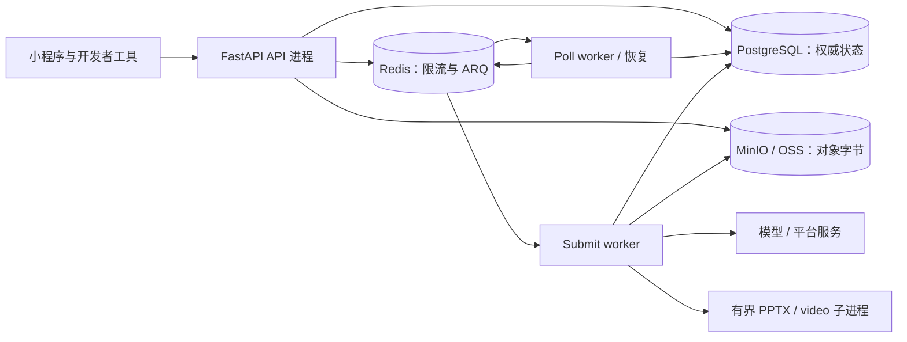
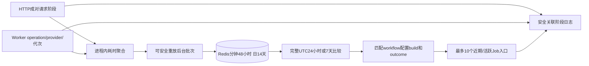

# 沿 HTTP、SQL、Redis 和 worker 追踪一次请求

有效诊断要说清最后一个**已经被证明的检查点**。“前端一直转圈”不能区分认证失败、准入已提交、队列投递、供应商接单、产物发布。本章教你只读追踪本地任务，不教改数据库状态来修任务。

## 先辨认进程边界 {#process-map}



并排打开 [app/worker.py → SubmitWorkerSettings](https://github.com/Orientation-CD/YuanZhu-AI/blob/e59716c83e087deda8477da5ea7b327a40cf65c5/app/worker.py#L887)、[app/worker.py → PollWorkerSettings](https://github.com/Orientation-CD/YuanZhu-AI/blob/e59716c83e087deda8477da5ea7b327a40cf65c5/app/worker.py#L921)。两类 worker 共用 SQL/存储/设置，但消费不同 ARQ 队列、注册不同 job/cron。HTTP 健康不证明 worker 已运行，Redis 连得上不证明准入消息已被消费，供应商有任务不证明结果已核验到自有存储。

读 Python 时区分 `request.app.state`（本 API 进程资源）、worker `ctx`（该 worker 初始化的资源）、`AsyncSession`（一次 SQL 会话/事务）。它们是不同进程的状态，不是与手机共享的全局 JavaScript store。

## 两个健康 API，回答不同问题

### Liveness：HTTP 进程能响应吗 {#health-live}

`GET /health/live` 没有小程序按钮和 Bearer 依赖，部署探针/操作人员调用 [app/core/health_api.py → live](https://github.com/Orientation-CD/YuanZhu-AI/blob/e59716c83e087deda8477da5ea7b327a40cf65c5/app/core/health_api.py#L12)，直接返回 `{"status":"ok"}`。不查 SQL、Redis、模型、存储、worker。刻意不查依赖，是为了避免依赖故障让进程被误判死亡、无意义重启。

### Readiness：API 能访问 Redis 与数据库吗 {#health-ready}

`GET /health/ready` 同样是公开探针/运维入口。[app/core/health_api.py → ready](https://github.com/Orientation-CD/YuanZhu-AI/blob/e59716c83e087deda8477da5ea7b327a40cf65c5/app/core/health_api.py#L18) 先 ping `request.app.state.redis`，再开配置的 DB session factory，执行 `SELECT count(*) FROM users`；成功返回 `{"status":"ok"}`。异常时日志记录 request ID、依赖名、异常类型，返回 `503 DEPENDENCY_UNAVAILABLE`。这个查询也能暴露预期表缺失，不仅仅测试 TCP 连通。

Readiness 不验证供应商余额、法律文档发布、套餐授权、Feature/模型配置、手机上传域名、converter 二进制或 worker 存活。新成员即便这里 200，第一个任务仍可能合理失败。应继续按[上手教程](/zh/get-started/quickstart)分别核对权益、上传和 worker。

## 收集一小组有用证据 {#evidence}

| 边界 | 记录什么 | 怎样连接下一跳 |
| --- | --- | --- |
| 前端 | 页面/操作、真实 path/method、状态和领域错误 | 区分 Mock 与 HTTP、UI 校验与服务端拒绝 |
| HTTP | request ID、认证用户/空间、动作 key、返回 Job ID | 定位准入/重放分支；token 与签名链接不进日志 |
| Job/run | Job ID、内部 run ID、retry 代次、node key | 连接公开状态与冻结执行 |
| Submission/provider | Submission ID、operation ID、dispatch、确定性、已有外部任务 ID | 分清排队/准备和可能已收费的外部执行 |
| 输出 | 公开绑定、Asset ID、精确 version/hash | 证明持久结果身份，而非临时 URL |
| 资金状态 | Job token_state 与账本 reason | 区分预留、成功消费、失败释放 |

[app/workflows/workflow_diagnostic_execution.py → execution_diagnostics](https://github.com/Orientation-CD/YuanZhu-AI/blob/e59716c83e087deda8477da5ea7b327a40cf65c5/app/workflows/workflow_diagnostic_execution.py#L116) 在各 Workflow 阶段附执行身份。沿它和 Admin 诊断页查，不把完整 provider envelope 打印出来。例行检查点对比不需要凭据、refresh/access token、邀请 bearer、签名 query URL 或私密原文。

## 用公开 Job ID 做只读 SQL 追踪 {#sql-trace}

使用本地库，或操作人员授权的只读连接。下列命令在 **psql** 中执行，不是普通终端，也不是 Python。`\set` 是 psql 变量命令，填入真实返回 Job UUID。以下查询不创建、不收费、不重试、不删除任务。

```sql
\set job_id '00000000-0000-0000-0000-000000000001'
BEGIN READ ONLY;
SELECT j.id AS job_id, j.status AS job_status, j.token_state,
       j.explicit_retry_count, r.id AS run_id, r.state AS run_state,
       o.id AS operation_id, o.node_key, o.state AS operation_state,
       s.id AS submission_id, s.attempt_generation, s.status AS submission_status,
       s.dispatch_state, s.provider_request_count,
       s.provider_outcome_uncertain, s.provider_job_id
FROM design_jobs j
LEFT JOIN workflow_runs r ON r.design_job_id = j.id
LEFT JOIN operation_runs o ON o.workflow_run_id = r.id
LEFT JOIN design_job_submissions s ON s.operation_run_id = o.id
WHERE j.id = :'job_id'::uuid
ORDER BY o.node_key, s.attempt_generation, s.id;

SELECT d.port_name, d.position, a.id AS asset_id, a.status,
       a.object_version, a.content_sha256, a.size_bytes
FROM design_job_outputs d
JOIN assets a ON a.id = d.asset_id
WHERE d.design_job_id = :'job_id'::uuid
ORDER BY d.port_name, d.position;
ROLLBACK;
```

示例 UUID 是占位值，查不到行可能只是没有选真实本地 Job。表定义看 [app/persistence/db_models.py → DesignJob](https://github.com/Orientation-CD/YuanZhu-AI/blob/e59716c83e087deda8477da5ea7b327a40cf65c5/app/persistence/db_models.py#L1962)、[app/persistence/db_models.py → WorkflowRun](https://github.com/Orientation-CD/YuanZhu-AI/blob/e59716c83e087deda8477da5ea7b327a40cf65c5/app/persistence/db_models.py#L2154)、[app/persistence/db_models.py → DesignJobSubmission](https://github.com/Orientation-CD/YuanZhu-AI/blob/e59716c83e087deda8477da5ea7b327a40cf65c5/app/persistence/db_models.py#L2606)；Asset/类型子表、输出绑定见[数据模型](/zh/reference/data-model)。一个 run 可有多个 operation/Submission，第一行不是整份报告。报告内含 child 是独立 Job，由 `workflow_generated_sources`、`parent_workflow_id` 关联。

未启动的 Submission 可按 `aggregate_id = submission_id` 查 `workflow_outbox_events` 的 `processed_at`。看似卡住的 provider 要先查当前代次、请求/受理/暂存证据，才能判断可否安全重试。不要暴露加密 envelope，也不要手改 lease、status、账本来“解卡”。

## Job尚未存在时追输入准备 {#input-preparation-trace}

创建失败时可能**还没有Job ID**，但已有耐久归档凭据。先从request ID和选定Asset ID追踪，不应把没有入队Job当成支付记录丢失。阶段包括`input_prepare`、`input_validate`、`input_validation_commit`、`input_archive_claim`、`input_archive_lookup`、`input_archive_lease`、`input_archive_copy`、`input_archive_recover`、`input_archive_verify`、`input_archive_publish`。源码为[app/core/request_stages.py → request_stage](https://github.com/Orientation-CD/YuanZhu-AI/blob/e59716c83e087deda8477da5ea7b327a40cf65c5/app/core/request_stages.py#L91)及[app/assets/asset_input_archival.py → archive_direct_input](https://github.com/Orientation-CD/YuanZhu-AI/blob/e59716c83e087deda8477da5ea7b327a40cf65c5/app/assets/asset_input_archival.py#L581)。

```sql
\set asset_id '00000000-0000-0000-0000-000000000002'
BEGIN READ ONLY;
SELECT a.id, a.status, a.expires_at, a.object_key, a.object_version,
       r.state AS archive_state, r.source_object_key, r.source_object_version,
       r.destination_object_key, r.destination_object_version, r.lease_expires_at
FROM assets a
LEFT JOIN asset_input_archives r ON r.asset_id = a.id
WHERE a.id = :'asset_id'::uuid;
ROLLBACK;
```

READY加COMPLETED凭据是已准备输入，不是已接受的付费工作。最终ACTIVE无过期、独占Job/pin/流水/outbox在之后共同提交。复制回执未知时保留源/目的证据，不能删除凭据或修改状态。已完成历史修复是独立的明确目标、默认dry-run命令，不是失败/运行中任务的通用修复。

## 从性能聚合连接到安全的具体追踪 {#performance-trace}



| 源码 | 要证明什么 |
| --- | --- |
|[app/core/request_stages.py → request_stage](https://github.com/Orientation-CD/YuanZhu-AI/blob/e59716c83e087deda8477da5ea7b327a40cf65c5/app/core/request_stages.py#L91)|正确成对的平台边界及安全request→Job关联，不带私有payload。|
|[app/core/execution_performance.py → observe_on_commit](https://github.com/Orientation-CD/YuanZhu-AI/blob/e59716c83e087deda8477da5ea7b327a40cf65c5/app/core/execution_performance.py#L68)|只计已提交终态，回滚不能生成成功Operation/Job耗时。|
|[app/core/performance_history.py → PerformanceHistory](https://github.com/Orientation-CD/YuanZhu-AI/blob/e59716c83e087deda8477da5ea7b327a40cf65c5/app/core/performance_history.py#L375)|有界进程聚合、不可变可重放批次、producer覆盖和缺口。|
|[app/core/performance_reports.py → build_history_performance_report](https://github.com/Orientation-CD/YuanZhu-AI/blob/e59716c83e087deda8477da5ea7b327a40cf65c5/app/core/performance_reports.py#L292)|完整等长UTC窗，缺失/尾桶不伪造零或边界，不可比时不显示改善方向。|
|[app/admin/performance.py → _performance_evidence](https://github.com/Orientation-CD/YuanZhu-AI/blob/e59716c83e087deda8477da5ea7b327a40cf65c5/app/admin/performance.py#L172)|近期Job匹配workflow/配置，是排查入口而非某直方图的精确样本。|

[性能页](/zh/admin/performance)只在同一measurement内排序，不求重叠阶段之和。p95至少20样本、p99至少100。唯一终态总量按Job ID去重并保留25小时，耗时样本则代表一次代次。缺失/已删/截断证据应明确不可用。只有start没有end是最后观察位置，不能证明付费请求未执行。这些阶段日志无需新的开放开关。

## 从症状走到下一个函数 {#decision-table}

| 症状 / 最后证据 | 下一处代码与问题 |
| --- | --- |
| Network 没有请求 | 是否选择前端 Mock？表单/account/权益校验是否在 repository HTTP 前就阻止？ |
| HTTP 401 或同意错误 | 沿[身份链](/zh/reference/flows/wechat-login-flow)：refresh 是否轮换、同意是否当前、会话是否改变？ |
| 存储上传成功，但提交不接受输入 | 沿[完成验证](/zh/reference/flows/asset-upload-flow)：是否真的 READY，角色/version 是否一致？ |
| POST 202、Job pending、outbox 未处理 | [app/workflows/submissions/workflow_submission_dispatch.py → dispatch_workflow_submission_outbox](https://github.com/Orientation-CD/YuanZhu-AI/blob/e59716c83e087deda8477da5ea7b327a40cf65c5/app/workflows/submissions/workflow_submission_dispatch.py#L1297)：确定消息是否入队/确认？ |
| 故障后无可执行消息 | [app/worker.py → reconcile_workflow_submissions](https://github.com/Orientation-CD/YuanZhu-AI/blob/e59716c83e087deda8477da5ea7b327a40cf65c5/app/worker.py#L513)：Poll worker 是否带 `recover=True` 运行恢复？ |
| Submission DISPATCHING、请求数大于零、无 provider ID | [供应商不确定分支](/zh/reference/flows/design-job-lifecycle#uncertain-provider)：无 ID 不证明没收费 |
| child 完成、根仍 running | [报告依赖关联](/zh/reference/flows/report-view-flow#report-graph)和 finalizer：sibling/export/input/output 是否仍未证实？ |
| Job completed、图片空白/浏览失败 | 当前签名 URL、origin/域名和[输出 viewer 检查](/zh/reference/flows/workflow-history-flow)，不是重新生成 |
| Job failed，reserved 看似未释放 | 先对比代次、活动 sibling/drain 和终态 finalizer，再考虑资金修复 |

`reconcile_workflow_submissions` 走持久分发/恢复。Cron 可以在队列故障或交接丢失后重建工作，但不能发明供应商受理证据，也不能安全重复所有收费请求。处理可能是改配置、恢复、领域显式重试、人工对账，页面转圈本身不能替你选择。

## 本地跟读练习 {#exercise}

1. 在终端用上手时配置的本地 API base 调 liveness/readiness，解释两个 200 各证明什么。
2. 打开已有本地模拟 Job，复制公开 ID，用只读 join 把 run/node/Submission 对应到代码表。
3. 对比 `job_status`、`run_state`、`operation_state`、`submission_status`、`dispatch_state`，解释范围差异，不强行塞成一个状态枚举。
4. 找公开输出的 Asset hash/version，再追到 GET 序列化如何按这个身份生成临时链接。
5. 沿 outbox 源码走一遍“commit 后、enqueue 前崩溃”，不改 SQL、不调收费供应商，解释恢复方式。

[REST 索引](/zh/reference/rest-api)、[源码版本](/zh/reference/source-revisions)、[维护指南](/zh/reference/maintenance)说明自动一致性检查的边界：核验审计版本，不宣称已演练运行环境配置或真实供应商行为。
