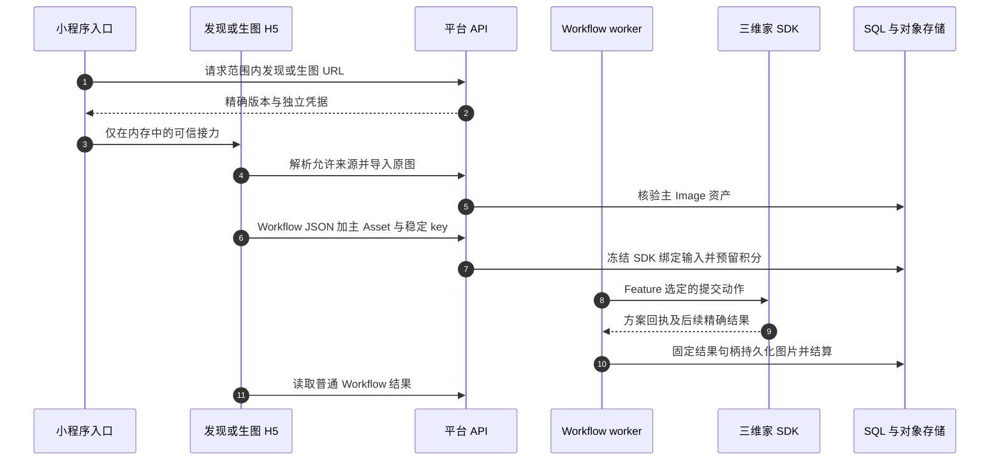

# 三维家生图与发现

普通生图复用平台 Workflow 记账和 Assets，H5 表单则保留供应商业务 JSON。它与作品分组驱动的户型渲染不同：此生图家族不要求先登记 FloorPlanWork。七个平台 Feature 为 `rough_room_design`、`old_room_renovation`、`finished_room_design`、`furniture_replace`、`furniture_remove`、`furniture_add` 和 `cabinet_redesign`。

## 从发现中的选择到一张落库图片

| 步骤 | 源码 | 原因 |
| --- | --- | --- |
| 1–3 | [prepareThreeVjiaImage](https://github.com/Orientation-CD/wechat_mini_program/blob/88c75c1f15cd65f45c7fb09d560df80430ddc198/src/repositories/threeVjiaImage.ts#L6) · [prepareThreeVjiaDiscovery](https://github.com/Orientation-CD/wechat_mini_program/blob/88c75c1f15cd65f45c7fb09d560df80430ddc198/src/repositories/threeVjiaDiscovery.ts#L7) · [image_editor_url](https://github.com/Orientation-CD/YuanZhu-AI/blob/749e82df3a51c441335ba6a4db607a98bacbcf97/app/scheme_images/api.py#L104) | 浏览／入口资格确认不会创建付费执行 |
| 4–6 | [submit](https://github.com/Orientation-CD/YuanZhu-AI/blob/749e82df3a51c441335ba6a4db607a98bacbcf97/app/static/3vjia/h5/scheme.js#L85) · [import_before_asset](https://github.com/Orientation-CD/YuanZhu-AI/blob/749e82df3a51c441335ba6a4db607a98bacbcf97/app/floor_plans/before_assets.py#L88) | 持久的稳定 key／body 用于恢复不确定响应；核验主图与供应商 JSON 分开 |
| 7–8 | [SchemeImageWorkflowCreate](https://github.com/Orientation-CD/YuanZhu-AI/blob/749e82df3a51c441335ba6a4db607a98bacbcf97/app/core/models.py#L740) · [scheme_submit_action](https://github.com/Orientation-CD/YuanZhu-AI/blob/749e82df3a51c441335ba6a4db607a98bacbcf97/app/scheme_images/family.py#L25) | 平台 Feature 选择 type／bizType 及两种提交动作，不信任文档中的路由字段 |
| 9–10 | [ThreeVjiaSchemeImageSDK](https://github.com/Orientation-CD/YuanZhu-AI/blob/749e82df3a51c441335ba6a4db607a98bacbcf97/app/three_vjia/scheme_image.py#L50) · [checkpoint_handle](https://github.com/Orientation-CD/YuanZhu-AI/blob/749e82df3a51c441335ba6a4db607a98bacbcf97/app/workflows/operations/image/scheme_image_execution.py#L19) | 原方案回执保持稳定，首次精确 record／task／file 绑定持久化后供后续轮询使用 |
| 11 | [get_workflow](https://github.com/Orientation-CD/YuanZhu-AI/blob/749e82df3a51c441335ba6a4db607a98bacbcf97/app/workflows/api.py#L1484) | 输出通过普通受权限保护的 Workflow 历史／结果 DTO 返回 |

`SchemeImageWorkflowCreate` 恰好要求 JSON render_request 与主 Image，并归一化平台选定的供应商 type／bizType 及单图数量规则。共享 `three_vjia_image` Workflow 使用 `generate_3vjia_image`，不是新增通用 Provider 模型。冻结的 `scheme_submit_action` 把房间设计 Feature 路由到 scheme_design_submit，家具／柜体修改路由到 scheme_change_submit。SDK 返回规范 `3vjs1:` 路由回执，后续 record／task／file 证据不能静默换到另一方案。查询失败或付费结果未知时应使用既有尝试恢复，不能再创建一条供应商方案。

发现来源接力只允许受限的已知定位器／动作：same_case、edit_selected_image 或 products；原生校验最多50个商品。H5 经所选发布版解析真实案例／文件／商品数据后才设置表单默认值。浏览本身不预留积分。来源定位器、供应商方案 ID、平台 Asset ID 与 Workflow ID 是不同对象。

## 初始化普通生图上下文 {#image-context}

`GET /v1/3vjia-image/context` 进入 `image_context`。已加载的 scheme H5 发送七个受支持 Feature 之一及空间／项目。`authenticate_editor_context` 确认当前平台权限；为诚实报告不可用状态，此读取不要求已有选中连接。响应包含 Feature 启用／基础积分及 `current_editor_model` 发布版元数据，不提交方案、不预留积分，也不证明供应商登录探测通过。H5 不能把不可用／移除 Feature 当作正常空表单。

源码阅读：[image_context](https://github.com/Orientation-CD/YuanZhu-AI/blob/749e82df3a51c441335ba6a4db607a98bacbcf97/app/scheme_images/api.py#L37) · [authenticate_editor_context](https://github.com/Orientation-CD/YuanZhu-AI/blob/749e82df3a51c441335ba6a4db607a98bacbcf97/app/floor_plans/works.py#L90) · [current_editor_model](https://github.com/Orientation-CD/YuanZhu-AI/blob/749e82df3a51c441335ba6a4db607a98bacbcf97/app/floor_plans/editor_entry.py#L37)。

## 进入一个生图 Feature {#image-entry}

`POST /v1/3vjia-image/editor-url` 进入 `image_editor_url`。原生 `prepareThreeVjiaImage` 发送 Feature、空间、名称、可选项目／source 及 bootstrap_auth。`prepare_editor_entry` 重查该 Feature，并要求 Feature 选定的提交动作、scheme_design_detail 及有效响应映射。登录探测在事务锁外完成，最终权限重查后才提交可选平台 auth。scheme-design.html 地址只带受限来源定位器（案例／文件／商品 ID 与 action），不能把任意供应商响应当作可信字段；此时不创建付费任务，来源解析和主图导入在 H5 中进行。

源码阅读：[image_editor_url](https://github.com/Orientation-CD/YuanZhu-AI/blob/749e82df3a51c441335ba6a4db607a98bacbcf97/app/scheme_images/api.py#L104) · [prepare_editor_entry](https://github.com/Orientation-CD/YuanZhu-AI/blob/749e82df3a51c441335ba6a4db607a98bacbcf97/app/floor_plans/editor_entry.py#L182)。

## 导入普通生图主输入 {#image-before}

`POST /v1/3vjia-image/before-assets` 进入 `import_before_image`。scheme.js 在构造平台 Workflow body 之前调用此别名。它与户型 before-assets 共享同一 handler、限流和 `import_before_asset`：稳定 key／指纹、作者／项目权限、I/O 前持久化临时 intent、受限 SDK 产物下载、图片校验、版本化存储及普通 Asset 完成流程。READY／replayed=true 是输入回执，不是生成输出或扣费；恢复不确定导入时保留原 key 和请求，同 key 改来源／范围会冲突，然后才把 asset_id 冻结进付费 body。

源码阅读：[import_before_image](https://github.com/Orientation-CD/YuanZhu-AI/blob/749e82df3a51c441335ba6a4db607a98bacbcf97/app/floor_plans/api.py#L255) · [import_before_asset](https://github.com/Orientation-CD/YuanZhu-AI/blob/749e82df3a51c441335ba6a4db607a98bacbcf97/app/floor_plans/before_assets.py#L88)。

## 读取发现上下文 {#discovery-context}

`GET /v1/3vjia-discovery/context` 进入 `discovery_context`。发现 H5 发送 page=idea 或 shopping、可选 shopping_mode=city／selected 及空间／项目。`authenticate_editor_context` 核验账号与范围，返回当前 SDK 发布版元数据，不要求计价 Feature。它不提交 Workflow、不为浏览扣积分；这些选择值只控制页面上下文，不能授权访问任意供应商账号、项目或来源资产。

源码阅读：[discovery_context](https://github.com/Orientation-CD/YuanZhu-AI/blob/749e82df3a51c441335ba6a4db607a98bacbcf97/app/discovery/api.py#L34) · [authenticate_editor_context](https://github.com/Orientation-CD/YuanZhu-AI/blob/749e82df3a51c441335ba6a4db607a98bacbcf97/app/floor_plans/works.py#L90)。

## 打开灵感或购物 {#discovery-entry}

`POST /v1/3vjia-discovery/entry-url` 进入 `discovery_entry`。原生 `prepareThreeVjiaDiscovery` 以 bootstrap_auth 申请页面／模式。`prepare_editor_entry` 使用 feature_keys=()，仍检查范围、精确发布版和四个必需浏览操作：内容列表／详情、商品搜索、门店详情。登录探测和最终权限检查完成后才提交可选平台 auth。discovery.html URL／版本沿用可信来源原生接力。浏览不计价；选择案例／图片／商品会开始独立 Feature 入口及后续付费 Workflow，不会隐式走网关渲染。

源码阅读：[discovery_entry](https://github.com/Orientation-CD/YuanZhu-AI/blob/749e82df3a51c441335ba6a4db607a98bacbcf97/app/discovery/api.py#L76) · [prepare_editor_entry](https://github.com/Orientation-CD/YuanZhu-AI/blob/749e82df3a51c441335ba6a4db607a98bacbcf97/app/floor_plans/editor_entry.py#L182)。
