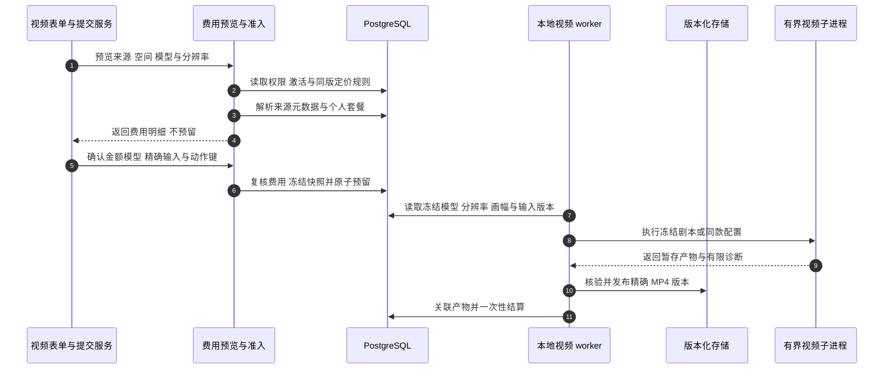

# 视频费用：预览、确认与冻结

视频表单可以在创建任务之前显示费用。“费用预览”和“付费任务被接纳”是两个边界。以下以用户上传参考视频、确认模型与积分、再提交准备好的请求为例：费用依据参考视频 Asset 的实测时长，客户端显示的时长只用于展示。

## 请求权威费用预览 {#video-price-preview}

`POST /v1/video-billing/preview` 进入 `preview_video_billing`。请求包含 `workspace_id`、可选的已知 `model` 和 `resolution`，以及 `script`、`template_name`、`reference_asset_id` **三选一**。`VideoBillingPreviewRequest` 对多来源、空白剧本返回 422。前端通过带认证的 `previewVideoBilling` 调用；表单使用 400 ms 防抖刷新显示，提交服务在确认前还会取得新的准确预览。

| 图中步骤 | 固定版本源码 | 应阅读的边界 |
| --- | --- | --- |
|1|[submitVideoGeneration](https://github.com/Orientation-CD/wechat_mini_program/blob/7f1a3169338c10bd4139c24318f7a35caf86310c/src/pkg-features/services/videoGenerationSubmit.ts#L81)|读取身份和目录、自传参考视频完成上传，再请求当前准确费用。|
|2–3|[preview_video_billing](https://github.com/Orientation-CD/YuanZhu-AI/blob/f34b8a4d6307c83c6f7bbc905485a4f586d59a99/app/billing/video_billing_api.py#L131) → [preview_source](https://github.com/Orientation-CD/YuanZhu-AI/blob/f34b8a4d6307c83c6f7bbc905485a4f586d59a99/app/billing/video_billing_api.py#L50) / [preview_discount](https://github.com/Orientation-CD/YuanZhu-AI/blob/f34b8a4d6307c83c6f7bbc905485a4f586d59a99/app/billing/video_billing_api.py#L103)|核验空间和可执行产品，[load_video_pricing](https://github.com/Orientation-CD/YuanZhu-AI/blob/f34b8a4d6307c83c6f7bbc905485a4f586d59a99/app/billing/video_pricing.py#L122)，再解析来源与套餐；此时还没有任务。|
|4|[calculate_video_price](https://github.com/Orientation-CD/YuanZhu-AI/blob/f34b8a4d6307c83c6f7bbc905485a4f586d59a99/app/billing/video_pricing.py#L164)|按同一配置版本用整数计算积分；读取事务回滚。|
|5|[submitVideoGeneration](https://github.com/Orientation-CD/wechat_mini_program/blob/7f1a3169338c10bd4139c24318f7a35caf86310c/src/pkg-features/services/videoGenerationSubmit.ts#L81)|确认费用、上传剩余素材，保存分辨率、画幅、完整正文和动作键后发送。|
|6|[video_commercial_snapshot](https://github.com/Orientation-CD/YuanZhu-AI/blob/f34b8a4d6307c83c6f7bbc905485a4f586d59a99/app/billing/video_billing.py#L43) / [admit_workflow_job](https://github.com/Orientation-CD/YuanZhu-AI/blob/f34b8a4d6307c83c6f7bbc905485a4f586d59a99/app/workflows/workflow_admission.py#L3301)|在准入权威边界重新计算并核对确认值，然后预留并冻结计费证据。|
|7–11|[execute_local_video_submission](https://github.com/Orientation-CD/YuanZhu-AI/blob/f34b8a4d6307c83c6f7bbc905485a4f586d59a99/app/workflows/submissions/workflow_local_video_submission.py#L1164) / [frozen_video_model](https://github.com/Orientation-CD/YuanZhu-AI/blob/f34b8a4d6307c83c6f7bbc905485a4f586d59a99/app/billing/video_billing.py#L105)|执行冻结模型，发布核验后的 MP4，按代际一次性结算或释放。|

`preview_source` 读取有效同款模板关联的参考 Asset，或核验自传参考视频的所有者、上传角色、READY 状态与不可变身份。两条路径都运行 `_validate_reference_video`：必须是已有实测时长的 Video，15,000–120,000 ms（含边界），最多 100 MiB。缺少时长是 `ASSET_CONTENT_CHANGED`；过短、过长返回 422 `VIDEO_REFERENCE_INVALID`，原因分别为 `too_short`、`too_long`。

`accessible_workspace` 核验计费空间；`preview_discount` 对企业不使用个人折扣，个人预览则要求当前有效订阅及允许 `video_generation` 的套餐。路由还核验产品激活和可执行的视频契约。预览不检查钱包余额或成员月额度，不预留积分、不创建任务/outbox、不上传产物，也不启动渲染；返回前回滚读取事务。收到预览只能说明取得了费用，不能说明任务已经接纳。

`VideoBillingPreviewResponse` 返回 `effective_model`、`mode`、`configuration_version`、`billing_method`、来源计数或时长、`billable_seconds`、`tokens_per_second`、`base_token_cost`、`discount_percent` 和最终 `token_cost`。计算器内部返回实际计费分辨率，FastAPI 的响应模型会从成功响应中过滤该字段。客户端应保存请求中的组合及报价。省略分辨率时，使用有效模型在目录顺序中的首个已启用档位。预览 schema 不接收 `aspect_ratio`。[VideoBillingPreviewResponse](https://github.com/Orientation-CD/YuanZhu-AI/blob/f34b8a4d6307c83c6f7bbc905485a4f586d59a99/app/core/models.py#L1354)

目录按每个已启用组合公布 Token/秒。`model_rates` 仅从已启用 `480p` 行派生，兼容的顶层 `resolution` 始终是 `480p`。例如 `MiniMax-H3` 的 `768p` 和 `2k` 出现在新映射中，旧映射不包含它。 [video_billing_discovery](https://github.com/Orientation-CD/YuanZhu-AI/blob/f34b8a4d6307c83c6f7bbc905485a4f586d59a99/app/billing/video_pricing_catalog.py#L17)

## 计费秒数如何计算

| 规则 | `calculate_video_price` 使用的计数 |
| --- | --- |
| 剧本按秒 `per_second` | UTF-16 剧本长度除以 `script_chars_per_second`，向上取整 |
| 两种参考视频按秒 `per_second` | 数据库存储的 `duration_ms / 1000`，向上取整 |
| 任一模式按次 `per_task` | 此模式配置的正整数 `fixed_seconds` |

计费秒数乘以所选模型与分辨率组合**持久化的整数**积分/秒，再按个人折扣向上取整，最终至少 10 积分：`max(10, ceil(base × (100 - discount_percent) / 100))`。例如参考视频 15,001 ms、单价 8、无折扣，得到 16 × 8 = 128 积分。这是计算示例，不代表当前线上单价。JavaScript 使用 UTF-16 单元计数，后端刻意采用相同计数，因此表情等补充字符也能得到一致结果。

版本化的 `video_billing.model_resolution_rates` 公布启用的模型与分辨率组合，各模型内部按工厂售卖顺序排列。`VIDEO_MODEL_SELECTION_ENABLED=false` 时，`effective_video_model` 与 `effective_resolution` 强制使用 `Doubao-Seedance-2.0-mini / 480p`。开启选型后，省略分辨率由 `_resolve_charged_resolution` 取该模型首个启用档位。明确指定了未供应的组合时，准入会在预留前返回 422 `WORKFLOW_UNAVAILABLE`。[video_billing_discovery](https://github.com/Orientation-CD/YuanZhu-AI/blob/f34b8a4d6307c83c6f7bbc905485a4f586d59a99/app/billing/video_pricing_catalog.py#L17) · [effective_resolution](https://github.com/Orientation-CD/YuanZhu-AI/blob/f34b8a4d6307c83c6f7bbc905485a4f586d59a99/app/billing/video_billing.py#L34) · [_resolve_charged_resolution](https://github.com/Orientation-CD/YuanZhu-AI/blob/f34b8a4d6307c83c6f7bbc905485a4f586d59a99/app/billing/video_pricing.py#L101)

## 确认、预留和重放

提交服务让用户确认服务端费用，将 `expected_token_cost` 和 `expected_effective_model` 写入准备好的请求，先保存正文和逻辑动作键，再通过当前 `/v1/design-jobs` 兼容入口提交。规范 `/v1/workflows` 也进入同一视频准入。字段在 schema 中可选，不表示缺少确认也能接纳：新的准入会把两个确认值与重新计算的值核对。

`video_commercial_snapshot` 在预留钱包积分之前运行。不匹配返回 409 `VIDEO_PRICE_CHANGED`。`detail.current_price` 包含实际计费 `resolution`，任务创建和积分预留尚未提交。准入只比较确认的金额和有效模型。两者都相同时，配置版本变化本身不会触发重新确认。表单进入重新确认，取得并确认新预览，只更新准备正文中的费用/模型确认值，保存后复用该逻辑动作。它与“网络失败，接纳回执未知”不同：回执未知时，应原样重放已保存的正文与 key，不能刷新价格或轮换 key 来尝试绕过不确定状态。

确认匹配后，准入再检查钱包可用余额和企业成员额度，冻结 `video_time_v1` 计费证据：配置版本、单价、有效模型、计费分辨率、模式规则、计数/时长、折扣、最终金额，以及参考 Asset 的版本/摘要。Job、run 和 operation 使用相同金额。已接纳请求同 key 重放取得原回执，即使价格或额度随后改变也不会重复预留。

## 把渲染选项与动作一起保留

显式 `resolution` 进入语义指纹，省略或 `null` 沿用历史指纹。剧本与同款都接受 `aspect_ratio` 的 `9:16`、`16:9`、`3:4`、`4:3`、`21:9`。省略、`null`、`9:16` 共用一种语义身份，其余四档改变指纹。worker 从冻结的公开输入读取画幅，通过 `video_aspect_ratio` 传递，缺省使用 `9:16`。计费公式读取分辨率、时长或剧本长度以及模式规则，单独调整画幅不改变商业计算。[_canonical_video_request_payload](https://github.com/Orientation-CD/YuanZhu-AI/blob/f34b8a4d6307c83c6f7bbc905485a4f586d59a99/app/workflows/workflow_admission.py#L1673) · [_build_render_request](https://github.com/Orientation-CD/YuanZhu-AI/blob/f34b8a4d6307c83c6f7bbc905485a4f586d59a99/app/workflows/submissions/workflow_local_video_submission.py#L617)

## 执行与恢复沿用已接纳事实

`frozen_video_model` 核验已接纳 `video_time_v1` 快照的身份与整数算式。`_snapshot_resolution` 从该快照读取计费分辨率，即使该档位已停售，也会把冻结值写入 `video_resolution`。较早的 `video_time_v1` 已存 `480p`。更早的 `feature_v1` 或无商业快照的任务沿用历史路径，worker 省略渲染器分辨率字段。[frozen_video_model](https://github.com/Orientation-CD/YuanZhu-AI/blob/f34b8a4d6307c83c6f7bbc905485a4f586d59a99/app/billing/video_billing.py#L105) · [_snapshot_resolution](https://github.com/Orientation-CD/YuanZhu-AI/blob/f34b8a4d6307c83c6f7bbc905485a4f586d59a99/app/workflows/submissions/workflow_local_video_submission.py#L260)

本地视频失败不会自动重新购买。共享的显式重试控制器要求数据库中可重试的失败证据、已释放的账本和当前权限；能够证明未派发的 RETRYABLE 情形可以按原冻结金额/模型接纳新代际。普通终态渲染失败仍被阻止。重试回执重放不产生第二个代际。见[历史与重试链路](/zh/reference/flows/workflow-history-flow)。

子进程仅在已安装的 `jinqiu_e2e` 能报告版本时写入 `runtime_version`，缺失时保留未知。排查模型/剧本差异时，保留后端提交、镜像摘要、私有供应商提交及可取得的运行版本。客户端诊断移除凭据和签名 URL，并对受保护项目读取额外移除客户信息，提供有限文件分享与复制兜底，但不能据此判断收费调用是否被供应商接纳。

## 跟读回归证据

[tests/test_video_billing_admission.py](https://github.com/Orientation-CD/YuanZhu-AI/blob/f34b8a4d6307c83c6f7bbc905485a4f586d59a99/tests/test_video_billing_admission.py) 覆盖确认值变化、原子拒绝和已接纳重放；[tests/test_video_billing_retry_integration.py](https://github.com/Orientation-CD/YuanZhu-AI/blob/f34b8a4d6307c83c6f7bbc905485a4f586d59a99/tests/test_video_billing_retry_integration.py) 覆盖冻结价格/模型与重试账本；[tests/test_video_member_quota_integration.py](https://github.com/Orientation-CD/YuanZhu-AI/blob/f34b8a4d6307c83c6f7bbc905485a4f586d59a99/tests/test_video_member_quota_integration.py) 覆盖成员额度拒绝及已接纳重放。这些是行为的源码证据，不表示本次文档更新已经运行应用或真实收费供应商。
