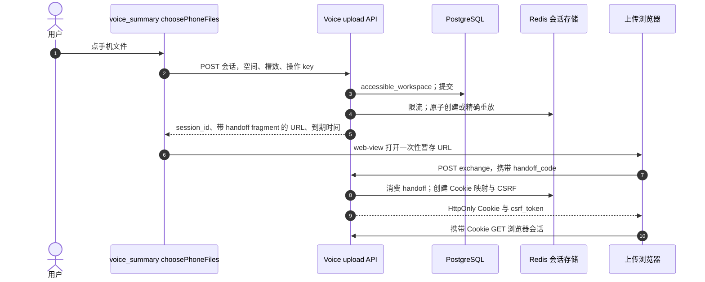
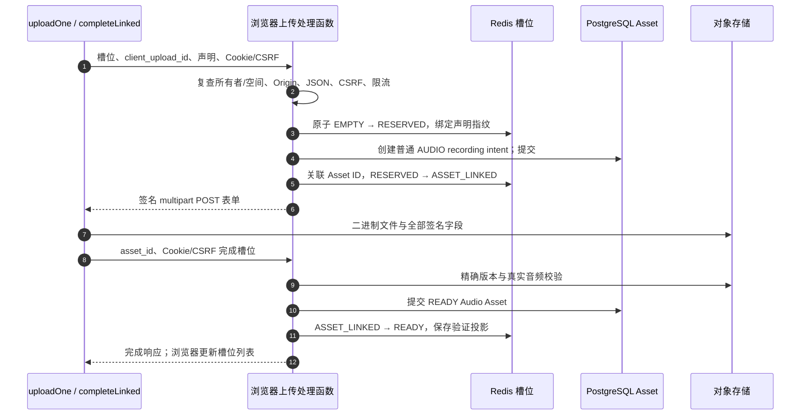

# 手机录音接力：小程序 → 浏览器 → 验证 Asset → 回到小程序

语音总结页“手机文件”打开受限上传网页。它是另一个客户端，使用**仅能操作一个上传会话的 Cookie 权限**，并没有复制小程序 access token。浏览器上传，回小程序导入验证后的 Asset ID；之后用户点击语音工作流提交，才开始生成。所有代码链接固定到[审计版本](/zh/reference/source-revisions)。

## 三层存储，三个时钟 {#voice-model}

| 状态 | 持有者 / 生命周期 | 用途 |
| --- | --- | --- |
| 小程序草稿与页面交接 | `pendingPhoneUpload`、本地草稿、一次性页面交接 | 记住会话/空间，准确打开服务端 URL，不把敏感 URL 塞进导航 query。 |
| Redis 会话与槽位 | 有到期时间的 `VoiceUploadSessionStore` | 一次性交换、Cookie 查找、CSRF、槽位原子状态变化。这里的 Redis **不是 worker 队列**。 |
| PostgreSQL Audio Asset 与存储版本 | 普通上传/完成路径 | 持久化所有权与验证字节，不依赖临时浏览器页面状态。 |

服务端返回 `upload_deadline`（上传窗口）、更早的 `intent_issuance_expires_at`（为签名表单留下最低可用时间）、更晚的 `retrieval_expires_at`（找回已完成文件的窗口）。读取这些时间，不把默认值硬编码成客户端规则；上传窗口关闭不等于检索也关闭，配置会检查它们的先后关系。

## 从“手机文件”创建会话 {#voice-session-create}

**接口：`POST /v1/voice-upload-sessions`。** [`choosePhoneFiles`](https://github.com/Orientation-CD/wechat_mini_program/blob/3662578b384fd5b0fbe7509229b2a08a6fe44ab9/src/pkg-features/pages/voice_summary/index.vue#L891) 先经过登录门禁，取权威资料并检查空间未变；可用槽为 `3 - files.length`。请求前保存 launch 身份，随后 [`createVoiceUploadSession`](https://github.com/Orientation-CD/wechat_mini_program/blob/3662578b384fd5b0fbe7509229b2a08a6fe44ab9/src/pkg-features/repositories/voiceUploadSessions.ts#L82) 带 Bearer、稳定 `Idempotency-Key` 发送：

```json
{
  "workspace_id": "11111111-1111-4111-8111-111111111111",
  "available_slots": 2
}
```

UUID 必须是此账号可访问的空间；`2` 表示这个浏览器会话最多占两槽，不是音频大小/时长，也不是用户的全局上传限额。API 允许 1–3。



| 步骤 | 打开代码 | 关注的边界 |
| --- | --- | --- |
| 1–2 | [`choosePhoneFiles`](https://github.com/Orientation-CD/wechat_mini_program/blob/3662578b384fd5b0fbe7509229b2a08a6fe44ab9/src/pkg-features/pages/voice_summary/index.vue#L891)、[`createVoiceUploadSession`](https://github.com/Orientation-CD/wechat_mini_program/blob/3662578b384fd5b0fbe7509229b2a08a6fe44ab9/src/pkg-features/repositories/voiceUploadSessions.ts#L82) | 登录门禁保留草稿，但不能悄悄把会话绑到变化后的空间。 |
| 3–5 | [`create_voice_upload_session`](https://github.com/Orientation-CD/YuanZhu-AI/blob/e59716c83e087deda8477da5ea7b327a40cf65c5/app/assets/voice_upload_api.py#L421)、[`VoiceUploadSessionStore.create`](https://github.com/Orientation-CD/YuanZhu-AI/blob/e59716c83e087deda8477da5ea7b327a40cf65c5/app/assets/voice_upload_sessions.py#L255) | 检查空间后结束读取事务再操作 Redis；Lua 一起原子发布会话/handoff/幂等记录。 |
| 6 | [`stageVoiceUploadHandoff`](https://github.com/Orientation-CD/wechat_mini_program/blob/3662578b384fd5b0fbe7509229b2a08a6fe44ab9/src/pkg-features/services/voiceUploadHandoff.ts#L9)、[`consumeVoiceUploadHandoff`](https://github.com/Orientation-CD/wechat_mini_program/blob/3662578b384fd5b0fbe7509229b2a08a6fe44ab9/src/pkg-features/services/voiceUploadHandoff.ts#L14) | 页面消费暂存 URL，再显示 web-view；URL fragment 是一次性能力凭证。 |
| 7–9 | [`bootstrap`](https://github.com/Orientation-CD/YuanZhu-AI/blob/e59716c83e087deda8477da5ea7b327a40cf65c5/app/static/voice-upload.js#L77)、[`exchange_voice_upload_handoff`](https://github.com/Orientation-CD/YuanZhu-AI/blob/e59716c83e087deda8477da5ea7b327a40cf65c5/app/assets/voice_upload_api.py#L502) | 浏览器交换 fragment 后用 `history.replaceState` 清除它；Cookie 限路径并且 HttpOnly。 |
| 10 | [`get_voice_upload_browser_session`](https://github.com/Orientation-CD/YuanZhu-AI/blob/e59716c83e087deda8477da5ea7b327a40cf65c5/app/assets/voice_upload_api.py#L527) | 后续浏览器请求解析受限 Cookie，小程序 Bearer 从未被交过去。 |

创建为 `201`，同 key 同声明重放为 `200` 并返回**完全相同的已保存响应**。`VoiceUploadSessionStore.create` 对用户/空间/槽数做指纹，响应含 handoff 秘密，因此用于重放的存储响应被加密。换声明复用 key 返回 `409 VOICE_UPLOAD_IDEMPOTENCY_KEY_REUSED`；同创建操作重放不会让已消费的 handoff 自动复活。

## 提供上传页面与静态资源 {#voice-static}

**接口：`GET /voice-upload`、`GET /voice-upload/app.js`、`GET /voice-upload/validation.js`、`GET /voice-upload/styles.css`。** 它们是后端提供的网站资源，不是四个额外的小程序业务 API。[`voice_upload_page`](https://github.com/Orientation-CD/YuanZhu-AI/blob/e59716c83e087deda8477da5ea7b327a40cf65c5/app/assets/voice_upload_api.py#L482)、[`voice_upload_script`](https://github.com/Orientation-CD/YuanZhu-AI/blob/e59716c83e087deda8477da5ea7b327a40cf65c5/app/assets/voice_upload_api.py#L487)、[`voice_upload_validation_script`](https://github.com/Orientation-CD/YuanZhu-AI/blob/e59716c83e087deda8477da5ea7b327a40cf65c5/app/assets/voice_upload_api.py#L492)、[`voice_upload_styles`](https://github.com/Orientation-CD/YuanZhu-AI/blob/e59716c83e087deda8477da5ea7b327a40cf65c5/app/assets/voice_upload_api.py#L497) 用 `FileResponse` 返回打包的 HTML/JS/CSS。

加载页面壳不代表获得文件权限。`bootstrap` 读取 `#handoff=...` 并交换，再读会话状态；失败就禁用选择器，请用户回小程序重开。validation 脚本提供浏览器反馈，最终仍以后端校验为准。

## 把一次 handoff 换成受限 Cookie {#voice-exchange}

**接口：`POST /voice-upload/exchange`。** 浏览器 `bootstrap` 发 JSON `{ "handoff_code": "fragment-里的秘密" }`。[`exchange_voice_upload_handoff`](https://github.com/Orientation-CD/YuanZhu-AI/blob/e59716c83e087deda8477da5ea7b327a40cf65c5/app/assets/voice_upload_api.py#L502) 要求 `application/json`，以及与公开 API origin 完全一致的 `Origin`，再调用 [`VoiceUploadSessionStore.exchange`](https://github.com/Orientation-CD/YuanZhu-AI/blob/e59716c83e087deda8477da5ea7b327a40cf65c5/app/assets/voice_upload_sessions.py#L352)。Lua 校验会话与上传窗口、消费 handoff key、记录 CSRF，并写入 Cookie Token 映射。

响应在 `/voice-upload` 路径设 HttpOnly、SameSite=Strict Cookie；Secure 由部署配置控制，JSON 只返回 `csrf_token`。缺失/已消费/过期 handoff 为 `410 VOICE_UPLOAD_HANDOFF_UNAVAILABLE`，错误 Origin 为 `403 VOICE_UPLOAD_ORIGIN_FORBIDDEN`，非 JSON 为 `415 JSON_CONTENT_TYPE_REQUIRED`。不要把 handoff URL 贴进公开问题或日志。

## 读取浏览器状态，同时复查成员资格 {#voice-browser-session}

**接口：`GET /voice-upload/session`。** 浏览器的 `bootstrap`、`uploadOne`、`completeLinked` 读取它来显示进度/恢复。[`_browser_record`](https://github.com/Orientation-CD/YuanZhu-AI/blob/e59716c83e087deda8477da5ea7b327a40cf65c5/app/assets/voice_upload_api.py#L318) 在 Redis 解析 Cookie，再从 SQL 读所有者，要求 active、未移除，重新检查 `accessible_workspace`。账号或成员关系变化后，仅有有效 Cookie 不够。

`get_voice_upload_browser_session` 返回状态、到期、CSRF、`max_files` 及按顺序的槽位，存在时附文件名/Asset ID，不返回应用 access/refresh。缺 Cookie 为 `401 VOICE_UPLOAD_BROWSER_SESSION_REQUIRED`，检索到期可为 `410 VOICE_UPLOAD_RETRIEVAL_EXPIRED`。刷新页面可恢复服务端槽位，却不能恢复浏览器内存里的本地 File 字节。

## 预留槽位，取得对应 Asset 上传凭证 {#voice-file-intent}

**接口：`POST /voice-upload/files/{slot}/upload-intent`。** “上传 N 个录音”的浏览器事件调用 [`uploadOne`](https://github.com/Orientation-CD/YuanZhu-AI/blob/e59716c83e087deda8477da5ea7b327a40cf65c5/app/static/voice-upload.js#L115)，选择下一个 EMPTY 槽（从零开始编号），为文件保留一个 `client_upload_id` UUID，带 Cookie、JSON、`X-CSRF-Token` 提交文件名、MIME、大小。



| 步骤 | 源码 | 状态 / 权限 |
| --- | --- | --- |
| 1–3 | [`create_voice_upload_file_intent`](https://github.com/Orientation-CD/YuanZhu-AI/blob/e59716c83e087deda8477da5ea7b327a40cf65c5/app/assets/voice_upload_api.py#L564)、[`VoiceUploadSessionStore.reserve`](https://github.com/Orientation-CD/YuanZhu-AI/blob/e59716c83e087deda8477da5ea7b327a40cf65c5/app/assets/voice_upload_sessions.py#L421) | 服务端规范化声明；Lua 把槽绑定到 UUID/指纹，不允许另一文件覆盖同槽。 |
| 4–6 | [`derived_asset_idempotency_key`](https://github.com/Orientation-CD/YuanZhu-AI/blob/e59716c83e087deda8477da5ea7b327a40cf65c5/app/assets/voice_upload_sessions.py#L525)、[`VoiceUploadSessionStore.link_asset`](https://github.com/Orientation-CD/YuanZhu-AI/blob/e59716c83e087deda8477da5ea7b327a40cf65c5/app/assets/voice_upload_sessions.py#L452) | 从会话+客户端 UUID 导出普通 Asset key；限制为 AUDIO / DESIGN_JOB_INPUT / recording；SQL 提交后才关联 Redis。 |
| 7 | [`uploadForm`](https://github.com/Orientation-CD/YuanZhu-AI/blob/e59716c83e087deda8477da5ea7b327a40cf65c5/app/static/voice-upload.js#L96) | 浏览器 XHR 向存储发 FormData，受限应用 Cookie 不是通用存储凭证。 |
| 8–10 | [`complete_voice_upload_file`](https://github.com/Orientation-CD/YuanZhu-AI/blob/e59716c83e087deda8477da5ea7b327a40cf65c5/app/assets/voice_upload_api.py#L653)、[`complete_asset_upload`](https://github.com/Orientation-CD/YuanZhu-AI/blob/e59716c83e087deda8477da5ea7b327a40cf65c5/app/assets/asset_completion.py#L261) | 先检查 Asset 就是此槽关联的 UUID，再验证真实字节/时长并提交持久化元数据。 |
| 11–12 | [`VoiceUploadSessionStore.mark_ready`](https://github.com/Orientation-CD/YuanZhu-AI/blob/e59716c83e087deda8477da5ea7b327a40cf65c5/app/assets/voice_upload_sessions.py#L489)、[`render`](https://github.com/Orientation-CD/YuanZhu-AI/blob/e59716c83e087deda8477da5ea7b327a40cf65c5/app/static/voice-upload.js#L25) | SQL 成功之后才发布 Redis READY；浏览器 complete 成功后才显示“上传完成”。 |

签名表单不得越过会话上传截止时间；更早的 `intent_issuance_expires_at` 为新表单留出最低可用时长。同槽/同客户端 UUID/同声明可重放；换声明或抢占返回 `409 VOICE_UPLOAD_SLOT_CONFLICT`。浏览器按顺序处理批次，在失败文件处停止，保留选中文件/已上传状态供重试。

## 完成一个槽，恢复丢失响应 {#voice-file-complete}

**接口：`POST /voice-upload/files/{slot}/complete`。** 请求体 `{ "asset_id": "此槽-intent-返回的-UUID" }`。[`complete_voice_upload_file`](https://github.com/Orientation-CD/YuanZhu-AI/blob/e59716c83e087deda8477da5ea7b327a40cf65c5/app/assets/voice_upload_api.py#L653) 重复 Cookie/用户/空间与写操作保护，检查槽边界和精确关联 UUID，调用普通 complete 服务并提交 SQL，最后原子标记 Redis READY。

这个顺序很重要：Redis 不在 SQL 事务里。如果 SQL 已成功而 Redis 发布或 HTTP 响应失败，可以重试**同一次 complete**；共享完成服务会检查已验证对象的身份。刷新后的浏览器对 ASSET_LINKED 槽显示“继续校验”，[`completeLinked`](https://github.com/Orientation-CD/YuanZhu-AI/blob/e59716c83e087deda8477da5ea7b327a40cf65c5/app/static/voice-upload.js#L177) 不需要重新选择字节即可完成。只有 RESERVED 的槽无法在浏览器重启后找回本地 File，可能需要重新打开接力。

[Asset 章节](/zh/reference/flows/asset-upload-flow#asset-complete) 解释精确版本 HEAD/读/HEAD、SHA、音频验证与 READY 持久化，浏览器后缀检查不能替代它们。

## 把 READY 文件取回小程序 {#voice-session-get}

**接口：`GET /v1/voice-upload-sessions/{session_id}`。** 返回/显示页面或显式同步时，[`syncPhoneUploadSession`](https://github.com/Orientation-CD/wechat_mini_program/blob/3662578b384fd5b0fbe7509229b2a08a6fe44ab9/src/pkg-features/pages/voice_summary/index.vue#L838) → [`getVoiceUploadSession`](https://github.com/Orientation-CD/wechat_mini_program/blob/3662578b384fd5b0fbe7509229b2a08a6fe44ab9/src/pkg-features/repositories/voiceUploadSessions.ts#L100) 使用小程序 Bearer，与浏览器 Cookie 路由故意分开。

[`get_voice_upload_session`](https://github.com/Orientation-CD/YuanZhu-AI/blob/e59716c83e087deda8477da5ea7b327a40cf65c5/app/assets/voice_upload_api.py#L453) 按 ID 取 Redis，会核对所有者、重查空间，并调用 [`_ready_assets`](https://github.com/Orientation-CD/YuanZhu-AI/blob/e59716c83e087deda8477da5ea7b327a40cf65c5/app/assets/voice_upload_api.py#L262)。它把 Redis READY 槽投影到**当前仍然**本人所有、未过期、READY、DESIGN_JOB_INPUT/recording 且验证元数据完整的 Audio 行。旧 Redis 快照不能接纳已删除、过期或他人文件。

页面拒绝已变化空间，按已知 Asset ID 去重，只导入三项上限内的剩余容量，把文件名、类型、大小、时长、SHA 与 `status: ready` 写入草稿，同步后清 pending handoff。找不到完成项时可显示“未发现已上传的手机录音”。导入不会创建生成工作流；后续提交才在普通 Workflow 路径使用这些 Asset ID。

## 沿失败边界排查，不靠猜测 {#voice-debug}

| 观察到的边界 | 先读什么证据 | 下一步检查 |
| --- | --- | --- |
| 页面加载但选择器不可用 | `bootstrap` → exchange/session 响应 | 一次性 handoff、精确 Origin、Cookie Secure/域/路径、公开 base URL。 |
| 接近截止时拿不到新 intent | Redis reserve / issuance cutoff | 返回截止与服务端时间，不靠改手机时钟延长。 |
| 存储进度结束却不是“上传完成” | Complete 响应、SQL Audio、ASSET_LINKED | 真实音频容器/类型/时长，重试 complete。 |
| 浏览器完成，小程序没导入 | Bearer 会话 GET 与 `_ready_assets` | 所有者/空间、检索窗口、未过期 READY、已知 ID 去重。 |
| Redis 不可用 | `VOICE_UPLOAD_SESSION_STORE_UNAVAILABLE`、`Retry-After: 5` | 会话存储；重启 submit worker 无法修复这层接力。 |

本地测试环境跟读练习：

1. 跟 `choosePhoneFiles`，记录 launch ID、空间与剩余槽位；再找 `VoiceUploadSessionStore.create` 同时创建的三个 Redis key。预期：会话、一次性 handoff、幂等响应用途不同。
2. 看 web-view bootstrap 的请求，但不要复制秘密 fragment。预期：exchange、Cookie、浏览器 session；浏览器没有应用 Bearer。
3. 跟一个文件的 EMPTY → RESERVED → ASSET_LINKED → READY，对照浏览器 intent、SQL complete、小程序检索中同一个 Asset UUID。
4. 找到 `mark_ready` 前的 SQL commit，用本地测试工具模拟完成响应丢失。预期：重试验证同一持久化 Asset，不创建新的工作流或文件身份。
5. 回小程序看导入草稿。预期：存在服务端测得的时长与 SHA，只有之后用户提交才进入生成调用链。

## 导入 READY 录音之后

浏览器会话负责到已核验 READY 上传；提交语音／视频还要经过[自有输入归档与最终激活](/zh/reference/flows/asset-upload-flow)。浏览器槽位 ready 不证明执行已接受。已接受 Asset 成为 ACTIVE、无过期时间并形成不可变 pins。不要用已消费的接力会话重建归属，也不要假设导入过的录音永远还是新的未过期 READY 输入。
