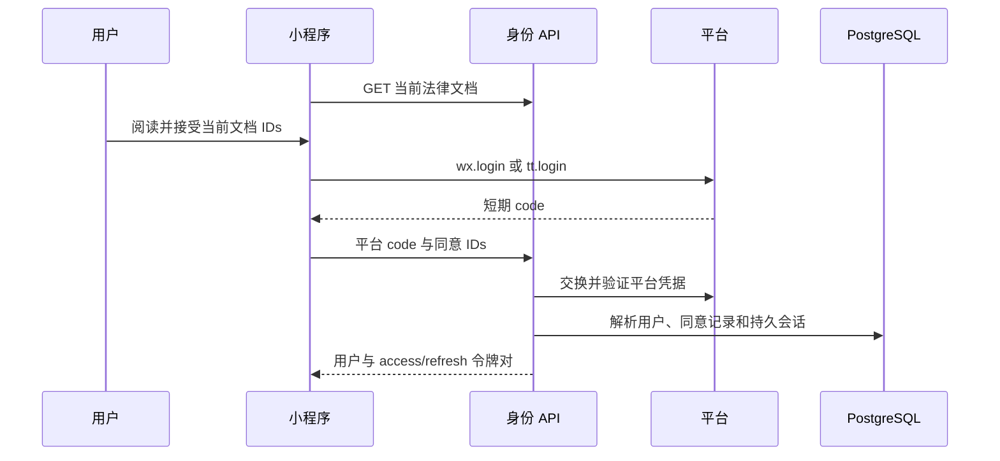

# 平台登录与法律同意

微信、抖音分别交换平台凭据，进入统一的应用账号/会话模型。本页保留历史路由名，内容覆盖两个当前平台。

## 客户端准备

`accountGate` 协调登录与后续动作。先按展示 locale 拉取当前法律文档、打开返回正文，保留用户真正接受的不可变 ID。mock 构建可模拟平台调用，但 API 模式仍需后端与已发布法律文档正确配置。

使用新 code 和契约要求的同意 IDs/手机号凭据字段请求 `/v1/auth/wechat-login` 或 `/v1/auth/douyin-login`。一次性平台 code 不是可复用密码。手机号授权是独立的平台证明，OpenID 不等于已验证手机号。

## 后端身份边界

identity 领域验证平台/模式，解析外部身份；同手机号平台身份可复用已有应用账号，账号状态、绑定冲突与同意要求仍由服务端检查。后端保存接受记录与持久 `auth_sessions`，再签发令牌。配置的新人/活动奖励通过账本入账，不是客户端硬编码余额。

`503 LEGAL_DOCUMENTS_UNAVAILABLE` 时停止注册/登录并稍后重试。`409 LEGAL_ACCEPTANCE_REQUIRED` 表示过时或缺少同意，需展示新要求并重新取得真实同意。注销/重新激活有专门端点，不能通过再造平台身份绕过。

## 刷新与退出

请求层在认证 API 携带 access token。过期后通过 `/v1/auth/refresh` 刷新一次，并串行协调并发刷新，替换返回的**两个** token。refresh 已撤销/无效时清理本地会话并重新登录，不能无限重试。

`POST /v1/auth/logout` 传 refresh token，撤销其持久 session。缓存和待续动作按 user/session generation 隔离，防止迟到响应写入另一账号。客户端存储不提供越权能力。

## 验证场景

覆盖首次/老用户、旧同意、法律配置缺失、平台 code 失败、手机号账号复用、access 过期/refresh 轮换、session 撤销、账号恢复。平台 live 与 mock 分别验收，见[认证](/zh/backend/authentication)和[API 边界](/zh/reference/openapi)。

## 源码依据

已按[记录的源码版本](/zh/reference/source-revisions)核对。

- [账号 gate](https://github.com/Orientation-CD/wechat_mini_program/blob/eca0a5f9e0a2aa1cb3fd4f9714114bb3db7fae5f/src/services/accountGate.ts)
- [请求与刷新协调](https://github.com/Orientation-CD/wechat_mini_program/blob/eca0a5f9e0a2aa1cb3fd4f9714114bb3db7fae5f/src/services/request.ts)
- [平台/密码身份 API](https://github.com/Orientation-CD/YuanZhu-AI/blob/b13cc5668920620a274cb91a3393ed9fadac72ae/app/identity/api.py)
- [持久认证会话](https://github.com/Orientation-CD/YuanZhu-AI/blob/b13cc5668920620a274cb91a3393ed9fadac72ae/app/identity/auth.py)
- [当前法律文档](https://github.com/Orientation-CD/YuanZhu-AI/blob/b13cc5668920620a274cb91a3393ed9fadac72ae/app/identity/legal_api.py)
