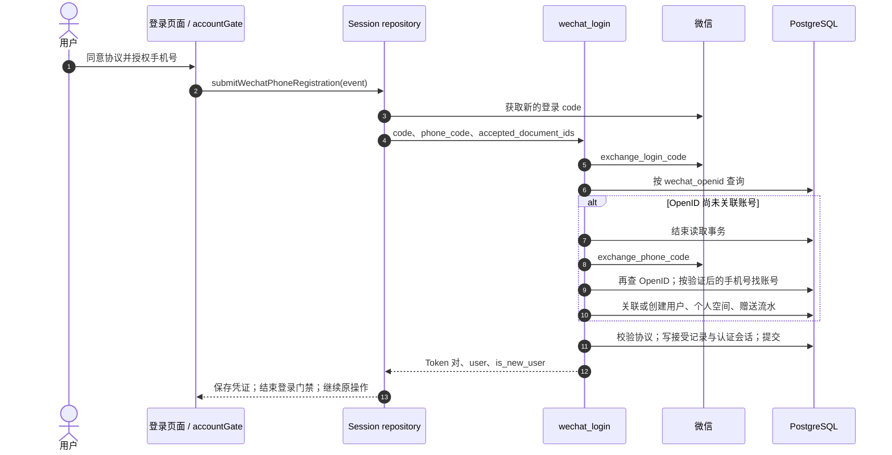
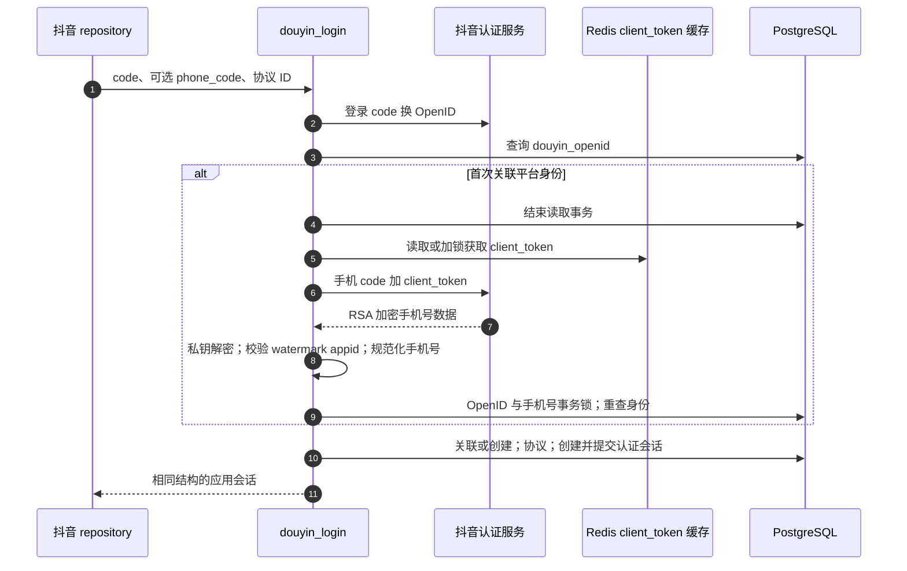
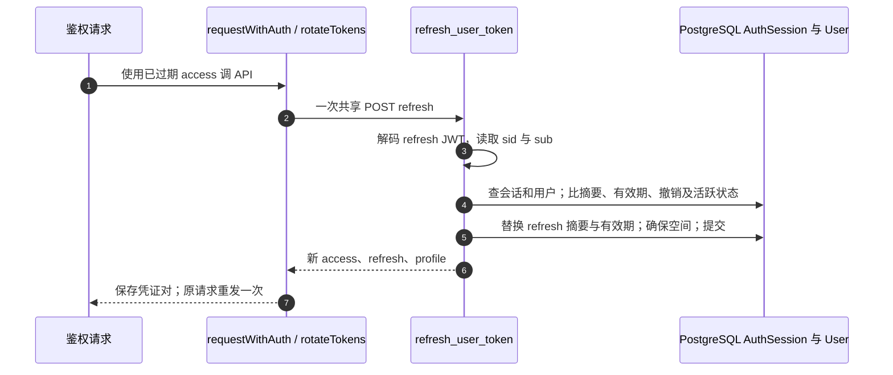

# 登录、协议、资料与账号生命周期：沿着代码追一遍

本章从一个人点开登录页面开始，追到数据库中的账号，再用同一组凭证追踪刷新、修改资料、退出和恢复账号。页面历史 URL 含有 `wechat`，正文同时覆盖微信与抖音。所有源码链接固定到[本次审计版本](/zh/reference/source-revisions)。

## 先分清四种身份 {#identity-map}

| 名称 | 存在于哪里 | 能证明什么 |
| --- | --- | --- |
| 平台 `code` | `uni.login` / `tt.login`，随后发给 API | 可由平台短期兑换 OpenID 的凭证，不是应用登录 Token。 |
| `phone_code` | 平台“授权手机号”按钮事件 | 允许服务端取得经过验证的手机号；OpenID 本身不能证明手机号。 |
| `users.id` | PostgreSQL 的 `User` 行 | 应用自己的身份。已验证手机号可以把平台身份关联到现有账号。 |
| Access / refresh token | 客户端存储；服务端 `AuthSession` 存 refresh 摘要 | Access 调用 API，refresh 换取新凭证。数据库保存 refresh 的 SHA-256 摘要，不存明文。 |

时序图从上往下读：箭头表示调用或响应，图下表格给出可直接打开的函数。`db.commit()` 结束当前数据库事务；行锁用来协调有冲突的请求，不是永久“锁住用户”。

## 微信登录：按钮 → code → 账号 → 继续原操作 {#wechat-login}

**接口：`POST /v1/auth/wechat-login`。** 功能页通过 `requestWechatRegistration` 申请登录后继续操作。老身份可以静默登录；新身份进入登录页，勾选协议并点“授权手机号并登录”。`@getphonenumber` 把平台手机授权 code 交给 `authorize(event)`，页面并没有直接读取手机号。



| 图中步骤 | 打开的具体代码 | 输入 → 输出 / 分支 |
| --- | --- | --- |
| 1–2 | [`authorize`](https://github.com/Orientation-CD/wechat_mini_program/blob/21db6d824a7b32417bda88e7e31d3f0b91dfa51c/src/pkg-account/pages/login/index.vue#L39)、[`submitWechatPhoneRegistration`](https://github.com/Orientation-CD/wechat_mini_program/blob/21db6d824a7b32417bda88e7e31d3f0b91dfa51c/src/services/accountGate.ts#L164) | UI 事件 → 已确认的协议版本与当前平台 repository。取消登录会结束门禁，不会提交受保护操作。 |
| 3–4 | [`buildRegistrationWechatLoginRequest`](https://github.com/Orientation-CD/wechat_mini_program/blob/21db6d824a7b32417bda88e7e31d3f0b91dfa51c/src/services/wechatAuth.ts#L58)、[`wechatSessionRepository`](https://github.com/Orientation-CD/wechat_mini_program/blob/21db6d824a7b32417bda88e7e31d3f0b91dfa51c/src/repositories/session.ts#L88) | 新登录 code、新手机 code、接受的 UUID → JSON。`acceptSession` 先校验响应再保存。 |
| 5–6 | [`wechat_login`](https://github.com/Orientation-CD/YuanZhu-AI/blob/e59716c83e087deda8477da5ea7b327a40cf65c5/app/identity/api.py#L313)、[`exchange_login_code`](https://github.com/Orientation-CD/YuanZhu-AI/blob/e59716c83e087deda8477da5ea7b327a40cf65c5/app/identity/wechat_auth.py#L69) | Redis 按 IP 限流；平台兑换；按 `wechat_openid` 查用户。平台拒绝是 `401`，上游不可用是 `503`。 |
| 7–10 | [`exchange_phone_code`](https://github.com/Orientation-CD/YuanZhu-AI/blob/e59716c83e087deda8477da5ea7b327a40cf65c5/app/identity/wechat_auth.py#L96)、[`wechat_login`](https://github.com/Orientation-CD/YuanZhu-AI/blob/e59716c83e087deda8477da5ea7b327a40cf65c5/app/identity/api.py#L313) | 缺少手机证明 → `428 PHONE_AUTH_REQUIRED`。平台 HTTP 前结束读事务，之后重新读身份。手机号已绑定别的 OpenID → `409 WECHAT_IDENTITY_MISMATCH`。 |
| 11 | [`record_required_acceptances`](https://github.com/Orientation-CD/YuanZhu-AI/blob/e59716c83e087deda8477da5ea7b327a40cf65c5/app/identity/legal_documents.py#L103)、[`issue_token_pair`](https://github.com/Orientation-CD/YuanZhu-AI/blob/e59716c83e087deda8477da5ea7b327a40cf65c5/app/identity/api.py#L79) | 校验当前协议、确保空间、持久化 `AuthSession`；提交后再组装响应，避免网络占用 SQL 连接。 |
| 12–13 | [`acceptSession`](https://github.com/Orientation-CD/wechat_mini_program/blob/21db6d824a7b32417bda88e7e31d3f0b91dfa51c/src/repositories/session.ts#L82)、[`finishWechatRegistration`](https://github.com/Orientation-CD/wechat_mini_program/blob/21db6d824a7b32417bda88e7e31d3f0b91dfa51c/src/services/accountGate.ts#L217) | 保存两个 Token；回到等待的操作。声称静默登录却返回 `is_new_user=true` 会被客户端判为无效响应。 |

OpenID 已知时会跳过手机号兑换和创建账号，但仍检查 `is_active`、当前协议并更新 `last_login_at`，随后创建新的持久化刷新会话。新用户积分来自 `effective_campaign_token_amount(... NEW_USER_REGISTRATION ...)`，没有活动覆盖时才用配置兜底。正数赠送在同一账号创建事务中写积分流水，页面不自行决定初始余额。

### 把请求逐字段读懂

```json
{
  "code": "fresh-platform-login-code",
  "phone_code": "fresh-phone-authorization-code",
  "accepted_document_ids": [
    "11111111-1111-4111-8111-111111111111",
    "22222222-2222-4222-8222-222222222222"
  ]
}
```

上面的 code 是占位说明，不能当作可重复测试凭证；UUID 代表协议目录实际返回的 `terms` 和 `privacy` 版本。首次绑定需要 `phone_code`，老用户一般只传 `code`。协议更新后，必须在用户实际接受新版本后取得新 code，再提交新文档 ID。

## 抖音登录：多出的 Redis 与 RSA 路径 {#douyin-login}

**接口：`POST /v1/auth/douyin-login`。** 同一登录页面在抖音运行模式下选用 `douyinSessionRepository`。`buildRegistrationDouyinLoginRequest` 取得新的 `tt.login` code 与手机授权事件 code。后端入口是 [`douyin_login`](https://github.com/Orientation-CD/YuanZhu-AI/blob/e59716c83e087deda8477da5ea7b327a40cf65c5/app/identity/api.py#L474)；平台函数是 [`exchange_login_code`](https://github.com/Orientation-CD/YuanZhu-AI/blob/e59716c83e087deda8477da5ea7b327a40cf65c5/app/identity/douyin_auth.py#L115)、[`exchange_phone_code`](https://github.com/Orientation-CD/YuanZhu-AI/blob/e59716c83e087deda8477da5ea7b327a40cf65c5/app/identity/douyin_auth.py#L331)。



| 步骤 | 源码 | 原因 |
| --- | --- | --- |
| 1 | [`buildRegistrationDouyinLoginRequest`](https://github.com/Orientation-CD/wechat_mini_program/blob/21db6d824a7b32417bda88e7e31d3f0b91dfa51c/src/services/douyinAuth.ts#L60)、[`douyinSessionRepository`](https://github.com/Orientation-CD/wechat_mini_program/blob/21db6d824a7b32417bda88e7e31d3f0b91dfa51c/src/repositories/session.ts#L171) | 运行模式选择抖音凭证，不把微信 code 发到此路由。 |
| 2–4 | [`douyin_login`](https://github.com/Orientation-CD/YuanZhu-AI/blob/e59716c83e087deda8477da5ea7b327a40cf65c5/app/identity/api.py#L474) | 先做 IP 保护与 OpenID 查询，已知活跃身份跳过手机分支。 |
| 5–6 | [`_client_token`](https://github.com/Orientation-CD/YuanZhu-AI/blob/e59716c83e087deda8477da5ea7b327a40cf65c5/app/identity/douyin_auth.py#L243)、[`exchange_phone_code`](https://github.com/Orientation-CD/YuanZhu-AI/blob/e59716c83e087deda8477da5ea7b327a40cf65c5/app/identity/douyin_auth.py#L331) | Redis 缓存供应商 `client_token` 并协调刷新所有权；无效 Token 按匹配值失效。它与应用 refresh session 是两套东西。 |
| 7–8 | [`_decrypt_phone_payload`](https://github.com/Orientation-CD/YuanZhu-AI/blob/e59716c83e087deda8477da5ea7b327a40cf65c5/app/identity/douyin_auth.py#L295) | 使用 RSA PKCS#1 v1.5 私钥解密，并拒绝属于别的应用的 watermark。这里不是微信 AES/session-key 解密。 |
| 9–11 | [`douyin_login`](https://github.com/Orientation-CD/YuanZhu-AI/blob/e59716c83e087deda8477da5ea7b327a40cf65c5/app/identity/api.py#L474)、[`issue_token_pair`](https://github.com/Orientation-CD/YuanZhu-AI/blob/e59716c83e087deda8477da5ea7b327a40cf65c5/app/identity/api.py#L79) | 对 OpenID、手机号使用事务咨询锁，协调并发首次关联；身份冲突不能靠新建第二个用户绕过。 |

无效登录/手机 code 分别是 `401 DOUYIN_LOGIN_CODE_INVALID`、`DOUYIN_PHONE_CODE_INVALID`；供应商、Redis Token 缓存或密钥/解密不可用走 unavailable 分支；手机号数据不合法是 `502 DOUYIN_PHONE_INVALID`。先查平台边界：登录不经过 submit worker 或 poll worker。

## 协议目录：先知道版本，再表达同意 {#legal-current}

**接口：`GET /v1/legal-documents/current?locale=zh-CN`。** 登录门禁调用 [`wechatSessionRepository`](https://github.com/Orientation-CD/wechat_mini_program/blob/21db6d824a7b32417bda88e7e31d3f0b91dfa51c/src/repositories/session.ts#L88) 的 `currentLegalDocuments()`。当前 UI 请求 `zh-CN`，后端也接受 locale 查询参数或使用服务端配置。

[`get_current_legal_documents`](https://github.com/Orientation-CD/YuanZhu-AI/blob/e59716c83e087deda8477da5ea7b327a40cf65c5/app/identity/legal_api.py#L23) 调用 [`current_required_documents`](https://github.com/Orientation-CD/YuanZhu-AI/blob/e59716c83e087deda8477da5ea7b327a40cf65c5/app/identity/legal_documents.py#L60)。查询把 `CurrentLegalDocument` 指针关联到不可变的 `LegalDocument` 版本，并预加载文档 Asset。当前 locale 必须恰好拥有已发布、已生效、required、纯文本且 Asset 为 ACTIVE/PUBLIC 的 `terms` 与 `privacy`。正常运行环境缺少任何条件都会拒绝继续，返回 `503 LEGAL_DOCUMENTS_UNAVAILABLE`。

接口按版本构造 ETag，结束 SQL 事务，再从存储取内容 URL；没有公开 URL 时使用内容接口。`If-None-Match` 匹配时为 `304`，普通响应使用 `Cache-Control: no-store`。前端校验两种文档类型并缓存元数据；本地缓存仅辅助展示，不能证明用户同意了新版本。

### 打开一份不可变法律文本 {#legal-content}

**接口：`GET /v1/legal-documents/{document_id}/content`。** 点击“用户协议 / 隐私政策”打开法律文本页面。线上可使用目录的公开 `content_url`；repository 的显式 `localLegalDocumentContent()` 请求用于本地 mock/LAN 模式。

[`get_current_legal_document_content`](https://github.com/Orientation-CD/YuanZhu-AI/blob/e59716c83e087deda8477da5ea7b327a40cf65c5/app/identity/legal_api.py#L83) 按 UUID 查记录，要求 `text/plain`，结束数据库事务，再用 `ObjectStorage.iter_bytes` 有界流式读取。响应携带内容 SHA 的 ETag、`nosniff` 与一年 immutable 缓存。未知或非文本 ID 返回 `404 DOCUMENT_NOT_FOUND`。“当前目录”与“按 ID 读取不可变正文”故意采用不同缓存策略。

登录时还要再校验协议。`record_required_acceptances` 对比提交 ID、**当前**版本集合和历史接受记录。多传旧 ID 或缺少新同意均返回 `409 LEGAL_ACCEPTANCE_REQUIRED`；只有本次新增接受的当前版本会写入 `LegalDocumentAcceptance`。

## 密码注册：公开契约，但当前小程序没有按钮 {#password-register}

**接口：`POST /v1/auth/register`。** 这是脚本/集成入口；当前小程序登录页面不收集密码，也不调用此 URL。前端 repository 名为 `register()` 的方法走的是平台登录，不能因同名就画成这条接口。

[`register_user`](https://github.com/Orientation-CD/YuanZhu-AI/blob/e59716c83e087deda8477da5ea7b327a40cf65c5/app/identity/api.py#L134) 先按 IP 限流、规范化 E.164 手机号、拒绝空昵称，再在**取得注册数据库槽位之前**做 Argon2 密码哈希。有界槽位避免密码计算耗尽 SQL 连接池。随后检查重复手机号（`409 PHONE_ALREADY_REGISTERED`），加载当前协议，计算活动赠送，创建 `User`、赠送流水、个人空间、协议证据，再准备 `AuthSession` 并一起提交。响应为 `201` 和 Token 对，不会调用模型供应商。

脚本发送 `phone`、`password`、`display_name`、`accepted_document_ids`。协议 ID 必须来自目录，UUID 格式正确并不等于用户已同意。密码不以明文保存；可打开 [`hash_password_async`](https://github.com/Orientation-CD/YuanZhu-AI/blob/e59716c83e087deda8477da5ea7b327a40cf65c5/app/identity/auth.py#L63)，再回到 `register_user` 看提交顺序。

## 密码登录：SQL 外验证密码，再复查状态 {#password-login}

**接口：`POST /v1/auth/login`。** 当前小程序同样没有对应 UI。[`login_user`](https://github.com/Orientation-CD/YuanZhu-AI/blob/e59716c83e087deda8477da5ea7b327a40cf65c5/app/identity/api.py#L243) 规范化手机号；在 Redis 对 IP 和账号分别限流；读用户后结束 SQL 事务，再校验 Argon2；最后重新加锁读取账号并签发会话。如果哈希计算期间账号被停用，复查可让停用状态生效。

错误手机号/密码统一返回 `401 INVALID_PHONE_OR_PASSWORD`，停用账号返回 `403 ACCOUNT_REMOVED`。密码正确后仍检查当前协议，成功才更新 `last_login_at` 并调用 `issue_token_pair`。登录返回 `200`；注册创建账号，所以返回 `201`。

## Access 过期与刷新：并发请求共用一次刷新 {#refresh}

**接口：`POST /v1/auth/refresh`。** 没有“刷新 Token”按钮。[`requestWithAuth`](https://github.com/Orientation-CD/wechat_mini_program/blob/21db6d824a7b32417bda88e7e31d3f0b91dfa51c/src/services/request.ts#L341) 处理 `auth: true` 请求中的 `401 AUTH_TOKEN_EXPIRED_OR_INVALID`。若其他请求刚换过 access，就直接复用；否则 [`rotateTokens`](https://github.com/Orientation-CD/wechat_mini_program/blob/21db6d824a7b32417bda88e7e31d3f0b91dfa51c/src/services/request.ts#L299) 共用一个 `refreshPromise`，发送 `{ "refresh_token": "当前的-refresh-token" }`，保存**两个**新 Token，再重发原请求一次。



| 步骤 | 源码 | 可观察边界 |
| --- | --- | --- |
| 1–2 | [`requestWithAuth`](https://github.com/Orientation-CD/wechat_mini_program/blob/21db6d824a7b32417bda88e7e31d3f0b91dfa51c/src/services/request.ts#L341)、[`rotateTokens`](https://github.com/Orientation-CD/wechat_mini_program/blob/21db6d824a7b32417bda88e7e31d3f0b91dfa51c/src/services/request.ts#L299) | 只有特定可刷新错误触发此流程；任意 `401` 都刷新会造成循环。 |
| 3–5 | [`refresh_user_token`](https://github.com/Orientation-CD/YuanZhu-AI/blob/e59716c83e087deda8477da5ea7b327a40cf65c5/app/identity/api.py#L650)、[`hash_refresh_token`](https://github.com/Orientation-CD/YuanZhu-AI/blob/e59716c83e087deda8477da5ea7b327a40cf65c5/app/identity/auth.py#L92) | `sid` 属于 refresh JWT。`AuthSession.user_id`、摘要、`revoked_at`、有效期与 `User.is_active` 必须符合；不满足为 `401 REFRESH_SESSION_UNAVAILABLE`。 |
| 6–7 | [`replayOnce`](https://github.com/Orientation-CD/wechat_mini_program/blob/21db6d824a7b32417bda88e7e31d3f0b91dfa51c/src/services/request.ts#L332) | 刷新或重发遇到终结性会话错误会清除状态。可以观察两个业务请求共用一个 refresh 请求。 |

Access JWT 包含 `sub`、`typ`、`iat`、`exp`；refresh 另含 `sid`、`jti`。[`get_current_user`](https://github.com/Orientation-CD/YuanZhu-AI/blob/e59716c83e087deda8477da5ea7b327a40cf65c5/app/identity/auth.py#L162) 校验 access JWT 并读取活跃 User，**不会**为每次业务请求读取 `AuthSession`。这决定了下面退出登录的实际边界。

## 退出：撤销 refresh 权限，清空客户端 {#logout}

**接口：`POST /v1/auth/logout`。** 个人资料页“退出登录”调用 [`logout`](https://github.com/Orientation-CD/wechat_mini_program/blob/21db6d824a7b32417bda88e7e31d3f0b91dfa51c/src/pkg-account/pages/profile/index.vue#L86) → repository `logout()` → [`logout_user`](https://github.com/Orientation-CD/YuanZhu-AI/blob/e59716c83e087deda8477da5ea7b327a40cf65c5/app/identity/api.py#L703)。请求体带 refresh token；服务端解码、找到会话，只在摘要匹配时写 `revoked_at`，返回 `204`。即使网络失败，repository 的 `finally` 仍清除 Token、空间选择并记录主动退出。

此接口撤销的是持久化 **refresh 会话**。已经发出的 access JWT 不会被这个 handler 单独作废，仍由 access 有效期与账号活跃检查约束；不能把退出写成所有设备的 access 立即失效。账号停用还会让 `get_current_user` 拒绝该用户。

## 读取当前资料 {#profile-get}

**接口：`GET /v1/me`。** 个人资料页 `load()` 调用 [`currentProfileRepository`](https://github.com/Orientation-CD/wechat_mini_program/blob/21db6d824a7b32417bda88e7e31d3f0b91dfa51c/src/repositories/profile.ts#L130)，repository 合并进行中的读取，并把服务端字段转换为页面模型。先经过 `get_current_user` 鉴权，再由 [`get_user_profile`](https://github.com/Orientation-CD/YuanZhu-AI/blob/e59716c83e087deda8477da5ea7b327a40cf65c5/app/identity/api.py#L731) 调用 `build_user_response`、提交并返回权威账号/空间/权益展示数据；“本地有 Token”本身不会生成资料。

具体数值来自 [`build_user_response`](https://github.com/Orientation-CD/YuanZhu-AI/blob/e59716c83e087deda8477da5ea7b327a40cf65c5/app/billing/billing.py#L523)：解析当前空间/成员资格，以个人 remaining/reserved 开始，仅当解析到企业成员资格时叠加企业 remaining/reserved；读取当前个人订阅和生效 Feature 权益；按已验证手机号查询有效且未接受的邀请；计算是否有可领取推荐奖励。返回中**同时**有 personal 与 effective，UI 再相加会重复计算个人余额。如果旧空间不可用，还可持久化安全的当前空间回退。因此 GET 返回的是多表组装视图，不是直接把 `SELECT * FROM users` 序列化。

沿 `load` → repository `get` → `get_user_profile` → 响应映射阅读。页面展示的 `displayName`、个人/有效 Token、企业与套餐数据来自这个响应。本节不包含 `/me/workspaces`、历史空间和通知，它们在协作章节有独立链路。

## 修改昵称或经过验证的手机号 {#profile-patch}

**接口：`PATCH /v1/me`。** “保存”触发 [`save`](https://github.com/Orientation-CD/wechat_mini_program/blob/21db6d824a7b32417bda88e7e31d3f0b91dfa51c/src/pkg-account/pages/profile/index.vue#L67) → `currentProfileRepository.updateDisplayName`；微信手机授权触发 `bindPhone` → `updateWechatPhone`。

[`update_user_profile`](https://github.com/Orientation-CD/YuanZhu-AI/blob/e59716c83e087deda8477da5ea7b327a40cf65c5/app/identity/api.py#L742) 去除昵称首尾空格、拒绝空值。`phone` 字段走直接规范化；`wechat_phone_code` 则要求已有微信身份，并在释放鉴权读取事务后兑换新的平台证明。再检查手机号是否被别的用户占用（`409 PHONE_ALREADY_LINKED`），修改 User、flush/commit、重建资料并返回。页面采用响应更新显示。当前 UI 没有把 raw-phone setter 暴露成直接输入手机号的捷径。

`{ "display_name": "新同事" }` 修改昵称；`{ "wechat_phone_code": "新的手机授权-code" }` 修改经微信验证的手机号。它们的验证路径不同，不能当作可随意互换的参数。

### 同一个 PATCH 还负责确认切换空间

`{ "current_workspace_id": "有权访问的空间-UUID" }` 走 `update_user_profile` 的第三分支：先调用 [`accessible_workspace`](https://github.com/Orientation-CD/YuanZhu-AI/blob/e59716c83e087deda8477da5ea7b327a40cf65c5/app/workspaces/workspaces.py#L224)，再改 `User.current_workspace_id`、提交并重建资料。客户端是 [`workspaceContextRepository`](https://github.com/Orientation-CD/wechat_mini_program/blob/21db6d824a7b32417bda88e7e31d3f0b91dfa51c/src/repositories/workspaces.ts#L9) 的 `select()` → `currentProfileRepository.selectWorkspace()`。

这里有容易误读的 UI 边界：在首页面板浏览别的空间时，可以只加载**预览**，并不修改服务端当前空间；确认路径才提交，[`confirmWorkspace`](https://github.com/Orientation-CD/wechat_mini_program/blob/21db6d824a7b32417bda88e7e31d3f0b91dfa51c/src/components/home/HomeScopeSwitch.vue#L386) 是其中一个具体入口。PATCH 后 repository 还检查会话代数、返回空间是否为目标，再记住草稿作用域与初始化项目上下文。随便拿一个空间 UUID 不够，服务端仍检查成员资格和空间活跃状态。

## 停用账号 {#account-deactivate}

**接口：`POST /v1/me/deactivate`。** 当前是契约/脚本入口：小程序有“退出”，没有调用此接口。[`deactivate_current_user`](https://github.com/Orientation-CD/YuanZhu-AI/blob/e59716c83e087deda8477da5ea7b327a40cf65c5/app/identity/account_lifecycle_api.py#L67) 鉴权后，将配置的宽限天数传给 [`deactivate_user_account`](https://github.com/Orientation-CD/YuanZhu-AI/blob/e59716c83e087deda8477da5ea7b327a40cf65c5/app/billing/billing.py#L1564)。

服务获取共享的 `active-design-job-admission` 事务锁，复查 ACTIVE 状态；存在运行任务时拒绝（`ACCOUNT_ACTIVE_JOBS`），仍拥有活跃企业时拒绝（`OWNER_ACTIVE_ENTERPRISE`）；符合条件才改为 DEACTIVATED/inactive，写 `deactivated_at`、`anonymize_after`，并撤销全部未撤销的 refresh 会话。路由提交后返回 `204`。这开始可恢复宽限期，不是立即抹去数据库身份或自动获得一个新账号。

## 用密码恢复 {#password-reactivate}

**接口：`POST /v1/auth/reactivate`。** 契约/脚本入口。[`reactivate_with_password`](https://github.com/Orientation-CD/YuanZhu-AI/blob/e59716c83e087deda8477da5ea7b327a40cf65c5/app/identity/account_lifecycle_api.py#L84) 接收 `phone` 与 `password`，按 IP/账号限流，在读取事务外校验 Argon2，再调用 [`reactivate_deactivated_user_account`](https://github.com/Orientation-CD/YuanZhu-AI/blob/e59716c83e087deda8477da5ea7b327a40cf65c5/app/billing/billing.py#L1723)。共享生命周期锁与资格校验阻止超出状态/窗口的恢复，冲突为 `409 ACCOUNT_STATE_CONFLICT`。成功返回 `204`，**不返回 Token**，之后要重新登录。

## 恢复微信关联账号 {#wechat-reactivate}

**接口：`POST /v1/auth/wechat-reactivate`。** 当前前端没有调用 UI。[`reactivate_with_wechat`](https://github.com/Orientation-CD/YuanZhu-AI/blob/e59716c83e087deda8477da5ea7b327a40cf65c5/app/identity/account_lifecycle_api.py#L129) 限流、兑换新平台 code、查现有 `wechat_openid`、调用共享恢复服务并提交。未知身份为 `403 ACCOUNT_REACTIVATION_UNAVAILABLE`，平台失败保留微信错误码；不能传任意用户 ID，也不会创建新用户。成功 `204` 后仍要重新登录。

## 恢复抖音关联账号 {#douyin-reactivate}

**接口：`POST /v1/auth/douyin-reactivate`。** 这条已有 UI：[`offerDouyinReactivation`](https://github.com/Orientation-CD/wechat_mini_program/blob/21db6d824a7b32417bda88e7e31d3f0b91dfa51c/src/services/accountGate.ts#L48) 在停用账号登录响应后提供恢复；`douyinSessionRepository.reactivate()` 获取新 code。[`reactivate_with_douyin`](https://github.com/Orientation-CD/YuanZhu-AI/blob/e59716c83e087deda8477da5ea7b327a40cf65c5/app/identity/account_lifecycle_api.py#L168) 限流、验证 code、找 `douyin_openid`、调用共享恢复服务并提交 `204`。门禁随后重试登录，恢复操作自身不签发凭证。

## 数据写入、定位失败与跟读练习 {#identity-debug}

| 证据 | 读写者 | 应对照什么 |
| --- | --- | --- |
| `User` | 平台/密码登录、资料修改、生命周期服务 | 应用 UUID、手机号/平台绑定、活跃状态与时间戳。截图不要泄露手机证明或 Token。 |
| `LegalDocumentAcceptance` | `record_required_acceptances` | 用户与不可变协议版本。本地改元数据不会产生服务端证据。 |
| `AuthSession` | `prepare_token_pair`、刷新、退出/停用 | Refresh 摘要、有效期、撤销时间。没有可恢复的明文密码/Token 列。 |
| `TokenLedgerEntry` 与个人空间记录 | 首次创建账号 | 初始赠送、空间与注册一起提交；关联现有手机号账号不能再次算新用户奖励。 |
| Redis | 限流、抖音供应商 client_token 缓存 | 与 PostgreSQL 登录会话是不同用途；不涉及工作流队列。 |

在获得授权的本地 mock 身份环境，用可丢弃账号跟读：

1. 打开登录 Vue 文件找 `@getphonenumber="authorize"`，沿微信表格前两行的四个代码链接阅读；Network 中找协议 GET 和登录 POST。预期：提交的协议 ID 就是展示过的版本。
2. 在 `wechat_login` 的 `exchange_login_code` 后停下，在纸上分别走已知 OpenID 与首次关联路径。预期：只有后者调用手机接口；`428` 是索取证明的业务分支，不是服务崩溃。
3. 登录成功后只查看脱敏后的 Token 对结构，并读 `prepare_token_pair`；对照 User 与 AuthSession 身份。预期：一个应用账号，加一条持久化 refresh 摘要。
4. 用项目本地认证测试设置构造 access 过期，再同时发两个鉴权读取。预期：一次共享刷新、两个 Token 都替换、每个原请求至多重发一次；持续 `401` 应结束会话。
5. 测试前先并排读退出与停用服务。预期：退出撤销一条匹配 refresh 会话；停用还修改用户状态并检查任务/企业所有权阻塞。不要在真实账号上做生命周期实验。

协议失败先查当前指针与接受 ID；平台兑换失败先查模式、URL、密钥及脱敏 request ID；刷新失败先查会话摘要/有效期/撤销。一个还没有创建工作流的登录事务，无法从 submit/poll worker 日志里查出原因。
