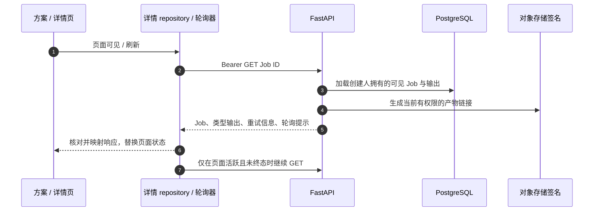
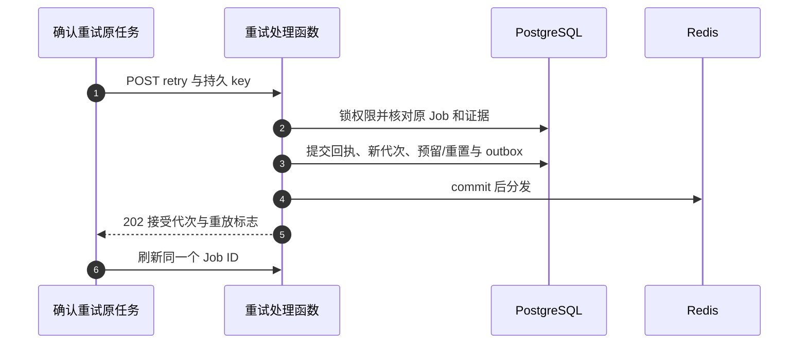

# 历史、轮询、重试、移动与删除

任务的寿命长于提交表单。本章从“我的方案”和结果页出发，跟进读取/操作 API 的 SQL 授权和持久状态。创建和 worker 执行先读[生命周期](/zh/reference/flows/design-job-lifecycle)。

## 一次详情刷新，全链路发生了什么 {#detail-chain}

| 消息 | 代码 | 应该找到什么 |
| --- | --- | --- |
| 1 | [src/services/pollScheduler.ts → createPollScheduler](https://github.com/Orientation-CD/wechat_mini_program/blob/21db6d824a7b32417bda88e7e31d3f0b91dfa51c/src/services/pollScheduler.ts#L33) | 可见性、单个在途请求、计时器、代次保护 |
| 2 | [src/repositories/designJobDetail.ts → designJobRepository](https://github.com/Orientation-CD/wechat_mini_program/blob/21db6d824a7b32417bda88e7e31d3f0b91dfa51c/src/repositories/designJobDetail.ts#L189) | canonical/compatibility 路径开关与类型映射 |
| 3 | [_get_design_job_response](https://github.com/Orientation-CD/YuanZhu-AI/blob/e59716c83e087deda8477da5ea7b327a40cf65c5/app/workflows/api.py#L1320) | 可见历史、创建者或当前企业 owner 复核；不调用供应商 |
| 4–5 | [app/workflows/api.py → job_response](https://github.com/Orientation-CD/YuanZhu-AI/blob/e59716c83e087deda8477da5ea7b327a40cf65c5/app/workflows/api.py#L760) | 读取输出、签新 URL、提供 retry 和 `poll_after_seconds` |
| 6–7 | repository 中 `mapDesignJobDetail` 和轮询器 | 丢弃过时响应，终态停止调度 |

当前后端允许创建者或活动企业的当前 owner 按 ID 读取可见任务。共享 `_get_design_job_response` 重新检查活动成员关系；owner 查看他人任务时保留真实提交者，返回 `inputs: []`，不授予重试、移动、删除或源素材复制。前端 `readOwnerListJob` 仍保留特定 404 后的显式空间集合 fallback；它不再意味着当前主线的所有按 ID 读取都限创建者。不得吞掉任意错误或偷偷切换工作区。

## 列表与读取端点

### 个人 canonical 列表 {#list-workflows}

`GET /v1/workflows` 由方案/历史界面的 [src/repositories/designJobs.ts → personalDesignJobRepository](https://github.com/Orientation-CD/wechat_mini_program/blob/21db6d824a7b32417bda88e7e31d3f0b91dfa51c/src/repositories/designJobs.ts#L468) 发起。[app/workflows/api.py → list_design_jobs](https://github.com/Orientation-CD/YuanZhu-AI/blob/e59716c83e087deda8477da5ea7b327a40cf65c5/app/workflows/api.py#L1391) 限定 `DesignJob.user_id` 为调用者，使用 `creator_root_history()`，再按可选 workspace/project、任务名 `q`、status 过滤；count、分页、预加载输出关系，每项调用 `job_response`。指定 Project 必须属于本人、处于 active，且与 workspace 筛选一致。它不启动 worker、不调模型。前端按稳定 Job ID 合并页，写操作后使项目计数缓存失效。

### 兼容个人列表 {#list-compatibility}

`GET /v1/design-jobs` 绑定同一个 `list_design_jobs`，过滤规则相同。它是已弃用别名，便于定位旧调用者；当前 `personalDesignJobRepository.list` 使用 `/v1/workflows`。别名不是另一张历史表，不会多暴露任务。

### canonical 详情与轮询 {#get-workflow}

`GET /v1/workflows/{workflow_id}` 进入 `get_workflow` → [_get_design_job_response](https://github.com/Orientation-CD/YuanZhu-AI/blob/e59716c83e087deda8477da5ea7b327a40cf65c5/app/workflows/api.py#L1320)。`workflow_id` 就是公开 `design_jobs.id`。加载器先限定可见历史，再允许创建者或当前活动企业 owner；不存在、不可见或无权访问统一返回 `404 DESIGN_JOB_NOT_FOUND`。响应读取报告依赖重试信息、缩略图，以 [job_response](https://github.com/Orientation-CD/YuanZhu-AI/blob/e59716c83e087deda8477da5ea7b327a40cf65c5/app/workflows/api.py#L760) 投影，`submitted_by` 保留真实创建者；owner 查看他人时 `inputs: []`。服务端按需提供 `Retry-After`／`poll_after_seconds` 和新签名 URL。GET 不重复生成或结算，也不授予写权限。

### 兼容详情 {#get-compatibility}

`GET /v1/design-jobs/{design_job_id}` 进入 `get_design_job`，复用 `_get_design_job_response`。图片/语音/视频详情调用可在 [src/repositories/designJobDetail.ts → designJobRepository](https://github.com/Orientation-CD/wechat_mini_program/blob/21db6d824a7b32417bda88e7e31d3f0b91dfa51c/src/repositories/designJobDetail.ts#L189) 中选这个路径，创建者／owner 的可见性和输出投影规则相同。URL 参数变量名变化不改变 Job 身份。

### 显式选定空间的 owner 列表 {#list-owner-workflows}

`GET /v1/workspace/workflows` 进入 [app/workflows/api.py → list_workspace_design_jobs](https://github.com/Orientation-CD/YuanZhu-AI/blob/e59716c83e087deda8477da5ea7b327a40cf65c5/app/workflows/api.py#L1481)，必填 `workspace_id`，要求该空间的活动成员关系且 role 为 `OWNER`，否则 `403 WORKSPACE_OWNER_REQUIRED`。SQL 限定 workspace、可见 Project 生命周期和根任务；可选 Project 必须是此空间 active 普通项目。序列化使用原提交者，并在调用者不是创建人时隐藏私有输入（`expose_private_inputs=False`）。owner 任务集合与“列出自己的私有 Projects”不同。当前 owner fallback 仍走下面的兼容别名，新集成可用此 canonical 路径。

### 兼容 owner 列表 {#list-owner-compatibility}

`GET /v1/workspace/design-jobs` 也绑定 `list_workspace_design_jobs`。[src/repositories/designJobDetail.ts → readOwnerListJob](https://github.com/Orientation-CD/wechat_mini_program/blob/21db6d824a7b32417bda88e7e31d3f0b91dfa51c/src/repositories/designJobDetail.ts#L149) 显式传 `workspace_id`，开关启用时传成员 Project scope；有界扫描分页，逐项校验选定成员/空间/项目，上下文变化就失败关闭，不猜测全局“当前企业”。

## 显式重试是一个持久动作 {#retry-workflow}

`POST /v1/workflows/{design_job_id}/retry` 由 [src/services/jobRetry.ts → retryDesignJob](https://github.com/Orientation-CD/wechat_mini_program/blob/21db6d824a7b32417bda88e7e31d3f0b91dfa51c/src/services/jobRetry.ts#L45) 为报告/文案选择。“重试原任务”先刷新状态和写入权限，以 Job ID、预期 retry count 为作用域保存 key。路由 [app/workflows/api.py → retry_failed_design_job](https://github.com/Orientation-CD/YuanZhu-AI/blob/e59716c83e087deda8477da5ea7b327a40cf65c5/app/workflows/api.py#L1159) 调 [app/workflows/submissions/workflow_submission_retry.py → retry_workflow_job](https://github.com/Orientation-CD/YuanZhu-AI/blob/e59716c83e087deda8477da5ea7b327a40cf65c5/app/workflows/submissions/workflow_submission_retry.py#L185)，再尝试分发已提交 outbox，返回 **202**、`accepted_retry_generation`、`retry_replayed` 与当前 Job。

控制器锁定准入/产品/聚合权限，核对原创建人、冻结执行/商业证据、删除/管理员失败/供应商不确定状态和重试上限。报告 child 要通过父任务重试，否则 `WORKFLOW_PARENT_RETRY_REQUIRED`。受理时写 `design_job_retry_requests`、推进代次、调度合格的重置 child，不创建新公开 Job。冻结价格和后端规则决定新预留，客户端不能另算节点费用，也不能手动释放旧预留。

| 消息 | 代码 |
| --- | --- |
| 1、5–6 | [src/services/jobRetry.ts → retryDesignJob](https://github.com/Orientation-CD/wechat_mini_program/blob/21db6d824a7b32417bda88e7e31d3f0b91dfa51c/src/services/jobRetry.ts#L45) |
| 2–3 | [app/workflows/submissions/workflow_submission_retry.py → retry_workflow_job](https://github.com/Orientation-CD/YuanZhu-AI/blob/e59716c83e087deda8477da5ea7b327a40cf65c5/app/workflows/submissions/workflow_submission_retry.py#L185) |
| 4 | [app/workflows/api.py → retry_failed_design_job](https://github.com/Orientation-CD/YuanZhu-AI/blob/e59716c83e087deda8477da5ea7b327a40cf65c5/app/workflows/api.py#L1159) 调用的 `dispatch_workflow_submission_outbox` |

响应丢失时保留 retry key。即使 Job 随后推进，持久回执也能区分重放与第二次尝试。`retry_block_code` 要求对账时，反复点按钮不能证明收费 POST 没发生。并非结果页所有“返回重新提交”都是同 ID 重试；专用历史动作和回执才是证据。

### 重试与成员额度

显式重试使用冻结价格申请新一轮预留；企业余额检查仍先于成员额度。新预留使用当前北京时间月份，原代次释放计零，跨月结算仍归原预留月。降低额度不撤销已接受任务；精确幂等重放也不额外预留。见[额度全链路](/zh/reference/flows/member-quota-flow)。

### 兼容重试 {#retry-compatibility}

`POST /v1/design-jobs/{design_job_id}/retry` 同样使用 `retry_failed_design_job`。[src/services/jobRetry.ts → retryDesignJob](https://github.com/Orientation-CD/wechat_mini_program/blob/21db6d824a7b32417bda88e7e31d3f0b91dfa51c/src/services/jobRetry.ts#L45) 为支持的非报告/非文案产品选它。仍是同一套回执和代次机制，不是客户端重新拼一次表单；key、权限和外部效果不确定性检查一致。

## 移动一个终态 Job {#move-workflow}

`POST /v1/workflows/{design_job_id}/move` 进入 [app/workflows/api.py → move_design_job_route](https://github.com/Orientation-CD/YuanZhu-AI/blob/e59716c83e087deda8477da5ea7b327a40cf65c5/app/workflows/api.py#L1464) → [app/workspaces/project_jobs.py → move_design_job](https://github.com/Orientation-CD/YuanZhu-AI/blob/e59716c83e087deda8477da5ea7b327a40cf65c5/app/workspaces/project_jobs.py#L77)。body 的 `expected_source_project_id`、`target_project_id` 提供乐观并发检查。服务锁本人 Job，重新确认 workspace 访问权，要求终态且未在删除，再按稳定顺序锁源/目标 Project。两个 Project 都必须 active、属于本人且在同一空间。更新 `job.project_id`、记录根任务项目活动、提交，响应返回真实 Job ID/Project ID。它不复制字节、不重新收费、不跨空间移动。源已过时返回 `409 PROJECT_SOURCE_STALE`，应刷新，不覆盖别人的较新操作。

### 当前 UI 使用的兼容移动 {#move-compatibility}

`POST /v1/design-jobs/{design_job_id}/move` 到同一个 `move_design_job_route`。[src/repositories/projectContext.ts → projectContextRepository](https://github.com/Orientation-CD/wechat_mini_program/blob/21db6d824a7b32417bda88e7e31d3f0b91dfa51c/src/repositories/projectContext.ts#L181) 从“我的方案”移动动作发送该别名，带选定源/目标和会话/scope 保护；成功后使两边计数失效，scope 已变化就拒绝应用迟到响应。canonical move 当前没有独立前端调用点。

## 删除一个终态 Job {#delete-workflow}

`DELETE /v1/workflows/{design_job_id}` 进入 [app/workflows/api.py → delete_design_job](https://github.com/Orientation-CD/YuanZhu-AI/blob/e59716c83e087deda8477da5ea7b327a40cf65c5/app/workflows/api.py#L1220) → [app/workflows/design_job.py → delete_terminal_design_job](https://github.com/Orientation-CD/YuanZhu-AI/blob/e59716c83e087deda8477da5ea7b327a40cf65c5/app/workflows/design_job.py#L165)。当前 `personalDesignJobRepository.remove` 为文案选此路径，其余产品走别名。只允许创建人删除可见 Job。服务拒绝活动 Job 和仍被引用的输出，claim 删除、清理精确存储版本及关联 SQL，并保留受保护恢复路径。可能返回 `409 DESIGN_JOB_ACTIVE`、`DESIGN_JOB_REFERENCED`、`ASSET_STATE_CONFLICT`，或带重试提示的 `503 DESIGN_JOB_CLEANUP_UNAVAILABLE`。**204** 证明这个端点成功删除，不授予任意 Asset 删除权。

### 兼容删除 {#delete-compatibility}

`DELETE /v1/design-jobs/{design_job_id}` 绑定同一个 `delete_design_job`。[src/services/jobDeletion.ts → deleteJobWithConflictRetry](https://github.com/Orientation-CD/wechat_mini_program/blob/21db6d824a7b32417bda88e7e31d3f0b91dfa51c/src/services/jobDeletion.ts#L9) 有界重试冲突并核对上下文，[src/repositories/designJobs.ts → personalDesignJobRepository](https://github.com/Orientation-CD/wechat_mini_program/blob/21db6d824a7b32417bda88e7e31d3f0b91dfa51c/src/repositories/designJobs.ts#L468) 在调用周围使项目计数失效。不要把删除失败的任务永久藏起来，也不要通过改 SQL 跳过对象清理。报告/来源引用可能需要先做明确的上游处理。

## 认证后下载媒体 {#result-workflow}

`GET /v1/workflows/{design_job_id}/result-file` 进入 [app/workflows/api.py → download_design_result](https://github.com/Orientation-CD/YuanZhu-AI/blob/e59716c83e087deda8477da5ea7b327a40cf65c5/app/workflows/api.py#L1559)，加载可见 completed Job 及媒体 Asset，允许原创建人或活动工作区 owner，要求 object version 与 ETag。存储能签下载时返回 **307**，指向精确对象版本，并带私有缓存/ETag；否则后端流式返回字节。不存在、未完成、无权限都用不泄露信息的 404，不生成任务、不入队。

### resolver 使用的兼容媒体下载 {#result-compatibility}

`GET /v1/design-jobs/{design_job_id}/result-file` 仍是 `download_design_result`。前端 resolver 只接受配置 API origin 下这个精确的认证 API path，[src/repositories/resultFile.ts → materializeResultFile](https://github.com/Orientation-CD/wechat_mini_program/blob/21db6d824a7b32417bda88e7e31d3f0b91dfa51c/src/repositories/resultFile.ts#L124) 下载时加 Bearer。已签存储 URL 走另一分支，校验 origin 与过期时间。canonical download 供 API 客户端使用，但 resolver 的认证 fallback 目前是此别名。不要把 API 凭据附到存储签名 URL。HTML/PPTX 浏览是不同的限时 query-token 边界，见[报告发布](/zh/reference/flows/report-view-flow)。

## 不新建收费任务的练习 {#exercise}

在本地打开已有终态任务，分别记录 list GET、detail GET 和 output URL。隐藏页面，观察 `createPollScheduler` 停止发起新请求；重开后解释哪个 URL 被刷新。读重试源码，区分持久回执和新建 POST，无需点击真实收费重试。针对本人本地终态任务，查看移动的预期源/目标 payload 与服务端 stale-source 分支。解释为什么企业 owner 能读某些输出，却不能修改另一创建人的 Job。
