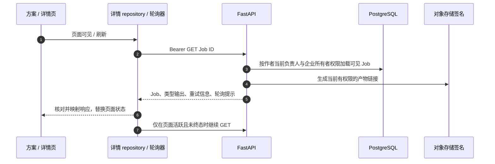
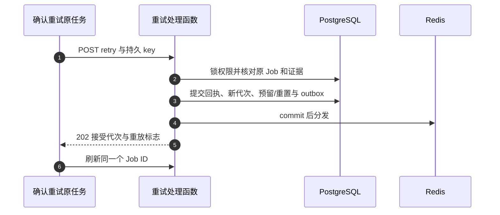

# 历史、轮询、重试、移动与删除

任务的寿命长于提交表单。本章从“我的方案”和结果页出发，跟进读取/操作 API 的 SQL 授权和持久状态。创建和 worker 执行先读[生命周期](/zh/reference/flows/design-job-lifecycle)。

## 一次详情刷新，全链路发生了什么 {#detail-chain}

| 消息 | 代码 | 应该找到什么 |
| --- | --- | --- |
| 1 | [src/services/pollScheduler.ts → createPollScheduler](https://github.com/Orientation-CD/wechat_mini_program/blob/7f1a3169338c10bd4139c24318f7a35caf86310c/src/services/pollScheduler.ts#L33) | 可见性、单个在途请求、计时器、代次保护 |
| 2 | [src/repositories/designJobDetail.ts → designJobRepository](https://github.com/Orientation-CD/wechat_mini_program/blob/7f1a3169338c10bd4139c24318f7a35caf86310c/src/repositories/designJobDetail.ts#L196) | canonical/compatibility 路径开关与类型映射 |
| 3 | [_get_design_job_response](https://github.com/Orientation-CD/YuanZhu-AI/blob/f34b8a4d6307c83c6f7bbc905485a4f586d59a99/app/workflows/api.py#L1428) | 可见历史、作者／当前负责人／企业 owner 复核；不调用供应商 |
| 4–5 | [app/workflows/api.py → job_response](https://github.com/Orientation-CD/YuanZhu-AI/blob/f34b8a4d6307c83c6f7bbc905485a4f586d59a99/app/workflows/api.py#L810) | 读取输出、签新 URL、提供 retry 和 `poll_after_seconds` |
| 6–7 | repository 中 `mapDesignJobDetail` 和轮询器 | 丢弃过时响应，终态停止调度 |

当前后端使用 `readable_design_job`：活动的原作者、当前企业 owner，或具有活动企业成员关系的当前项目负责人可按 ID 读取可见任务。原作者交接／离开企业后可保留历史读取，并不保留项目导航或新操作权限。`_get_design_job_response` 对已授权的按 ID 详情明确使用 `expose_private_inputs=True`，因此 owner／受指派人能读输入 Asset；列表投影则隐藏其他作者的 `inputs`。响应保留真实 `submitted_by`，补充当前 `project_assignee` 与 `permissions`，并由 `finalize_workflow_reads` 在签名后用标量 SQL 重查权限。能读输入不等于能将其用于新的收费请求，也不等于能继续编辑、重试、移动或删除他人的 Job。前端 `readOwnerListJob` 仍保留特定 404 后的显式空间集合 fallback；它不再意味着当前主线的所有按 ID 读取都限创建者。不得吞掉任意错误或偷偷切换工作区。

## 列表与读取端点

### canonical 历史列表 {#list-workflows}

`GET /v1/workflows` 由方案/历史界面的 [src/repositories/designJobs.ts → personalDesignJobRepository](https://github.com/Orientation-CD/wechat_mini_program/blob/7f1a3169338c10bd4139c24318f7a35caf86310c/src/repositories/designJobs.ts#L490) 发起。[app/workflows/api.py → list_design_jobs](https://github.com/Orientation-CD/YuanZhu-AI/blob/f34b8a4d6307c83c6f7bbc905485a4f586d59a99/app/workflows/api.py#L1497) 使用 `creator_root_history()`；未传项目时限定 `DesignJob.user_id` 为调用者，指定可读 `project_id` 时返回该项目的根任务，包括前任作者，再按可选 workspace、任务名 `q`、status 过滤；count、分页、预加载输出关系，每项调用 `job_response`。指定 Project 必须满足当前 `readable_project` 的负责人／owner 规则、处于 active，且与 workspace 筛选一致。列表中非作者条目隐藏私有输入；按 ID 详情使用独立的输入投影。它不启动 worker、不调模型。前端按稳定 Job ID 合并页，写操作后使项目计数缓存失效。

### 兼容个人列表 {#list-compatibility}

`GET /v1/design-jobs` 绑定同一个 `list_design_jobs`，过滤规则相同。它是已弃用别名，便于定位旧调用者；当前 `personalDesignJobRepository.list` 使用 `/v1/workflows`。别名不是另一张历史表，不会多暴露任务。

### canonical 详情与轮询 {#get-workflow}

`GET /v1/workflows/{workflow_id}` 进入 `get_workflow` → [_get_design_job_response](https://github.com/Orientation-CD/YuanZhu-AI/blob/f34b8a4d6307c83c6f7bbc905485a4f586d59a99/app/workflows/api.py#L1428)。`workflow_id` 就是公开 `design_jobs.id`。加载器以 `readable_design_job` 限定可见历史，允许原作者、具有成员关系的当前项目负责人或活动企业 owner；不存在、不可见或无权访问统一返回 `404 DESIGN_JOB_NOT_FOUND`。响应读取报告依赖重试信息、缩略图，以 [job_response](https://github.com/Orientation-CD/YuanZhu-AI/blob/f34b8a4d6307c83c6f7bbc905485a4f586d59a99/app/workflows/api.py#L810) 投影，`submitted_by` 保留真实创建者；已授权详情读者会取得输入 Asset（`expose_private_inputs=True`）。`finalize_workflow_reads` 再次核验访问权并计算当前负责人／操作权限；删除中详情按下文规则脱敏。服务端按需提供 `Retry-After`／`poll_after_seconds` 和新签名 URL。GET 不重复生成或结算，也不授予写权限。

### 兼容详情 {#get-compatibility}

`GET /v1/design-jobs/{design_job_id}` 进入 `get_design_job`，复用 `_get_design_job_response`。图片/语音/视频详情调用可在 [src/repositories/designJobDetail.ts → designJobRepository](https://github.com/Orientation-CD/wechat_mini_program/blob/7f1a3169338c10bd4139c24318f7a35caf86310c/src/repositories/designJobDetail.ts#L196) 中选这个路径，作者／负责人／owner 的可见性、获授权输入详情投影和最终权限检查规则相同。URL 参数变量名变化不改变 Job 身份。

### 显式选定空间的 owner 列表 {#list-owner-workflows}

`GET /v1/workspace/workflows` 进入 [app/workflows/api.py → list_workspace_design_jobs](https://github.com/Orientation-CD/YuanZhu-AI/blob/f34b8a4d6307c83c6f7bbc905485a4f586d59a99/app/workflows/api.py#L1591)，必填 `workspace_id`，要求该空间的活动成员关系且 role 为 `OWNER`，否则 `403 WORKSPACE_OWNER_REQUIRED`。SQL 限定 workspace、可见 Project 生命周期和根任务；可选 Project 必须是此空间 active 普通项目。序列化使用原提交者，并在调用者不是创建人时隐藏私有输入（`expose_private_inputs=False`）。owner 任务集合与“列出自己的私有 Projects”不同。当前 owner fallback 仍走下面的兼容别名，新集成可用此 canonical 路径。

### 兼容 owner 列表 {#list-owner-compatibility}

`GET /v1/workspace/design-jobs` 也绑定 `list_workspace_design_jobs`。[src/repositories/designJobDetail.ts → readOwnerListJob](https://github.com/Orientation-CD/wechat_mini_program/blob/7f1a3169338c10bd4139c24318f7a35caf86310c/src/repositories/designJobDetail.ts#L156) 显式传 `workspace_id`，开关启用时传成员 Project scope；有界扫描分页，逐项校验选定成员/空间/项目，上下文变化就失败关闭，不猜测全局“当前企业”。

### 可读权限与操作提示

| 场景 | 输入投影 | 新操作权限 |
| --- | --- | --- |
| 未按项目过滤的原作者历史 | 除删除中外返回本人输入 | 每个动作独立检查当前负责人与成员／生命周期规则 |
| 可读项目集合／owner 集合 | 隐藏其他作者输入 | 集合可见不授予修改权限 |
| 作者、当前负责人或 owner 获授权按 ID 详情 | 除删除中外暴露输入 Asset | 仍由服务端 `permissions` 决定，读取输入不等于允许复用来源 |
| 原作者交接以后 | 空间／项目生命周期允许时保留任务历史 | `PROJECT_NOT_ASSIGNEE` 阻止原作者新操作，项目导航可能不可用 |

`finalize_workflow_reads` 在签名后使用新 SQL，依据作者身份、当前负责人、活动范围、终态／删除状态和重试证据设置 can_open_project、can_move、can_delete、can_retry、can_continue_editing。新移动／重试／继续编辑通常要求原作者仍是负责人且处于活动范围。新删除 claim 的负责人检查有意不要求历史作者仍有成员关系；已领取清理又是另一种情况。前端将提示与新资料／空间成员关系及会话保护结合，不把 owner 身份当作写权限，其 UI 规则也可能比服务端保留历史清理规则更严格。

源码：[finalize_workflow_reads](https://github.com/Orientation-CD/YuanZhu-AI/blob/f34b8a4d6307c83c6f7bbc905485a4f586d59a99/app/workflows/read_access.py#L117) · [require_job_assignee](https://github.com/Orientation-CD/YuanZhu-AI/blob/f34b8a4d6307c83c6f7bbc905485a4f586d59a99/app/workspaces/project_jobs.py#L155) · [canReadJob](https://github.com/Orientation-CD/wechat_mini_program/blob/7f1a3169338c10bd4139c24318f7a35caf86310c/src/services/jobReadAccess.ts#L7) · [canWriteJob](https://github.com/Orientation-CD/wechat_mini_program/blob/7f1a3169338c10bd4139c24318f7a35caf86310c/src/services/jobWriteAccess.ts#L47)。

## 显式重试是一个持久动作 {#retry-workflow}

`POST /v1/workflows/{design_job_id}/retry` 由 [src/services/jobRetry.ts → retryDesignJob](https://github.com/Orientation-CD/wechat_mini_program/blob/7f1a3169338c10bd4139c24318f7a35caf86310c/src/services/jobRetry.ts#L47) 为报告/文案选择。“重试原任务”先刷新状态和写入权限，以 Job ID、预期 retry count 为作用域保存 key。路由 [app/workflows/api.py → retry_failed_design_job](https://github.com/Orientation-CD/YuanZhu-AI/blob/f34b8a4d6307c83c6f7bbc905485a4f586d59a99/app/workflows/api.py#L1264) 调 [app/workflows/submissions/workflow_submission_retry.py → retry_workflow_job](https://github.com/Orientation-CD/YuanZhu-AI/blob/f34b8a4d6307c83c6f7bbc905485a4f586d59a99/app/workflows/submissions/workflow_submission_retry.py#L187)，再尝试分发已提交 outbox，返回 **202**、`accepted_retry_generation`、`retry_replayed` 与当前 Job。

控制器锁定准入/产品/聚合权限，对新重试核对原创建人及当前项目负责人、冻结执行/商业证据、删除/管理员失败/供应商不确定状态和重试上限。报告 child 要通过父任务重试，否则 `WORKFLOW_PARENT_RETRY_REQUIRED`。受理时写 `design_job_retry_requests`、推进代次、调度合格的重置 child，不创建新公开 Job。冻结价格和后端规则决定新预留，客户端不能另算节点费用，也不能手动释放旧预留。

| 消息 | 代码 |
| --- | --- |
| 1、5–6 | [src/services/jobRetry.ts → retryDesignJob](https://github.com/Orientation-CD/wechat_mini_program/blob/7f1a3169338c10bd4139c24318f7a35caf86310c/src/services/jobRetry.ts#L47) |
| 2–3 | [app/workflows/submissions/workflow_submission_retry.py → retry_workflow_job](https://github.com/Orientation-CD/YuanZhu-AI/blob/f34b8a4d6307c83c6f7bbc905485a4f586d59a99/app/workflows/submissions/workflow_submission_retry.py#L187) |
| 4 | [app/workflows/api.py → retry_failed_design_job](https://github.com/Orientation-CD/YuanZhu-AI/blob/f34b8a4d6307c83c6f7bbc905485a4f586d59a99/app/workflows/api.py#L1264) 调用的 `dispatch_workflow_submission_outbox` |

响应丢失时保留 retry key。即使 Job 随后推进，持久回执也能区分重放与第二次尝试。匹配的已受理 retry 回执先于新操作的负责人资格检查，且不会产生新效果；仍核验计费账号访问权。`retry_block_code` 要求对账时，反复点按钮不能证明收费 POST 没发生。[有界 UNKNOWN 恢复](/zh/backend/workflows#unknown-recovery) 只读确认，不会重新 POST 不确定的付费请求。并非结果页所有“返回重新提交”都是同 ID 重试；专用历史动作和回执才是证据。

### 重试与成员额度

显式重试使用冻结价格申请新一轮预留；企业余额检查仍先于成员额度。新预留使用当前北京时间月份，原代次释放计零，跨月结算仍归原预留月。降低额度不撤销已接受任务；精确幂等重放也不额外预留。见[额度全链路](/zh/reference/flows/member-quota-flow)。

### 兼容重试 {#retry-compatibility}

`POST /v1/design-jobs/{design_job_id}/retry` 同样使用 `retry_failed_design_job`。[src/services/jobRetry.ts → retryDesignJob](https://github.com/Orientation-CD/wechat_mini_program/blob/7f1a3169338c10bd4139c24318f7a35caf86310c/src/services/jobRetry.ts#L47) 为支持的非报告/非文案产品选它。仍是同一套回执和代次机制，不是客户端重新拼一次表单；key、权限和外部效果不确定性检查一致。

## 移动一个终态 Job {#move-workflow}

`POST /v1/workflows/{design_job_id}/move` 进入 [app/workflows/api.py → move_design_job_route](https://github.com/Orientation-CD/YuanZhu-AI/blob/f34b8a4d6307c83c6f7bbc905485a4f586d59a99/app/workflows/api.py#L1574) → [app/workspaces/project_jobs.py → move_design_job](https://github.com/Orientation-CD/YuanZhu-AI/blob/f34b8a4d6307c83c6f7bbc905485a4f586d59a99/app/workspaces/project_jobs.py#L185)。body 的 `expected_source_project_id`、`target_project_id` 提供乐观并发检查。服务锁本人 Job，重新确认 workspace 访问权，要求终态且未在删除，再按稳定顺序锁源/目标 Project。两个 Project 都必须 active、由当前原作者负责且在同一空间，来源负责人不符返回 `PROJECT_NOT_ASSIGNEE`。更新 `job.project_id`、记录根任务项目活动、提交，响应返回真实 Job ID/Project ID。取得普通 Job 锁之前，`group_job_association` 检测关联户型分组并委托 `move_group`，将作品和全部关联执行一起移动，防止单个结果破坏分组／项目一致性。两条分支都不复制字节、不重新收费、不跨空间移动。源已过时返回 `409 PROJECT_SOURCE_STALE`，应刷新，不覆盖别人的较新操作。

### 当前 UI 使用的兼容移动 {#move-compatibility}

`POST /v1/design-jobs/{design_job_id}/move` 到同一个 `move_design_job_route`。[src/repositories/projectContext.ts → projectContextRepository](https://github.com/Orientation-CD/wechat_mini_program/blob/7f1a3169338c10bd4139c24318f7a35caf86310c/src/repositories/projectContext.ts#L203) 从“我的方案”移动动作发送该别名，带选定源/目标和会话/scope 保护；成功后使两边计数失效，scope 已变化就拒绝应用迟到响应。canonical move 当前没有独立前端调用点。

## 删除一个终态 Job {#delete-workflow}

`DELETE /v1/workflows/{design_job_id}` 进入 [app/workflows/api.py → delete_design_job](https://github.com/Orientation-CD/YuanZhu-AI/blob/f34b8a4d6307c83c6f7bbc905485a4f586d59a99/app/workflows/api.py#L1328) → [app/workflows/design_job.py → delete_terminal_design_job](https://github.com/Orientation-CD/YuanZhu-AI/blob/f34b8a4d6307c83c6f7bbc905485a4f586d59a99/app/workflows/design_job.py#L487)。当前 `personalDesignJobRepository.remove` 为文案选此路径，其余产品走别名。只允许原作者请求删除，新 claim 还须经 `require_job_assignee` 核对当前项目责任；已持久化 claim 继续其自有清理，后续改派不构成取消。服务拒绝活动 Job 和仍被引用的输出，claim 删除、清理精确存储版本及关联 SQL，并保留受保护恢复路径。可能返回 `409 DESIGN_JOB_ACTIVE`、`DESIGN_JOB_REFERENCED`、`ASSET_STATE_CONFLICT`，或带重试提示的 `503 DESIGN_JOB_CLEANUP_UNAVAILABLE`。**204** 证明这个端点成功删除，不授予任意 Asset 删除权。

### 兼容删除 {#delete-compatibility}

`DELETE /v1/design-jobs/{design_job_id}` 绑定同一个 `delete_design_job`。[src/services/jobDeletion.ts → deleteJobWithConflictRetry](https://github.com/Orientation-CD/wechat_mini_program/blob/7f1a3169338c10bd4139c24318f7a35caf86310c/src/services/jobDeletion.ts#L9) 有界重试冲突并核对上下文，[src/repositories/designJobs.ts → personalDesignJobRepository](https://github.com/Orientation-CD/wechat_mini_program/blob/7f1a3169338c10bd4139c24318f7a35caf86310c/src/repositories/designJobs.ts#L490) 在调用周围使项目计数失效。不要把删除失败的任务永久藏起来，也不要通过改 SQL 跳过对象清理；下文共享删除中占位会在列表／详情刷新间保留未完成清理。报告/来源引用可能需要先做明确的上游处理。

### 删除中条目是独立 UI 状态

任一持久删除时间戳存在时，`job_response` 设置 `deletion_pending`，该条目不再投影私有输入、类型化输出、图片／视频／报告／文案结果或新的结果能力。原终态仍可为 completed／failed，这两个状态都不能证明媒体仍可使用。

前端 `mapDeletionPending` 只对终态任务接受这种例外的空媒体结构，拒绝与非空媒体矛盾的响应。`observeJobDeletion`、`redactDeletingJob`、`assertJobResultAvailable` 通过会话内存 map 在列表／详情间共享状态。`503 DESIGN_JOB_CLEANUP_UNAVAILABLE` 设置 pending 和 Retry-After 冷却（默认5秒，上限60秒），保留可见删除中占位，并允许显式重试清理；204 标记完成。后续404只有在已知 pending 删除、会话／范围仍有效、且新资料确认当前人是原作者时才可作为完成证据，其他读者的权限丢失不是删除证明。会话变化清空此内存 map。此状态不绕过原作者的服务端权限，也不重放供应商写入。

源码：[job_response](https://github.com/Orientation-CD/YuanZhu-AI/blob/f34b8a4d6307c83c6f7bbc905485a4f586d59a99/app/workflows/api.py#L810) · [delete_terminal_design_job](https://github.com/Orientation-CD/YuanZhu-AI/blob/f34b8a4d6307c83c6f7bbc905485a4f586d59a99/app/workflows/design_job.py#L487) · [mapDeletionPending](https://github.com/Orientation-CD/wechat_mini_program/blob/7f1a3169338c10bd4139c24318f7a35caf86310c/src/services/jobDeletionState.ts#L75) · [withJobDeletion](https://github.com/Orientation-CD/wechat_mini_program/blob/7f1a3169338c10bd4139c24318f7a35caf86310c/src/services/jobDeletionState.ts#L52) · [designJobRepository](https://github.com/Orientation-CD/wechat_mini_program/blob/7f1a3169338c10bd4139c24318f7a35caf86310c/src/repositories/designJobDetail.ts#L196)。

## 认证后下载媒体 {#result-workflow}

`GET /v1/workflows/{design_job_id}/result-file` 进入 [app/workflows/api.py → download_design_result](https://github.com/Orientation-CD/YuanZhu-AI/blob/f34b8a4d6307c83c6f7bbc905485a4f586d59a99/app/workflows/api.py#L1674)，加载可见 completed Job 及媒体 Asset，使用 `readable_design_job` 检查原作者、当前项目负责人或活动企业 owner，并要求 object version 与 ETag。存储能签下载时返回 **307**，指向精确对象版本，并带私有缓存/ETag；返回签名跳转或流之前，`require_design_job_read_access` 在存储操作后再次检查权限；不能签名时由后端流式返回字节。不存在、未完成、无权限都用不泄露信息的 404，不生成任务、不入队。

### resolver 使用的兼容媒体下载 {#result-compatibility}

`GET /v1/design-jobs/{design_job_id}/result-file` 仍是 `download_design_result`。前端 resolver 只接受配置 API origin 下这个精确的认证 API path，[src/repositories/resultFile.ts → materializeResultFile](https://github.com/Orientation-CD/wechat_mini_program/blob/7f1a3169338c10bd4139c24318f7a35caf86310c/src/repositories/resultFile.ts#L124) 下载时加 Bearer。已签存储 URL 走另一分支，校验 origin 与过期时间。canonical download 供 API 客户端使用，但 resolver 的认证 fallback 目前是此别名。不要把 API 凭据附到存储签名 URL。HTML/PPTX 浏览是不同的限时 query-token 边界，见[报告发布](/zh/reference/flows/report-view-flow)。

## 不新建收费任务的练习 {#exercise}

在本地打开已有终态任务，分别记录 list GET、detail GET 和 output URL。隐藏页面，观察 `createPollScheduler` 停止发起新请求；重开后解释哪个 URL 被刷新。读重试源码，区分持久回执和新建 POST，无需点击真实收费重试。针对本人本地终态任务，查看移动的预期源/目标 payload 与服务端 stale-source 分支。解释为什么企业 owner／当前负责人能读获授权的输入和输出详情，却不能修改另一作者的 Job，以及原作者交接后为何能保留历史而失去当前项目访问。
