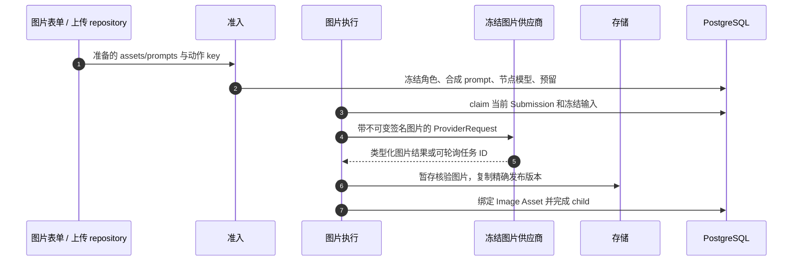
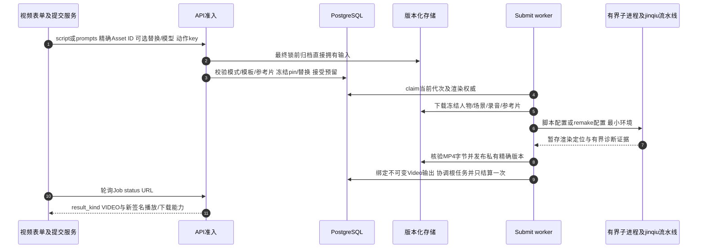

# 各产品请求与模型执行分支

共享生命周期解释持久化与结算。本章回答下一步读源码的问题：选择 `type` 后，到底使用哪些输入、供应商分支和输出类型？共用提交接口，不表示产品可以相互替代。

## 已交付前端真正选择的路由 {#frontend-routing}

| 页面 / 操作 | 准备函数与 HTTP 路径 | 后端分支 | 产物 |
| --- | --- | --- | --- |
| 图片/自定义设计表单提交 | `submitDesignJob` → `postPrepared` → `/v1/design-jobs`，旧式有序 `assets` | 兼容适配器规范化图片角色，再进图片 Workflow | Image Asset |
| 语音总结提交录音 | 同一兼容路径，传有序录音 `assets` | 转为语音类型准入，执行共享 summary operation | Markdown + Document Asset |
| 八项文案表单生成 | `prepareCopywriting` → 同一 repository，但 `isCopywritingFeature` 选 `/v1/workflows` | 当前纯文本请求，共享 summary operation | Markdown + Document Asset |
| 视频表单生成 | `submitVideoGeneration` → 类型化 `inputs`、`script`或`prompts`、可选替换/scope/模型 → `/v1/design-jobs` | 视频准入、本地视频 Submission | MP4 Asset |
| 设计报告表单提交 | `prepareProjectWorkflow` / `postWorkflow` → `workflowsRepository.submit` → `/v1/workflows` | Blueprint 报告图、包含的 child、本地导出 | HTML 预览 + PPTX |

打开 [src/pkg-features/repositories/designJobSubmit.ts → postPrepared](https://github.com/Orientation-CD/wechat_mini_program/blob/21db6d824a7b32417bda88e7e31d3f0b91dfa51c/src/pkg-features/repositories/designJobSubmit.ts#L182) 看真实路径条件。新 API 客户端可经 `/v1/workflows` 提交受支持的图片/语音/视频类型请求；修改现有表单路径必须同时符合 body/mapper 契约，不能只在文档里替换 URL。旧前端 helper 还看得到 `html_report` 分支，不代表服务端继续接受那个已退休请求。

同款视频的`script`与`prompts`互斥，参考片、替换对和scope也进入冻结契约。直接自有图片/音频/视频输入在最终事务前先[耐久归档](/zh/reference/flows/asset-upload-flow#input-archive)，再冻结规范定位。现有UI是否走兼容适配器见[联调状态](/zh/reference/integration-status)。

## 图片和自定义设计 {#image-branch}

[app/core/models.py → ImageWorkflowDesignJobCreate](https://github.com/Orientation-CD/YuanZhu-AI/blob/e59716c83e087deda8477da5ea7b327a40cf65c5/app/core/models.py#L694) 要求 1–3 个带角色输入：一个 `primary`，最多各一个 `mask`、`reference`；真实库存还受 Feature/图约束。上传时已冻结的角色必须与这些语义角色一致。自定义设计是图片分支，不授予任意 URL 或自定义供应商 endpoint 的权限。



| 消息 | 源码与证据 |
| --- | --- |
| 1–2 | [准入](/zh/reference/flows/design-job-lifecycle#submit-workflow)：先规范化当前/受支持旧请求，后调供应商 |
| 3–5 | [app/workflows/operations/image/workflow_image_execution.py → dispatch_image_workflow_submission](https://github.com/Orientation-CD/YuanZhu-AI/blob/e59716c83e087deda8477da5ea7b327a40cf65c5/app/workflows/operations/image/workflow_image_execution.py#L1537) → [app/workflows/operations/image/workflow_image_execution.py → build_image_provider_request](https://github.com/Orientation-CD/YuanZhu-AI/blob/e59716c83e087deda8477da5ea7b327a40cf65c5/app/workflows/operations/image/workflow_image_execution.py#L223)：加载冻结 pin，构建指令/图片输入，校验适配器能力 |
| 6–7 | [app/workflows/operations/image/workflow_image_execution.py → _publish](https://github.com/Orientation-CD/YuanZhu-AI/blob/e59716c83e087deda8477da5ea7b327a40cf65c5/app/workflows/operations/image/workflow_image_execution.py#L1214)：再次核对 publication intent、租约、精确版本/哈希、代次和权限，才能关联 |

供应商临时 URL 是运输证据，不是永久结果。执行器落地、校验、暂存，再发布到自己存储的授权 Asset。HTTP 成功但没有正确输出，不能把 Job 标 completed。GPT image、Seedream 等适配器各自实现传输协议；引擎消费类型化图片结果，不把不同供应商响应格式直接暴露给小程序。

## 有序音频如何变成持久 Markdown {#voice-branch}

[app/core/models.py → VoiceWorkflowDesignJobCreate](https://github.com/Orientation-CD/YuanZhu-AI/blob/e59716c83e087deda8477da5ea7b327a40cf65c5/app/core/models.py#L738) 接收 **1–3 个不同录音**，端口/角色为 `port: "recordings", role: "recording"`，输入顺序有意义。当前前端兼容 `assets` 列表按该顺序规范化。浏览器接力只准备录音，[受限会话](/zh/reference/flows/voice-upload-flow)本身不创建收费总结。

1. 准入核验 owner、ready 状态、对象 pin，冻结总结指令。
2. [app/workflows/submissions/workflow_provider_submission.py → dispatch_workflow_provider_submission](https://github.com/Orientation-CD/YuanZhu-AI/blob/e59716c83e087deda8477da5ea7b327a40cf65c5/app/workflows/submissions/workflow_provider_submission.py#L781) 选冻结适配器，[app/workflows/operations/summary/summary_execution.py → build_summary_provider_request](https://github.com/Orientation-CD/YuanZhu-AI/blob/e59716c83e087deda8477da5ea7b327a40cf65c5/app/workflows/operations/summary/summary_execution.py#L19) 构建有序 `AudioInput` 并要求 Markdown。供应商能力必须真的支持音频，纯文本适配器不能替代。
3. 同一 attempt 下核验/恢复完成文本，[app/workflows/operations/markdown_output_assets.py → materialize_markdown_output](https://github.com/Orientation-CD/YuanZhu-AI/blob/e59716c83e087deda8477da5ea7b327a40cf65c5/app/workflows/operations/markdown_output_assets.py#L407) 创建带 hash、持久 Asset ID 的私有版本化 Document 输出。
4. 协调器/finalizer 把输出绑定公开 Job 并结算；根语音任务完成可推进 Project 到已采集需求。
5. Markdown 结果页读类型输出内容与身份。内联字符串方便展示，但不能替代报告复用时需要的 Document。

当前类型请求长这样（两个 UUID 都要换成实际可访问响应 ID）：

```json
{
  "workspace_id": "22222222-2222-2222-2222-222222222222",
  "type": "voice_summary",
  "name": "本地需求沟通总结",
  "inputs": [
    {"kind":"asset","port":"recordings","role":"recording","asset_id":"00000000-0000-0000-0000-000000000001"}
  ]
}
```

`workspace_id` 是计费/权限上下文；`asset_id` 是已完成的音频上传，不是文件路径。省略 `project_id` 使用后端按调用者解析的 scratch Project。本例用于 `/v1/workflows`；兼容 UI 的 body 使用 `assets` 而非 `inputs`。

## 八项文案共用文本引擎 {#copywriting-branch}

| Feature key | 用户用途 |
| --- | --- |
| `copywriting_short_video` | 短视频脚本 |
| `copywriting_xiaohongshu` | 小红书文案 |
| `copywriting_moments` | 朋友圈文案 |
| `copywriting_titles` | 标题建议 |
| `copywriting_shooting` | 拍摄指导 |
| `copywriting_knowledge` | 知识科普 |
| `copywriting_pitfalls` | 避坑内容 |
| `copywriting_operations_experience` | 运营经验 |

从表单 `submit` 跟进 [src/pkg-features/services/copywritingSubmit.ts → prepareCopywriting](https://github.com/Orientation-CD/wechat_mini_program/blob/21db6d824a7b32417bda88e7e31d3f0b91dfa51c/src/pkg-features/services/copywritingSubmit.ts#L13)：校验对应 Feature 的字段，加载 profile/catalog/templates，核对上下文/权益，规范化字段，开关启用时绑定 Project，创建持久逻辑动作 key。`inputs` 是空数组，用户文本在具名提示词字段里，不应伪造 Asset 输入。模板名/字段名都是配置契约。

[app/core/models.py → CopywritingWorkflowDesignJobCreate](https://github.com/Orientation-CD/YuanZhu-AI/blob/e59716c83e087deda8477da5ea7b327a40cf65c5/app/core/models.py#L776) 拒绝非空 `inputs`。准入合成可配置 prompt，并经 [app/workflows/operations/summary/copywriting_kb.py → read_copywriting_kb](https://github.com/Orientation-CD/YuanZhu-AI/blob/e59716c83e087deda8477da5ea7b327a40cf65c5/app/workflows/operations/summary/copywriting_kb.py#L23) 读取空间/Feature 知识资料，冻结相关知识文本/配置，避免后续对象/配置变化悄悄改写本次执行。知识对象错误会在发模型前得到 `COPYWRITING_KB_INVALID`。

同一 summary operation 构建纯文本 `ProviderRequest`：可配置 prompt/知识变成类型化 `TextInput`，system/negative 指令单独保留，再校验 Markdown、落地与语音相同的持久 Document。复用 operation 不代表八个 Feature 共用开放状态、价格、模板或知识配置。沿准确 Feature key 搜索前端目录、提示词选择与后端准入，就能看到这些差异。

## 视频：脚本或同款参考片，再进入一次本地执行 {#video-branch}

真实表单为[src/pkg-features/pages/video_generation/index.vue → submit](https://github.com/Orientation-CD/wechat_mini_program/blob/21db6d824a7b32417bda88e7e31d3f0b91dfa51c/src/pkg-features/pages/video_generation/index.vue#L908)，默认同款模式，可选系统示例、上传参考片或脚本创作。[src/pkg-features/services/videoGenerationSubmit.ts → submitVideoGeneration](https://github.com/Orientation-CD/wechat_mini_program/blob/21db6d824a7b32417bda88e7e31d3f0b91dfa51c/src/pkg-features/services/videoGenerationSubmit.ts#L69)校验模式/替换/上下文，准备图片/录音/自定义Video后，`postPrepared`当前仍把视频body发到`/v1/design-jobs`。规范类型API也支持`/v1/workflows`，不能因共用准入就说已上线UI换了URL。

| 层 | 脚本路径 | 同款路径 |
| --- | --- | --- |
| 当前UI | 脚本1..1000字符，场景图恰好1 | 系统/自定义来源、称呼、必需录音、场景图0..1 |
| 公共API | 脚本≤20,000字符，场景0..12，录音0..1 | prompts恰好一个选择，无script，场景0..1，MP3>5秒 |
| 已安装执行器 | 镜像内脚本解析/媒体/模型能力 | 参考片驱动remake，省略场景可丢弃自动抽取场景 |

所有模式都需一张人物合成图。自定义参考片是已完成Video Asset，最大100 MiB、120秒。UI与服务端参考片字节上限均为100×1024×1024（104857600），实际字节/内容仍由服务端核验。[src/pkg-features/services/sameStyleVideo.ts → buildCustomReferenceSelection](https://github.com/Orientation-CD/wechat_mini_program/blob/21db6d824a7b32417bda88e7e31d3f0b91dfa51c/src/pkg-features/services/sameStyleVideo.ts#L69)提交`__user_reference__`和唯一`称呼`字段，不查后台模板，不建script pin。系统选择走`buildSameStyleSelection`，按`purpose=same_style_video`发现模板，得到短期参考片/封面预览URL。播放到期刷新发现，不预留积分。



| 消息 | 打开源码 | 追什么数据 |
| --- | --- | --- |
|1|[src/pkg-features/services/videoGenerationSubmit.ts → submitVideoGeneration](https://github.com/Orientation-CD/wechat_mini_program/blob/21db6d824a7b32417bda88e7e31d3f0b91dfa51c/src/pkg-features/services/videoGenerationSubmit.ts#L69)|准备不表示接受付费工作，不确定时保留逻辑key/草稿。|
|2–3|[app/workflows/workflow_admission.py → admit_workflow_job](https://github.com/Orientation-CD/YuanZhu-AI/blob/e59716c83e087deda8477da5ea7b327a40cf65c5/app/workflows/workflow_admission.py#L2939)、`_video_request_mode`、`_resolve_video_inputs`、`render_video_script`|script/prompts互斥，系统模板拥有参考片，自定义要求调用者参考片，规范角色/pin后原子接受。|
|4–6|[app/workflows/submissions/workflow_local_video_submission.py → execute_local_video_submission](https://github.com/Orientation-CD/YuanZhu-AI/blob/e59716c83e087deda8477da5ea7b327a40cf65c5/app/workflows/submissions/workflow_local_video_submission.py#L1034) → [app/workflows/submissions/workflow_local_video_submission.py → _build_render_request](https://github.com/Orientation-CD/YuanZhu-AI/blob/e59716c83e087deda8477da5ea7b327a40cf65c5/app/workflows/submissions/workflow_local_video_submission.py#L552)|租约/代次、精确下载、冻结模型/称呼/替换/scope。|
|6|[app/conversion/video_jinqiu_adapter.py → build_config](https://github.com/Orientation-CD/YuanZhu-AI/blob/e59716c83e087deda8477da5ea7b327a40cf65c5/app/conversion/video_jinqiu_adapter.py#L224) → `_remake_config`或`_script_config`|参考片选择remake并保持script_path空，自定义不伪造script文件。|
|7–9|[app/workflows/submissions/workflow_local_video_submission.py → attach_verified_video_output](https://github.com/Orientation-CD/YuanZhu-AI/blob/e59716c83e087deda8477da5ea7b327a40cf65c5/app/workflows/submissions/workflow_local_video_submission.py#L871)|绑定自己MP4 Asset前暂存、发布并重查权威。|
|10–11|[app/workflows/api.py → workflow_video_response](https://github.com/Orientation-CD/YuanZhu-AI/blob/e59716c83e087deda8477da5ea7b327a40cf65c5/app/workflows/api.py#L606)与`job_response`|类型输出指向自身已核验内容，不是永久供应商URL。|

同款顶层`replacements`冻结去空格from/to对，`replace_scope`为all（默认）/dialogue且要求存在替换。后端透传镜头规划，不自己替换。默认all保持规范指纹，dialogue改变身份。空替换端结构422；主体冲突为`VIDEO_SCRIPT_CONFLICT`，缺主体`VIDEO_SCRIPT_REQUIRED`，选择错误`VIDEO_PROMPTS_INVALID`，系统定义错误`VIDEO_TEMPLATE_INVALID`，参考片缺失/类型/大小/时长错误为带reason的`VIDEO_REFERENCE_INVALID`。prompts模式场景>1为`WORKFLOW_INPUT_INVALID/VIDEO_SCENE_COUNT`，录音缺失/非MP3/≤5秒各有reason。

后台保存可接受空同款正文，但实际准入仍校验`render_video_script`，保存成功不证明模板可用。这个已测边界见[提示词](/zh/admin/prompts)与[联调状态](/zh/reference/integration-status)。

“本地”只表示worker负责编排，不表示流水线不能收费调用远端。渲染失败是终态，不自动重新购买。恢复暂存下载/上传不等于重新渲染。模型开放、媒体二进制和镜像内私有供应商版本仍由[部署](/zh/deploy/local-stack)保证；源码测试不证明仍待验证的真实供应商/长时运行场景。

## 报告组合这些分支 {#report-branch}

报告 Blueprint 可引用已核验图片/总结、冻结图库对象，或包含新生成设计，其图再合成 HTML 并导出 PPTX。不能传 HTML 字符串或旧 `report_items` 就当作当前契约。沿[报告合成与浏览](/zh/reference/flows/report-view-flow)学习父子依赖、页计划、清理、转换和签名访问。当前直接提交 `design_report_pptx` 被拒绝为 `WORKFLOW_UNAVAILABLE`；活动报告流水线的 HTML/PPTX 双输出才是受支持主路径。

## 比较两个产品的源码练习 {#exercise}

选语音和文案，从表单处理函数找出不同 body 和共用 summary operation。在 `operation_run_inputs` 中分辨有序音频 pin、文本指令/知识，找出共用 Document 落地，解释报告后续为何能复用。再对比视频，找出 OS 进程边界，以及恢复下载与重新发起供应商执行的分界。用本地模拟供应商即可，读源码无需付费调用。
