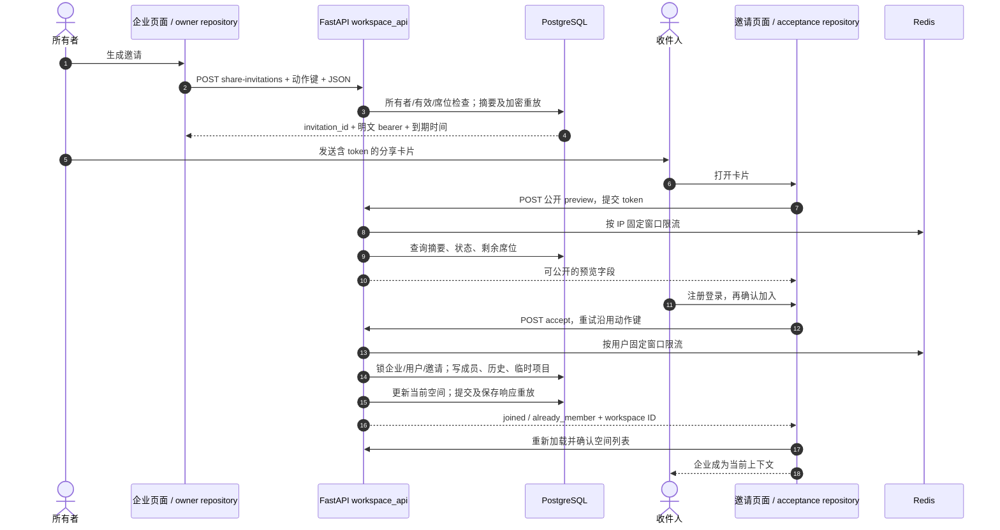

# 企业成员全链路：从分享卡片到每次权限检查

本章跟踪的是**访问权限边界**，不只是一条邀请链接。从“我的 / 企业空间 → 生成邀请”出发，跟随收件人加入企业，再移除该成员，观察哪些数据继续存在。Workspace 选择积分池；Membership 授予当前访问权；Project 则属于该空间内的创建者。这是数据库中的三种不同关系。

先读编号图。“HTTP”代表小程序到 FastAPI 的一次请求；`Depends` 表示 FastAPI 在执行处理函数前准备当前登录用户和数据库会话。`flush()` 把变更发送到当前事务；`commit()` 才使其持久化。预览成功不会创建成员关系。



## 对照编号定位代码

| 步骤 | 按顺序打开 | 阅读重点 |
| --- | --- | --- |
| 1–4 | [`invite` · `src/pkg-account/pages/organization/index.vue:305`](https://github.com/Orientation-CD/wechat_mini_program/blob/21db6d824a7b32417bda88e7e31d3f0b91dfa51c/src/pkg-account/pages/organization/index.vue#L307) → [`shareInvitationOwnerRepository` · `src/pkg-account/repositories/shareInvitations.ts:70`](https://github.com/Orientation-CD/wechat_mini_program/blob/21db6d824a7b32417bda88e7e31d3f0b91dfa51c/src/pkg-account/repositories/shareInvitations.ts#L70) → [`create_share_invitation` · `app/workspaces/share_invitations.py:178`](https://github.com/Orientation-CD/YuanZhu-AI/blob/e59716c83e087deda8477da5ea7b327a40cf65c5/app/workspaces/share_invitations.py#L178) | 页面保留同一逻辑邀请身份；repository 添加 `Idempotency-Key`；service 保存摘要和加密的原始响应。 |
| 5–9 | [`accept` · `src/pkg-account/pages/invitation/index.vue:99`](https://github.com/Orientation-CD/wechat_mini_program/blob/21db6d824a7b32417bda88e7e31d3f0b91dfa51c/src/pkg-account/pages/invitation/index.vue#L101) → [`shareInvitationPreviewRepository` · `src/pkg-account/repositories/shareInvitationPreview.ts:70`](https://github.com/Orientation-CD/wechat_mini_program/blob/21db6d824a7b32417bda88e7e31d3f0b91dfa51c/src/pkg-account/repositories/shareInvitationPreview.ts#L70) → [`enforce_rate_limit` · `app/core/rate_limit.py:25`](https://github.com/Orientation-CD/YuanZhu-AI/blob/e59716c83e087deda8477da5ea7b327a40cf65c5/app/core/rate_limit.py#L25) | 卡片传来的是 bearer，不是登录身份。Redis 保护预览入口；真实状态在数据库。 |
| 10–15 | [`shareInvitationAcceptanceRepository` · `src/pkg-account/repositories/shareInvitationAcceptance.ts:89`](https://github.com/Orientation-CD/wechat_mini_program/blob/21db6d824a7b32417bda88e7e31d3f0b91dfa51c/src/pkg-account/repositories/shareInvitationAcceptance.ts#L89) → [`accept_share_invitation` · `app/workspaces/share_invitations.py:360`](https://github.com/Orientation-CD/YuanZhu-AI/blob/e59716c83e087deda8477da5ea7b327a40cf65c5/app/workspaces/share_invitations.py#L360) → [`accessible_workspace` · `app/workspaces/workspaces.py:223`](https://github.com/Orientation-CD/YuanZhu-AI/blob/e59716c83e087deda8477da5ea7b327a40cf65c5/app/workspaces/workspaces.py#L224) | 先注册与同意；accept 是一个事务；之后每个请求仍要单独检查成员资格。 |

## 跨边界时跟踪哪些字段

| 值 / 记录 | 含义与存储位置 |
| --- | --- |
| `workspace_id` / `Enterprise.id` | 稳定的积分与权限边界。复数路由明确选择该 ID，不依赖可能过期的当前空间。 |
| `EnterpriseMembership(enterprise_id, user_id)` | 当前角色、加入时间。删除此行撤销当前访问，不会把任务或项目转给别人。 |
| `EnterpriseMembershipHistory` | 过去加入过的持久凭据和成员活动。离开后的历史权限是另一种更窄的权限。 |
| `WorkspaceShareInvitation.id` / `token_hash` | 生命周期 ID / 带密钥摘要。仅创建和加密重放返回明文 bearer，所有者列表不能恢复它。 |
| `User.current_workspace_id` | 服务端持久化的当前空间。移除/退出后可能修复为个人空间。 |
| `Project` / `ProjectPreference` | 创建者私有项目 / 默认项目。加入时确保该 `(user, workspace)` 有临时项目。 |

模型声明见 [`EnterpriseMembership` · `app/persistence/db_models.py:895`](https://github.com/Orientation-CD/YuanZhu-AI/blob/e59716c83e087deda8477da5ea7b327a40cf65c5/app/persistence/db_models.py#L1024)，权限判断见 [`accessible_workspace` · `app/workspaces/workspaces.py:223`](https://github.com/Orientation-CD/YuanZhu-AI/blob/e59716c83e087deda8477da5ea7b327a40cf65c5/app/workspaces/workspaces.py#L224)。普通读取和成员变更不会提交 AI 任务，也不调用模型供应商。本章仅明确标出限流的位置使用 Redis；席位、邀请消耗、幂等和成员关系由 PostgreSQL 管理。

## 发现空间并修复当前上下文 {#list-workspaces}

`GET /v1/me/workspaces`

**界面 / 入口：** 打开“我的项目”、企业设置或空间切换器时加载上下文。

**跟着请求读代码：**

1. repository 请求带登录凭证的列表，并把 API 的 `enterprise` 映射为 UI 的 organization 类型；角色不是本地随意拼出的列表。

2. FastAPI 在 `app/api/__init__.py` 注册 `get_my_workspaces`。`list_workspace_summaries` 确保个人空间与临时/默认项目存在，再查询有效且未移除企业的当前成员关系。

3. 仅当当前选择还在返回列表中才保留它，否则 `_persist_workspace_fallback` 修复为个人空间，同时避免覆盖并发切换。

**响应和失败分支：** 返回 `current_workspace_id` 与 `items`，handler 提交修复。前端校验身份并广播已确认的上下文；缓存的企业名称不能覆盖后续 403。

**源码停靠点：** [`workspaceReadRepository` · `src/repositories/workspaceRead.ts:142`](https://github.com/Orientation-CD/wechat_mini_program/blob/21db6d824a7b32417bda88e7e31d3f0b91dfa51c/src/repositories/workspaceRead.ts#L142) → [`get_my_workspaces` · `app/workspaces/api.py:13`](https://github.com/Orientation-CD/YuanZhu-AI/blob/e59716c83e087deda8477da5ea7b327a40cf65c5/app/workspaces/api.py#L13) → [`list_workspace_summaries` · `app/workspaces/workspaces.py:440`](https://github.com/Orientation-CD/YuanZhu-AI/blob/e59716c83e087deda8477da5ea7b327a40cf65c5/app/workspaces/workspaces.py#L445)

## 创建企业及其所有者 {#create-workspace}

`POST /v1/workspaces`

**界面 / 入口：** 企业页面 → 创建企业；`createOrganization()` 调用 `workspaceCreateRepository.create`。

**跟着请求读代码：**

1. repository 先记录空间列表，再通过成员变更屏障发送名称与 `member_limit`，之后重读空间上下文，确认新 ID、名称、owner 角色与当前选择。

2. handler 锁定并重读 User，要求 ACTIVE，检查 `allowed_workspaces`，去除名称两端空白，并拒绝重名企业。

3. 插入剩余/预留积分均为零的 Enterprise、OWNER 成员、临时/默认项目、成员历史；选择新空间并提交。

**响应和失败分支：** 201 返回成员可见详情，不会赠送已付费积分。数量上限、企业重名和空名称会阻止创建；该 API 无动作键重放，网络结果不确定时先核对列表再创建。

**源码停靠点：** [`createOrganization` · `src/pkg-account/pages/organization/index.vue:202`](https://github.com/Orientation-CD/wechat_mini_program/blob/21db6d824a7b32417bda88e7e31d3f0b91dfa51c/src/pkg-account/pages/organization/index.vue#L204) → [`workspaceCreateRepository` · `src/pkg-account/repositories/workspaceCreate.ts:84`](https://github.com/Orientation-CD/wechat_mini_program/blob/21db6d824a7b32417bda88e7e31d3f0b91dfa51c/src/pkg-account/repositories/workspaceCreate.ts#L84) → [`create_workspace` · `app/workspaces/workspace_api.py:328`](https://github.com/Orientation-CD/YuanZhu-AI/blob/e59716c83e087deda8477da5ea7b327a40cf65c5/app/workspaces/workspace_api.py#L388) → [`ensure_scratch_project` · `app/workspaces/workspaces.py:80`](https://github.com/Orientation-CD/YuanZhu-AI/blob/e59716c83e087deda8477da5ea7b327a40cf65c5/app/workspaces/workspaces.py#L81)

## 读取成员可见详情 {#get-workspace}

`GET /v1/workspaces/{workspace_id}`

**界面 / 入口：** 企业页面加载或成员操作核对调用 `workspaceDetailRepository.get`。

**跟着请求读代码：**

1. URL 的 UUID 指定确切空间。`accessible_workspace` 验证个人归属或当前企业成员资格和有效企业状态。

2. `workspace_detail` 返回个人摘要且 `members=null`；企业则附成员 ID、显示名、角色、加入时间。

3. 前端先检查响应确实属于请求空间，再决定是否显示所有者操作。

**响应和失败分支：** 200 不暴露成员手机号，也不授予修改其他创建者项目的权限。没有成员资格为 403 `WORKSPACE_ACCESS_DENIED`；停用企业为 409 `WORKSPACE_INACTIVE`。

**源码停靠点：** [`workspaceDetailRepository` · `src/pkg-account/repositories/workspaceDetail.ts:113`](https://github.com/Orientation-CD/wechat_mini_program/blob/21db6d824a7b32417bda88e7e31d3f0b91dfa51c/src/pkg-account/repositories/workspaceDetail.ts#L113) → [`get_workspace` · `app/workspaces/workspace_api.py:161`](https://github.com/Orientation-CD/YuanZhu-AI/blob/e59716c83e087deda8477da5ea7b327a40cf65c5/app/workspaces/workspace_api.py#L170) → [`workspace_detail` · `app/workspaces/workspaces.py:473`](https://github.com/Orientation-CD/YuanZhu-AI/blob/e59716c83e087deda8477da5ea7b327a40cf65c5/app/workspaces/workspaces.py#L480) → [`accessible_workspace` · `app/workspaces/workspaces.py:223`](https://github.com/Orientation-CD/YuanZhu-AI/blob/e59716c83e087deda8477da5ea7b327a40cf65c5/app/workspaces/workspaces.py#L224)

## 修改名称或席位 {#update-workspace}

`PATCH /v1/workspaces/{workspace_id}`

**界面 / 入口：** 企业页面 → 修改企业名称 / 调整席位 → `applyUpdate`。

**跟着请求读代码：**

1. repository 仅发送本次修改，再映射服务端返回的权威详情。

2. handler 检查访问及 OWNER，锁定 Enterprise；拒绝空名、重名；降低 `member_limit` 前统计实际成员。

3. 修改属性并提交，返回最新成员可见详情。调整席位不会发放订阅权益或增加积分。

**响应和失败分支：** `MEMBER_LIMIT_BELOW_MEMBER_COUNT` 保护已占席位；即使 UI 隐藏按钮，服务端仍检查 OWNER。页面在权限/角色失败后重新加载上下文。

**源码停靠点：** [`applyUpdate` · `src/pkg-account/pages/organization/index.vue:230`](https://github.com/Orientation-CD/wechat_mini_program/blob/21db6d824a7b32417bda88e7e31d3f0b91dfa51c/src/pkg-account/pages/organization/index.vue#L232) → [`workspaceDetailRepository` · `src/pkg-account/repositories/workspaceDetail.ts:113`](https://github.com/Orientation-CD/wechat_mini_program/blob/21db6d824a7b32417bda88e7e31d3f0b91dfa51c/src/pkg-account/repositories/workspaceDetail.ts#L113) → [`update_workspace` · `app/workspaces/workspace_api.py:392`](https://github.com/Orientation-CD/YuanZhu-AI/blob/e59716c83e087deda8477da5ea7b327a40cf65c5/app/workspaces/workspace_api.py#L452) → [`require_workspace_owner` · `app/workspaces/workspaces.py:509`](https://github.com/Orientation-CD/YuanZhu-AI/blob/e59716c83e087deda8477da5ea7b327a40cf65c5/app/workspaces/workspaces.py#L516)

## 汇总共享积分及所有者项目视图 {#workspace-overview}

`GET /v1/workspaces/{workspace_id}/overview`

**界面 / 入口：** “我的项目” → 成员项目概览，或企业积分概览。

**跟着请求读代码：**

1. 通过 `accessible_workspace` 检查显式空间；个人空间返回 `ENTERPRISE_WORKSPACE_REQUIRED`。

2. `enterprise_overview` 按账本汇总当月与累计已结算消耗。当前成员都能看到共享剩余、预留、可用余额及汇总消耗。

3. 只有 OWNER 继续读取当前/历史成员、普通有效项目、可信活动/阶段以及根任务成果计数。缩略图步骤补充展示 URL，这是读取，不是新生成结果。

**响应和失败分支：** 所有者概览是专门开放的读取视图；Project 修改接口仍过滤 `creator_user_id`。离开者不能访问当前成员概览。活动可信状态缺失时返回 503，不伪造活动时间。

**源码停靠点：** [`projectContextRepository` · `src/repositories/projectContext.ts:181`](https://github.com/Orientation-CD/wechat_mini_program/blob/21db6d824a7b32417bda88e7e31d3f0b91dfa51c/src/repositories/projectContext.ts#L181) → [`loadProjectOverview` · `src/repositories/projectOverview.ts:88`](https://github.com/Orientation-CD/wechat_mini_program/blob/21db6d824a7b32417bda88e7e31d3f0b91dfa51c/src/repositories/projectOverview.ts#L88) → [`get_enterprise_overview` · `app/workspaces/workspace_api.py:175`](https://github.com/Orientation-CD/YuanZhu-AI/blob/e59716c83e087deda8477da5ea7b327a40cf65c5/app/workspaces/workspace_api.py#L184) → [`enterprise_overview` · `app/admin/enterprise_overview.py:52`](https://github.com/Orientation-CD/YuanZhu-AI/blob/e59716c83e087deda8477da5ea7b327a40cf65c5/app/admin/enterprise_overview.py#L58) → [`attach_overview_thumbnails` · `app/workflows/history_thumbnails.py:320`](https://github.com/Orientation-CD/YuanZhu-AI/blob/e59716c83e087deda8477da5ea7b327a40cf65c5/app/workflows/history_thumbnails.py#L320)

## 分清owner查看、成员额度和创建者写权限 {#owner-read-and-quota}

`get_enterprise_overview`仍按当前成员关系限定响应。`enterprise_overview`仅向当前OWNER增加`member_token_limit`、`member_token_limit_configured`、`quota_month`；当前成员行有`token_quota:{limit,used,reserved,source}`，已退出成员行省略当前quota；普通成员省略这些owner新字段，私有成员/历史段仍为null。

[app/admin/enterprise_overview.py → enterprise_overview](https://github.com/Orientation-CD/YuanZhu-AI/blob/e59716c83e087deda8477da5ea7b327a40cf65c5/app/admin/enterprise_overview.py#L58)按结算月读取`consumption.current_month`，与[app/billing/member_token_quotas.py → enterprise_member_token_usage](https://github.com/Orientation-CD/YuanZhu-AI/blob/e59716c83e087deda8477da5ea7b327a40cf65c5/app/billing/member_token_quotas.py#L57)独立。额度按预留月，待结算预留只计一次，`reserved`是`used`子集，不能再加。全局保存重置所有override，单人零持续暂停。三个已实现额度API**尚无当前小程序调用者**，完整集成/服务/流水/准入链见[成员额度](/zh/reference/flows/member-quota-flow)。

当前企业owner可从可见成员任务进入`GET /v1/workflows/{id}`并轮询规范status URL。[app/workflows/api.py → _get_design_job_response](https://github.com/Orientation-CD/YuanZhu-AI/blob/e59716c83e087deda8477da5ea7b327a40cf65c5/app/workflows/api.py#L1320)每次重查当前owner关系及可见企业/Project范围。`job_response`标明实际`submitted_by`，把其他创建者的`inputs`设为`[]`，可返回已有获授权输出投影。企业活跃时可包含已退出成员的可见Job。这不授予提交、删除、移动、重试权。无权/隐藏/不存在ID都404，换当前空间不能把无权ID变可读。[历史动作](/zh/reference/flows/workflow-history-flow)追踪创建者写检查。

## 分页追踪空间积分账本 {#workspace-token-detail}

`GET /v1/workspaces/{workspace_id}/token-detail`

**界面 / 入口：** 企业/个人积分明细页通过 `workspaceTokenDetailRepository` 加载。

**跟着请求读代码：**

1. 证明访问资格后，handler 把 TokenLedgerEntry 限制为个人用户或企业范围。

2. 企业非所有者仅看到 origin-member 为自己的预留、消耗、释放事件，购买/订阅引用被隐藏；OWNER 读取企业范围。

3. cursor 必须属于同一可见范围。按 `(created_at,id)` 倒序查询 `limit+1`，关联任务、支付、订阅、积分包，返回事件类型和积分绝对值。

**响应和失败分支：** `limit` 为 1–100，默认 50；`next_cursor=null` 表示结束。无关 cursor 为 422 `TOKEN_DETAIL_CURSOR_INVALID`。返回金额为绝对值，需要结合类型判断含义。

**源码停靠点：** [`workspaceTokenDetailRepository` · `src/pkg-account/repositories/workspaceTokenDetail.ts:144`](https://github.com/Orientation-CD/wechat_mini_program/blob/21db6d824a7b32417bda88e7e31d3f0b91dfa51c/src/pkg-account/repositories/workspaceTokenDetail.ts#L144) → [`get_workspace_token_detail` · `app/workspaces/workspace_api.py:199`](https://github.com/Orientation-CD/YuanZhu-AI/blob/e59716c83e087deda8477da5ea7b327a40cf65c5/app/workspaces/workspace_api.py#L259)

## 生成可转发邀请 {#create-share-invitation}

`POST /v1/workspaces/{workspace_id}/share-invitations`

**界面 / 入口：** 企业 → 生成邀请 → `invite()`；返回 token 用于分享卡片及复制兜底。

**跟着请求读代码：**

1. 必须发送 JSON `{}` 和 8–128 字符的 `Idempotency-Key`。前端对同一逻辑邀请的重试保留同一键。

2. service 获取 `(owner,key)` 的事务 advisory lock，检查相同请求指纹的加密重放；新动作则锁 Enterprise，检查 OWNER、有效且未移除、成员席位未满。

3. 生成随机 bearer，将带密钥摘要和七天到期时间写入 WorkspaceShareInvitation，并把响应加密保存在幂等记录中。handler 提交后返回 201。

**响应和失败分支：** 用 `id` 跟踪生命周期，禁止把 bearer 写入日志/分析。加入时还会再次检查席位，所以生成不是预占席位。同键不同指纹会冲突；无法重放时应核对结果，不能无限生成新邀请。

**源码停靠点：** [`invite` · `src/pkg-account/pages/organization/index.vue:305`](https://github.com/Orientation-CD/wechat_mini_program/blob/21db6d824a7b32417bda88e7e31d3f0b91dfa51c/src/pkg-account/pages/organization/index.vue#L307) → [`shareInvitationOwnerRepository` · `src/pkg-account/repositories/shareInvitations.ts:70`](https://github.com/Orientation-CD/wechat_mini_program/blob/21db6d824a7b32417bda88e7e31d3f0b91dfa51c/src/pkg-account/repositories/shareInvitations.ts#L70) → [`create_workspace_share_invitation` · `app/workspaces/workspace_api.py:489`](https://github.com/Orientation-CD/YuanZhu-AI/blob/e59716c83e087deda8477da5ea7b327a40cf65c5/app/workspaces/workspace_api.py#L549) → [`create_share_invitation` · `app/workspaces/share_invitations.py:178`](https://github.com/Orientation-CD/YuanZhu-AI/blob/e59716c83e087deda8477da5ea7b327a40cf65c5/app/workspaces/share_invitations.py#L178)

## 注册前预览 {#preview-share-invitation}

`POST /v1/share-invitations/preview`

**界面 / 入口：** 打开邀请卡片，邀请页 `load()` 在未登录时请求预览。

**跟着请求读代码：**

1. 在请求体 POST `{ "token": "<bearer>" }`。公开 handler 按 `share-invitation-preview-ip` 进行 Redis 固定窗口限流，key 使用已验证客户端地址的哈希。

2. service 计算摘要，读取邀请及企业/邀请者，比较摘要，计算生命周期和此刻剩余席位。

3. 只返回企业名称、邀请者显示名、到期时间、剩余席位和是否可加入；不插入 EnterpriseMembership。

**响应和失败分支：** 未知 bearer 为 404；已使用/过期/撤销/满员/停用会返回对应展示状态及 `can_accept=false`。Redis 故障为 503，超限为带 `Retry-After` 的 429。preview 到 accept 之间状态可能变化。

**源码停靠点：** [`load` · `src/pkg-account/pages/invitation/index.vue:83`](https://github.com/Orientation-CD/wechat_mini_program/blob/21db6d824a7b32417bda88e7e31d3f0b91dfa51c/src/pkg-account/pages/invitation/index.vue#L85) → [`shareInvitationPreviewRepository` · `src/pkg-account/repositories/shareInvitationPreview.ts:70`](https://github.com/Orientation-CD/wechat_mini_program/blob/21db6d824a7b32417bda88e7e31d3f0b91dfa51c/src/pkg-account/repositories/shareInvitationPreview.ts#L70) → [`preview_workspace_share_invitation` · `app/workspaces/workspace_api.py:522`](https://github.com/Orientation-CD/YuanZhu-AI/blob/e59716c83e087deda8477da5ea7b327a40cf65c5/app/workspaces/workspace_api.py#L582) → [`preview_share_invitation` · `app/workspaces/share_invitations.py:292`](https://github.com/Orientation-CD/YuanZhu-AI/blob/e59716c83e087deda8477da5ea7b327a40cf65c5/app/workspaces/share_invitations.py#L292) → [`enforce_rate_limit` · `app/core/rate_limit.py:25`](https://github.com/Orientation-CD/YuanZhu-AI/blob/e59716c83e087deda8477da5ea7b327a40cf65c5/app/core/rate_limit.py#L25)

## 原子消耗 bearer 并加入企业 {#accept-share-invitation}

`POST /v1/share-invitations/accept`

**界面 / 入口：** 邀请页 → 注册登录并确认加入 → `accept()`；取消同意不会调用 accept。

**跟着请求读代码：**

1. repository 把 bearer/动作键绑定到当前账号与 session，发送 token 和 `Idempotency-Key`，之后通过重新读取确认返回空间。

2. Redis 按登录用户限流。service 对 `(user,key)` 加 advisory lock 并查重放；摘要定位后按 Enterprise → User → Invitation 锁行，在事务内再次检查重放和状态。

3. 满足条件且尚未加入时插入 MEMBER、成员历史、临时/默认项目，记录接受并选择企业。已是成员则消耗邀请但不增加席位。同一接受者可对已接受邀请取得 `already_member`；其他人会收到 `INVITATION_USED`。

4. service 保存加密的接受响应；handler 将成员、上下文、邀请一起提交。前端在 accept 前已读取用户，accept 后重读空间列表并确认返回上下文，再跳转。

**响应和失败分支：** 响应含 `invitation_id`、`current_workspace_id`、空间角色和 `joined/already_member`。已使用/过期/撤销为 410；满员/停用/管理员禁入为 409。后续请求仍以当前成员资格为准，重放只证明历史动作结果。

**源码停靠点：** [`accept` · `src/pkg-account/pages/invitation/index.vue:99`](https://github.com/Orientation-CD/wechat_mini_program/blob/21db6d824a7b32417bda88e7e31d3f0b91dfa51c/src/pkg-account/pages/invitation/index.vue#L101) → [`shareInvitationAcceptanceRepository` · `src/pkg-account/repositories/shareInvitationAcceptance.ts:89`](https://github.com/Orientation-CD/wechat_mini_program/blob/21db6d824a7b32417bda88e7e31d3f0b91dfa51c/src/pkg-account/repositories/shareInvitationAcceptance.ts#L89) → [`accept_workspace_share_invitation` · `app/workspaces/workspace_api.py:544`](https://github.com/Orientation-CD/YuanZhu-AI/blob/e59716c83e087deda8477da5ea7b327a40cf65c5/app/workspaces/workspace_api.py#L604) → [`accept_share_invitation` · `app/workspaces/share_invitations.py:360`](https://github.com/Orientation-CD/YuanZhu-AI/blob/e59716c83e087deda8477da5ea7b327a40cf65c5/app/workspaces/share_invitations.py#L360) → [`remember_enterprise_membership` · `app/workspaces/workspaces.py:168`](https://github.com/Orientation-CD/YuanZhu-AI/blob/e59716c83e087deda8477da5ea7b327a40cf65c5/app/workspaces/workspaces.py#L169) → [`ensure_scratch_project` · `app/workspaces/workspaces.py:80`](https://github.com/Orientation-CD/YuanZhu-AI/blob/e59716c83e087deda8477da5ea7b327a40cf65c5/app/workspaces/workspaces.py#L81)

## 查看生命周期而不恢复 bearer {#list-share-invitations}

`GET /v1/workspaces/{workspace_id}/share-invitations`

**界面 / 入口：** repository/契约入口 `shareInvitationOwnerRepository.list`；当前企业页未调用该列表方法。

**跟着请求读代码：**

1. 登录并证明显式企业的 OWNER；个人空间不能列出此邀请。

2. 按创建时间倒序读取最多 500 条 WorkspaceShareInvitation，通过 `owner_item` 投影。

3. 投影计算 pending/accepted/expired/revoked，返回 ID 和创建、到期、接受、撤销时间；前端 mapper 检查顺序及状态时间一致性。

**响应和失败分支：** 不返回明文或摘要。403 `WORKSPACE_OWNER_REQUIRED` 防止普通成员枚举邀请元数据。

**源码停靠点：** [`shareInvitationOwnerRepository` · `src/pkg-account/repositories/shareInvitations.ts:70`](https://github.com/Orientation-CD/wechat_mini_program/blob/21db6d824a7b32417bda88e7e31d3f0b91dfa51c/src/pkg-account/repositories/shareInvitations.ts#L70) → [`list_workspace_share_invitations` · `app/workspaces/workspace_api.py:584`](https://github.com/Orientation-CD/YuanZhu-AI/blob/e59716c83e087deda8477da5ea7b327a40cf65c5/app/workspaces/workspace_api.py#L644) → [`owner_item` · `app/workspaces/share_invitations.py:550`](https://github.com/Orientation-CD/YuanZhu-AI/blob/e59716c83e087deda8477da5ea7b327a40cf65c5/app/workspaces/share_invitations.py#L550)

## 撤销待接受的分享邀请 {#revoke-share-invitation}

`DELETE /v1/workspaces/{workspace_id}/share-invitations/{invitation_id}`

**界面 / 入口：** repository/契约层所有者动作 `shareInvitationOwnerRepository.revoke`；当前页面没有调用它的按钮。

**跟着请求读代码：**

1. 锁 Enterprise 并证明调用者为 OWNER，再按 invitation ID 和 enterprise ID 锁定邀请。

2. 已撤销记录安全返回 204；待接受记录写 `revoked_at`，提交后 preview/accept 看到撤销状态。

3. 已接受或过期记录不会被改成 revoked；URL 中的空间条件防止跨企业撤销。

**响应和失败分支：** 缺失为 404；非 pending 为 409 `INVITATION_NOT_PENDING`。此 DELETE 可重放；手机号邀请撤销第二次会因非 pending 冲突，不能混为一谈。

**源码停靠点：** [`shareInvitationOwnerRepository` · `src/pkg-account/repositories/shareInvitations.ts:70`](https://github.com/Orientation-CD/wechat_mini_program/blob/21db6d824a7b32417bda88e7e31d3f0b91dfa51c/src/pkg-account/repositories/shareInvitations.ts#L70) → [`revoke_workspace_share_invitation` · `app/workspaces/workspace_api.py:614`](https://github.com/Orientation-CD/YuanZhu-AI/blob/e59716c83e087deda8477da5ea7b327a40cf65c5/app/workspaces/workspace_api.py#L674)

## 退出而不把历史转到个人空间 {#leave-workspace}

`DELETE /v1/workspaces/{workspace_id}/membership`

**界面 / 入口：** 企业成员 → 退出企业 → `confirmMembership("leave", ...)`；当前流程受 PRIVATE_PROJECTS/API 能力开关控制。

**跟着请求读代码：**

1. 页面在确认前捕获账号、空间、成员、加入时间凭据；repository 再核对，通过成员写屏障发送显式 DELETE。

2. handler 获取用于协调任务准入的 `active-design-job-admission` advisory lock，再锁 Enterprise/User/Membership。OWNER 不能退出；该空间有活跃任务时禁止退出。

3. 保留历史关系、删除当前成员、确保个人空间并选择它，然后提交。企业出资的任务与创建者项目保留原范围。

**响应和失败分支：** 204 表示退出已确认。响应不确定时 `reconcile` 读取上下文/详情判断是否完成，不盲目重发 DELETE。离开者可读取允许的本人历史，但不能提交新企业任务或管理项目。

**源码停靠点：** [`confirmMembership` · `src/pkg-account/pages/organization/index.vue:120`](https://github.com/Orientation-CD/wechat_mini_program/blob/21db6d824a7b32417bda88e7e31d3f0b91dfa51c/src/pkg-account/pages/organization/index.vue#L122) → [`enterpriseMembershipRepository` · `src/pkg-account/repositories/enterpriseMembership.ts:44`](https://github.com/Orientation-CD/wechat_mini_program/blob/21db6d824a7b32417bda88e7e31d3f0b91dfa51c/src/pkg-account/repositories/enterpriseMembership.ts#L44) → [`leave_workspace_membership` · `app/workspaces/workspace_api.py:674`](https://github.com/Orientation-CD/YuanZhu-AI/blob/e59716c83e087deda8477da5ea7b327a40cf65c5/app/workspaces/workspace_api.py#L734) → [`remember_enterprise_membership` · `app/workspaces/workspaces.py:168`](https://github.com/Orientation-CD/YuanZhu-AI/blob/e59716c83e087deda8477da5ea7b327a40cf65c5/app/workspaces/workspaces.py#L169)

## 所有者移除成员 {#remove-workspace-member}

`DELETE /v1/workspaces/{workspace_id}/members/{member_user_id}`

**界面 / 入口：** 企业 → 成员操作 → 移除成员 → `confirmMembership("remove", member)`。

**跟着请求读代码：**

1. 动作保留企业和目标成员凭据，repository 在显式 DELETE 前再次检查。

2. `remove_enterprise_member` 对目标用户加任务准入锁，证明调用者 OWNER，再锁 Enterprise、目标 User、Membership。禁止移除 OWNER 或仍有活跃任务的成员。

3. 保留历史关系，仅删当前成员；若目标当前选择已失效则修复。handler 提交，前端核对成员列表与上下文，项目/任务原归属不变。

**响应和失败分支：** 404 `MEMBER_NOT_FOUND` 表示成员已变化；409 `WORKSPACE_MEMBER_ACTIVE_JOBS` 防止中断记账。UI 确认不是权限依据，过期或替换的成员关系仍需再核对。

**源码停靠点：** [`confirmMembership` · `src/pkg-account/pages/organization/index.vue:120`](https://github.com/Orientation-CD/wechat_mini_program/blob/21db6d824a7b32417bda88e7e31d3f0b91dfa51c/src/pkg-account/pages/organization/index.vue#L122) → [`enterpriseMembershipRepository` · `src/pkg-account/repositories/enterpriseMembership.ts:44`](https://github.com/Orientation-CD/wechat_mini_program/blob/21db6d824a7b32417bda88e7e31d3f0b91dfa51c/src/pkg-account/repositories/enterpriseMembership.ts#L44) → [`remove_workspace_member` · `app/workspaces/workspace_api.py:735`](https://github.com/Orientation-CD/YuanZhu-AI/blob/e59716c83e087deda8477da5ea7b327a40cf65c5/app/workspaces/workspace_api.py#L795) → [`remove_enterprise_member` · `app/billing/billing.py:1229`](https://github.com/Orientation-CD/YuanZhu-AI/blob/e59716c83e087deda8477da5ea7b327a40cf65c5/app/billing/billing.py#L1247)

## 发现离开企业的本人历史入口 {#history-workspaces}

`GET /v1/me/history-workspaces`

**界面 / 入口：** 方案/历史范围选择器读取 `historyWorkspaceRepository`，不会切换当前空间。

**跟着请求读代码：**

1. 前端把历史发现缓存与当前成员上下文分开，并与当前空间列表去重。

2. handler 关联 EnterpriseMembershipHistory 和有效且未移除 Enterprise，用 EXISTS 排除当前仍为成员的空间。

3. 仅返回离开企业 ID/名称/类型。之后本人历史读取仍经过更窄的 `accessible_history_workspace`，发现入口不恢复成员资格。

**响应和失败分支：** 重新加入后该企业不再属于离开列表；企业被移除后也不再可发现。此请求不写数据库、不进入 Redis 队列。

**源码停靠点：** [`historyWorkspaceRepository` · `src/repositories/historyWorkspaces.ts:45`](https://github.com/Orientation-CD/wechat_mini_program/blob/21db6d824a7b32417bda88e7e31d3f0b91dfa51c/src/repositories/historyWorkspaces.ts#L45) → [`list_history_workspaces` · `app/workspaces/workspace_api.py:88`](https://github.com/Orientation-CD/YuanZhu-AI/blob/e59716c83e087deda8477da5ea7b327a40cf65c5/app/workspaces/workspace_api.py#L97) → [`accessible_history_workspace` · `app/workspaces/workspaces.py:192`](https://github.com/Orientation-CD/YuanZhu-AI/blob/e59716c83e087deda8477da5ea7b327a40cf65c5/app/workspaces/workspaces.py#L193)

## 按设备显示企业移除通知 {#workspace-removal-notices}

`GET /v1/me/workspace-removal-notices`

**界面 / 入口：** 项目上下文调用 `loadWorkspaceRemovalNotices`；UI 在本机记录已展示事件 ID。

**跟着请求读代码：**

1. 登录 handler 关联成员历史与 `removed_at` 非空的企业，最新移除在前。

2. 每条通知用 Enterprise ID 同时作为 `event_id` 和 `workspace_id`，附名称和移除时间。

3. 前端按账号/session 隔离，校验通知，并在设备本地保存已展示 ID。接口本身不确认或删除服务端事件。

**响应和失败分支：** 另一设备再次读到同事件属于正常行为。企业移除与退出仍有效企业不同，后者应去历史发现入口。

**源码停靠点：** [`loadWorkspaceRemovalNotices` · `src/repositories/workspaceRemovalNotices.ts:48`](https://github.com/Orientation-CD/wechat_mini_program/blob/21db6d824a7b32417bda88e7e31d3f0b91dfa51c/src/repositories/workspaceRemovalNotices.ts#L48) → [`list_workspace_removal_notices` · `app/workspaces/workspace_api.py:127`](https://github.com/Orientation-CD/YuanZhu-AI/blob/e59716c83e087deda8477da5ea7b327a40cf65c5/app/workspaces/workspace_api.py#L136)

## 手机号邀请与单数路由：另一套协议

下面的接口仍被注册，**并非全部 deprecated**。“兼容”描述的是早期的当前企业上下文与手机号收件箱协议，不代表一律返回 410。`active_membership` 优先选择匹配 `User.current_workspace_id` 的成员关系；不匹配时按加入时间取最早有效关系。因此单数路由不保证指向当前选择的个人空间，也不能代替明确的企业 ID。该版本 API 模式前端没有调用下列单数所有者/收件箱接口，也没有调用显式手机号邀请创建接口；学习时通过带登录凭证的契约请求进入。企业页面实际采用分享邀请。不能把 bearer 分享图套在手机号邀请上：收件箱根据登录用户手机号证明收件人，接受时使用非秘密的 invitation ID。

## 在显式企业创建手机号邀请 {#phone-invite-explicit}

`POST /v1/workspaces/{workspace_id}/invitations`

**界面 / 入口：** 该版本 API 模式小程序无调用者；入口是已登录的 REST 契约/集成客户端。

**跟着请求读代码：**

1. 将 `payload.phone` 标准化为 E.164；`create_enterprise_invitation(..., workspace_id=...)` 验证该确切企业的 OWNER，锁企业并检查席位。

2. 按手机号查已注册且有效的非管理员；拒绝自己、已有成员、未到期待接受重复邀请。插入 EnterpriseInvitation，存手机号、随机 token 哈希、邀请者和配置到期时间，再提交。

3. 返回 ID、状态和展示摘要，不返回分享 bearer；目标用户通过登录收件箱发现。

**响应和失败分支：** 201 返回摘要。无效手机号为 422，目标未注册为 404；自邀/已有成员/待接受重复/满员分别为 409。该接口没有动作键重放。

**源码停靠点：** [`invite_workspace_member` · `app/workspaces/workspace_api.py:457`](https://github.com/Orientation-CD/YuanZhu-AI/blob/e59716c83e087deda8477da5ea7b327a40cf65c5/app/workspaces/workspace_api.py#L517) → [`create_enterprise_invitation` · `app/billing/billing.py:901`](https://github.com/Orientation-CD/YuanZhu-AI/blob/e59716c83e087deda8477da5ea7b327a40cf65c5/app/billing/billing.py#L919)

## 在当前企业创建手机号邀请 {#phone-invite-current}

`POST /v1/workspace/invitations`

**界面 / 入口：** 该版本 API 模式小程序无调用者；入口是已登录的 REST 契约/集成客户端。

**跟着请求读代码：**

1. 单数 handler 标准化手机号，调用同一 service 但不传 `workspace_id`；`active_membership` 优先匹配选中的企业成员关系，否则回退最早有效关系。

2. 执行相同的已注册目标、企业有效、席位、自邀/已有成员/重复检查，插入 EnterpriseInvitation；handler 提交并序列化 `invitation_summary`。

3. 请求不指定 workspace ID，当前上下文变动可能改变目标企业；新接入优先使用显式路由。

**响应和失败分支：** 201 返回摘要。手机号/目标/席位错误同显式创建，但所有者资格从当前上下文解析。响应不确定时先重读上下文再创建。

**源码停靠点：** [`invite_workspace_member` · `app/billing/billing_api.py:995`](https://github.com/Orientation-CD/YuanZhu-AI/blob/e59716c83e087deda8477da5ea7b327a40cf65c5/app/billing/billing_api.py#L998) → [`create_enterprise_invitation` · `app/billing/billing.py:901`](https://github.com/Orientation-CD/YuanZhu-AI/blob/e59716c83e087deda8477da5ea7b327a40cf65c5/app/billing/billing.py#L919)

## 读取手机号邀请收件箱 {#phone-invitation-inbox}

`GET /v1/workspace/invitations`

**界面 / 入口：** 该版本 API 模式小程序无调用者；入口是已登录的 REST 契约/集成客户端。

**跟着请求读代码：**

1. 通过 `get_current_user`，筛选 `phone_e164 == current_user.phone_e164` 的 EnterpriseInvitation，预加载企业和邀请者。

2. 最新在前、最多 100 条，再以 `invitation_summary` 计算生命周期；不仅返回 pending，也包含终态历史。

3. 轮询收件箱只是读取，不切换空间也不占席位。

**响应和失败分支：** 200 返回 items，可包含终态摘要。不需要动作键或 cursor，空收件箱合法；必须登录，手机号过滤在服务端执行。

**源码停靠点：** [`received_workspace_invitations` · `app/billing/billing_api.py:1024`](https://github.com/Orientation-CD/YuanZhu-AI/blob/e59716c83e087deda8477da5ea7b327a40cf65c5/app/billing/billing_api.py#L1027) → [`invitation_summary` · `app/billing/billing.py:185`](https://github.com/Orientation-CD/YuanZhu-AI/blob/e59716c83e087deda8477da5ea7b327a40cf65c5/app/billing/billing.py#L185)

## 接受指向自己的收件箱邀请 {#phone-invitation-accept}

`POST /v1/workspace/invitations/{invitation_id}/accept`

**界面 / 入口：** 该版本 API 模式小程序无调用者；入口是已登录的 REST 契约/集成客户端。

**跟着请求读代码：**

1. `accept_enterprise_invitation_by_id` 先定位，再按 Enterprise、User、Invitation 锁定；验证待接受、未过期/撤销，且手机号准确相同。

2. `_accept_loaded_invitation` 拒绝管理员、已有成员、停用企业和满员；写 MEMBER、accepted_at、当前空间、成员历史和临时/默认项目。

3. handler 提交后重新构造 UserResponse，再提交可能的用户信息修复；此入口不接收分享卡片 bearer。

**响应和失败分支：** 200 返回最新 UserResponse。无效/已消费/过期/手机号不符为 400 INVITATION_INVALID；管理员/已有成员/满员/停用为 409。此协议无接受动作重放键，成功后再试会看到已消费邀请。

**源码停靠点：** [`accept_invitation_by_id` · `app/billing/billing_api.py:1051`](https://github.com/Orientation-CD/YuanZhu-AI/blob/e59716c83e087deda8477da5ea7b327a40cf65c5/app/billing/billing_api.py#L1054) → [`accept_enterprise_invitation_by_id` · `app/billing/billing.py:1101`](https://github.com/Orientation-CD/YuanZhu-AI/blob/e59716c83e087deda8477da5ea7b327a40cf65c5/app/billing/billing.py#L1119)

## 拒绝指向自己的邀请 {#phone-invitation-decline}

`POST /v1/workspace/invitations/{invitation_id}/decline`

**界面 / 入口：** 该版本 API 模式小程序无调用者；入口是已登录的 REST 契约/集成客户端。

**跟着请求读代码：**

1. `decline_enterprise_invitation` 锁定指定 EnterpriseInvitation，`_validate_pending_invitation` 检查调用者手机号、未消耗及到期时间。

2. 写 `declined_at`，提交并返回 204；不改成员关系或当前空间。

3. 其他用户即使猜中非秘密 ID 也不能拒绝，仍需手机号匹配。

**响应和失败分支：** 204 无正文。无效/已消费/过期/手机号不符为 400 INVITATION_INVALID，重复拒绝也一样；此动作不会删除已有成员关系。

**源码停靠点：** [`decline_invitation_by_id` · `app/billing/billing_api.py:1073`](https://github.com/Orientation-CD/YuanZhu-AI/blob/e59716c83e087deda8477da5ea7b327a40cf65c5/app/billing/billing_api.py#L1076) → [`decline_enterprise_invitation` · `app/billing/billing.py:1135`](https://github.com/Orientation-CD/YuanZhu-AI/blob/e59716c83e087deda8477da5ea7b327a40cf65c5/app/billing/billing.py#L1153)

## 撤销发出的手机号邀请 {#phone-invitation-revoke}

`DELETE /v1/workspace/invitations/{invitation_id}`

**界面 / 入口：** 该版本 API 模式小程序无调用者；入口是已登录的 REST 契约/集成客户端。

**跟着请求读代码：**

1. `revoke_enterprise_invitation` 按当前优先、否则最早有效的成员关系解析调用者，并要求 OWNER。

2. 仅在该所有者企业内锁定邀请，找不到为 404；要求计算状态 pending，写 `revoked_at`，提交返回 204。

3. 此协议的第二次 DELETE 不属于成功重放，因为已非 pending，会冲突。

**响应和失败分支：** 204 无正文。非所有者为 403；当前所有者范围内找不到为 404；任何非 pending 状态（包括重复撤销）为 409 INVITATION_NOT_PENDING。

**源码停靠点：** [`revoke_outgoing_invitation` · `app/billing/billing_api.py:1093`](https://github.com/Orientation-CD/YuanZhu-AI/blob/e59716c83e087deda8477da5ea7b327a40cf65c5/app/billing/billing_api.py#L1096) → [`revoke_enterprise_invitation` · `app/billing/billing.py:1155`](https://github.com/Orientation-CD/YuanZhu-AI/blob/e59716c83e087deda8477da5ea7b327a40cf65c5/app/billing/billing.py#L1173)

## 读取旧的所有者管理投影 {#current-workspace-management}

`GET /v1/workspace`

**界面 / 入口：** 该版本 API 模式小程序无调用者；入口是已登录的 REST 契约/集成客户端。

**跟着请求读代码：**

1. `active_membership` 优先匹配选中的企业关系，否则取最早有效关系；得到非所有者关系则返回 `WORKSPACE_OWNER_REQUIRED`。

2. 查询所有成员及 User，再查最新 100 条手机号邀请和邀请者/企业。

3. 返回共享余额、席位、包含手机号/用户类型的成员及邀请摘要。此所有者专用投影与复数成员可见详情不同，后者不返回成员手机号。

**响应和失败分支：** 200 返回所有者管理详情。解析到非所有者关系或没有有效企业成员关系时为 403 WORKSPACE_OWNER_REQUIRED。此请求只读，响应缓存不能建立成员资格或授予权限。

**源码停靠点：** [`current_workspace_management` · `app/billing/billing_api.py:1110`](https://github.com/Orientation-CD/YuanZhu-AI/blob/e59716c83e087deda8477da5ea7b327a40cf65c5/app/billing/billing_api.py#L1113) → [`active_membership` · `app/billing/billing.py:140`](https://github.com/Orientation-CD/YuanZhu-AI/blob/e59716c83e087deda8477da5ea7b327a40cf65c5/app/billing/billing.py#L140)

## 通过旧的当前空间上下文移除成员 {#current-workspace-remove-member}

`DELETE /v1/workspace/members/{member_user_id}`

**界面 / 入口：** 该版本 API 模式小程序无调用者；入口是已登录的 REST 契约/集成客户端。

**跟着请求读代码：**

1. handler 调用 `remove_enterprise_member` 但不传 workspace ID，所以 service 按当前优先、否则最早有效的成员关系解析，并要求得到的角色是 OWNER。

2. 与显式移除相同：目标任务准入锁、所有者/成员检查、活跃任务保护、保留历史、目标个人空间回退。

3. handler 提交返回 204，不清除任务、账本或项目归属；新 UI 优先用显式选中空间的 URL。

**响应和失败分支：** 204 无正文。非所有者为 403；成员缺失为 404 MEMBER_NOT_FOUND；移除 OWNER 或活跃任务成员为 409。重复 DELETE 不保证 204，应读取核对。

**源码停靠点：** [`remove_member` · `app/billing/billing_api.py:1169`](https://github.com/Orientation-CD/YuanZhu-AI/blob/e59716c83e087deda8477da5ea7b327a40cf65c5/app/billing/billing_api.py#L1172) → [`remove_enterprise_member` · `app/billing/billing.py:1229`](https://github.com/Orientation-CD/YuanZhu-AI/blob/e59716c83e087deda8477da5ea7b327a40cf65c5/app/billing/billing.py#L1247)

## 自己复现并解释边界

在本地开发环境准备两个测试账号。在笔记中记录 workspace ID、所有者/成员 user ID、invitation ID；不要把 bearer 明文或登录 token 放进截图/日志。使用小程序开发者工具 Network 捕获请求。

1. 生成一次，再用同一逻辑动作/键重试：比较 invitation ID 与到期时间。读 advisory lock 和加密重放分支，解释为什么两次 HTTP 响应不代表两条邀请。
2. 注册前预览。找出用于展示的 JSON 字段，以及此时**尚未存在**的成员关系。登录/同意后才 accept；找到新增成员、历史、临时/默认项目和当前空间。
3. 普通成员调用复数 detail 和 overview，与 OWNER 对比。解释为什么所有者概览能读项目摘要，但不能 PATCH 别人的项目。
4. 本地测试任务活跃时尝试退出，任务终态后再试。观察保护错误与之后的 204。刷新当前/离开历史空间：成果仍属企业，个人钱包没有继承企业积分。
5. 跟读 `workspaceReadRepository` 和 `enterpriseMembershipRepository` 的不确定写入路径。核对 GET 回答“操作是否发生”，不会在另一账号/session 下创建新动作。

继续阅读[项目、活动和删除](/zh/reference/flows/project-flow)与[推荐归因及奖励](/zh/reference/flows/referral-rewards-flow)。推荐归因不会授予企业席位。

## 不必读完 Vue，也能检查 HTTP 边界

repository 把路由和 `{ auth:true, method, data }` 交给 [`request` · `src/services/request.ts:369`](https://github.com/Orientation-CD/wechat_mini_program/blob/21db6d824a7b32417bda88e7e31d3f0b91dfa51c/src/services/request.ts#L369)。共享 transport 组装配置的 API URL、加入 bearer 身份和请求观测信息、通过平台请求 API 发送 JSON，并把非 2xx detail 规范化为 ApiRequestError（`statusCode`、`code`、`message`、`requestId`）。随后 repository mapper 将契约的 snake_case 转为 UI 值，拒绝不属于正确账号/空间/项目的响应。学习一个动作时，分别在页面 handler、repository、transport 打断点，按 data → URL → 响应 → 规范化错误观察；不要把 bearer token 粘进文档或 issue 截图。

FastAPI 的 [`get_current_user` · `app/identity/auth.py:161`](https://github.com/Orientation-CD/YuanZhu-AI/blob/e59716c83e087deda8477da5ea7b327a40cf65c5/app/identity/auth.py#L162) 验证 bearer 与有效账号；[`get_db` · `app/core/database.py:86`](https://github.com/Orientation-CD/YuanZhu-AI/blob/e59716c83e087deda8477da5ea7b327a40cf65c5/app/core/database.py#L86) 提供 AsyncSession。然后接口对应 service 再证明空间/项目/奖励范围。登录回答“谁在调用”，不能代替资源授权。本章源码链接固定前后端版本，不随 main 漂移。

## 从小段真实代码读懂交接

所有者 repository 包含下面的请求（摘录，省略外围输入校验）：

```ts
return mapShareInvitationSecret(await request<unknown>(
  `/v1/workspaces/${workspaceId}/share-invitations`, { method: "POST", auth: true,
    headers: { "Idempotency-Key": getOrCreateIdempotencyKey(action) }, data: {} },
));
```

从左到右读：插值 `workspaceId` 选择资源；`POST` 表示创建；`auth:true` 让共享 transport 附登录凭证；header 标识**这一次逻辑动作**；`{}` 是必需 JSON 请求体；`mapShareInvitationSecret` 在 UI 使用前验证响应形状。Python handler 再调用 `create_share_invitation` 并提交。请求工具不会替服务端决定席位或所有者资格。

accept 内“已有成员”和“插入新成员”是两个分支；插入记录形状如下（摘录）：

```py
EnterpriseMembership(
    enterprise_id=enterprise.id,
    user_id=user.id,
    role=EnterpriseRole.MEMBER,
)
```

这行关联用户 ID 和企业 ID，不含 project ID，也不转移积分余额。所以接受邀请授予访问，却不会让企业所有者成为收件人项目的创建者。
