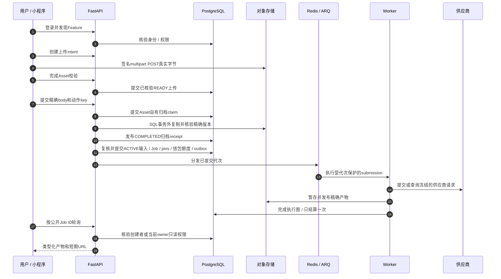
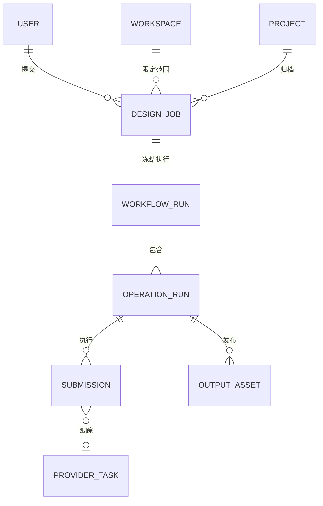

# 从一次用户操作读懂整个系统

Reference 是源码学习路径。先选一个你在小程序里认得的操作，沿请求进入 FastAPI，再找到解释页面结果的数据库记录与外部调用。不必先看懂整个仓库，才能跟完一条链。

## 第一条可以亲手追踪的链 {#first-journey}

使用[本地真实 API 教程](/zh/get-started/quickstart)，按配置模拟外部服务。前端 Mock 不会到达 SQL、Redis 或 worker。先看[对齐状态](/zh/reference/integration-status)，新户型客户端不是可用于此后端 main 的闭环练习。

选一个图片任务，记录用户 ID、空间 ID、上传 Asset ID、动作 key 和公开 Job ID。用这些身份跨进程连接证据，不能只靠文件名和进度百分比。

消息6、8、10、11、16是不同 SQL 检查点。9的存储 I/O 不持有最终准入事务。10归档完成后，11仍可能拒绝准入；receipt 不证明 Job 已存在。202仅表示接受，不表示生成完成。服务端 Poll worker 恢复调度，与客户端 HTTP 轮询是两回事。

| 消息 | 跟读章节 | 识别的证据 |
| --- | --- | --- |
| 1–2 | [身份](/zh/reference/flows/wechat-login-flow)、[发现](/zh/reference/flows/discovery-prompts-flow) | 平台证明、当前同意、有效 Feature |
| 3–10 | [上传／归档](/zh/reference/flows/asset-upload-flow)、[音频接力](/zh/reference/flows/voice-upload-flow) | 绑定用途的 intent、精确版本、receipt、Asset 身份 |
| 7–14 | [准入／worker](/zh/reference/flows/design-job-lifecycle)、[成员额度](/zh/reference/flows/member-quota-flow)、[产品分支](/zh/reference/flows/workflow-products-flow) | 先精确重放再新执行；持久 pins、钱包／额度预留与代次 |
| 15–16 | [报告／导出](/zh/reference/flows/report-view-flow)、[诊断](/zh/reference/flows/runtime-debugging) | 发布证据和一次结算 |
| 17–19 | [历史／操作](/zh/reference/flows/workflow-history-flow) | 新签名链接、owner 只读、创建者写权限 |

## 怎样把源码链接变成一个学习步骤 {#reading-code}

`文件 → 函数` 链接固定到具体 commit 和函数起始行。在自己的编辑器中，进入对应仓库，打开这个相对路径，再搜索同名函数。`src/` 是前端，`app/` 是后端；`.vue` 组合页面逻辑与模板；`.ts` repository 把界面操作转为 HTTP；Python 路由把 HTTP 输入绑定到处理函数。

按下面顺序读一个函数：

1. **输入**：参数、请求模型、`Depends(...)`。依赖负责取认证用户、数据库会话或存储，也可能在处理函数运行前就拒绝请求。
2. **分支**：`if`、`isinstance`、`raise`。它们解释两个看起来相似的请求为何得到不同结果。
3. **调用**：跟进具名业务函数，不必逐个阅读所有 import。`await` 是当前协程等待这次 I/O，不表示后台 Job 已经完成。
4. **状态**：`select(...)` 读 SQL 行；`db.add`、属性赋值暂存写入；`flush` 发 SQL 但不提交；`commit` 才让状态持久化。
5. **边界**：`queue.enqueue_job` 把工作交给另一个进程；供应商 HTTP 可能产生费用；存储字节与数据库元数据分别落地。
6. **返回**：把响应字段对应回前端 mapper 和页面响应式状态。HTTP 成功只证明当前端点定义的操作成功。

可以从这些真实入口开始：

- [src/services/request.ts → request](https://github.com/Orientation-CD/wechat_mini_program/blob/3662578b384fd5b0fbe7509229b2a08a6fe44ab9/src/services/request.ts#L369)
- [app/workflows/api.py → create_workflow](https://github.com/Orientation-CD/YuanZhu-AI/blob/e59716c83e087deda8477da5ea7b327a40cf65c5/app/workflows/api.py#L1135)
- [app/workflows/workflow_admission.py → admit_workflow_job](https://github.com/Orientation-CD/YuanZhu-AI/blob/e59716c83e087deda8477da5ea7b327a40cf65c5/app/workflows/workflow_admission.py#L2939)
- [app/worker.py → execute_workflow_submission](https://github.com/Orientation-CD/YuanZhu-AI/blob/e59716c83e087deda8477da5ea7b327a40cf65c5/app/worker.py#L254)

不能仅凭文件名推测实际路径。当前 API 支持主入口 `/v1/workflows`，但已交付的部分图片、语音、视频表单仍明确走 `/v1/design-jobs` 兼容适配器。[产品路由矩阵](/zh/reference/flows/workflow-products-flow#frontend-routing)逐项列出真实调用者。

## 先选业务链，再找具体 API {#reading-map}

| 你想弄懂什么 | 全链路章节 |
| --- | --- |
| 登录 code 怎样变成自己的账号？同意法律文档为什么会阻止登录？ | [身份、法律文档、会话与账户生命周期](/zh/reference/flows/wechat-login-flow) |
| 功能为什么不可用？提示词字段从哪里来？ | [发现与提示词配置](/zh/reference/flows/discovery-prompts-flow) |
| 上传成功了，为什么还不能提交任务？ | [上传意图 → 签名 POST → 完成验证 → 不可变输入](/zh/reference/flows/asset-upload-flow) |
| 上传 web-view 怎样把录音交回小程序？ | [语音接力与受限 cookie](/zh/reference/flows/voice-upload-flow) |
| 图片、语音、八项文案和视频怎样共用执行引擎？ | [各产品请求与执行分支](/zh/reference/flows/workflow-products-flow) |
| 一份报告怎样等待子设计、成为 HTML 和 PPTX？ | [报告合成、发布与导出](/zh/reference/flows/report-view-flow) |
| 超时、worker 崩溃、重试和刷新以后，什么会保留？ | [持久化 Workflow 生命周期](/zh/reference/flows/design-job-lifecycle) · [历史操作](/zh/reference/flows/workflow-history-flow) |
| 项目隐私、企业席位、推荐奖励有什么不同？ | [项目](/zh/reference/flows/project-flow) · [成员](/zh/reference/flows/workspace-membership-flow) · [推荐奖励](/zh/reference/flows/referral-rewards-flow) |
| 谁决定付款后发积分、退款后回收积分？ | [支付](/zh/reference/flows/payment-flow) · [抖音支付](/zh/reference/douyin-payment) · [退款](/zh/reference/flows/refund-flow) |
| 企业有余额，为什么某成员仍不能提交？ | [月额度与记账月份](/zh/reference/flows/member-quota-flow) |
| 哪个新前端功能尚不能在此后端 main 运行？ | [对齐状态](/zh/reference/integration-status) · [户型](/zh/frontend/floor-plans) |

[逐 API 路由索引](/zh/reference/rest-api#generated-route-index)把每条公开路由声明连到真实处理函数和对应端点的链路解释。Webhook 的触发者是供应商；运维 API 可能没有小程序按钮。文档会说明这一点，不虚构前端入口。条件 Mock 路由、浏览器 Admin 路由另有边界，不冒充手机公开 API。

## 四种身份不要混在一起 {#identities}

这是概念图；精确 SQL 表和外键见[数据模型](/zh/reference/data-model)。公开 Workflow ID 等于 `design_jobs.id`，内部 `workflow_runs.id`、`operation_runs.id` 是不同值。供应商任务 ID 表示外部一次收费/执行，不是授权凭据。限时产物 URL 是临时访问能力，不是持久结果身份。

## 一次带着问题读源码的练习 {#exercise}

使用上手教程里已经创建的本地任务，不为读代码购买一次真实模型调用。

1. 在开发者工具 Network 找 POST 请求，记录实际 path 和 `Idempotency-Key`，用路由矩阵解释 UI 到 repository 的转换。
2. 打开处理函数，再进 `admit_workflow_job`，找到新准入前的重放检查，解释丢失响应后为什么必须保留原 key。
3. 按[运行时诊断](/zh/reference/flows/runtime-debugging#sql-trace)的只读关联查询，追踪 Job ID，找出冻结 run、operation、submission 代次和输出 Asset。
4. 找到上传字节、发布 SQL 输出身份、结算父任务这三个步骤，解释为什么要分成不同检查点。
5. 关闭再打开详情页，用 GET 请求和前端轮询器解释结果为什么能跨页面保留。

某一步说不出具体函数或存储身份，就回到那一章的代码导航表。无需按字母顺序通读整个仓库。
