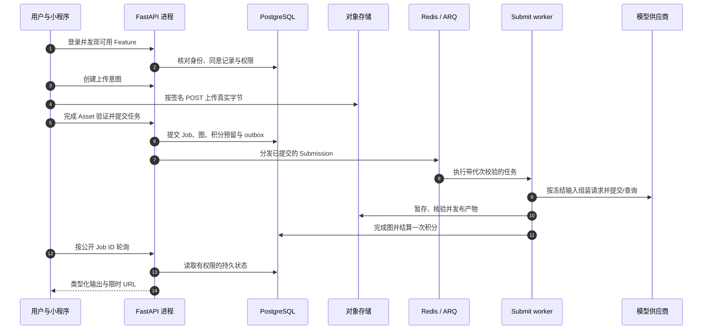
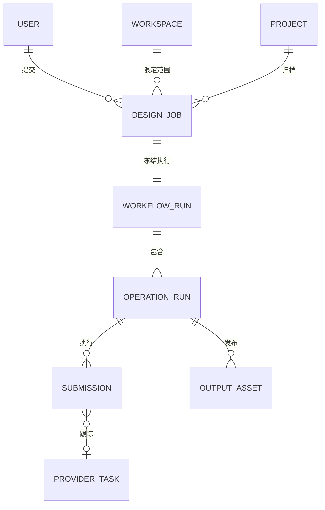

# 从一次用户操作读懂整个系统

Reference 是源码学习路径。先选一个你在小程序里认得的操作，沿请求进入 FastAPI，再找到解释页面结果的数据库记录与外部调用。不必先看懂整个仓库，才能跟完一条链。

## 第一条可以亲手追踪的链 {#first-journey}

先按[第一个完整工作流](/zh/get-started/quickstart)跑通本地真实 API，按教程配置模拟身份和供应商。前端 Mock 模式不会请求 FastAPI，适合调页面，但无法演示 Redis、worker 或 PostgreSQL。

选择一次图片生成，取一个容易辨认的任务名，保留五个值：当前用户 ID、workspace ID、上传 Asset ID、动作幂等键、返回的公开 Job ID。这些值把不同进程连接起来；图片文件名和页面百分比做不到这一点。

图中是进程边界，不是一个 Python 函数从头运行到尾。消息 6 和 11 属于不同数据库事务；HTTP 响应可以早于生成完成。Poll worker 定期恢复遗漏的交接，它与小程序发起的 HTTP 轮询是两件事。

| 图中消息 | 接下来读哪里 | 在源码中回答的问题 |
| --- | --- | --- |
| 1–2 | [身份与同意](/zh/reference/flows/wechat-login-flow) · [Feature 与提示词发现](/zh/reference/flows/discovery-prompts-flow) | 平台证明什么，我们自己的服务器决定什么权限？ |
| 3–5 | [资产准入](/zh/reference/flows/asset-upload-flow) · [浏览器音频接力](/zh/reference/flows/voice-upload-flow) | 文件字节在哪里，什么时候成为可复用 Asset？ |
| 5–9 | [Workflow 准入与执行](/zh/reference/flows/design-job-lifecycle) · [各产品执行分支](/zh/reference/flows/workflow-products-flow) | 模型可能收费以前，数据库已经保存了什么？ |
| 10–11 | [报告、HTML、PPTX 发布](/zh/reference/flows/report-view-flow) · [运行时诊断](/zh/reference/flows/runtime-debugging) | 哪些证据证明产物存在，且属于本次执行代次？ |
| 12–14 | [历史、轮询、重试与删除](/zh/reference/flows/workflow-history-flow) | 原页面关掉以后，前端怎样重新拿到结果？ |

## 怎样把源码链接变成一个学习步骤 {#reading-code}

`文件 → 函数` 链接固定到具体 commit 和函数起始行。在自己的编辑器中，进入对应仓库，打开这个相对路径，再搜索同名函数。`src/` 是前端，`app/` 是后端；`.vue` 组合页面逻辑与模板；`.ts` repository 把界面操作转为 HTTP；Python 路由把 HTTP 输入绑定到处理函数。

按下面顺序读一个函数：

1. **输入**：参数、请求模型、`Depends(...)`。依赖负责取认证用户、数据库会话或存储，也可能在处理函数运行前就拒绝请求。
2. **分支**：`if`、`isinstance`、`raise`。它们解释两个看起来相似的请求为何得到不同结果。
3. **调用**：跟进具名业务函数，不必逐个阅读所有 import。`await` 是当前协程等待这次 I/O，不表示后台 Job 已经完成。
4. **状态**：`select(...)` 读 SQL 行；`db.add`、属性赋值暂存写入；`flush` 发 SQL 但不提交；`commit` 才让状态持久化。
5. **边界**：`queue.enqueue_job` 把工作交给另一个进程；供应商 HTTP 可能产生费用；存储字节与数据库元数据分别落地。
6. **返回**：把响应字段对应回前端 mapper 和页面响应式状态。HTTP 成功只证明当前端点定义的操作成功。

可以从这些真实入口开始：

- [src/services/request.ts → request](https://github.com/Orientation-CD/wechat_mini_program/blob/eca0a5f9e0a2aa1cb3fd4f9714114bb3db7fae5f/src/services/request.ts#L369)
- [app/workflows/api.py → create_workflow](https://github.com/Orientation-CD/YuanZhu-AI/blob/b13cc5668920620a274cb91a3393ed9fadac72ae/app/workflows/api.py#L1075)
- [app/workflows/workflow_admission.py → admit_workflow_job](https://github.com/Orientation-CD/YuanZhu-AI/blob/b13cc5668920620a274cb91a3393ed9fadac72ae/app/workflows/workflow_admission.py#L2426)
- [app/worker.py → execute_workflow_submission](https://github.com/Orientation-CD/YuanZhu-AI/blob/b13cc5668920620a274cb91a3393ed9fadac72ae/app/worker.py#L203)

不能仅凭文件名推测实际路径。当前 API 支持主入口 `/v1/workflows`，但已交付的部分图片、语音、视频表单仍明确走 `/v1/design-jobs` 兼容适配器。[产品路由矩阵](/zh/reference/flows/workflow-products-flow#frontend-routing)逐项列出真实调用者。

## 先选业务链，再找具体 API {#reading-map}

| 你想弄懂什么 | 全链路章节 |
| --- | --- |
| 登录 code 怎样变成自己的账号？同意法律文档为什么会阻止登录？ | [身份、法律文档、会话与账户生命周期](/zh/reference/flows/wechat-login-flow) |
| 功能为什么不可用？提示词字段从哪里来？ | [发现与提示词配置](/zh/reference/flows/discovery-prompts-flow) |
| 上传成功了，为什么还不能提交任务？ | [上传意图 → 签名 POST → 完成验证 → 不可变输入](/zh/reference/flows/asset-upload-flow) |
| 上传 web-view 怎样把录音交回小程序？ | [语音接力与受限 cookie](/zh/reference/flows/voice-upload-flow) |
| 图片、语音、八项文案和视频怎样共用执行引擎？ | [各产品请求与执行分支](/zh/reference/flows/workflow-products-flow) |
| 一份报告怎样等待子设计、成为 HTML 和 PPTX？ | [报告合成、发布与导出](/zh/reference/flows/report-view-flow) |
| 超时、worker 崩溃、重试和刷新以后，什么会保留？ | [持久化 Workflow 生命周期](/zh/reference/flows/design-job-lifecycle) · [历史操作](/zh/reference/flows/workflow-history-flow) |
| 项目隐私、企业席位、推荐奖励有什么不同？ | [项目](/zh/reference/flows/project-flow) · [成员](/zh/reference/flows/workspace-membership-flow) · [推荐奖励](/zh/reference/flows/referral-rewards-flow) |
| 谁决定付款后发积分、退款后回收积分？ | [支付](/zh/reference/flows/payment-flow) · [抖音支付](/zh/reference/douyin-payment) · [退款](/zh/reference/flows/refund-flow) |

[逐 API 路由索引](/zh/reference/rest-api#generated-route-index)把每条公开路由声明连到真实处理函数和对应端点的链路解释。Webhook 的触发者是供应商；运维 API 可能没有小程序按钮。文档会说明这一点，不虚构前端入口。条件 Mock 路由、浏览器 Admin 路由另有边界，不冒充手机公开 API。

## 四种身份不要混在一起 {#identities}

这是概念图；精确 SQL 表和外键见[数据模型](/zh/reference/data-model)。公开 Workflow ID 等于 `design_jobs.id`，内部 `workflow_runs.id`、`operation_runs.id` 是不同值。供应商任务 ID 表示外部一次收费/执行，不是授权凭据。限时产物 URL 是临时访问能力，不是持久结果身份。

## 一次带着问题读源码的练习 {#exercise}

使用上手教程里已经创建的本地任务，不为读代码购买一次真实模型调用。

1. 在开发者工具 Network 找 POST 请求，记录实际 path 和 `Idempotency-Key`，用路由矩阵解释 UI 到 repository 的转换。
2. 打开处理函数，再进 `admit_workflow_job`，找到新准入前的重放检查，解释丢失响应后为什么必须保留原 key。
3. 按[运行时诊断](/zh/reference/flows/runtime-debugging#sql-trace)的只读关联查询，追踪 Job ID，找出冻结 run、operation、submission 代次和输出 Asset。
4. 找到上传字节、发布 SQL 输出身份、结算父任务这三个步骤，解释为什么要分成不同检查点。
5. 关闭再打开详情页，用 GET 请求和前端轮询器解释结果为什么能跨页面保留。

某一步说不出具体函数或存储身份，就回到那一章的代码导航表。无需按字母顺序通读整个仓库。
